# Legacy backend: Authored Content (2)

Repertoire/line/membership and annotation source data or related authored-content projections.

**Current source schema, deployment unverified.** Owner: Legacy backend; SQL schema `public`. Derived from checked-in DDL at the `14ad5754` baseline with file relocation only. No live database was queried. [Database index](../../README.md).

Charts show primary/foreign key columns; the dictionary lists **every stored field and its SQL type**. `PK` means primary key (all marked fields form one composite key); `FK` means an enforced SQL foreign key. Parent `||`/`o|` means a required/optional parent; child `o{` means zero or more children and `o|` zero or one (a unique referencing tuple). Edges describe allowed SQL cardinality, not an obligation to create children. Nullable components of a composite FK can leave the tuple unlinked under PostgreSQL MATCH SIMPLE. No edge is inferred from a similar field name.

```mermaid
erDiagram
  puzzles {
    text id PK
    text deck_id FK
  }
  repertoire_cards {
    text repertoire_id PK,FK
    text card_id PK,FK
  }
  repertoire_decision_gameplay_summaries {
    text repertoire_id PK,FK
    text fen_key PK
    text expected_uci PK
  }
  repertoire_integrity_card_blocks {
    text repertoire_id PK,FK
    text card_id PK,FK
    text issue_id PK,FK
  }
  repertoire_integrity_issue_candidates {
    text run_id PK
    text id PK
    text repertoire_id FK
  }
  repertoire_integrity_issues {
    text id PK
    text repertoire_id FK
  }
  repertoire_integrity_jobs {
    text repertoire_id PK,FK
  }
  repertoire_integrity_position_accumulators {
    text run_id PK
    text fen_key PK
  }
  repertoire_integrity_source_runs {
    text run_id PK
    bigint source_offset PK
  }
  repertoire_integrity_state {
    text repertoire_id PK,FK
  }
  repertoire_line_training_depths {
    text line_id PK,FK
  }
  repertoire_lines {
    text id PK
    text repertoire_id FK
  }
  puzzle_decks ||..o{ puzzles : "deck_id"
  repertoires ||..o{ repertoire_cards : "repertoire_id"
  cards ||..o{ repertoire_cards : "card_id"
  repertoires ||..o{ repertoire_decision_gameplay_summaries : "repertoire_id"
  repertoires ||..o{ repertoire_integrity_card_blocks : "repertoire_id"
  cards ||..o{ repertoire_integrity_card_blocks : "card_id"
  repertoire_integrity_issues ||..o{ repertoire_integrity_card_blocks : "issue_id"
  repertoires ||..o{ repertoire_integrity_issue_candidates : "repertoire_id"
  repertoires ||..o{ repertoire_integrity_issues : "repertoire_id"
  repertoires ||..o| repertoire_integrity_jobs : "repertoire_id"
  repertoires ||..o| repertoire_integrity_state : "repertoire_id"
  repertoire_lines ||..o| repertoire_line_training_depths : "line_id"
  repertoires ||..o{ repertoire_lines : "repertoire_id"
```

Referenced tables outside this view: `public.cards`, `public.puzzle_decks`, `public.repertoires`. Follow the [schema index](../README.md) for their full definitions.

## Data dictionary

### `public.puzzles`

Primary key: (`id`). DDL: [001_initial.sql](../../ddl/migrations/001_initial.sql).

| Field | SQL type | Null allowed | Keys |
| --- | --- | --- | --- |
| `id` | `text` | no | PK |
| `deck_id` | `text` | no | FK deck_id → public.puzzle_decks(`id`) |
| `source_fen` | `text` | no |  |
| `start_fen` | `text` | no |  |
| `moves_json` | `text` | no |  |
| `rating` | `bigint` | no |  |
| `popularity` | `bigint` | no |  |
| `themes_json` | `text` | no |  |
| `game_url` | `text` | no |  |
| `state` | `text` | no |  |
| `due_date` | `text` | no |  |
| `interval_days` | `bigint` | no |  |

Foreign key delete actions: (`deck_id`) CASCADE.

### `public.repertoire_cards`

Primary key: (`repertoire_id`, `card_id`). DDL: [001_initial.sql](../../ddl/migrations/001_initial.sql), [035_canonical_publication_freshness.sql](../../ddl/migrations/035_canonical_publication_freshness.sql).

| Field | SQL type | Null allowed | Keys |
| --- | --- | --- | --- |
| `repertoire_id` | `text` | no | PK; FK repertoire_id → public.repertoires(`id`) |
| `card_id` | `text` | no | PK; FK card_id → public.cards(`id`) |
| `canonical_route_source` | `bigint` | no |  |

Foreign key delete actions: (`repertoire_id`) CASCADE, (`card_id`) CASCADE.

### `public.repertoire_decision_gameplay_summaries`

Primary key: (`repertoire_id`, `fen_key`, `expected_uci`). DDL: [001_initial.sql](../../ddl/migrations/001_initial.sql).

| Field | SQL type | Null allowed | Keys |
| --- | --- | --- | --- |
| `repertoire_id` | `text` | no | PK; FK repertoire_id → public.repertoires(`id`) |
| `fen_key` | `text` | no | PK |
| `expected_uci` | `text` | no | PK |
| `encounter_count` | `bigint` | no |  |
| `success_count` | `bigint` | no |  |
| `miss_count` | `bigint` | no |  |
| `recent_encounter_count` | `bigint` | no |  |
| `recent_success_count` | `bigint` | no |  |
| `recent_miss_count` | `bigint` | no |  |
| `last_encountered` | `text` | yes |  |
| `route_success_count` | `bigint` | yes |  |
| `updated_at` | `text` | no |  |

Foreign key delete actions: (`repertoire_id`) CASCADE.

### `public.repertoire_integrity_card_blocks`

Primary key: (`repertoire_id`, `card_id`, `issue_id`). DDL: [001_initial.sql](../../ddl/migrations/001_initial.sql).

| Field | SQL type | Null allowed | Keys |
| --- | --- | --- | --- |
| `repertoire_id` | `text` | no | PK; FK repertoire_id → public.repertoires(`id`) |
| `card_id` | `text` | no | PK; FK card_id → public.cards(`id`) |
| `issue_id` | `text` | no | PK; FK issue_id → public.repertoire_integrity_issues(`id`) |
| `scan_generation` | `text` | no |  |
| `published_at` | `text` | no |  |

Foreign key delete actions: (`repertoire_id`) CASCADE, (`card_id`) CASCADE, (`issue_id`) CASCADE.

### `public.repertoire_integrity_issue_candidates`

Primary key: (`run_id`, `id`). DDL: [003_integrity_accumulators.sql](../../ddl/migrations/003_integrity_accumulators.sql).

| Field | SQL type | Null allowed | Keys |
| --- | --- | --- | --- |
| `run_id` | `text` | no | PK |
| `id` | `text` | no | PK |
| `repertoire_id` | `text` | no | FK repertoire_id → public.repertoires(`id`) |
| `kind` | `text` | no |  |
| `fen_key` | `text` | yes |  |
| `fen` | `text` | yes |  |
| `trained_color` | `text` | yes |  |
| `signature` | `text` | no |  |
| `moves_json` | `text` | no |  |
| `sources_json` | `text` | no |  |

Foreign key delete actions: (`repertoire_id`) CASCADE.

### `public.repertoire_integrity_issues`

Primary key: (`id`). DDL: [001_initial.sql](../../ddl/migrations/001_initial.sql).

| Field | SQL type | Null allowed | Keys |
| --- | --- | --- | --- |
| `id` | `text` | no | PK |
| `repertoire_id` | `text` | no | FK repertoire_id → public.repertoires(`id`) |
| `kind` | `text` | no |  |
| `fen_key` | `text` | yes |  |
| `fen` | `text` | yes |  |
| `trained_color` | `text` | yes |  |
| `signature` | `text` | no |  |
| `moves_json` | `text` | no |  |
| `sources_json` | `text` | no |  |
| `created_at` | `text` | no |  |
| `updated_at` | `text` | no |  |

Foreign key delete actions: (`repertoire_id`) CASCADE.

### `public.repertoire_integrity_jobs`

Primary key: (`repertoire_id`). DDL: [001_initial.sql](../../ddl/migrations/001_initial.sql).

| Field | SQL type | Null allowed | Keys |
| --- | --- | --- | --- |
| `repertoire_id` | `text` | no | PK; FK repertoire_id → public.repertoires(`id`) |
| `run_id` | `text` | no |  |
| `status` | `text` | no |  |
| `source_offset` | `bigint` | no |  |
| `total_sources` | `bigint` | no |  |
| `attempts` | `bigint` | no |  |
| `last_error` | `text` | yes |  |
| `updated_at` | `text` | no |  |

Foreign key delete actions: (`repertoire_id`) CASCADE.

### `public.repertoire_integrity_position_accumulators`

Primary key: (`run_id`, `fen_key`). DDL: [003_integrity_accumulators.sql](../../ddl/migrations/003_integrity_accumulators.sql).

| Field | SQL type | Null allowed | Keys |
| --- | --- | --- | --- |
| `run_id` | `text` | no | PK |
| `fen_key` | `text` | no | PK |
| `fen` | `text` | no |  |
| `trained_color` | `text` | yes |  |
| `moves_json` | `text` | no |  |
| `sources_json` | `text` | no |  |

### `public.repertoire_integrity_source_runs`

Primary key: (`run_id`, `source_offset`). DDL: [001_initial.sql](../../ddl/migrations/001_initial.sql).

| Field | SQL type | Null allowed | Keys |
| --- | --- | --- | --- |
| `run_id` | `text` | no | PK |
| `source_offset` | `bigint` | no | PK |
| `observations_json` | `text` | no |  |
| `invalid_json` | `text` | no |  |

### `public.repertoire_integrity_state`

Primary key: (`repertoire_id`). DDL: [001_initial.sql](../../ddl/migrations/001_initial.sql).

| Field | SQL type | Null allowed | Keys |
| --- | --- | --- | --- |
| `repertoire_id` | `text` | no | PK; FK repertoire_id → public.repertoires(`id`) |
| `status` | `text` | no |  |
| `checked_at` | `text` | yes |  |
| `scan_status` | `text` | no |  |
| `scan_generation` | `text` | yes |  |
| `scan_completed_sources` | `bigint` | no |  |
| `scan_total_sources` | `bigint` | no |  |
| `scan_error` | `text` | yes |  |

Foreign key delete actions: (`repertoire_id`) CASCADE.

### `public.repertoire_line_training_depths`

Primary key: (`line_id`). DDL: [001_initial.sql](../../ddl/migrations/001_initial.sql).

| Field | SQL type | Null allowed | Keys |
| --- | --- | --- | --- |
| `line_id` | `text` | no | PK; FK line_id → public.repertoire_lines(`id`) |
| `learner_decision_count` | `bigint` | no |  |

Foreign key delete actions: (`line_id`) CASCADE.

### `public.repertoire_lines`

Primary key: (`id`). DDL: [001_initial.sql](../../ddl/migrations/001_initial.sql).

| Field | SQL type | Null allowed | Keys |
| --- | --- | --- | --- |
| `id` | `text` | no | PK |
| `repertoire_id` | `text` | no | FK repertoire_id → public.repertoires(`id`) |
| `name` | `text` | no |  |
| `trained_color` | `text` | no |  |
| `start_fen` | `text` | no |  |
| `moves_json` | `text` | no |  |
| `created_at` | `text` | no |  |

Foreign key delete actions: (`repertoire_id`) CASCADE.
