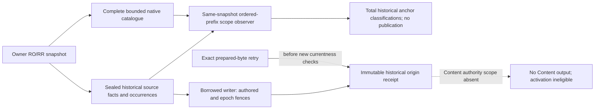

# Historical authored origin receipts

Source candidate; migration061 is additive source only, never a live apply.
The legacy authored-source owner captures one actual read-only repeatable-read
snapshot, retains exact semantic facts and original accepted-digest domain,
and inserts a sealed historical observation in a borrowed writer after the
existing authored and owner-epoch fences. Ordinary source preparation does
not serialize the archive; retention is explicitly opt-in.

`public.legacy_content_historical_origins` key is
`(legacy_target_id, legacy_workspace_id, export_id)`; `receipt_id` is unique.
`payload` BYTEA retains the versioned semantic observation, original token and
ordered repertoire/route/ply occurrences; `receipt_digest` binds its exact bytes.
UPDATE/DELETE/TRUNCATE are rejected; insertion does not rewrite earlier evidence.
The namespace is the existing logical backend identity, never physical-instance
proof. Fresh preparation includes new snapshot observations and is not claimed
to reproduce prior prepared bytes after service recreation.

Every observation is historical-repeatable-read, physical-currentness and
physical-instance UNQUALIFIED, activation ineligible and has no final legacy
fence receipt. Cross-repertoire authority anchor is unavailable: Content source
and manifest bytes/hashes are absent and projection is BLOCKED_AUTHORITY_SCOPE.
An exact accepted retry returns the original receipt even if authored state
subsequently changes; a new insertion must still pass its actual owner fences.
No scheduling, grade, queue, current correspondence or installed authority is
created. Full legacy physical fencing and Content approval binding remain gates.

The read-only `authored_repertoires.authority_scope` observer pairs ONLY that
same transaction's sealed prepared origin with the complete non-internal native
repertoire/line family. Its existing ordered-prefix rule classifies every
original occurrence as before-anchor, ambiguous or qualified-in-snapshot; root0
is allowed only when actually unique. Raw authored scope is not the union of
active Learning memberships: archived cards and retired target publications do
not silently remove source competitors. No retirement, publication, persistence
or currentness follows. The separately returned observation does not rewrite061
receipts or fill their absent Content artifacts.

Scope artifacts account escaped-UTF8 JSON prefix repetition and occurrence
expansion before materializing/encoding over-limit output. A bounded source
catalogue is not by itself a bound on its repeated policy-prefix representation;
resource refusal remains AUTH_SCOPE_LIMIT and never becomes a guessed anchor.
