# Legacy backend: Discovery Priority

Derived repertoire coverage, discovered opportunities, admission intents and prepared priority projections.

**Current source schema, deployment unverified.** Owner: Legacy backend; SQL schema `public`. Derived from checked-in DDL at the `14ad5754` baseline with file relocation only. No live database was queried. [Database index](../../README.md).

Charts show primary/foreign key columns; the dictionary lists **every stored field and its SQL type**. `PK` means primary key (all marked fields form one composite key); `FK` means an enforced SQL foreign key. Parent `||`/`o|` means a required/optional parent; child `o{` means zero or more children and `o|` zero or one (a unique referencing tuple). Edges describe allowed SQL cardinality, not an obligation to create children. Nullable components of a composite FK can leave the tuple unlinked under PostgreSQL MATCH SIMPLE. No edge is inferred from a similar field name.

```mermaid
erDiagram
  discovery_admission_intents {
    text id PK
    text opportunity_id FK
    text repertoire_id FK
  }
  discovery_recommendation_requests {
    text opportunity_id PK,FK
    text request_id FK
    text source_game_id FK
  }
  repertoire_card_introduction_priorities {
    text repertoire_id PK,FK
    text card_id PK,FK
  }
  repertoire_card_priority_generations {
    text repertoire_id PK,FK
    bigint generation PK
    text card_id PK,FK
  }
  repertoire_coverage_candidates {
    text node_id PK,FK
    text move_uci PK
  }
  repertoire_coverage_nodes {
    text id PK
    text run_id FK
    text repertoire_id FK
  }
  repertoire_coverage_runs {
    text id PK
    text repertoire_id FK
  }
  repertoire_opportunities {
    text id PK
    text repertoire_id FK
    text card_id FK
  }
  repertoire_priority_jobs {
    text repertoire_id PK,FK
  }
  repertoire_priority_preparations {
    text repertoire_id PK,FK
    bigint generation PK
  }
  repertoire_priority_prepared_rows {
    text repertoire_id PK,FK
    bigint generation PK,FK
    bigint ordinal PK
    text card_id FK
  }
  repertoire_priority_publications {
    text repertoire_id PK,FK
  }
  repertoire_opportunities ||..o{ discovery_admission_intents : "opportunity_id"
  repertoires ||..o{ discovery_admission_intents : "repertoire_id"
  repertoire_opportunities ||..o| discovery_recommendation_requests : "opportunity_id"
  threat_analysis_requests ||..o{ discovery_recommendation_requests : "request_id"
  imported_games ||..o{ discovery_recommendation_requests : "source_game_id"
  repertoires ||..o{ repertoire_card_introduction_priorities : "repertoire_id"
  cards ||..o{ repertoire_card_introduction_priorities : "card_id"
  repertoires ||..o{ repertoire_card_priority_generations : "repertoire_id"
  cards ||..o{ repertoire_card_priority_generations : "card_id"
  repertoire_coverage_nodes ||..o{ repertoire_coverage_candidates : "node_id"
  repertoire_coverage_runs ||..o{ repertoire_coverage_nodes : "run_id"
  repertoires ||..o{ repertoire_coverage_nodes : "repertoire_id"
  repertoires ||..o{ repertoire_coverage_runs : "repertoire_id"
  repertoires ||..o{ repertoire_opportunities : "repertoire_id"
  cards o|..o{ repertoire_opportunities : "card_id"
  repertoires ||..o| repertoire_priority_jobs : "repertoire_id"
  repertoires ||..o{ repertoire_priority_preparations : "repertoire_id"
  cards ||..o{ repertoire_priority_prepared_rows : "card_id"
  repertoire_priority_preparations ||..o{ repertoire_priority_prepared_rows : "repertoire_id,generation"
  repertoires ||..o| repertoire_priority_publications : "repertoire_id"
```

Referenced tables outside this view: `public.cards`, `public.imported_games`, `public.repertoires`, `public.threat_analysis_requests`. Follow the [schema index](../README.md) for their full definitions.

## Data dictionary

### `public.discovery_admission_intents`

Primary key: (`id`). DDL: [001_initial.sql](../../ddl/migrations/001_initial.sql), [028_revisioned_discovery_admissions.sql](../../ddl/migrations/028_revisioned_discovery_admissions.sql).

| Field | SQL type | Null allowed | Keys |
| --- | --- | --- | --- |
| `id` | `text` | no | PK |
| `opportunity_id` | `text` | no | FK opportunity_id → public.repertoire_opportunities(`id`) |
| `repertoire_id` | `text` | no | FK repertoire_id → public.repertoires(`id`) |
| `evidence_fingerprint` | `text` | no |  |
| `starting_fen` | `text` | no |  |
| `selected_move_uci` | `text` | no |  |
| `preview_moves_json` | `text` | no |  |
| `recommendation_json` | `text` | no |  |
| `line_id` | `text` | no |  |
| `state` | `text` | no |  |
| `card_id` | `text` | yes |  |
| `last_error` | `text` | yes |  |
| `created_at` | `text` | no |  |
| `updated_at` | `text` | no |  |

Unique tuples (including non-partial simple unique indexes): (`opportunity_id`, `selected_move_uci`, `evidence_fingerprint`).

Foreign key delete actions: (`opportunity_id`) CASCADE, (`repertoire_id`) CASCADE.

### `public.discovery_recommendation_requests`

Primary key: (`opportunity_id`). DDL: [001_initial.sql](../../ddl/migrations/001_initial.sql).

| Field | SQL type | Null allowed | Keys |
| --- | --- | --- | --- |
| `opportunity_id` | `text` | no | PK; FK opportunity_id → public.repertoire_opportunities(`id`) |
| `request_id` | `text` | no | FK request_id → public.threat_analysis_requests(`id`) |
| `source_game_id` | `text` | no | FK source_game_id → public.imported_games(`id`) |
| `source_ply` | `bigint` | no |  |
| `created_at` | `text` | no |  |
| `updated_at` | `text` | no |  |

Foreign key delete actions: (`opportunity_id`) CASCADE, (`request_id`) CASCADE, (`source_game_id`) CASCADE.

### `public.repertoire_card_introduction_priorities`

Primary key: (`repertoire_id`, `card_id`). DDL: [001_initial.sql](../../ddl/migrations/001_initial.sql).

| Field | SQL type | Null allowed | Keys |
| --- | --- | --- | --- |
| `repertoire_id` | `text` | no | PK; FK repertoire_id → public.repertoires(`id`) |
| `card_id` | `text` | no | PK; FK card_id → public.cards(`id`) |
| `scoring_version` | `bigint` | no |  |
| `completed_line_ids_json` | `text` | no |  |
| `completion_mass` | `double precision` | no |  |
| `frontier_decisions_json` | `text` | no |  |
| `frontier_reach` | `double precision` | no |  |
| `priority_score` | `double precision` | no |  |
| `evidence_json` | `text` | no |  |
| `updated_at` | `text` | no |  |

Foreign key delete actions: (`repertoire_id`) CASCADE, (`card_id`) CASCADE.

### `public.repertoire_card_priority_generations`

Primary key: (`repertoire_id`, `generation`, `card_id`). DDL: [001_initial.sql](../../ddl/migrations/001_initial.sql).

| Field | SQL type | Null allowed | Keys |
| --- | --- | --- | --- |
| `repertoire_id` | `text` | no | PK; FK repertoire_id → public.repertoires(`id`) |
| `generation` | `bigint` | no | PK |
| `card_id` | `text` | no | PK; FK card_id → public.cards(`id`) |
| `scoring_version` | `bigint` | no |  |
| `completed_line_ids_json` | `text` | no |  |
| `completion_mass` | `double precision` | no |  |
| `frontier_decisions_json` | `text` | no |  |
| `frontier_reach` | `double precision` | no |  |
| `priority_score` | `double precision` | no |  |
| `evidence_json` | `text` | no |  |
| `updated_at` | `text` | no |  |

Foreign key delete actions: (`repertoire_id`) CASCADE, (`card_id`) CASCADE.

### `public.repertoire_coverage_candidates`

Primary key: (`node_id`, `move_uci`). DDL: [001_initial.sql](../../ddl/migrations/001_initial.sql).

| Field | SQL type | Null allowed | Keys |
| --- | --- | --- | --- |
| `node_id` | `text` | no | PK; FK node_id → public.repertoire_coverage_nodes(`id`) |
| `move_uci` | `text` | no | PK |
| `explorer_probability` | `double precision` | yes |  |
| `maia_probability` | `double precision` | yes |  |
| `blended_probability` | `double precision` | yes |  |
| `required` | `bigint` | no |  |
| `covered` | `bigint` | no |  |
| `source_state` | `text` | no |  |

Foreign key delete actions: (`node_id`) CASCADE.

### `public.repertoire_coverage_nodes`

Primary key: (`id`). DDL: [001_initial.sql](../../ddl/migrations/001_initial.sql).

| Field | SQL type | Null allowed | Keys |
| --- | --- | --- | --- |
| `id` | `text` | no | PK |
| `run_id` | `text` | no | FK run_id → public.repertoire_coverage_runs(`id`) |
| `repertoire_id` | `text` | no | FK repertoire_id → public.repertoires(`id`) |
| `fen` | `text` | no |  |
| `fen_key` | `text` | no |  |
| `ply` | `bigint` | no |  |
| `trained_color` | `text` | no |  |
| `routes_json` | `text` | no |  |
| `covered_replies_json` | `text` | no |  |
| `explorer_status` | `text` | no |  |
| `maia_status` | `text` | no |  |
| `explorer_games` | `bigint` | no |  |
| `lease_id` | `text` | yes |  |
| `lease_expires_at` | `text` | yes |  |
| `last_error` | `text` | yes |  |
| `updated_at` | `text` | no |  |

Unique tuples (including non-partial simple unique indexes): (`run_id`, `fen_key`).

Foreign key delete actions: (`run_id`) CASCADE, (`repertoire_id`) CASCADE.

### `public.repertoire_coverage_runs`

Primary key: (`id`). DDL: [001_initial.sql](../../ddl/migrations/001_initial.sql), [005_coverage_building.sql](../../ddl/migrations/005_coverage_building.sql).

| Field | SQL type | Null allowed | Keys |
| --- | --- | --- | --- |
| `id` | `text` | no | PK |
| `repertoire_id` | `text` | no | FK repertoire_id → public.repertoires(`id`) |
| `status` | `text` | no |  |
| `settings_json` | `text` | no |  |
| `total_nodes` | `bigint` | no |  |
| `completed_nodes` | `bigint` | no |  |
| `last_error` | `text` | yes |  |
| `created_at` | `text` | no |  |
| `updated_at` | `text` | no |  |

Foreign key delete actions: (`repertoire_id`) CASCADE.

### `public.repertoire_opportunities`

Primary key: (`id`). DDL: [001_initial.sql](../../ddl/migrations/001_initial.sql), [027_handled_discoveries.sql](../../ddl/migrations/027_handled_discoveries.sql), [033_canonical_prefix.sql](../../ddl/migrations/033_canonical_prefix.sql), [035_canonical_publication_freshness.sql](../../ddl/migrations/035_canonical_publication_freshness.sql).

| Field | SQL type | Null allowed | Keys |
| --- | --- | --- | --- |
| `id` | `text` | no | PK |
| `repertoire_id` | `text` | no | FK repertoire_id → public.repertoires(`id`) |
| `kind` | `text` | no |  |
| `fen_key` | `text` | no |  |
| `card_id` | `text` | yes | FK card_id → public.cards(`id`) |
| `opponent_move_uci` | `text` | yes |  |
| `status` | `text` | no |  |
| `score` | `double precision` | no |  |
| `evidence_json` | `text` | no |  |
| `evidence_fingerprint` | `text` | no |  |
| `dismissed_evidence_json` | `text` | yes |  |
| `created_at` | `text` | no |  |
| `updated_at` | `text` | no |  |
| `resolved_at` | `text` | yes |  |
| `seen_at` | `text` | yes |  |
| `snoozed_until` | `text` | yes |  |
| `admission_state` | `text` | yes |  |
| `admitted_card_id` | `text` | yes |  |
| `handled_evidence_json` | `text` | yes |  |
| `canonical_prefix_revision` | `bigint` | no |  |
| `canonical_scope_source_revision` | `bigint` | no |  |
| `canonical_scope_preview_id` | `text` | yes |  |
| `game_scope_generation` | `bigint` | no |  |

Foreign key delete actions: (`repertoire_id`) CASCADE, (`card_id`) SET NULL.

### `public.repertoire_priority_jobs`

Primary key: (`repertoire_id`). DDL: [001_initial.sql](../../ddl/migrations/001_initial.sql).

| Field | SQL type | Null allowed | Keys |
| --- | --- | --- | --- |
| `repertoire_id` | `text` | no | PK; FK repertoire_id → public.repertoires(`id`) |
| `generation` | `bigint` | no |  |
| `status` | `text` | no |  |
| `attempts` | `bigint` | no |  |
| `next_attempt_at` | `text` | no |  |
| `last_error` | `text` | yes |  |
| `updated_at` | `text` | no |  |

Foreign key delete actions: (`repertoire_id`) CASCADE.

### `public.repertoire_priority_preparations`

Primary key: (`repertoire_id`, `generation`). DDL: [021_priority_preparations.sql](../../ddl/migrations/021_priority_preparations.sql), [022_priority_preparation_ordering.sql](../../ddl/migrations/022_priority_preparation_ordering.sql).

| Field | SQL type | Null allowed | Keys |
| --- | --- | --- | --- |
| `repertoire_id` | `text` | no | PK; FK repertoire_id → public.repertoires(`id`) |
| `generation` | `bigint` | no | PK |
| `source_version` | `text` | no |  |
| `scoring_version` | `bigint` | no |  |
| `calculated_at` | `text` | no |  |
| `expected_count` | `bigint` | yes |  |
| `status` | `text` | no |  |
| `ordering_version` | `bigint` | yes |  |

Foreign key delete actions: (`repertoire_id`) CASCADE.

### `public.repertoire_priority_prepared_rows`

Primary key: (`repertoire_id`, `generation`, `ordinal`). DDL: [021_priority_preparations.sql](../../ddl/migrations/021_priority_preparations.sql).

| Field | SQL type | Null allowed | Keys |
| --- | --- | --- | --- |
| `repertoire_id` | `text` | no | PK; FK repertoire_id,generation → public.repertoire_priority_preparations(`repertoire_id`, `generation`) |
| `generation` | `bigint` | no | PK; FK repertoire_id,generation → public.repertoire_priority_preparations(`repertoire_id`, `generation`) |
| `ordinal` | `bigint` | no | PK |
| `card_id` | `text` | no | FK card_id → public.cards(`id`) |
| `completed_line_ids_json` | `text` | no |  |
| `completion_mass` | `double precision` | no |  |
| `frontier_decisions_json` | `text` | no |  |
| `frontier_reach` | `double precision` | no |  |
| `priority_score` | `double precision` | no |  |
| `evidence_json` | `text` | no |  |

Unique tuples (including non-partial simple unique indexes): (`repertoire_id`, `generation`, `card_id`).

Foreign key delete actions: (`card_id`) CASCADE, (`repertoire_id`, `generation`) CASCADE.

### `public.repertoire_priority_publications`

Primary key: (`repertoire_id`). DDL: [001_initial.sql](../../ddl/migrations/001_initial.sql).

| Field | SQL type | Null allowed | Keys |
| --- | --- | --- | --- |
| `repertoire_id` | `text` | no | PK; FK repertoire_id → public.repertoires(`id`) |
| `generation` | `bigint` | no |  |
| `updated_at` | `text` | no |  |

Foreign key delete actions: (`repertoire_id`) CASCADE.
