# Legacy backend: Game Projections (1)

Legacy observed games and versioned analysis/position/repertoire/event projections. These are existing legacy tables, not a new Study dependency.

**Current source schema, deployment unverified.** Owner: Legacy backend; SQL schema `public`. Derived from checked-in DDL at the `14ad5754` baseline with file relocation only. No live database was queried. [Database index](../../README.md).

Charts show primary/foreign key columns; the dictionary lists **every stored field and its SQL type**. `PK` means primary key (all marked fields form one composite key); `FK` means an enforced SQL foreign key. Parent `||`/`o|` means a required/optional parent; child `o{` means zero or more children and `o|` zero or one (a unique referencing tuple). Edges describe allowed SQL cardinality, not an obligation to create children. Nullable components of a composite FK can leave the tuple unlinked under PostgreSQL MATCH SIMPLE. No edge is inferred from a similar field name.

```mermaid
erDiagram
  game_accounts {
    text provider PK
  }
  game_analysis_jobs {
    text game_id PK,FK
  }
  game_analysis_position_errors {
    bigint id PK
  }
  game_analysis_position_reports {
    text id PK
    text game_id FK
  }
  game_analysis_publications {
    text game_id PK,FK
  }
  game_derivation_jobs {
    text game_id PK,FK
  }
  game_feature_rows {
    text game_id PK,FK
  }
  game_finding_preparations {
    text game_id PK,FK
    bigint derivation_version PK
  }
  game_finding_publication_items {
    text game_id PK,FK
    bigint derivation_version PK
    text item_kind PK
    text item_key PK
  }
  game_findings {
    text id PK
    text game_id FK
  }
  game_insight_recommendations {
    text motif PK
  }
  game_move_analysis_candidates_legacy {
    text game_id PK,FK
    bigint ply PK,FK
    bigint rank PK
  }
  imported_games ||..o| game_analysis_jobs : "game_id"
  imported_games ||..o{ game_analysis_position_reports : "game_id"
  imported_games ||..o| game_analysis_publications : "game_id"
  imported_games ||..o| game_derivation_jobs : "game_id"
  imported_games ||..o| game_feature_rows : "game_id"
  imported_games ||..o{ game_finding_preparations : "game_id"
  imported_games ||..o{ game_finding_publication_items : "game_id"
  imported_games ||..o{ game_findings : "game_id"
  game_move_analysis_legacy ||..o{ game_move_analysis_candidates_legacy : "game_id,ply"
```

Referenced tables outside this view: `public.game_move_analysis_legacy`, `public.imported_games`. Follow the [schema index](../README.md) for their full definitions.

## Data dictionary

### `public.game_accounts`

Primary key: (`provider`). DDL: [001_initial.sql](../../ddl/migrations/001_initial.sql).

| Field | SQL type | Null allowed | Keys |
| --- | --- | --- | --- |
| `provider` | `text` | no | PK |
| `username` | `text` | no |  |
| `last_synced_at` | `text` | yes |  |

### `public.game_analysis_jobs`

Primary key: (`game_id`). DDL: [001_initial.sql](../../ddl/migrations/001_initial.sql), [010_game_analysis_publications.sql](../../ddl/migrations/010_game_analysis_publications.sql), [026_background_diagnostics.sql](../../ddl/migrations/026_background_diagnostics.sql).

| Field | SQL type | Null allowed | Keys |
| --- | --- | --- | --- |
| `game_id` | `text` | no | PK; FK game_id → public.imported_games(`id`) |
| `analysis_version` | `bigint` | no |  |
| `status` | `text` | no |  |
| `lease_id` | `text` | yes |  |
| `lease_expires_at` | `text` | yes |  |
| `idempotency_key` | `text` | yes |  |
| `attempts` | `bigint` | no |  |
| `last_error` | `text` | yes |  |
| `updated_at` | `text` | no |  |
| `analysis_evidence_version` | `bigint` | no |  |
| `age_origin_estimated` | `bigint` | no |  |
| `pending_since` | `text` | yes |  |
| `generation_started_at` | `text` | yes |  |

Foreign key delete actions: (`game_id`) CASCADE.

### `public.game_analysis_position_errors`

Primary key: (`id`). DDL: [001_initial.sql](../../ddl/migrations/001_initial.sql).

| Field | SQL type | Null allowed | Keys |
| --- | --- | --- | --- |
| `id` | `bigint` | no | PK |
| `report_id` | `text` | no |  |
| `game_id` | `text` | no |  |
| `error` | `text` | no |  |
| `recorded_at` | `text` | no |  |

### `public.game_analysis_position_reports`

Primary key: (`id`). DDL: [001_initial.sql](../../ddl/migrations/001_initial.sql).

| Field | SQL type | Null allowed | Keys |
| --- | --- | --- | --- |
| `id` | `text` | no | PK |
| `game_id` | `text` | no | FK game_id → public.imported_games(`id`) |
| `analysis_version` | `bigint` | no |  |
| `scan_pass` | `text` | no |  |
| `position_index` | `bigint` | no |  |
| `request_json` | `text` | no |  |
| `report_json` | `text` | yes |  |
| `state` | `text` | no |  |
| `lease_id` | `text` | yes |  |
| `parent_lease_id` | `text` | yes |  |
| `lease_expires_at` | `text` | yes |  |
| `attempts` | `bigint` | no |  |
| `last_error` | `text` | yes |  |
| `updated_at` | `text` | no |  |

Unique tuples (including non-partial simple unique indexes): (`game_id`, `analysis_version`, `scan_pass`, `position_index`).

Foreign key delete actions: (`game_id`) CASCADE.

### `public.game_analysis_publications`

Primary key: (`game_id`). DDL: [010_game_analysis_publications.sql](../../ddl/migrations/010_game_analysis_publications.sql).

| Field | SQL type | Null allowed | Keys |
| --- | --- | --- | --- |
| `game_id` | `text` | no | PK; FK game_id → public.imported_games(`id`) |
| `analysis_version` | `bigint` | no |  |
| `analysis_evidence_version` | `bigint` | no |  |
| `prepared_json` | `text` | no |  |
| `next_ply` | `bigint` | no |  |
| `status` | `text` | no |  |
| `result_json` | `text` | no |  |
| `last_error` | `text` | yes |  |
| `updated_at` | `text` | no |  |

Foreign key delete actions: (`game_id`) CASCADE.

### `public.game_derivation_jobs`

Primary key: (`game_id`). DDL: [001_initial.sql](../../ddl/migrations/001_initial.sql), [011_versioned_game_positions.sql](../../ddl/migrations/011_versioned_game_positions.sql), [012_versioned_game_repertoire.sql](../../ddl/migrations/012_versioned_game_repertoire.sql), [014_versioned_game_events.sql](../../ddl/migrations/014_versioned_game_events.sql).

| Field | SQL type | Null allowed | Keys |
| --- | --- | --- | --- |
| `game_id` | `text` | no | PK; FK game_id → public.imported_games(`id`) |
| `status` | `text` | no |  |
| `attempts` | `bigint` | no |  |
| `last_error` | `text` | yes |  |
| `updated_at` | `text` | no |  |
| `derivation_version` | `bigint` | no |  |
| `next_attempt_at` | `text` | yes |  |
| `phase` | `text` | yes |  |
| `completed_phases` | `bigint` | no |  |
| `published_position_version` | `bigint` | no |  |
| `published_repertoire_version` | `bigint` | no |  |
| `published_events_version` | `bigint` | no |  |

Foreign key delete actions: (`game_id`) CASCADE.

### `public.game_feature_rows`

Primary key: (`game_id`). DDL: [001_initial.sql](../../ddl/migrations/001_initial.sql).

| Field | SQL type | Null allowed | Keys |
| --- | --- | --- | --- |
| `game_id` | `text` | no | PK; FK game_id → public.imported_games(`id`) |
| `feature_version` | `bigint` | no |  |
| `local_day` | `text` | no |  |
| `local_hour` | `bigint` | no |  |
| `local_weekday` | `bigint` | no |  |
| `outcome_score` | `double precision` | no |  |
| `player_decisions` | `bigint` | no |  |
| `mean_loss_cp` | `double precision` | yes |  |
| `major_mistakes` | `bigint` | yes |  |
| `opening_exit_ply` | `bigint` | yes |  |
| `opening_exit_eval_cp` | `bigint` | yes |  |
| `endgame_entry_ply` | `bigint` | yes |  |
| `endgame_entry_eval_cp` | `bigint` | yes |  |
| `tactical_opportunities` | `bigint` | no |  |
| `tactical_found` | `bigint` | no |  |
| `tactical_conceded` | `bigint` | no |  |
| `primary_repertoire_id` | `text` | yes |  |
| `updated_at` | `text` | no |  |

Foreign key delete actions: (`game_id`) CASCADE.

### `public.game_finding_preparations`

Primary key: (`game_id`, `derivation_version`). DDL: [015_game_finding_preparations.sql](../../ddl/migrations/015_game_finding_preparations.sql).

| Field | SQL type | Null allowed | Keys |
| --- | --- | --- | --- |
| `game_id` | `text` | no | PK; FK game_id → public.imported_games(`id`) |
| `derivation_version` | `bigint` | no | PK |
| `source_signature` | `text` | no |  |
| `item_count` | `bigint` | no |  |
| `items_json` | `jsonb` | no |  |

Foreign key delete actions: (`game_id`) CASCADE.

### `public.game_finding_publication_items`

Primary key: (`game_id`, `derivation_version`, `item_kind`, `item_key`). DDL: [013_versioned_game_findings.sql](../../ddl/migrations/013_versioned_game_findings.sql).

| Field | SQL type | Null allowed | Keys |
| --- | --- | --- | --- |
| `game_id` | `text` | no | PK; FK game_id → public.imported_games(`id`) |
| `derivation_version` | `bigint` | no | PK |
| `item_kind` | `text` | no | PK |
| `item_key` | `text` | no | PK |
| `payload_json` | `text` | no |  |

Foreign key delete actions: (`game_id`) CASCADE.

### `public.game_findings`

Primary key: (`id`). DDL: [001_initial.sql](../../ddl/migrations/001_initial.sql), [035_canonical_publication_freshness.sql](../../ddl/migrations/035_canonical_publication_freshness.sql).

| Field | SQL type | Null allowed | Keys |
| --- | --- | --- | --- |
| `id` | `text` | no | PK |
| `game_id` | `text` | no | FK game_id → public.imported_games(`id`) |
| `analysis_version` | `bigint` | no |  |
| `ply` | `bigint` | no |  |
| `kind` | `text` | no |  |
| `confidence` | `double precision` | no |  |
| `evidence_json` | `text` | no |  |
| `repertoire_id` | `text` | yes |  |
| `card_id` | `text` | yes |  |
| `motif` | `text` | yes |  |
| `status` | `text` | no |  |
| `created_at` | `text` | no |  |
| `updated_at` | `text` | no |  |
| `source_opportunity_id` | `text` | yes |  |
| `review_after` | `text` | yes |  |
| `game_scope_generation` | `bigint` | no |  |

Foreign key delete actions: (`game_id`) CASCADE.

### `public.game_insight_recommendations`

Primary key: (`motif`). DDL: [001_initial.sql](../../ddl/migrations/001_initial.sql).

| Field | SQL type | Null allowed | Keys |
| --- | --- | --- | --- |
| `motif` | `text` | no | PK |
| `miss_count` | `bigint` | no |  |
| `total_loss_cp` | `bigint` | no |  |
| `supporting_games_json` | `text` | no |  |
| `recommended_pack_id` | `text` | yes |  |
| `updated_at` | `text` | no |  |

### `public.game_move_analysis_candidates_legacy`

Primary key: (`game_id`, `ply`, `rank`). DDL: [001_initial.sql](../../ddl/migrations/001_initial.sql).

| Field | SQL type | Null allowed | Keys |
| --- | --- | --- | --- |
| `game_id` | `text` | no | PK; FK game_id,ply → public.game_move_analysis_legacy(`game_id`, `ply`) |
| `ply` | `bigint` | no | PK; FK game_id,ply → public.game_move_analysis_legacy(`game_id`, `ply`) |
| `rank` | `bigint` | no | PK |
| `candidate_uci` | `text` | no |  |
| `score_cp` | `bigint` | yes |  |
| `mate` | `bigint` | yes |  |
| `score_text` | `text` | yes |  |
| `principal_variation_json` | `text` | no |  |
| `depth` | `bigint` | no |  |
| `position_fen` | `text` | no |  |
| `engine_version` | `text` | no |  |
| `network_version` | `text` | no |  |

Foreign key delete actions: (`game_id`, `ply`) CASCADE.
