# Legacy backend: Game Projections (2)

Legacy observed games and versioned analysis/position/repertoire/event projections. These are existing legacy tables, not a new Study dependency.

**Current source schema, deployment unverified.** Owner: Legacy backend; SQL schema `public`. Derived from checked-in DDL at the `14ad5754` baseline with file relocation only. No live database was queried. [Database index](../../README.md).

Charts show primary/foreign key columns; the dictionary lists **every stored field and its SQL type**. `PK` means primary key (all marked fields form one composite key); `FK` means an enforced SQL foreign key. Parent `||`/`o|` means a required/optional parent; child `o{` means zero or more children and `o|` zero or one (a unique referencing tuple). Edges describe allowed SQL cardinality, not an obligation to create children. Nullable components of a composite FK can leave the tuple unlinked under PostgreSQL MATCH SIMPLE. No edge is inferred from a similar field name.

```mermaid
erDiagram
  game_move_analysis_candidates_staged {
    text game_id PK,FK
    bigint ply PK,FK
    bigint rank PK
    bigint publication_generation PK,FK
  }
  game_move_analysis_legacy {
    text game_id PK,FK
    bigint ply PK
  }
  game_move_analysis_staged {
    text game_id PK,FK
    bigint ply PK
    bigint publication_generation PK
  }
  game_position_occurrences_legacy {
    text game_id PK,FK
    bigint ply PK
  }
  game_position_occurrences_staged {
    text game_id PK,FK
    bigint derivation_version PK
    bigint ply PK
  }
  game_repertoire_matches_legacy {
    text game_id PK,FK
    text repertoire_id PK,FK
  }
  game_repertoire_matches_staged {
    text game_id PK,FK
    text repertoire_id PK,FK
    bigint derivation_version PK
  }
  game_sync_jobs {
    text id PK
  }
  game_sync_state {
    text provider PK
  }
  game_sync_windows {
    text id PK
    text job_id FK
  }
  gameplay_card_priorities {
    text card_id PK,FK
    text source_game_id FK
  }
  gameplay_events_legacy {
    text id PK
    text game_id FK
  }
  game_move_analysis_staged ||..o{ game_move_analysis_candidates_staged : "game_id,publication_generation,ply"
  imported_games ||..o{ game_move_analysis_legacy : "game_id"
  imported_games ||..o{ game_move_analysis_staged : "game_id"
  imported_games ||..o{ game_position_occurrences_legacy : "game_id"
  imported_games ||..o{ game_position_occurrences_staged : "game_id"
  imported_games ||..o{ game_repertoire_matches_legacy : "game_id"
  repertoires ||..o{ game_repertoire_matches_legacy : "repertoire_id"
  imported_games ||..o{ game_repertoire_matches_staged : "game_id"
  repertoires ||..o{ game_repertoire_matches_staged : "repertoire_id"
  game_sync_jobs ||..o{ game_sync_windows : "job_id"
  cards ||..o| gameplay_card_priorities : "card_id"
  imported_games ||..o{ gameplay_card_priorities : "source_game_id"
  imported_games ||..o{ gameplay_events_legacy : "game_id"
```

Referenced tables outside this view: `public.cards`, `public.imported_games`, `public.repertoires`. Follow the [schema index](../README.md) for their full definitions.

## Data dictionary

### `public.game_move_analysis_candidates_staged`

Primary key: (`game_id`, `publication_generation`, `ply`, `rank`). DDL: [009_versioned_game_analysis.sql](../../ddl/migrations/009_versioned_game_analysis.sql).

| Field | SQL type | Null allowed | Keys |
| --- | --- | --- | --- |
| `game_id` | `text` | no | PK; FK game_id,publication_generation,ply → public.game_move_analysis_staged(`game_id`, `publication_generation`, `ply`) |
| `ply` | `bigint` | no | PK; FK game_id,publication_generation,ply → public.game_move_analysis_staged(`game_id`, `publication_generation`, `ply`) |
| `rank` | `bigint` | no | PK |
| `candidate_uci` | `text` | no |  |
| `score_cp` | `bigint` | yes |  |
| `mate` | `bigint` | yes |  |
| `score_text` | `text` | yes |  |
| `principal_variation_json` | `text` | no |  |
| `depth` | `bigint` | no |  |
| `position_fen` | `text` | no |  |
| `engine_version` | `text` | no |  |
| `network_version` | `text` | no |  |
| `publication_generation` | `bigint` | no | PK; FK game_id,publication_generation,ply → public.game_move_analysis_staged(`game_id`, `publication_generation`, `ply`) |

Foreign key delete actions: (`game_id`, `publication_generation`, `ply`) CASCADE.

### `public.game_move_analysis_legacy`

Primary key: (`game_id`, `ply`). DDL: [001_initial.sql](../../ddl/migrations/001_initial.sql).

| Field | SQL type | Null allowed | Keys |
| --- | --- | --- | --- |
| `game_id` | `text` | no | PK; FK game_id → public.imported_games(`id`) |
| `ply` | `bigint` | no | PK |
| `eval_before_cp` | `bigint` | yes |  |
| `eval_after_cp` | `bigint` | yes |  |
| `loss_cp` | `bigint` | yes |  |
| `label` | `text` | yes |  |
| `depth` | `bigint` | no |  |
| `best_move_uci` | `text` | yes |  |
| `principal_variation_json` | `text` | no |  |
| `mate_before` | `bigint` | yes |  |
| `mate_after` | `bigint` | yes |  |
| `engine_version` | `text` | yes |  |
| `network_version` | `text` | yes |  |
| `mover_color` | `text` | yes |  |
| `is_player_move` | `bigint` | no |  |
| `actual_move_uci` | `text` | yes |  |
| `position_fen` | `text` | yes |  |

Foreign key delete actions: (`game_id`) CASCADE.

### `public.game_move_analysis_staged`

Primary key: (`game_id`, `publication_generation`, `ply`). DDL: [009_versioned_game_analysis.sql](../../ddl/migrations/009_versioned_game_analysis.sql).

| Field | SQL type | Null allowed | Keys |
| --- | --- | --- | --- |
| `game_id` | `text` | no | PK; FK game_id → public.imported_games(`id`) |
| `ply` | `bigint` | no | PK |
| `eval_before_cp` | `bigint` | yes |  |
| `eval_after_cp` | `bigint` | yes |  |
| `loss_cp` | `bigint` | yes |  |
| `label` | `text` | yes |  |
| `depth` | `bigint` | no |  |
| `best_move_uci` | `text` | yes |  |
| `principal_variation_json` | `text` | no |  |
| `mate_before` | `bigint` | yes |  |
| `mate_after` | `bigint` | yes |  |
| `engine_version` | `text` | yes |  |
| `network_version` | `text` | yes |  |
| `mover_color` | `text` | yes |  |
| `is_player_move` | `bigint` | no |  |
| `actual_move_uci` | `text` | yes |  |
| `position_fen` | `text` | yes |  |
| `publication_generation` | `bigint` | no | PK |

Foreign key delete actions: (`game_id`) CASCADE.

### `public.game_position_occurrences_legacy`

Primary key: (`game_id`, `ply`). DDL: [001_initial.sql](../../ddl/migrations/001_initial.sql).

| Field | SQL type | Null allowed | Keys |
| --- | --- | --- | --- |
| `game_id` | `text` | no | PK; FK game_id → public.imported_games(`id`) |
| `ply` | `bigint` | no | PK |
| `fen_key` | `text` | no |  |
| `move_uci` | `text` | yes |  |

Foreign key delete actions: (`game_id`) CASCADE.

### `public.game_position_occurrences_staged`

Primary key: (`game_id`, `derivation_version`, `ply`). DDL: [011_versioned_game_positions.sql](../../ddl/migrations/011_versioned_game_positions.sql).

| Field | SQL type | Null allowed | Keys |
| --- | --- | --- | --- |
| `game_id` | `text` | no | PK; FK game_id → public.imported_games(`id`) |
| `derivation_version` | `bigint` | no | PK |
| `ply` | `bigint` | no | PK |
| `fen_key` | `text` | no |  |
| `move_uci` | `text` | yes |  |

Foreign key delete actions: (`game_id`) CASCADE.

### `public.game_repertoire_matches_legacy`

Primary key: (`game_id`, `repertoire_id`). DDL: [001_initial.sql](../../ddl/migrations/001_initial.sql), [033_canonical_prefix.sql](../../ddl/migrations/033_canonical_prefix.sql).

| Field | SQL type | Null allowed | Keys |
| --- | --- | --- | --- |
| `game_id` | `text` | no | PK; FK game_id → public.imported_games(`id`) |
| `repertoire_id` | `text` | no | PK; FK repertoire_id → public.repertoires(`id`) |
| `is_primary` | `bigint` | no |  |
| `classification` | `text` | no |  |
| `matched_player_decisions` | `bigint` | no |  |
| `repertoire_opportunities` | `bigint` | no |  |
| `deepest_covered_ply` | `bigint` | no |  |
| `first_player_deviation_ply` | `bigint` | yes |  |
| `first_player_deviation_fen` | `text` | yes |  |
| `first_player_deviation_expected_json` | `text` | no |  |
| `first_player_deviation_actual_uci` | `text` | yes |  |
| `deviation_card_id` | `text` | yes |  |
| `first_opponent_gap_ply` | `bigint` | yes |  |
| `out_of_book_ply` | `bigint` | yes |  |
| `timeline_json` | `text` | no |  |
| `updated_at` | `text` | no |  |
| `canonical_prefix_revision` | `bigint` | no |  |

Foreign key delete actions: (`game_id`) CASCADE, (`repertoire_id`) CASCADE.

### `public.game_repertoire_matches_staged`

Primary key: (`game_id`, `derivation_version`, `repertoire_id`). DDL: [012_versioned_game_repertoire.sql](../../ddl/migrations/012_versioned_game_repertoire.sql), [033_canonical_prefix.sql](../../ddl/migrations/033_canonical_prefix.sql).

| Field | SQL type | Null allowed | Keys |
| --- | --- | --- | --- |
| `game_id` | `text` | no | PK; FK game_id → public.imported_games(`id`) |
| `repertoire_id` | `text` | no | PK; FK repertoire_id → public.repertoires(`id`) |
| `is_primary` | `bigint` | no |  |
| `classification` | `text` | no |  |
| `matched_player_decisions` | `bigint` | no |  |
| `repertoire_opportunities` | `bigint` | no |  |
| `deepest_covered_ply` | `bigint` | no |  |
| `first_player_deviation_ply` | `bigint` | yes |  |
| `first_player_deviation_fen` | `text` | yes |  |
| `first_player_deviation_expected_json` | `text` | no |  |
| `first_player_deviation_actual_uci` | `text` | yes |  |
| `deviation_card_id` | `text` | yes |  |
| `first_opponent_gap_ply` | `bigint` | yes |  |
| `out_of_book_ply` | `bigint` | yes |  |
| `timeline_json` | `text` | no |  |
| `updated_at` | `text` | no |  |
| `derivation_version` | `bigint` | no | PK |
| `canonical_prefix_revision` | `bigint` | no |  |

Foreign key delete actions: (`game_id`) CASCADE, (`repertoire_id`) CASCADE.

### `public.game_sync_jobs`

Primary key: (`id`). DDL: [001_initial.sql](../../ddl/migrations/001_initial.sql).

| Field | SQL type | Null allowed | Keys |
| --- | --- | --- | --- |
| `id` | `text` | no | PK |
| `request_json` | `text` | no |  |
| `status` | `text` | no |  |
| `result_json` | `text` | yes |  |
| `error` | `text` | yes |  |
| `created_at` | `text` | no |  |
| `started_at` | `text` | yes |  |
| `completed_at` | `text` | yes |  |
| `updated_at` | `text` | no |  |

### `public.game_sync_state`

Primary key: (`provider`). DDL: [001_initial.sql](../../ddl/migrations/001_initial.sql).

| Field | SQL type | Null allowed | Keys |
| --- | --- | --- | --- |
| `provider` | `text` | no | PK |
| `status` | `text` | no |  |
| `cursor` | `text` | yes |  |
| `last_started_at` | `text` | yes |  |
| `last_success_at` | `text` | yes |  |
| `last_error` | `text` | yes |  |
| `retry_after` | `text` | yes |  |
| `username` | `text` | no |  |
| `last_result_json` | `text` | yes |  |

### `public.game_sync_windows`

Primary key: (`id`). DDL: [002_game_sync_windows.sql](../../ddl/migrations/002_game_sync_windows.sql).

| Field | SQL type | Null allowed | Keys |
| --- | --- | --- | --- |
| `id` | `text` | no | PK |
| `job_id` | `text` | no | FK job_id → public.game_sync_jobs(`id`) |
| `provider` | `text` | no |  |
| `window_kind` | `text` | no |  |
| `window_start_ms` | `bigint` | no |  |
| `window_end_ms` | `bigint` | no |  |
| `source_url` | `text` | yes |  |
| `status` | `text` | no |  |
| `records_json` | `text` | yes |  |
| `source_digest` | `text` | yes |  |
| `next_record_index` | `bigint` | no |  |
| `total_records` | `bigint` | no |  |
| `fetched_count` | `bigint` | no |  |
| `filtered_count` | `bigint` | no |  |
| `rejected_count` | `bigint` | no |  |
| `created_at` | `text` | no |  |
| `updated_at` | `text` | no |  |

Unique tuples (including non-partial simple unique indexes): (`job_id`, `provider`, `window_kind`, `window_start_ms`, `window_end_ms`).

Foreign key delete actions: (`job_id`) CASCADE.

### `public.gameplay_card_priorities`

Primary key: (`card_id`). DDL: [001_initial.sql](../../ddl/migrations/001_initial.sql).

| Field | SQL type | Null allowed | Keys |
| --- | --- | --- | --- |
| `card_id` | `text` | no | PK; FK card_id → public.cards(`id`) |
| `source_game_id` | `text` | no | FK source_game_id → public.imported_games(`id`) |
| `finding_id` | `text` | no |  |
| `priority_date` | `text` | no |  |
| `reason` | `text` | no |  |
| `created_at` | `text` | no |  |

Foreign key delete actions: (`card_id`) CASCADE, (`source_game_id`) CASCADE.

### `public.gameplay_events_legacy`

Primary key: (`id`). DDL: [001_initial.sql](../../ddl/migrations/001_initial.sql).

| Field | SQL type | Null allowed | Keys |
| --- | --- | --- | --- |
| `id` | `text` | no | PK |
| `game_id` | `text` | no | FK game_id → public.imported_games(`id`) |
| `analysis_version` | `bigint` | no |  |
| `classifier_version` | `bigint` | no |  |
| `ply` | `bigint` | no |  |
| `kind` | `text` | no |  |
| `motif` | `text` | no |  |
| `beneficiary_color` | `text` | no |  |
| `created_by_color` | `text` | no |  |
| `outcome` | `text` | no |  |
| `confidence` | `double precision` | no |  |
| `loss_cp` | `bigint` | no |  |
| `best_move_uci` | `text` | yes |  |
| `actual_move_uci` | `text` | yes |  |
| `principal_variation_json` | `text` | no |  |
| `evidence_json` | `text` | no |  |
| `created_at` | `text` | no |  |
| `updated_at` | `text` | no |  |

Foreign key delete actions: (`game_id`) CASCADE.
