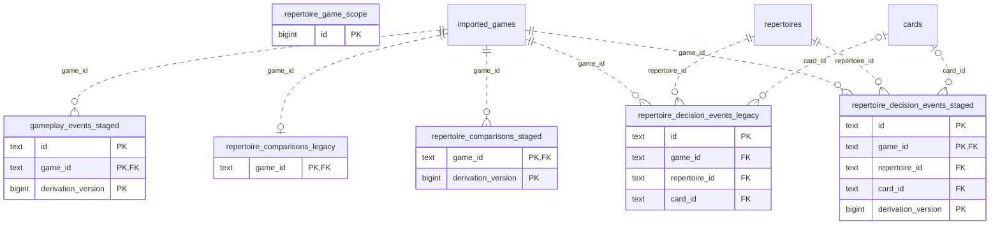

# Legacy backend: Game Projections (3)

Legacy observed games and versioned analysis/position/repertoire/event projections. These are existing legacy tables, not a new Study dependency.

**Current source schema, deployment unverified.** Owner: Legacy backend; SQL schema `public`. Derived from checked-in DDL at the `14ad5754` baseline with file relocation only. No live database was queried. [Database index](../../README.md).

Charts show primary/foreign key columns; the dictionary lists **every stored field and its SQL type**. `PK` means primary key (all marked fields form one composite key); `FK` means an enforced SQL foreign key. Parent `||`/`o|` means a required/optional parent; child `o{` means zero or more children and `o|` zero or one (a unique referencing tuple). Edges describe allowed SQL cardinality, not an obligation to create children. Nullable components of a composite FK can leave the tuple unlinked under PostgreSQL MATCH SIMPLE. No edge is inferred from a similar field name.

Referenced tables outside this view: `public.cards`, `public.imported_games`, `public.repertoires`. Follow the [schema index](../README.md) for their full definitions.

## Data dictionary

### `public.gameplay_events_staged`

Primary key: (`game_id`, `derivation_version`, `id`). DDL: [014_versioned_game_events.sql](../../ddl/migrations/014_versioned_game_events.sql).

| Field | SQL type | Null allowed | Keys |
| --- | --- | --- | --- |
| `id` | `text` | no | PK |
| `game_id` | `text` | no | PK; FK game_id → public.imported_games(`id`) |
| `analysis_version` | `bigint` | no |  |
| `classifier_version` | `bigint` | no |  |
| `ply` | `bigint` | no |  |
| `kind` | `text` | no |  |
| `motif` | `text` | no |  |
| `beneficiary_color` | `text` | no |  |
| `created_by_color` | `text` | no |  |
| `outcome` | `text` | no |  |
| `confidence` | `double precision` | no |  |
| `loss_cp` | `bigint` | no |  |
| `best_move_uci` | `text` | yes |  |
| `actual_move_uci` | `text` | yes |  |
| `principal_variation_json` | `text` | no |  |
| `evidence_json` | `text` | no |  |
| `created_at` | `text` | no |  |
| `updated_at` | `text` | no |  |
| `derivation_version` | `bigint` | no | PK |

Foreign key delete actions: (`game_id`) CASCADE.

### `public.repertoire_comparisons_legacy`

Primary key: (`game_id`). DDL: [001_initial.sql](../../ddl/migrations/001_initial.sql).

| Field | SQL type | Null allowed | Keys |
| --- | --- | --- | --- |
| `game_id` | `text` | no | PK; FK game_id → public.imported_games(`id`) |
| `repertoire_id` | `text` | yes |  |
| `classification` | `text` | no |  |
| `divergence_ply` | `bigint` | yes |  |
| `divergence_fen` | `text` | yes |  |
| `expected_json` | `text` | no |  |
| `actual_uci` | `text` | yes |  |
| `updated_at` | `text` | no |  |

Foreign key delete actions: (`game_id`) CASCADE.

### `public.repertoire_comparisons_staged`

Primary key: (`game_id`, `derivation_version`). DDL: [012_versioned_game_repertoire.sql](../../ddl/migrations/012_versioned_game_repertoire.sql).

| Field | SQL type | Null allowed | Keys |
| --- | --- | --- | --- |
| `game_id` | `text` | no | PK; FK game_id → public.imported_games(`id`) |
| `repertoire_id` | `text` | yes |  |
| `classification` | `text` | no |  |
| `divergence_ply` | `bigint` | yes |  |
| `divergence_fen` | `text` | yes |  |
| `expected_json` | `text` | no |  |
| `actual_uci` | `text` | yes |  |
| `updated_at` | `text` | no |  |
| `derivation_version` | `bigint` | no | PK |

Foreign key delete actions: (`game_id`) CASCADE.

### `public.repertoire_decision_events_legacy`

Primary key: (`id`). DDL: [001_initial.sql](../../ddl/migrations/001_initial.sql).

| Field | SQL type | Null allowed | Keys |
| --- | --- | --- | --- |
| `id` | `text` | no | PK |
| `game_id` | `text` | no | FK game_id → public.imported_games(`id`) |
| `repertoire_id` | `text` | no | FK repertoire_id → public.repertoires(`id`) |
| `card_id` | `text` | yes | FK card_id → public.cards(`id`) |
| `ply` | `bigint` | no |  |
| `fen_key` | `text` | no |  |
| `expected_uci` | `text` | no |  |
| `actual_uci` | `text` | no |  |
| `outcome` | `text` | no |  |
| `played_at` | `text` | no |  |
| `updated_at` | `text` | no |  |

Unique tuples (including non-partial simple unique indexes): (`game_id`, `repertoire_id`, `ply`).

Foreign key delete actions: (`game_id`) CASCADE, (`repertoire_id`) CASCADE, (`card_id`) SET NULL.

### `public.repertoire_decision_events_staged`

Primary key: (`game_id`, `derivation_version`, `id`). DDL: [012_versioned_game_repertoire.sql](../../ddl/migrations/012_versioned_game_repertoire.sql).

| Field | SQL type | Null allowed | Keys |
| --- | --- | --- | --- |
| `id` | `text` | no | PK |
| `game_id` | `text` | no | PK; FK game_id → public.imported_games(`id`) |
| `repertoire_id` | `text` | no | FK repertoire_id → public.repertoires(`id`) |
| `card_id` | `text` | yes | FK card_id → public.cards(`id`) |
| `ply` | `bigint` | no |  |
| `fen_key` | `text` | no |  |
| `expected_uci` | `text` | no |  |
| `actual_uci` | `text` | no |  |
| `outcome` | `text` | no |  |
| `played_at` | `text` | no |  |
| `updated_at` | `text` | no |  |
| `derivation_version` | `bigint` | no | PK |

Unique tuples (including non-partial simple unique indexes): (`game_id`, `derivation_version`, `repertoire_id`, `ply`).

Foreign key delete actions: (`game_id`) CASCADE, (`repertoire_id`) CASCADE, (`card_id`) SET NULL.

### `public.repertoire_game_scope`

Primary key: (`id`). DDL: [035_canonical_publication_freshness.sql](../../ddl/migrations/035_canonical_publication_freshness.sql).

| Field | SQL type | Null allowed | Keys |
| --- | --- | --- | --- |
| `id` | `bigint` | no | PK |
| `generation` | `bigint` | no |  |
