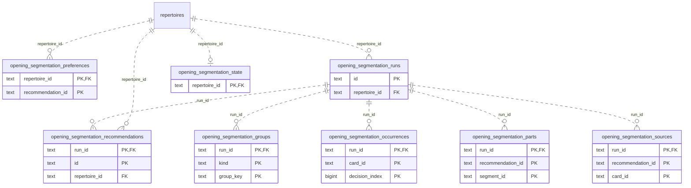

# Legacy backend: Opening Evidence (2)

Persisted opening decision evidence, presentation snapshots and attempts, segmentation and frozen ordering.

**Current source schema, deployment unverified.** Owner: Legacy backend; SQL schema `public`. Derived from checked-in DDL at the `14ad5754` baseline with file relocation only. No live database was queried. [Database index](../../README.md).

Charts show primary/foreign key columns; the dictionary lists **every stored field and its SQL type**. `PK` means primary key (all marked fields form one composite key); `FK` means an enforced SQL foreign key. Parent `||`/`o|` means a required/optional parent; child `o{` means zero or more children and `o|` zero or one (a unique referencing tuple). Edges describe allowed SQL cardinality, not an obligation to create children. Nullable components of a composite FK can leave the tuple unlinked under PostgreSQL MATCH SIMPLE. No edge is inferred from a similar field name.

Referenced tables outside this view: `public.repertoires`. Follow the [schema index](../README.md) for their full definitions.

## Data dictionary

### `public.opening_segmentation_groups`

Primary key: (`run_id`, `kind`, `group_key`). DDL: [024_opening_segmentation.sql](../../ddl/migrations/024_opening_segmentation.sql).

| Field | SQL type | Null allowed | Keys |
| --- | --- | --- | --- |
| `run_id` | `text` | no | PK; FK run_id → public.opening_segmentation_runs(`id`) |
| `kind` | `text` | no | PK |
| `group_key` | `text` | no | PK |
| `source_count` | `bigint` | no |  |
| `decisions_before` | `bigint` | no |  |
| `segment_count` | `bigint` | no |  |
| `decisions_after` | `bigint` | no |  |
| `first_discriminator` | `text` | yes |  |
| `diverse` | `boolean` | no |  |
| `source_fingerprint` | `text` | no |  |

Foreign key delete actions: (`run_id`) CASCADE.

### `public.opening_segmentation_occurrences`

Primary key: (`run_id`, `card_id`, `decision_index`). DDL: [024_opening_segmentation.sql](../../ddl/migrations/024_opening_segmentation.sql).

| Field | SQL type | Null allowed | Keys |
| --- | --- | --- | --- |
| `run_id` | `text` | no | PK; FK run_id → public.opening_segmentation_runs(`id`) |
| `card_id` | `text` | no | PK |
| `decision_index` | `bigint` | no | PK |
| `trunk_key` | `text` | no |  |
| `suffix_key` | `text` | no |  |
| `occurrence_json` | `text` | no |  |

Foreign key delete actions: (`run_id`) CASCADE.

### `public.opening_segmentation_parts`

Primary key: (`run_id`, `recommendation_id`, `segment_id`). DDL: [024_opening_segmentation.sql](../../ddl/migrations/024_opening_segmentation.sql).

| Field | SQL type | Null allowed | Keys |
| --- | --- | --- | --- |
| `run_id` | `text` | no | PK; FK run_id → public.opening_segmentation_runs(`id`) |
| `recommendation_id` | `text` | no | PK |
| `segment_id` | `text` | no | PK |
| `tested_decisions` | `bigint` | no |  |
| `segment_json` | `text` | no |  |

Foreign key delete actions: (`run_id`) CASCADE.

### `public.opening_segmentation_preferences`

Primary key: (`repertoire_id`, `recommendation_id`). DDL: [024_opening_segmentation.sql](../../ddl/migrations/024_opening_segmentation.sql).

| Field | SQL type | Null allowed | Keys |
| --- | --- | --- | --- |
| `repertoire_id` | `text` | no | PK; FK repertoire_id → public.repertoires(`id`) |
| `recommendation_id` | `text` | no | PK |
| `choice` | `text` | no |  |
| `source_fingerprint` | `text` | no |  |
| `updated_at` | `text` | no |  |

Foreign key delete actions: (`repertoire_id`) CASCADE.

### `public.opening_segmentation_recommendations`

Primary key: (`run_id`, `id`). DDL: [024_opening_segmentation.sql](../../ddl/migrations/024_opening_segmentation.sql).

| Field | SQL type | Null allowed | Keys |
| --- | --- | --- | --- |
| `run_id` | `text` | no | PK; FK run_id → public.opening_segmentation_runs(`id`) |
| `id` | `text` | no | PK |
| `repertoire_id` | `text` | no | FK repertoire_id → public.repertoires(`id`) |
| `kind` | `text` | no |  |
| `decisions_before` | `bigint` | no |  |
| `decisions_after` | `bigint` | no |  |
| `decisions_avoided` | `bigint` | no |  |
| `additional_starts` | `bigint` | no |  |
| `segment_count` | `bigint` | no |  |
| `source_fingerprint` | `text` | no |  |

Foreign key delete actions: (`run_id`) CASCADE, (`repertoire_id`) CASCADE.

### `public.opening_segmentation_runs`

Primary key: (`id`). DDL: [024_opening_segmentation.sql](../../ddl/migrations/024_opening_segmentation.sql).

| Field | SQL type | Null allowed | Keys |
| --- | --- | --- | --- |
| `id` | `text` | no | PK |
| `repertoire_id` | `text` | no | FK repertoire_id → public.repertoires(`id`) |

Foreign key delete actions: (`repertoire_id`) CASCADE.

### `public.opening_segmentation_sources`

Primary key: (`run_id`, `recommendation_id`, `card_id`). DDL: [024_opening_segmentation.sql](../../ddl/migrations/024_opening_segmentation.sql).

| Field | SQL type | Null allowed | Keys |
| --- | --- | --- | --- |
| `run_id` | `text` | no | PK; FK run_id → public.opening_segmentation_runs(`id`) |
| `recommendation_id` | `text` | no | PK |
| `card_id` | `text` | no | PK |
| `decision_count` | `bigint` | no |  |
| `discriminator` | `text` | no |  |

Foreign key delete actions: (`run_id`) CASCADE.

### `public.opening_segmentation_state`

Primary key: (`repertoire_id`). DDL: [024_opening_segmentation.sql](../../ddl/migrations/024_opening_segmentation.sql).

| Field | SQL type | Null allowed | Keys |
| --- | --- | --- | --- |
| `repertoire_id` | `text` | no | PK; FK repertoire_id → public.repertoires(`id`) |
| `content_version` | `bigint` | no |  |
| `graph_generation` | `bigint` | yes |  |
| `run_id` | `text` | yes |  |
| `state` | `text` | no |  |
| `published_at` | `text` | yes |  |

Foreign key delete actions: (`repertoire_id`) CASCADE.
