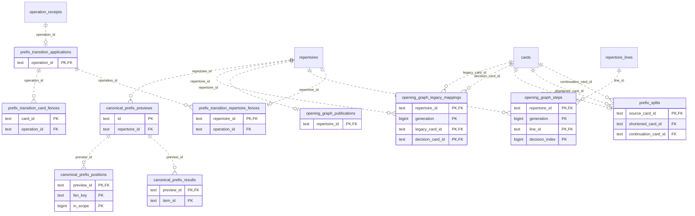

# Legacy backend: Opening Graph

Versioned opening graph routes, source mappings, canonical prefixes, publication/transition state and diagnostics.

**Current source schema, deployment unverified.** Owner: Legacy backend; SQL schema `public`. Derived from checked-in DDL at the `14ad5754` baseline with file relocation only. No live database was queried. [Database index](../../README.md).

Charts show primary/foreign key columns; the dictionary lists **every stored field and its SQL type**. `PK` means primary key (all marked fields form one composite key); `FK` means an enforced SQL foreign key. Parent `||`/`o|` means a required/optional parent; child `o{` means zero or more children and `o|` zero or one (a unique referencing tuple). Edges describe allowed SQL cardinality, not an obligation to create children. Nullable components of a composite FK can leave the tuple unlinked under PostgreSQL MATCH SIMPLE. No edge is inferred from a similar field name.

Referenced tables outside this view: `public.cards`, `public.operation_receipts`, `public.repertoire_lines`, `public.repertoires`. Follow the [schema index](../README.md) for their full definitions.

## Data dictionary

### `public.canonical_prefix_positions`

Primary key: (`preview_id`, `fen_key`, `in_scope`). DDL: [033_canonical_prefix.sql](../../ddl/migrations/033_canonical_prefix.sql), [034_current_canonical_routes.sql](../../ddl/migrations/034_current_canonical_routes.sql).

| Field | SQL type | Null allowed | Keys |
| --- | --- | --- | --- |
| `preview_id` | `text` | no | PK; FK preview_id → public.canonical_prefix_previews(`id`) |
| `fen_key` | `text` | no | PK |
| `in_scope` | `bigint` | no | PK |
| `fen` | `text` | no |  |
| `route_json` | `text` | no |  |
| `ply` | `bigint` | no |  |
| `source_revision` | `bigint` | no |  |

Foreign key delete actions: (`preview_id`) CASCADE.

### `public.canonical_prefix_previews`

Primary key: (`id`). DDL: [033_canonical_prefix.sql](../../ddl/migrations/033_canonical_prefix.sql).

| Field | SQL type | Null allowed | Keys |
| --- | --- | --- | --- |
| `id` | `text` | no | PK |
| `repertoire_id` | `text` | no | FK repertoire_id → public.repertoires(`id`) |
| `moves_json` | `text` | no |  |
| `expected_revision` | `bigint` | no |  |
| `source_revision` | `bigint` | no |  |
| `state` | `text` | no |  |
| `suggestion_json` | `text` | no |  |
| `last_error` | `text` | yes |  |
| `created_at` | `text` | no |  |

Foreign key delete actions: (`repertoire_id`) CASCADE.

### `public.canonical_prefix_results`

Primary key: (`preview_id`, `item_id`). DDL: [033_canonical_prefix.sql](../../ddl/migrations/033_canonical_prefix.sql).

| Field | SQL type | Null allowed | Keys |
| --- | --- | --- | --- |
| `preview_id` | `text` | no | PK; FK preview_id → public.canonical_prefix_previews(`id`) |
| `item_id` | `text` | no | PK |
| `name` | `text` | no |  |
| `status` | `text` | no |  |
| `reason` | `text` | yes |  |
| `disagreement_ply` | `bigint` | yes |  |
| `origin_json` | `text` | yes |  |
| `scope_start_ply` | `bigint` | yes |  |

Foreign key delete actions: (`preview_id`) CASCADE.

### `public.opening_graph_legacy_mappings`

Primary key: (`repertoire_id`, `generation`, `legacy_card_id`, `decision_card_id`). DDL: [001_initial.sql](../../ddl/migrations/001_initial.sql).

| Field | SQL type | Null allowed | Keys |
| --- | --- | --- | --- |
| `repertoire_id` | `text` | no | PK; FK repertoire_id → public.repertoires(`id`) |
| `generation` | `bigint` | no | PK |
| `legacy_card_id` | `text` | no | PK; FK legacy_card_id → public.cards(`id`) |
| `decision_card_id` | `text` | no | PK; FK decision_card_id → public.cards(`id`) |

Foreign key delete actions: (`repertoire_id`) CASCADE, (`legacy_card_id`) CASCADE, (`decision_card_id`) CASCADE.

### `public.opening_graph_publications`

Primary key: (`repertoire_id`). DDL: [001_initial.sql](../../ddl/migrations/001_initial.sql).

| Field | SQL type | Null allowed | Keys |
| --- | --- | --- | --- |
| `repertoire_id` | `text` | no | PK; FK repertoire_id → public.repertoires(`id`) |
| `generation` | `bigint` | no |  |
| `state` | `text` | no |  |
| `last_error` | `text` | yes |  |
| `published_at` | `text` | no |  |

Foreign key delete actions: (`repertoire_id`) CASCADE.

### `public.opening_graph_steps`

Primary key: (`repertoire_id`, `generation`, `line_id`, `decision_index`). DDL: [001_initial.sql](../../ddl/migrations/001_initial.sql).

| Field | SQL type | Null allowed | Keys |
| --- | --- | --- | --- |
| `repertoire_id` | `text` | no | PK; FK repertoire_id → public.repertoires(`id`) |
| `generation` | `bigint` | no | PK |
| `line_id` | `text` | no | PK; FK line_id → public.repertoire_lines(`id`) |
| `decision_index` | `bigint` | no | PK |
| `card_id` | `text` | no |  |
| `parent_card_id` | `text` | yes |  |
| `decision_fen_key` | `text` | no |  |
| `starting_fen` | `text` | no |  |
| `moves_json` | `text` | no |  |
| `trained_color` | `text` | no |  |
| `segment_kind` | `text` | no |  |
| `first_decision_index` | `bigint` | no |  |
| `last_decision_index` | `bigint` | no |  |
| `decision_fen_keys_json` | `text` | no |  |

Foreign key delete actions: (`repertoire_id`) CASCADE, (`line_id`) CASCADE.

### `public.prefix_splits`

Primary key: (`source_card_id`). DDL: [001_initial.sql](../../ddl/migrations/001_initial.sql).

| Field | SQL type | Null allowed | Keys |
| --- | --- | --- | --- |
| `source_card_id` | `text` | no | PK; FK source_card_id → public.cards(`id`) |
| `source_revision` | `bigint` | no |  |
| `shortened_card_id` | `text` | no | FK shortened_card_id → public.cards(`id`) |
| `continuation_card_id` | `text` | no | FK continuation_card_id → public.cards(`id`) |
| `created_at` | `text` | no |  |

Foreign key delete actions: (`source_card_id`) CASCADE, (`shortened_card_id`) CASCADE, (`continuation_card_id`) CASCADE.

### `public.prefix_transition_applications`

Primary key: (`operation_id`). DDL: [038_prefix_transition_application.sql](../../ddl/migrations/038_prefix_transition_application.sql).

| Field | SQL type | Null allowed | Keys |
| --- | --- | --- | --- |
| `operation_id` | `text` | no | PK; FK operation_id → public.operation_receipts(`operation_id`) |
| `repertoire_id` | `text` | no |  |
| `plan_id` | `text` | no |  |
| `plan_json` | `text` | no |  |
| `graph_generation` | `bigint` | no |  |
| `state` | `text` | no |  |
| `staging_task_id` | `text` | yes |  |
| `graph_task_id` | `text` | yes |  |
| `integrity_task_id` | `text` | yes |  |
| `integrity_generation` | `bigint` | yes |  |
| `queue_task_id` | `text` | yes |  |
| `queue_generation` | `bigint` | yes |  |
| `queue_date` | `text` | yes |  |
| `result_json` | `text` | yes |  |
| `last_error` | `text` | yes |  |
| `created_at` | `timestamptz` | no |  |
| `updated_at` | `timestamptz` | no |  |

Foreign key delete actions: (`operation_id`) NO ACTION.

### `public.prefix_transition_card_fences`

Primary key: (`card_id`). DDL: [038_prefix_transition_application.sql](../../ddl/migrations/038_prefix_transition_application.sql).

| Field | SQL type | Null allowed | Keys |
| --- | --- | --- | --- |
| `card_id` | `text` | no | PK |
| `operation_id` | `text` | no | FK operation_id → public.prefix_transition_applications(`operation_id`) |

Foreign key delete actions: (`operation_id`) NO ACTION.

### `public.prefix_transition_repertoire_fences`

Primary key: (`repertoire_id`). DDL: [038_prefix_transition_application.sql](../../ddl/migrations/038_prefix_transition_application.sql).

| Field | SQL type | Null allowed | Keys |
| --- | --- | --- | --- |
| `repertoire_id` | `text` | no | PK; FK repertoire_id → public.repertoires(`id`) |
| `operation_id` | `text` | no | FK operation_id → public.prefix_transition_applications(`operation_id`) |

Foreign key delete actions: (`repertoire_id`) NO ACTION, (`operation_id`) NO ACTION.
