# Legacy backend: Practice Families (1)

Tactic, defense, threat and endgame exercise/progress/attempt facts and tablebase cache.

**Current source schema, deployment unverified.** Owner: Legacy backend; SQL schema `public`. Derived from checked-in DDL at the `14ad5754` baseline with file relocation only. No live database was queried. [Database index](../../README.md).

Charts show primary/foreign key columns; the dictionary lists **every stored field and its SQL type**. `PK` means primary key (all marked fields form one composite key); `FK` means an enforced SQL foreign key. Parent `||`/`o|` means a required/optional parent; child `o{` means zero or more children and `o|` zero or one (a unique referencing tuple). Edges describe allowed SQL cardinality, not an obligation to create children. Nullable components of a composite FK can leave the tuple unlinked under PostgreSQL MATCH SIMPLE. No edge is inferred from a similar field name.

```mermaid
erDiagram
  defense_attempts {
    text attempt_id PK
    text candidate_id FK
    text card_id FK
  }
  defense_recognition_submissions {
    text attempt_id PK
    text candidate_id FK
    bigint queue_entry_id FK
  }
  endgame_attempts {
    text id PK
    text template_id FK
  }
  endgame_templates {
    text id PK
  }
  tablebase_cache {
    text fen_key PK
  }
  tactic_captures {
    text id PK
    text card_id FK
  }
  tactic_discovery_attempts {
    text id PK
  }
  tactic_introductions {
    text puzzle_id PK
  }
  tactic_pack_activation {
    text pack_id PK
  }
  tactic_progress {
    text puzzle_id PK
  }
  tactic_rotation {
    bigint id PK
  }
  tactical_opportunities {
    text id PK
    text game_id FK
  }
  threat_training_candidates ||..o{ defense_attempts : "candidate_id"
  cards ||..o{ defense_attempts : "card_id"
  threat_training_candidates ||..o{ defense_recognition_submissions : "candidate_id"
  daily_queue ||..o{ defense_recognition_submissions : "queue_entry_id"
  endgame_templates ||..o{ endgame_attempts : "template_id"
  cards ||..o{ tactic_captures : "card_id"
  imported_games ||..o{ tactical_opportunities : "game_id"
```

Referenced tables outside this view: `public.cards`, `public.daily_queue`, `public.imported_games`, `public.threat_training_candidates`. Follow the [schema index](../README.md) for their full definitions.

## Data dictionary

### `public.defense_attempts`

Primary key: (`attempt_id`). DDL: [001_initial.sql](../../ddl/migrations/001_initial.sql).

| Field | SQL type | Null allowed | Keys |
| --- | --- | --- | --- |
| `attempt_id` | `text` | no | PK |
| `candidate_id` | `text` | no | FK candidate_id → public.threat_training_candidates(`id`) |
| `card_id` | `text` | no | FK card_id → public.cards(`id`) |
| `queue_entry_id` | `bigint` | yes |  |
| `exercise_revision` | `bigint` | no |  |
| `move_uci` | `text` | no |  |
| `grade_json` | `text` | no |  |
| `reviewed_at` | `text` | no |  |

Foreign key delete actions: (`candidate_id`) CASCADE, (`card_id`) CASCADE.

### `public.defense_recognition_submissions`

Primary key: (`attempt_id`). DDL: [001_initial.sql](../../ddl/migrations/001_initial.sql).

| Field | SQL type | Null allowed | Keys |
| --- | --- | --- | --- |
| `attempt_id` | `text` | no | PK |
| `candidate_id` | `text` | no | FK candidate_id → public.threat_training_candidates(`id`) |
| `queue_entry_id` | `bigint` | no | FK queue_entry_id → public.daily_queue(`id`) |
| `exercise_revision` | `bigint` | no |  |
| `answer_json` | `text` | no |  |
| `recognition_correct` | `bigint` | no |  |
| `created_at` | `text` | no |  |

Foreign key delete actions: (`candidate_id`) CASCADE, (`queue_entry_id`) CASCADE.

### `public.endgame_attempts`

Primary key: (`id`). DDL: [001_initial.sql](../../ddl/migrations/001_initial.sql).

| Field | SQL type | Null allowed | Keys |
| --- | --- | --- | --- |
| `id` | `text` | no | PK |
| `template_id` | `text` | no | FK template_id → public.endgame_templates(`id`) |
| `start_fen` | `text` | no |  |
| `target` | `text` | no |  |
| `status` | `text` | no |  |
| `user_moves` | `bigint` | no |  |
| `created_at` | `text` | no |  |
| `completed_at` | `text` | yes |  |

Foreign key delete actions: (`template_id`) CASCADE.

### `public.endgame_templates`

Primary key: (`id`). DDL: [001_initial.sql](../../ddl/migrations/001_initial.sql).

| Field | SQL type | Null allowed | Keys |
| --- | --- | --- | --- |
| `id` | `text` | no | PK |
| `card_id` | `text` | no |  |
| `name` | `text` | no |  |
| `white_material` | `text` | no |  |
| `black_material` | `text` | no |  |
| `trained_color` | `text` | no |  |
| `goal_mix` | `text` | no |  |
| `enabled` | `bigint` | no |  |
| `created_at` | `text` | no |  |

Unique tuples (including non-partial simple unique indexes): (`card_id`).

### `public.tablebase_cache`

Primary key: (`fen_key`). DDL: [001_initial.sql](../../ddl/migrations/001_initial.sql).

| Field | SQL type | Null allowed | Keys |
| --- | --- | --- | --- |
| `fen_key` | `text` | no | PK |
| `response_json` | `text` | no |  |
| `fetched_at` | `text` | no |  |

### `public.tactic_captures`

Primary key: (`id`). DDL: [025_tactic_capture.sql](../../ddl/migrations/025_tactic_capture.sql).

| Field | SQL type | Null allowed | Keys |
| --- | --- | --- | --- |
| `id` | `text` | no | PK |
| `card_id` | `text` | no | FK card_id → public.cards(`id`) |
| `source_kind` | `text` | no |  |
| `source_ref` | `text` | yes |  |
| `source_url` | `text` | yes |  |
| `note` | `text` | no |  |
| `captured_at` | `text` | no |  |
| `request_json` | `text` | no |  |
| `result_json` | `text` | no |  |

Foreign key delete actions: (`card_id`) CASCADE.

### `public.tactic_discovery_attempts`

Primary key: (`id`). DDL: [001_initial.sql](../../ddl/migrations/001_initial.sql).

| Field | SQL type | Null allowed | Keys |
| --- | --- | --- | --- |
| `id` | `text` | no | PK |
| `deck_id` | `text` | no |  |
| `puzzle_id` | `text` | no |  |
| `clean` | `bigint` | no |  |
| `result_json` | `text` | no |  |

### `public.tactic_introductions`

Primary key: (`puzzle_id`). DDL: [001_initial.sql](../../ddl/migrations/001_initial.sql).

| Field | SQL type | Null allowed | Keys |
| --- | --- | --- | --- |
| `puzzle_id` | `text` | no | PK |
| `pack_id` | `text` | no |  |
| `introduction_date` | `text` | no |  |

### `public.tactic_pack_activation`

Primary key: (`pack_id`). DDL: [001_initial.sql](../../ddl/migrations/001_initial.sql).

| Field | SQL type | Null allowed | Keys |
| --- | --- | --- | --- |
| `pack_id` | `text` | no | PK |
| `active` | `bigint` | no |  |

### `public.tactic_progress`

Primary key: (`puzzle_id`). DDL: [001_initial.sql](../../ddl/migrations/001_initial.sql).

| Field | SQL type | Null allowed | Keys |
| --- | --- | --- | --- |
| `puzzle_id` | `text` | no | PK |
| `deck_id` | `text` | no |  |
| `card_id` | `text` | yes |  |
| `clean_pass_at` | `text` | yes |  |
| `admitted_at` | `text` | yes |  |
| `admission_mode` | `text` | no |  |

### `public.tactic_rotation`

Primary key: (`id`). DDL: [001_initial.sql](../../ddl/migrations/001_initial.sql).

| Field | SQL type | Null allowed | Keys |
| --- | --- | --- | --- |
| `id` | `bigint` | no | PK |
| `last_pack_id` | `text` | no |  |

### `public.tactical_opportunities`

Primary key: (`id`). DDL: [001_initial.sql](../../ddl/migrations/001_initial.sql).

| Field | SQL type | Null allowed | Keys |
| --- | --- | --- | --- |
| `id` | `text` | no | PK |
| `game_id` | `text` | no | FK game_id → public.imported_games(`id`) |
| `analysis_version` | `bigint` | no |  |
| `ply` | `bigint` | no |  |
| `motif` | `text` | no |  |
| `outcome` | `text` | no |  |
| `confidence` | `double precision` | no |  |
| `opportunity_value_cp` | `bigint` | no |  |
| `evaluation_loss_cp` | `bigint` | no |  |
| `played_move_uci` | `text` | no |  |
| `accepted_moves_json` | `text` | no |  |
| `evidence_json` | `text` | no |  |
| `engine_version` | `text` | yes |  |
| `network_version` | `text` | yes |  |
| `active` | `bigint` | no |  |
| `created_at` | `text` | no |  |
| `updated_at` | `text` | no |  |
| `superseded_at` | `text` | yes |  |

Unique tuples (including non-partial simple unique indexes): (`game_id`, `analysis_version`, `ply`, `motif`).

Foreign key delete actions: (`game_id`) CASCADE.
