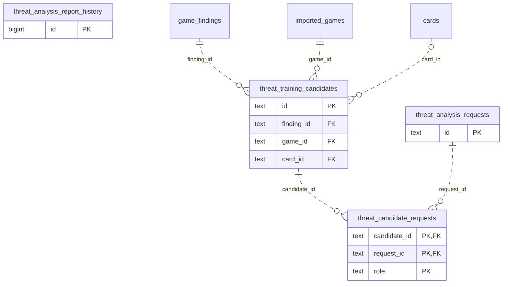

# Legacy backend: Practice Families (2)

Tactic, defense and threat exercise/progress/attempt facts.

**Current source schema, deployment unverified.** Owner: Legacy backend; SQL schema `public`. Derived from checked-in DDL at the `14ad5754` baseline with file relocation only. No live database was queried. [Database index](../../README.md).

Charts show primary/foreign key columns; the dictionary lists **every stored field and its SQL type**. `PK` means primary key (all marked fields form one composite key); `FK` means an enforced SQL foreign key. Parent `||`/`o|` means a required/optional parent; child `o{` means zero or more children and `o|` zero or one (a unique referencing tuple). Edges describe allowed SQL cardinality, not an obligation to create children. Nullable components of a composite FK can leave the tuple unlinked under PostgreSQL MATCH SIMPLE. No edge is inferred from a similar field name.

Referenced tables outside this view: `public.cards`, `public.game_findings`, `public.imported_games`. Follow the [schema index](../README.md) for their full definitions.

## Data dictionary

### `public.threat_analysis_report_history`

Primary key: (`id`). DDL: [001_initial.sql](../../ddl/migrations/001_initial.sql).

| Field | SQL type | Null allowed | Keys |
| --- | --- | --- | --- |
| `id` | `bigint` | no | PK |
| `request_id` | `text` | no |  |
| `report_json` | `text` | no |  |
| `rejection_reason` | `text` | no |  |
| `archived_at` | `text` | no |  |

### `public.threat_analysis_requests`

Primary key: (`id`). DDL: [001_initial.sql](../../ddl/migrations/001_initial.sql).

| Field | SQL type | Null allowed | Keys |
| --- | --- | --- | --- |
| `id` | `text` | no | PK |
| `request_json` | `text` | no |  |
| `state` | `text` | no |  |
| `report_json` | `text` | yes |  |
| `lease_id` | `text` | yes |  |
| `lease_expires_at` | `text` | yes |  |
| `attempts` | `bigint` | no |  |
| `last_error` | `text` | yes |  |
| `created_at` | `text` | no |  |
| `updated_at` | `text` | no |  |

### `public.threat_candidate_requests`

Primary key: (`candidate_id`, `request_id`, `role`). DDL: [001_initial.sql](../../ddl/migrations/001_initial.sql).

| Field | SQL type | Null allowed | Keys |
| --- | --- | --- | --- |
| `candidate_id` | `text` | no | PK; FK candidate_id → public.threat_training_candidates(`id`) |
| `request_id` | `text` | no | PK; FK request_id → public.threat_analysis_requests(`id`) |
| `role` | `text` | no | PK |

Foreign key delete actions: (`candidate_id`) CASCADE, (`request_id`) CASCADE.

### `public.threat_training_candidates`

Primary key: (`id`). DDL: [001_initial.sql](../../ddl/migrations/001_initial.sql).

| Field | SQL type | Null allowed | Keys |
| --- | --- | --- | --- |
| `id` | `text` | no | PK |
| `finding_id` | `text` | no | FK finding_id → public.game_findings(`id`) |
| `game_id` | `text` | no | FK game_id → public.imported_games(`id`) |
| `analysis_version` | `bigint` | no |  |
| `incident_id` | `text` | no |  |
| `player_ply` | `bigint` | no |  |
| `validation_state` | `text` | no |  |
| `diagnostic` | `text` | no |  |
| `evidence_json` | `text` | no |  |
| `validation_json` | `text` | no |  |
| `source_fingerprint` | `text` | no |  |
| `detector_version` | `bigint` | no |  |
| `policy_json` | `text` | no |  |
| `exercise_revision` | `bigint` | no |  |
| `dismissed_at` | `text` | yes |  |
| `dismissed_evidence_fingerprint` | `text` | yes |  |
| `approved_at` | `text` | yes |  |
| `card_id` | `text` | yes | FK card_id → public.cards(`id`) |
| `superseded_at` | `text` | yes |  |
| `created_at` | `text` | no |  |
| `updated_at` | `text` | no |  |
| `paused_at` | `text` | yes |  |
| `admission_mode` | `text` | yes |  |

Unique tuples (including non-partial simple unique indexes): (`game_id`, `analysis_version`, `incident_id`, `player_ply`).

Foreign key delete actions: (`finding_id`) CASCADE, (`game_id`) CASCADE, (`card_id`) SET NULL.
