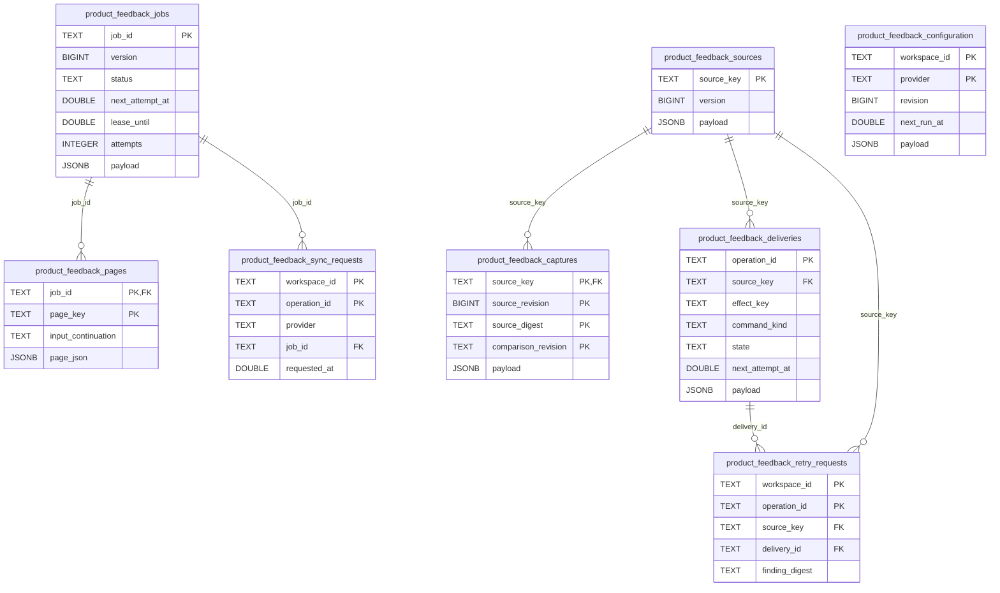

# Optional game-feedback storage — migration 052

Source schema for [052_product_game_sync.sql](../../ddl/migrations/052_product_game_sync.sql),
after Study-owned 051. Readiness advances **51 → 52**. This is additive Games-owned
storage, not a migration activation or an installation claim. Study tables,
reviews, content and schedules are unchanged by this migration.

The capture/checkpoint/source/delivery DDL is copied unchanged from #489's
published `SCHEMA_SQL` at `d5e3068b6fb1148bfc6d79a66a66ffa39c679ac8`. Configuration,
sync-request and retry-request facts are #491 additions. Every primary key/FK
below is actually declared. Workspace/provider/repertoire references in JSON are
logical references without foreign keys to Study or Repertoire.

`jobs.payload` contains JobState/JobSpec, preserving the explicit provider,
account, UTC window, repertoire scope, filters, checkpoint, completeness and
retry facts. A page stores its provider JSON and input continuation atomically
with sources/captures/pending deliveries. Capture's composite key retains distinct
source/comparison evidence without overwriting previous captures. Source payload
retains the original GameRecord, normalized game, findings, logical effects and
quarantine state. Delivery payload retains one lapse or control and the receiving
owner's actual receipt, independently of acquisition completeness.

#619 adds optional `first_departure` and `determined_at` values inside the existing
source/capture JSON. They retain the typed global boundary, source/scope/route
provenance and first durable actionable determination. The same existing page
transaction persists them with the checkpoint and pending command; no new table,
column, relationship or migration is introduced. Old JSON reads these values as
null. A logical effect key remains independent of the comparison policy revision.
The read-only selected-game projection exposes the retained global election
separately from per-repertoire diagnostic summaries; it never reclassifies work.

Configuration payload contains explicit account/window/repertoires/speeds/rated
policy, optional fixed-window recurrence and revision. Null recurrence is off.
Sync requests bind operation IDs to the existing job and request time. Retry
requests bind operation IDs to an existing source/delivery and Finding digest;
they do not create a second learning command or owner receipt.

Indexes cover ready jobs/deliveries, latest configured requests, and bounded
workspace/provider/canonical-game lookups within source JSON. No cascade is
declared. No table, column or applied migration is removed or altered.

Native source evidence: the owning disposable PostgreSQL fixture validates and
applies the full ordered registry through 52; configuration/projection/retry and
current-owner fence cases pass against it. The fixture derives readiness from
the schema owner so later additive 053 is validated rather than rejected by an
obsolete hardcoded 51. Source/native proof is separate from browser, installed
schema and deployment qualification.
# Retained first-departure qualification (#621)

The existing `product_feedback_deliveries.payload` JSON now retains separate
`qualification_status` (`pending`, `ready`, `held`, `ineligible`), finite reason and
retryability, the typed current first-departure witness, original determination,
actual origin job/stream/configuration revision where known, and a service
sequence for live/history intake fairness. No new table, column or effect identity
is introduced for qualification. Original lapse/encounter/control bytes remain
unchanged; source/capture/checkpoint/outbox publication remains atomic.

Controls supersede pending automatic records before delivery. A delayed owner
acknowledgment cannot reactivate them, replace a captured command, or restart its
determination. Games' current source/config/control fence borrows the Study writer
through the public composition; actual Study schedules, reviews, admission,
issuance and settlement remain owned by Study. New handoff additionally consumes
the separately owned managed-mode shared-row fence (schema56); accepted Study debt
continues independently when optional feedback is off.

The status inventory's qualification counts have delivery-record grain. An
accepted/pending receipt counted at acknowledgment is not a current queue,
issuance or settlement observation. The canonical policy and bounded failure flow
are documented by [the Games owner](../../../../backend/app/games/feedback/README.md#first-departure-delivery-qualification--621).
