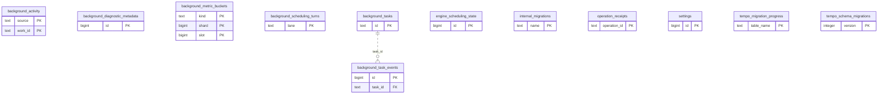

# Legacy backend: Runtime Metadata

Schema/import progress, workspace settings, durable operations and background scheduling/lease metadata.

**Current source schema, deployment unverified.** Owner: Legacy backend; SQL schema `public`. Derived from checked-in DDL at the `14ad5754` baseline with file relocation only. No live database was queried. [Database index](../../README.md).

Charts show primary/foreign key columns; the dictionary lists **every stored field and its SQL type**. `PK` means primary key (all marked fields form one composite key); `FK` means an enforced SQL foreign key. Parent `||`/`o|` means a required/optional parent; child `o{` means zero or more children and `o|` zero or one (a unique referencing tuple). Edges describe allowed SQL cardinality, not an obligation to create children. Nullable components of a composite FK can leave the tuple unlinked under PostgreSQL MATCH SIMPLE. No edge is inferred from a similar field name.

## Data dictionary

### `public.background_activity`

Primary key: (`source`, `work_id`). DDL: [001_initial.sql](../../ddl/migrations/001_initial.sql).

| Field | SQL type | Null allowed | Keys |
| --- | --- | --- | --- |
| `source` | `text` | no | PK |
| `work_id` | `text` | no | PK |
| `generation_key` | `text` | yes |  |
| `paused` | `bigint` | no |  |
| `promoted` | `bigint` | no |  |
| `phase` | `text` | yes |  |
| `completed_units` | `bigint` | yes |  |
| `total_units` | `bigint` | yes |  |
| `updated_at` | `text` | no |  |

### `public.background_diagnostic_metadata`

Primary key: (`id`). DDL: [026_background_diagnostics.sql](../../ddl/migrations/026_background_diagnostics.sql).

| Field | SQL type | Null allowed | Keys |
| --- | --- | --- | --- |
| `id` | `bigint` | no | PK |
| `collection_started_at` | `text` | no |  |

### `public.background_metric_buckets`

Primary key: (`kind`, `shard`, `slot`). DDL: [026_background_diagnostics.sql](../../ddl/migrations/026_background_diagnostics.sql).

| Field | SQL type | Null allowed | Keys |
| --- | --- | --- | --- |
| `kind` | `text` | no | PK |
| `shard` | `bigint` | no | PK |
| `slot` | `bigint` | no | PK |
| `bucket_start` | `text` | no |  |
| `generations_started` | `bigint` | no |  |
| `generation_replacements` | `bigint` | no |  |
| `generation_restarts` | `bigint` | no |  |
| `claims` | `bigint` | no |  |
| `slices` | `bigint` | no |  |
| `retries` | `bigint` | no |  |
| `completed_generations` | `bigint` | no |  |
| `useful_completions` | `bigint` | no |  |
| `stale_deliveries` | `bigint` | no |  |
| `stale_results` | `bigint` | no |  |
| `lease_expiries` | `bigint` | no |  |
| `lease_reclaims` | `bigint` | no |  |
| `contention_deferrals` | `bigint` | no |  |
| `engine_completed_positions` | `bigint` | no |  |
| `engine_preemptions` | `bigint` | no |  |
| `engine_timeouts` | `bigint` | no |  |
| `engine_failures` | `bigint` | no |  |
| `priority_calculator_calls` | `bigint` | no |  |
| `priority_publications` | `bigint` | no |  |
| `priority_published_records` | `bigint` | no |  |
| `engine_successful_seconds` | `double precision` | no |  |
| `engine_preempted_seconds` | `double precision` | no |  |
| `engine_abandoned_seconds` | `double precision` | no |  |
| `engine_successful_samples` | `bigint` | no |  |
| `engine_abandoned_samples` | `bigint` | no |  |
| `engine_unknown_timing_attempts` | `bigint` | no |  |
| `engine_successful_max_seconds` | `double precision` | no |  |
| `engine_preempted_max_seconds` | `double precision` | no |  |
| `engine_abandoned_max_seconds` | `double precision` | no |  |

### `public.background_scheduling_turns`

Primary key: (`lane`). DDL: [043_background_scheduling_turns.sql](../../ddl/migrations/043_background_scheduling_turns.sql).

| Field | SQL type | Null allowed | Keys |
| --- | --- | --- | --- |
| `lane` | `text` | no | PK |
| `next_turn` | `bigint` | no |  |
| `promoted_since_turn` | `bigint` | no |  |
| `control_streak` | `bigint` | no |  |

### `public.background_task_events`

Primary key: (`id`). DDL: [001_initial.sql](../../ddl/migrations/001_initial.sql).

| Field | SQL type | Null allowed | Keys |
| --- | --- | --- | --- |
| `id` | `bigint` | no | PK |
| `task_id` | `text` | no | FK task_id → public.background_tasks(`id`) |
| `generation` | `bigint` | no |  |
| `event` | `text` | no |  |
| `phase` | `text` | yes |  |
| `detail` | `text` | yes |  |
| `created_at` | `text` | no |  |

Foreign key delete actions: (`task_id`) CASCADE.

### `public.background_tasks`

Primary key: (`id`). DDL: [001_initial.sql](../../ddl/migrations/001_initial.sql), [026_background_diagnostics.sql](../../ddl/migrations/026_background_diagnostics.sql), [040_queue_unlock_deadlines.sql](../../ddl/migrations/040_queue_unlock_deadlines.sql).

| Field | SQL type | Null allowed | Keys |
| --- | --- | --- | --- |
| `id` | `text` | no | PK |
| `kind` | `text` | no |  |
| `deduplication_key` | `text` | no |  |
| `generation` | `bigint` | no |  |
| `priority` | `bigint` | no |  |
| `state` | `text` | no |  |
| `phase` | `text` | no |  |
| `payload_version` | `bigint` | no |  |
| `payload_json` | `text` | no |  |
| `attempt_count` | `bigint` | no |  |
| `max_attempts` | `bigint` | no |  |
| `next_attempt_at` | `text` | no |  |
| `lease_token` | `text` | yes |  |
| `lease_expires_at` | `text` | yes |  |
| `last_error` | `text` | yes |  |
| `created_at` | `text` | no |  |
| `started_at` | `text` | yes |  |
| `completed_at` | `text` | yes |  |
| `updated_at` | `text` | no |  |
| `replaced_pending_generation` | `bigint` | no |  |
| `pending_since` | `text` | yes |  |
| `generation_started_at` | `text` | yes |  |
| `age_origin_estimated` | `bigint` | no |  |
| `transaction_timeout_count` | `bigint` | no |  |
| `transaction_timeout_checkpoint` | `text` | yes |  |

Unique tuples (including non-partial simple unique indexes): (`kind`, `deduplication_key`).

### `public.engine_scheduling_state`

Primary key: (`id`). DDL: [045_engine_scheduling.sql](../../ddl/migrations/045_engine_scheduling.sql).

| Field | SQL type | Null allowed | Keys |
| --- | --- | --- | --- |
| `id` | `bigint` | no | PK |
| `automated_streak` | `bigint` | no |  |

### `public.internal_migrations`

Primary key: (`name`). DDL: [001_initial.sql](../../ddl/migrations/001_initial.sql).

| Field | SQL type | Null allowed | Keys |
| --- | --- | --- | --- |
| `name` | `text` | no | PK |
| `applied_at` | `text` | no |  |

### `public.operation_receipts`

Primary key: (`operation_id`). DDL: [001_initial.sql](../../ddl/migrations/001_initial.sql), [017_operation_recovery.sql](../../ddl/migrations/017_operation_recovery.sql), [018_operation_attempt_ownership.sql](../../ddl/migrations/018_operation_attempt_ownership.sql).

| Field | SQL type | Null allowed | Keys |
| --- | --- | --- | --- |
| `operation_id` | `text` | no | PK |
| `command_name` | `text` | no |  |
| `request_hash` | `text` | no |  |
| `state` | `text` | no |  |
| `response_json` | `text` | yes |  |
| `error_json` | `text` | yes |  |
| `created_at` | `timestamptz` | no |  |
| `updated_at` | `timestamptz` | no |  |
| `payload_json` | `text` | yes |  |
| `background` | `boolean` | no |  |
| `attempt_count` | `bigint` | no |  |
| `next_retry_at` | `timestamptz` | yes |  |
| `lease_expires_at` | `timestamptz` | yes |  |
| `last_error_json` | `text` | yes |  |
| `retry_cycle` | `bigint` | no |  |
| `cycle_attempt_count` | `bigint` | no |  |
| `attempt_token` | `text` | yes |  |

### `public.settings`

Primary key: (`id`). DDL: [001_initial.sql](../../ddl/migrations/001_initial.sql), [031_defensive_analysis_pause.sql](../../ddl/migrations/031_defensive_analysis_pause.sql), [047_study_only_mode.sql](../../ddl/migrations/047_study_only_mode.sql).

| Field | SQL type | Null allowed | Keys |
| --- | --- | --- | --- |
| `id` | `bigint` | no | PK |
| `initial_depth` | `bigint` | no |  |
| `timezone` | `text` | no |  |
| `new_cards_per_day` | `bigint` | no |  |
| `lichess_username` | `text` | no |  |
| `chesscom_username` | `text` | no |  |
| `auto_sync_minutes` | `bigint` | no |  |
| `engine_line_window_cp` | `bigint` | no |  |
| `major_mistake_cp` | `bigint` | no |  |
| `light_first_interval_days` | `bigint` | no |  |
| `tactics_new_per_day` | `bigint` | no |  |
| `coverage_reply_denominator` | `bigint` | no |  |
| `coverage_cumulative_target` | `bigint` | no |  |
| `coverage_horizon_fullmoves` | `bigint` | no |  |
| `coverage_path_floor` | `double precision` | no |  |
| `coverage_maia_elo` | `bigint` | no |  |
| `defense_new_cards_per_day` | `bigint` | no |  |
| `discovery_window_days` | `bigint` | no |  |
| `include_defensive_cards_in_daily_stack` | `bigint` | no |  |
| `study_new_per_day` | `bigint` | no |  |
| `defensive_analysis_enabled` | `bigint` | no |  |
| `study_only_mode` | `bigint` | no |  |

### `public.tempo_migration_progress`

Primary key: (`table_name`). DDL: [001_initial.sql](../../ddl/migrations/001_initial.sql).

| Field | SQL type | Null allowed | Keys |
| --- | --- | --- | --- |
| `table_name` | `text` | no | PK |
| `source_count` | `bigint` | no |  |
| `source_sha256` | `text` | no |  |
| `copied_at` | `timestamptz` | no |  |

### `public.tempo_schema_migrations`

Primary key: (`version`). DDL: [001_initial.sql](../../ddl/migrations/001_initial.sql).

| Field | SQL type | Null allowed | Keys |
| --- | --- | --- | --- |
| `version` | `integer` | no | PK |
| `applied_at` | `timestamptz` | no |  |
