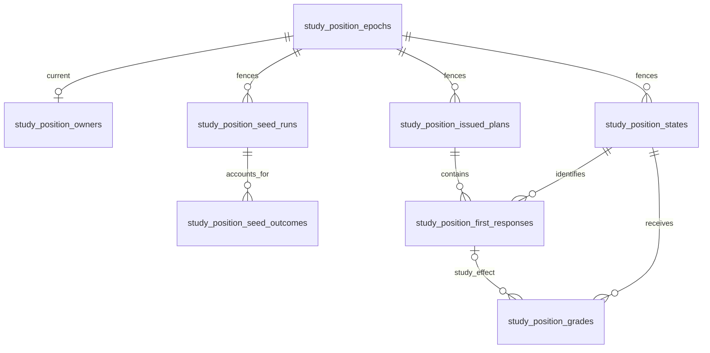

# Study position storage

Migration [057](../../ddl/migrations/057_position_study.sql) is additive in the
legacy serving PostgreSQL `public` schema. This is source schema, not evidence
of installation, seeding or activation. Study owns the writes in a borrowed
transaction; the existing role provisioner grants public-table privileges.

- `study_position_epochs`: `(repertoire_id, epoch)` identity, source digest and
  creation time; retained across owner changes.
- `study_position_owners`: one current epoch per repertoire; mode defaults to
  `inactive`, with shadow, staged, active and paused explicit. No seed turns it on.
- `study_position_states`: key `(repertoire_id, variant, position)` is exact
  canonical four-field FEN from the shared value owner. Expected UCI and policy
  version are separately fenced. `fsrs_json` is the complete native state and
  `fsrs_internal_card_id` is unique; version and UTC due support bounded reads.
  Donor card, revision, fingerprint and selection policy are all present or all
  absent, preserving restart-safe provenance without rewriting physical cards.
- `study_position_fsrs_id_seq`: a non-cycling positive reservation range
  2^52 through 2^53-1. It does not itself establish uniqueness against legacy
  FSRS IDs. Migration 57 installs a reject-only `cards` insert/update trigger:
  newly assigned integral JSON numeric IDs in this range fail, while a retained
  ID may keep the same identity across memory updates, but its card ID cannot
  change while that reserved FSRS ID remains; this prevents a paged inventory
  from missing a row moved behind its cursor. New or changed readable
  nonnumeric or fractional IDs fail closed; malformed blobs without a readable
  ID remain accepted. Existing rows are not rewritten. The seed owner must
  inspect all retained IDs, hold on malformed/unknown IDs and collision, and
  verify the installed guard through `position_fsrs_namespace.fence_namespace`
  in its borrowed transaction before allocation. The guard does not grade or
  change legacy state. An access-share table lock protects the verified trigger
  from concurrent DDL while allowing ordinary card writes.
- `study_position_seed_runs`: one run per repertoire/epoch, with original source
  token, authored digest, selection policy, immutable manifest digest/count and
  allocator preflight, plus checkpoint, seeded/held counts and completion time.
  A completed count is not a cutover certificate: F4 must check actual outcomes,
  source currentness, holds and introduction support.
- `study_position_seed_outcomes`: seeded or held outcome per manifest
  position. Seeded outcomes retain donor card/revision/blob fingerprint, selection
  policy, original and allocated FSRS IDs, initial clone fingerprint and original
  introduction time. The donor and new IDs must differ. A hold has a reason.
  Page writes atomically commit outcomes, new states and the checkpoint; retries
  compare original provenance without overwriting an already graded state.
  A completed inactive/shadow run may recover at most 100 newly eligible held
  positions per page under the original fences and allocator preflight. Its
  immutable operator response retains the full prior hold and donor provenance;
  seeded outcomes and existing states are never replaced. Canonical legacy
  introduction days remain evidence of introduction, with the aware adoption
  time used as a conservative Games eligibility lower bound. The response keeps
  the raw day and adopted bound; aware legacy introduction instants stay exact.
- `study_position_issued_plans`: one frozen plan per original attempt, storing
  original queue/card/revision, scope, source, issue day, digest and plan JSON
  including route and due witnesses. A unique original queue/card/revision fence
  prevents two attempts issuing the same original presentation; the scope/day/time
  index supports bounded clean-proof reads. Its identifier snapshots do not cascade
  when original sources change.
- `study_position_first_responses`: durable event and first attempt/decision
  identity, position scope, original payload/digest and observation/acceptance
  times; it can exist before terminal aggregate completion.
- `study_position_grades`: final accepted effect and digest, owner day, policy,
  source, complete before/after FSRS and versions. Human effects reference their
  exact first-response scope; Games Again instead keeps its original effect key
  and evidence, without inventing a human attempt. Unseen introduction is not a
  grade. A partial unique index enforces one Good per position and accepted Study
  day, across all epochs and policies; distinct genuine Again effects remain valid.

Issuance and receipt payloads are immutable by the owning adapters: identical
replay returns the original; a changed digest is a conflict. Composite foreign
keys reject cross-repertoire, variant and epoch receipt attachment. The schema
alone does not validate route authority, FEN legality, source currentness,
transaction locks or FSRS transitions; consumers must perform those checks.
No trigger grades or mutates legacy reviews. No ledger row is written for a
pending qualification. Deletion of retained position state is restricted by
receipt references, and originals are logical snapshots rather than cascading
foreign keys to editable legacy rows.

All `source_digest` columns in migration 57 mean the authoritative B1
`authored_token.authored_digest`. The full original snapshot digest is retained
in the plan or seed provenance JSON for history; it is not the currentness
fence after physical source changes.
