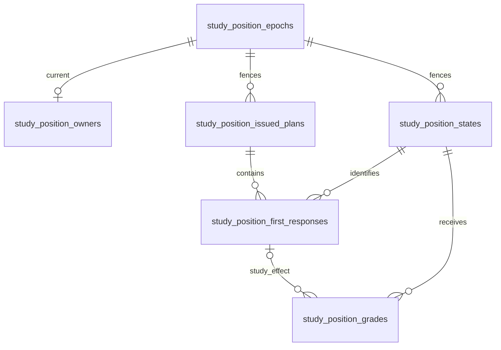

# Study position storage

Migration [057](../../ddl/migrations/057_position_study.sql) is additive in the
legacy serving PostgreSQL `public` schema. This is source schema, not evidence
of installation, seeding or activation. Study owns the writes in a borrowed
transaction; the existing role provisioner grants public-table privileges.

- `study_position_epochs`: `(repertoire_id, epoch)` identity, source digest and
  creation time; retained across owner changes.
- `study_position_owners`: one current epoch per repertoire; mode defaults to
  `inactive`, with shadow, staged, active and paused explicit. No seed turns it on.
- `study_position_states`: key `(repertoire_id, variant, position)` is exact
  canonical four-field FEN from the shared value owner. Expected UCI and policy
  version are separately fenced. `fsrs_json` is the complete native state and
  `fsrs_internal_card_id` is unique; version and UTC due support bounded reads.
  Donor card, revision, fingerprint and selection policy are all present or all
  absent, preserving restart-safe provenance without rewriting physical cards.
- `study_position_issued_plans`: one frozen plan per original attempt, storing
  original queue/card/revision, scope, source, issue day, digest and plan JSON
  including route and due witnesses. Its identifier snapshots do not cascade
  when original sources change.
- `study_position_first_responses`: durable event and first attempt/decision
  identity, position scope, original payload/digest and observation/acceptance
  times; it can exist before terminal aggregate completion.
- `study_position_grades`: final accepted effect and digest, owner day, policy,
  source, complete before/after FSRS and versions. Human effects reference their
  exact first-response scope; Games Again instead keeps its original effect key
  and evidence, without inventing a human attempt. Unseen introduction is not a
  grade. A partial unique index enforces one Good per position and accepted Study
  day, across all epochs and policies; distinct genuine Again effects remain valid.

Issuance and receipt payloads are immutable by the owning adapters: identical
replay returns the original; a changed digest is a conflict. Composite foreign
keys reject cross-repertoire, variant and epoch receipt attachment. The schema
alone does not validate route authority, FEN legality, source currentness,
transaction locks or FSRS transitions; consumers must perform those checks.
No trigger grades or mutates legacy reviews. No ledger row is written for a
pending qualification. Deletion of retained position state is restricted by
receipt references, and originals are logical snapshots rather than cascading
foreign keys to editable legacy rows.
