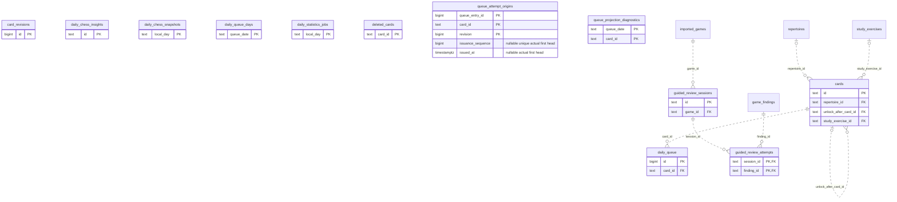

# Legacy backend: Study Queue Review (1)

Accepted cards/exercises, queue membership and presentation, teaching progress, review/attempt receipts and scheduling history.

**Current source schema, deployment unverified.** Owner: Legacy backend; SQL schema `public`. Derived from checked-in DDL at the `14ad5754` baseline with file relocation only. No live database was queried. [Database index](../../README.md).

Charts show primary/foreign key columns; the dictionary lists **every stored field and its SQL type**. `PK` means primary key (all marked fields form one composite key); `FK` means an enforced SQL foreign key. Parent `||`/`o|` means a required/optional parent; child `o{` means zero or more children and `o|` zero or one (a unique referencing tuple). Edges describe allowed SQL cardinality, not an obligation to create children. Nullable components of a composite FK can leave the tuple unlinked under PostgreSQL MATCH SIMPLE. No edge is inferred from a similar field name.

Referenced tables outside this view: `public.game_findings`, `public.imported_games`, `public.repertoires`, `public.study_exercises`. Follow the [schema index](../README.md) for their full definitions.

## Data dictionary

### `public.card_revisions`

Primary key: (`id`). DDL: [001_initial.sql](../../ddl/migrations/001_initial.sql).

| Field | SQL type | Null allowed | Keys |
| --- | --- | --- | --- |
| `id` | `bigint` | no | PK |
| `card_id` | `text` | no |  |
| `revision` | `bigint` | no |  |
| `start_fen` | `text` | no |  |
| `moves_json` | `text` | no |  |
| `history_mode` | `text` | no |  |
| `created_at` | `text` | no |  |

Unique tuples (including non-partial simple unique indexes): (`card_id`, `revision`).

### `public.cards`

Primary key: (`id`). DDL: [001_initial.sql](../../ddl/migrations/001_initial.sql), [035_canonical_publication_freshness.sql](../../ddl/migrations/035_canonical_publication_freshness.sql).

| Field | SQL type | Null allowed | Keys |
| --- | --- | --- | --- |
| `id` | `text` | no | PK |
| `repertoire_id` | `text` | yes | FK repertoire_id → public.repertoires(`id`) |
| `kind` | `text` | no |  |
| `start_fen` | `text` | no |  |
| `moves_json` | `text` | no |  |
| `state` | `text` | no |  |
| `due_date` | `text` | no |  |
| `interval_days` | `bigint` | no |  |
| `ease` | `double precision` | no |  |
| `repetitions` | `bigint` | no |  |
| `lapses` | `bigint` | no |  |
| `unlock_after_card_id` | `text` | yes | FK unlock_after_card_id → public.cards(`id`) |
| `fsrs_card_json` | `text` | yes |  |
| `first_correct_at` | `text` | yes |  |
| `reinforcement_pending` | `bigint` | no |  |
| `stability` | `double precision` | no |  |
| `guided_review` | `bigint` | no |  |
| `maximum_interval` | `bigint` | no |  |
| `content_type` | `text` | no |  |
| `scheduling_mode` | `text` | no |  |
| `hard_correct_streak` | `bigint` | no |  |
| `recent_attempts_json` | `text` | no |  |
| `archived` | `bigint` | no |  |
| `superseded_by` | `text` | yes |  |
| `source_ref` | `text` | yes |  |
| `source_fen` | `text` | yes |  |
| `revision` | `bigint` | no |  |
| `introduced_at` | `text` | yes |  |
| `trained_color` | `text` | yes |  |
| `pending_validation` | `bigint` | no |  |
| `prefix_split_rejected_after_review_id` | `bigint` | no |  |
| `study_exercise_id` | `text` | yes | FK study_exercise_id → public.study_exercises(`id`) |
| `canonical_route_source` | `bigint` | no |  |

Foreign key delete actions: (`repertoire_id`) CASCADE, (`unlock_after_card_id`) SET NULL, (`study_exercise_id`) NO ACTION.

### `public.daily_chess_insights`

Primary key: (`id`). DDL: [001_initial.sql](../../ddl/migrations/001_initial.sql).

| Field | SQL type | Null allowed | Keys |
| --- | --- | --- | --- |
| `id` | `text` | no | PK |
| `local_day` | `text` | no |  |
| `kind` | `text` | no |  |
| `evidence_json` | `text` | no |  |
| `status` | `text` | no |  |
| `created_at` | `text` | no |  |
| `updated_at` | `text` | no |  |

### `public.daily_chess_snapshots`

Primary key: (`local_day`). DDL: [001_initial.sql](../../ddl/migrations/001_initial.sql).

| Field | SQL type | Null allowed | Keys |
| --- | --- | --- | --- |
| `local_day` | `text` | no | PK |
| `snapshot_version` | `bigint` | no |  |
| `metrics_json` | `text` | no |  |
| `status` | `text` | no |  |
| `updated_at` | `text` | no |  |

### `public.daily_queue`

Primary key: (`id`). DDL: [001_initial.sql](../../ddl/migrations/001_initial.sql).

| Field | SQL type | Null allowed | Keys |
| --- | --- | --- | --- |
| `id` | `bigint` | no | PK |
| `queue_date` | `text` | no |  |
| `card_id` | `text` | no | FK card_id → public.cards(`id`) |
| `cycle` | `bigint` | no |  |
| `position` | `bigint` | no |  |
| `status` | `text` | no |  |
| `attempt_state` | `text` | no |  |
| `review_result_json` | `text` | yes |  |
| `attempt_failed` | `bigint` | no |  |
| `card_bucket` | `text` | yes |  |
| `admission_kind` | `text` | yes |  |
| `gameplay_priority_reason` | `text` | yes |  |
| `admission_repertoire_id` | `text` | yes |  |
| `admission_source` | `text` | yes |  |

Unique tuples (including non-partial simple unique indexes): (`queue_date`, `card_id`, `cycle`).

Foreign key delete actions: (`card_id`) CASCADE.

### `public.daily_queue_days`

Primary key: (`queue_date`). DDL: [001_initial.sql](../../ddl/migrations/001_initial.sql).

| Field | SQL type | Null allowed | Keys |
| --- | --- | --- | --- |
| `queue_date` | `text` | no | PK |
| `seed` | `bigint` | no |  |
| `membership_hash` | `text` | no |  |
| `generated_at` | `text` | no |  |

### `public.daily_statistics_jobs`

Primary key: (`local_day`). DDL: [001_initial.sql](../../ddl/migrations/001_initial.sql).

| Field | SQL type | Null allowed | Keys |
| --- | --- | --- | --- |
| `local_day` | `text` | no | PK |
| `status` | `text` | no |  |
| `last_error` | `text` | yes |  |
| `updated_at` | `text` | no |  |

### `public.deleted_cards`

Primary key: (`card_id`). DDL: [037_card_deletion.sql](../../ddl/migrations/037_card_deletion.sql).

| Field | SQL type | Null allowed | Keys |
| --- | --- | --- | --- |
| `card_id` | `text` | no | PK |
| `deleted_at` | `text` | no |  |

### `public.guided_review_attempts`

Primary key: (`session_id`, `finding_id`). DDL: [001_initial.sql](../../ddl/migrations/001_initial.sql).

| Field | SQL type | Null allowed | Keys |
| --- | --- | --- | --- |
| `session_id` | `text` | no | PK; FK session_id → public.guided_review_sessions(`id`) |
| `finding_id` | `text` | no | PK; FK finding_id → public.game_findings(`id`) |
| `move_uci` | `text` | no |  |
| `correct` | `bigint` | no |  |
| `attempted_at` | `text` | no |  |

Foreign key delete actions: (`session_id`) CASCADE, (`finding_id`) CASCADE.

### `public.guided_review_sessions`

Primary key: (`id`). DDL: [001_initial.sql](../../ddl/migrations/001_initial.sql).

| Field | SQL type | Null allowed | Keys |
| --- | --- | --- | --- |
| `id` | `text` | no | PK |
| `game_id` | `text` | no | FK game_id → public.imported_games(`id`) |
| `analysis_version` | `bigint` | no |  |
| `finding_ids_json` | `text` | no |  |
| `current_index` | `bigint` | no |  |
| `status` | `text` | no |  |
| `created_at` | `text` | no |  |
| `updated_at` | `text` | no |  |

Foreign key delete actions: (`game_id`) CASCADE.

### `public.queue_attempt_origins`

Primary key: (`queue_entry_id`, `card_id`, `revision`). DDL: [032_queue_attempt_origins.sql](../../ddl/migrations/032_queue_attempt_origins.sql), [042_queue_attempt_issuance.sql](../../ddl/migrations/042_queue_attempt_issuance.sql), [055_study_attempt_issuance.sql](../../ddl/migrations/055_study_attempt_issuance.sql).

| Field | SQL type | Null allowed | Keys |
| --- | --- | --- | --- |
| `queue_entry_id` | `bigint` | no | PK |
| `card_id` | `text` | no | PK |
| `revision` | `bigint` | no | PK |
| `queue_date` | `text` | no |  |
| `cycle` | `bigint` | no |  |
| `admission_kind` | `text` | yes |  |
| `admission_repertoire_id` | `text` | yes |  |
| `attempt_failed` | `bigint` | no |  |
| `last_status` | `text` | no |  |
| `review_result_json` | `text` | yes |  |
| `legacy` | `bigint` | no |  |
| `start_fen` | `text` | no |  |
| `moves_json` | `text` | no |  |
| `trained_color` | `text` | yes |  |
| `content_type` | `text` | no |  |
| `issued_as_head` | `bigint` | no |  |
| `issuance_sequence` | `bigint` | yes | unique when present |
| `issued_at` | `timestamptz` | yes | indexed with sequence |

Actual issuance is stamped once by the existing Study head writer, after its
card/day/eligibility fences. Prefetch, reload and queue reconstruction cannot
increment it. The existing queue-entry/card/revision key identifies the attempt
generation; no second attempt ledger is introduced. One database contains this
single-user Study workspace, so the sequence and actual issuance count span its
clients, days and sessions. PostgreSQL sequence gaps are permitted: measured
determination-to-target ordinal counts committed origins after the original
determination, never sequence subtraction. An application fence and first
issuance share the short transaction-owned issuance lock. Legacy issued rows
with unknown generation/time remain usable for their genuine old attempt, but
cannot prove a post-reset remediation generation. DDL does not fabricate them.

### `public.queue_projection_diagnostics`

Primary key: (`queue_date`, `card_id`). DDL: [001_initial.sql](../../ddl/migrations/001_initial.sql).

| Field | SQL type | Null allowed | Keys |
| --- | --- | --- | --- |
| `queue_date` | `text` | no | PK |
| `card_id` | `text` | no | PK |
| `message` | `text` | no |  |
