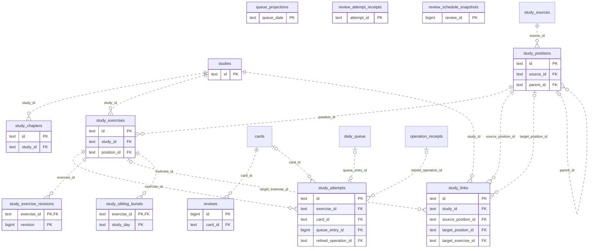

# Legacy backend: Study Queue Review (2)

Accepted cards/exercises, queue membership and presentation, teaching progress, review/attempt receipts and scheduling history.

**Current source schema, deployment unverified.** Owner: Legacy backend; SQL schema `public`. Derived from checked-in DDL at the `14ad5754` baseline with file relocation only. No live database was queried. [Database index](../../README.md).

Charts show primary/foreign key columns; the dictionary lists **every stored field and its SQL type**. `PK` means primary key (all marked fields form one composite key); `FK` means an enforced SQL foreign key. Parent `||`/`o|` means a required/optional parent; child `o{` means zero or more children and `o|` zero or one (a unique referencing tuple). Edges describe allowed SQL cardinality, not an obligation to create children. Nullable components of a composite FK can leave the tuple unlinked under PostgreSQL MATCH SIMPLE. No edge is inferred from a similar field name.

Referenced tables outside this view: `public.cards`, `public.daily_queue`, `public.operation_receipts`, `public.study_sources`. Follow the [schema index](../README.md) for their full definitions.

## Data dictionary

### `public.queue_projections`

Primary key: (`queue_date`). DDL: [001_initial.sql](../../ddl/migrations/001_initial.sql).

| Field | SQL type | Null allowed | Keys |
| --- | --- | --- | --- |
| `queue_date` | `text` | no | PK |
| `state` | `text` | no |  |
| `generation` | `bigint` | no |  |
| `updated_at` | `text` | yes |  |
| `refresh_pending` | `bigint` | no |  |
| `last_error` | `text` | yes |  |
| `blocked_count` | `bigint` | no |  |

### `public.review_attempt_receipts`

Primary key: (`attempt_id`). DDL: [016_phone_review_receipts.sql](../../ddl/migrations/016_phone_review_receipts.sql), [032_queue_attempt_origins.sql](../../ddl/migrations/032_queue_attempt_origins.sql).

| Field | SQL type | Null allowed | Keys |
| --- | --- | --- | --- |
| `attempt_id` | `text` | no | PK |
| `card_id` | `text` | no |  |
| `queue_entry_id` | `bigint` | yes |  |
| `outcome` | `text` | no |  |
| `guided` | `bigint` | no |  |
| `completed_at` | `text` | yes |  |
| `review_id` | `bigint` | yes |  |
| `scheduling_status` | `text` | no |  |
| `warning` | `text` | yes |  |
| `result_json` | `text` | no |  |
| `request_json` | `text` | yes |  |

### `public.review_schedule_snapshots`

Primary key: (`review_id`). DDL: [016_phone_review_receipts.sql](../../ddl/migrations/016_phone_review_receipts.sql).

| Field | SQL type | Null allowed | Keys |
| --- | --- | --- | --- |
| `review_id` | `bigint` | no | PK |
| `state_json` | `text` | no |  |

### `public.reviews`

Primary key: (`id`). DDL: [001_initial.sql](../../ddl/migrations/001_initial.sql).

| Field | SQL type | Null allowed | Keys |
| --- | --- | --- | --- |
| `id` | `bigint` | no | PK |
| `card_id` | `text` | no | FK card_id → public.cards(`id`) |
| `rating` | `text` | no |  |
| `reviewed_at` | `text` | no |  |
| `previous_interval` | `bigint` | no |  |
| `next_interval` | `bigint` | no |  |
| `internal_rating` | `text` | no |  |
| `guided` | `bigint` | no |  |
| `source_kind` | `text` | no |  |
| `source_ref` | `text` | yes |  |
| `invalidated_at` | `text` | yes |  |
| `invalidation_reason` | `text` | yes |  |

Foreign key delete actions: (`card_id`) CASCADE.

### `public.studies`

Primary key: (`id`). DDL: [001_initial.sql](../../ddl/migrations/001_initial.sql).

| Field | SQL type | Null allowed | Keys |
| --- | --- | --- | --- |
| `id` | `text` | no | PK |
| `title` | `text` | no |  |
| `description` | `text` | no |  |
| `source_json` | `text` | no |  |
| `archived` | `bigint` | no |  |
| `created_at` | `text` | no |  |
| `updated_at` | `text` | no |  |

### `public.study_attempts`

Primary key: (`id`). DDL: [001_initial.sql](../../ddl/migrations/001_initial.sql), [038_prefix_transition_application.sql](../../ddl/migrations/038_prefix_transition_application.sql).

| Field | SQL type | Null allowed | Keys |
| --- | --- | --- | --- |
| `id` | `text` | no | PK |
| `exercise_id` | `text` | no | FK exercise_id → public.study_exercises(`id`) |
| `revision` | `bigint` | no |  |
| `card_id` | `text` | yes | FK card_id → public.cards(`id`) |
| `queue_entry_id` | `bigint` | yes | FK queue_entry_id → public.daily_queue(`id`) |
| `cycle` | `bigint` | yes |  |
| `context` | `text` | no |  |
| `answer_json` | `text` | no |  |
| `answer_hash` | `text` | no |  |
| `assessment_json` | `text` | no |  |
| `assessment_method` | `text` | no |  |
| `grader_version` | `bigint` | no |  |
| `hint_seen` | `bigint` | no |  |
| `solution_seen_before_answer` | `bigint` | no |  |
| `started_at` | `text` | no |  |
| `committed_at` | `text` | no |  |
| `finalized_at` | `text` | yes |  |
| `result_json` | `text` | yes |  |
| `retired_operation_id` | `text` | yes | FK retired_operation_id → public.operation_receipts(`operation_id`) |

Unique tuples (including non-partial simple unique indexes): (`queue_entry_id`).

Foreign key delete actions: (`exercise_id`) NO ACTION, (`card_id`) NO ACTION, (`queue_entry_id`) NO ACTION, (`retired_operation_id`) NO ACTION.

### `public.study_chapters`

Primary key: (`id`). DDL: [001_initial.sql](../../ddl/migrations/001_initial.sql).

| Field | SQL type | Null allowed | Keys |
| --- | --- | --- | --- |
| `id` | `text` | no | PK |
| `study_id` | `text` | no | FK study_id → public.studies(`id`) |
| `title` | `text` | no |  |
| `description` | `text` | no |  |
| `position` | `bigint` | no |  |
| `archived` | `bigint` | no |  |

Unique tuples (including non-partial simple unique indexes): (`study_id`, `position`).

Foreign key delete actions: (`study_id`) NO ACTION.

### `public.study_exercise_revisions`

Primary key: (`exercise_id`, `revision`). DDL: [001_initial.sql](../../ddl/migrations/001_initial.sql).

| Field | SQL type | Null allowed | Keys |
| --- | --- | --- | --- |
| `exercise_id` | `text` | no | PK; FK exercise_id → public.study_exercises(`id`) |
| `revision` | `bigint` | no | PK |
| `specification_json` | `text` | no |  |
| `specification_hash` | `text` | no |  |
| `created_at` | `text` | no |  |

Foreign key delete actions: (`exercise_id`) NO ACTION.

### `public.study_exercises`

Primary key: (`id`). DDL: [001_initial.sql](../../ddl/migrations/001_initial.sql).

| Field | SQL type | Null allowed | Keys |
| --- | --- | --- | --- |
| `id` | `text` | no | PK |
| `study_id` | `text` | no | FK study_id → public.studies(`id`) |
| `position_id` | `text` | no | FK position_id → public.study_positions(`id`) |
| `current_revision` | `bigint` | no |  |
| `status` | `text` | no |  |
| `sibling_group` | `text` | yes |  |
| `source_json` | `text` | no |  |
| `point_value` | `double precision` | yes |  |
| `created_at` | `text` | no |  |
| `updated_at` | `text` | no |  |

Foreign key delete actions: (`study_id`) NO ACTION, (`position_id`) NO ACTION.

### `public.study_links`

Primary key: (`id`). DDL: [001_initial.sql](../../ddl/migrations/001_initial.sql).

| Field | SQL type | Null allowed | Keys |
| --- | --- | --- | --- |
| `id` | `text` | no | PK |
| `study_id` | `text` | no | FK study_id → public.studies(`id`) |
| `source_position_id` | `text` | no | FK source_position_id → public.study_positions(`id`) |
| `target_position_id` | `text` | yes | FK target_position_id → public.study_positions(`id`) |
| `target_exercise_id` | `text` | yes | FK target_exercise_id → public.study_exercises(`id`) |
| `relation` | `text` | no |  |

Foreign key delete actions: (`study_id`) NO ACTION, (`source_position_id`) NO ACTION, (`target_position_id`) NO ACTION, (`target_exercise_id`) NO ACTION.

### `public.study_positions`

Primary key: (`id`). DDL: [001_initial.sql](../../ddl/migrations/001_initial.sql).

| Field | SQL type | Null allowed | Keys |
| --- | --- | --- | --- |
| `id` | `text` | no | PK |
| `source_id` | `text` | no | FK source_id → public.study_sources(`id`) |
| `parent_id` | `text` | yes | FK parent_id → public.study_positions(`id`) |
| `child_index` | `bigint` | no |  |
| `move_uci` | `text` | yes |  |
| `fen` | `text` | no |  |
| `history_json` | `text` | no |  |
| `comment` | `text` | no |  |
| `starting_comment` | `text` | no |  |
| `nags_json` | `text` | no |  |
| `arrows_json` | `text` | no |  |
| `squares_json` | `text` | no |  |
| `node_path` | `text` | no |  |
| `valid` | `bigint` | no |  |

Unique tuples (including non-partial simple unique indexes): (`source_id`, `node_path`).

Foreign key delete actions: (`source_id`) NO ACTION, (`parent_id`) NO ACTION.

### `public.study_sibling_burials`

Primary key: (`exercise_id`, `study_day`). DDL: [001_initial.sql](../../ddl/migrations/001_initial.sql).

| Field | SQL type | Null allowed | Keys |
| --- | --- | --- | --- |
| `exercise_id` | `text` | no | PK; FK exercise_id → public.study_exercises(`id`) |
| `study_day` | `text` | no | PK |
| `reason` | `text` | no |  |

Foreign key delete actions: (`exercise_id`) NO ACTION.
