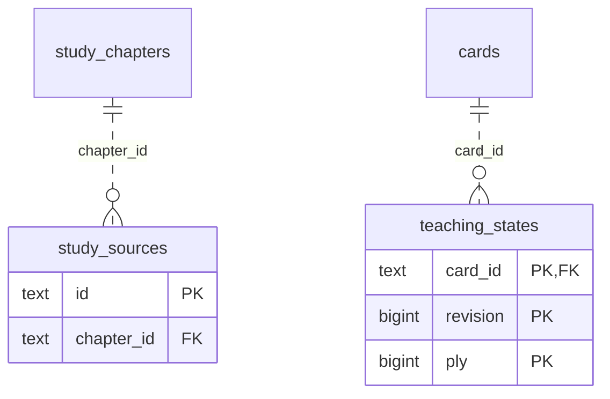

# Legacy backend: Study Queue Review (3)

Accepted cards/exercises, queue membership and presentation, teaching progress, review/attempt receipts and scheduling history.

**Current source schema, deployment unverified.** Owner: Legacy backend; SQL schema `public`. Derived from checked-in DDL at the `14ad5754` baseline with file relocation only. No live database was queried. [Database index](../../README.md).

Charts show primary/foreign key columns; the dictionary lists **every stored field and its SQL type**. `PK` means primary key (all marked fields form one composite key); `FK` means an enforced SQL foreign key. Parent `||`/`o|` means a required/optional parent; child `o{` means zero or more children and `o|` zero or one (a unique referencing tuple). Edges describe allowed SQL cardinality, not an obligation to create children. Nullable components of a composite FK can leave the tuple unlinked under PostgreSQL MATCH SIMPLE. No edge is inferred from a similar field name.

Referenced tables outside this view: `public.cards`, `public.study_chapters`. Follow the [schema index](../README.md) for their full definitions.

## Data dictionary

### `public.study_sources`

Primary key: (`id`). DDL: [001_initial.sql](../../ddl/migrations/001_initial.sql).

| Field | SQL type | Null allowed | Keys |
| --- | --- | --- | --- |
| `id` | `text` | no | PK |
| `chapter_id` | `text` | no | FK chapter_id → public.study_chapters(`id`) |
| `source_group_id` | `text` | no |  |
| `version` | `bigint` | no |  |
| `raw_pgn` | `text` | no |  |
| `sha256` | `text` | no |  |
| `filename` | `text` | no |  |
| `record_index` | `bigint` | no |  |
| `headers_json` | `text` | no |  |
| `diagnostics_json` | `text` | no |  |
| `valid` | `bigint` | no |  |
| `created_at` | `text` | no |  |

Unique tuples (including non-partial simple unique indexes): (`chapter_id`, `source_group_id`, `version`, `record_index`).

Foreign key delete actions: (`chapter_id`) NO ACTION.

### `public.teaching_states`

Primary key: (`card_id`, `revision`, `ply`). DDL: [001_initial.sql](../../ddl/migrations/001_initial.sql).

| Field | SQL type | Null allowed | Keys |
| --- | --- | --- | --- |
| `card_id` | `text` | no | PK; FK card_id → public.cards(`id`) |
| `revision` | `bigint` | no | PK |
| `ply` | `bigint` | no | PK |
| `taught_at` | `text` | no |  |

Foreign key delete actions: (`card_id`) CASCADE.
