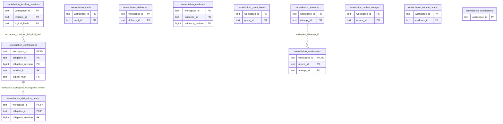

# Learning remediation: Remediation

Learning-owned delivery receipts, revisioned game-miss incidents/contributions, obligation heads, issuance and settlement facts.

**Current source schema, deployment unverified.** Owner: Learning remediation; SQL schema `learning`. Derived from checked-in DDL at the `14ad5754` baseline with file relocation only. No live database was queried. [Database index](../../README.md).

Charts show primary/foreign key columns; the dictionary lists **every stored field and its SQL type**. `PK` means primary key (all marked fields form one composite key); `FK` means an enforced SQL foreign key. Parent `||`/`o|` means a required/optional parent; child `o{` means zero or more children and `o|` zero or one (a unique referencing tuple). Edges describe allowed SQL cardinality, not an obligation to create children. Nullable components of a composite FK can leave the tuple unlinked under PostgreSQL MATCH SIMPLE. No edge is inferred from a similar field name.

## Data dictionary

### `learning.remediation_attempts`

Primary key: (`workspace_id`, `attempt_id`). DDL: [001_remediation.sql](../../ddl/migrations/001_remediation.sql).

| Field | SQL type | Null allowed | Keys |
| --- | --- | --- | --- |
| `workspace_id` | `text` | no | PK |
| `attempt_id` | `text` | no | PK |
| `card_id` | `text` | no |  |
| `card_revision` | `bigint` | no |  |
| `publication_id` | `text` | no |  |
| `publication_generation` | `bigint` | no |  |
| `issued_at` | `timestamptz` | no |  |
| `frontier_sequence` | `bigint` | no |  |

### `learning.remediation_cards`

Primary key: (`workspace_id`, `card_id`). DDL: [001_remediation.sql](../../ddl/migrations/001_remediation.sql).

| Field | SQL type | Null allowed | Keys |
| --- | --- | --- | --- |
| `workspace_id` | `text` | no | PK |
| `card_id` | `text` | no | PK |
| `sequence` | `bigint` | no |  |
| `work_state` | `text` | no |  |
| `reason` | `text` | yes |  |
| `queue_entry_id` | `bigint` | yes |  |

### `learning.remediation_contributions`

Primary key: (`workspace_id`, `obligation_id`, `obligation_revision`). DDL: [001_remediation.sql](../../ddl/migrations/001_remediation.sql).

| Field | SQL type | Null allowed | Keys |
| --- | --- | --- | --- |
| `workspace_id` | `text` | no | PK; FK workspace_id,incident_id,logical_hash → learning.remediation_incident_versions(`workspace_id`, `incident_id`, `logical_hash`) |
| `obligation_id` | `text` | no | PK |
| `obligation_revision` | `bigint` | no | PK |
| `evidence_id` | `text` | no |  |
| `evidence_revision` | `bigint` | no |  |
| `game_id` | `text` | no |  |
| `incident_id` | `text` | no | FK workspace_id,incident_id,logical_hash → learning.remediation_incident_versions(`workspace_id`, `incident_id`, `logical_hash`) |
| `logical_hash` | `text` | no | FK workspace_id,incident_id,logical_hash → learning.remediation_incident_versions(`workspace_id`, `incident_id`, `logical_hash`) |
| `card_id` | `text` | no |  |
| `card_revision` | `bigint` | no |  |
| `publication_id` | `text` | no |  |
| `publication_generation` | `bigint` | no |  |
| `kind` | `text` | no |  |
| `occurred_at` | `timestamptz` | yes |  |
| `payload_json` | `text` | no |  |
| `game_revision` | `bigint` | no |  |

Foreign key delete actions: (`workspace_id`, `incident_id`, `logical_hash`) NO ACTION.

### `learning.remediation_deliveries`

Primary key: (`workspace_id`, `delivery_id`). DDL: [001_remediation.sql](../../ddl/migrations/001_remediation.sql).

| Field | SQL type | Null allowed | Keys |
| --- | --- | --- | --- |
| `workspace_id` | `text` | no | PK |
| `delivery_id` | `text` | no | PK |
| `payload_hash` | `text` | no |  |
| `response_json` | `jsonb` | no |  |

### `learning.remediation_evidence`

Primary key: (`workspace_id`, `evidence_id`, `evidence_revision`). DDL: [001_remediation.sql](../../ddl/migrations/001_remediation.sql).

| Field | SQL type | Null allowed | Keys |
| --- | --- | --- | --- |
| `workspace_id` | `text` | no | PK |
| `evidence_id` | `text` | no | PK |
| `evidence_revision` | `bigint` | no | PK |
| `game_id` | `text` | no |  |
| `game_revision` | `bigint` | no |  |
| `payload_hash` | `text` | no |  |
| `learning_revision` | `bigint` | no |  |

### `learning.remediation_game_heads`

Primary key: (`workspace_id`, `game_id`). DDL: [001_remediation.sql](../../ddl/migrations/001_remediation.sql).

| Field | SQL type | Null allowed | Keys |
| --- | --- | --- | --- |
| `workspace_id` | `text` | no | PK |
| `game_id` | `text` | no | PK |
| `game_revision` | `bigint` | no |  |

### `learning.remediation_incident_versions`

Primary key: (`workspace_id`, `incident_id`, `logical_hash`). DDL: [001_remediation.sql](../../ddl/migrations/001_remediation.sql).

| Field | SQL type | Null allowed | Keys |
| --- | --- | --- | --- |
| `workspace_id` | `text` | no | PK |
| `incident_id` | `text` | no | PK |
| `logical_hash` | `text` | no | PK |
| `card_id` | `text` | no |  |
| `work_sequence` | `bigint` | no |  |
| `accepted_at` | `timestamptz` | no |  |

Unique tuples (including non-partial simple unique indexes): (`workspace_id`, `card_id`, `work_sequence`).

### `learning.remediation_obligation_heads`

Primary key: (`workspace_id`, `obligation_id`). DDL: [001_remediation.sql](../../ddl/migrations/001_remediation.sql).

| Field | SQL type | Null allowed | Keys |
| --- | --- | --- | --- |
| `workspace_id` | `text` | no | PK; FK workspace_id,obligation_id,obligation_revision → learning.remediation_contributions(`workspace_id`, `obligation_id`, `obligation_revision`) |
| `obligation_id` | `text` | no | PK; FK workspace_id,obligation_id,obligation_revision → learning.remediation_contributions(`workspace_id`, `obligation_id`, `obligation_revision`) |
| `obligation_revision` | `bigint` | no | FK workspace_id,obligation_id,obligation_revision → learning.remediation_contributions(`workspace_id`, `obligation_id`, `obligation_revision`) |
| `evidence_id` | `text` | no |  |
| `game_id` | `text` | no |  |
| `incident_id` | `text` | no |  |
| `card_id` | `text` | no |  |
| `active` | `boolean` | no |  |

Foreign key delete actions: (`workspace_id`, `obligation_id`, `obligation_revision`) NO ACTION.

### `learning.remediation_review_receipts`

Primary key: (`workspace_id`, `review_id`). DDL: [001_remediation.sql](../../ddl/migrations/001_remediation.sql).

| Field | SQL type | Null allowed | Keys |
| --- | --- | --- | --- |
| `workspace_id` | `text` | no | PK |
| `review_id` | `text` | no | PK |
| `payload_json` | `text` | no |  |
| `settled` | `boolean` | no |  |

### `learning.remediation_settlements`

Primary key: (`workspace_id`, `review_id`). DDL: [001_remediation.sql](../../ddl/migrations/001_remediation.sql).

| Field | SQL type | Null allowed | Keys |
| --- | --- | --- | --- |
| `workspace_id` | `text` | no | PK; FK workspace_id,attempt_id → learning.remediation_attempts(`workspace_id`, `attempt_id`) |
| `review_id` | `text` | no | PK |
| `attempt_id` | `text` | no | FK workspace_id,attempt_id → learning.remediation_attempts(`workspace_id`, `attempt_id`) |
| `card_id` | `text` | no |  |
| `reviewed_at` | `timestamptz` | no |  |
| `invalidated` | `boolean` | no |  |
| `invalidation_reason` | `text` | yes |  |

Foreign key delete actions: (`workspace_id`, `attempt_id`) NO ACTION.

### `learning.remediation_source_heads`

Primary key: (`workspace_id`, `evidence_id`). DDL: [001_remediation.sql](../../ddl/migrations/001_remediation.sql).

| Field | SQL type | Null allowed | Keys |
| --- | --- | --- | --- |
| `workspace_id` | `text` | no | PK |
| `evidence_id` | `text` | no | PK |
| `game_id` | `text` | no |  |
| `evidence_revision` | `bigint` | no |  |
| `game_revision` | `bigint` | no |  |

### `learning.remediation_workspaces`

Primary key: (`workspace_id`). DDL: [001_remediation.sql](../../ddl/migrations/001_remediation.sql).

| Field | SQL type | Null allowed | Keys |
| --- | --- | --- | --- |
| `workspace_id` | `text` | no | PK |
| `revision` | `bigint` | no |  |
