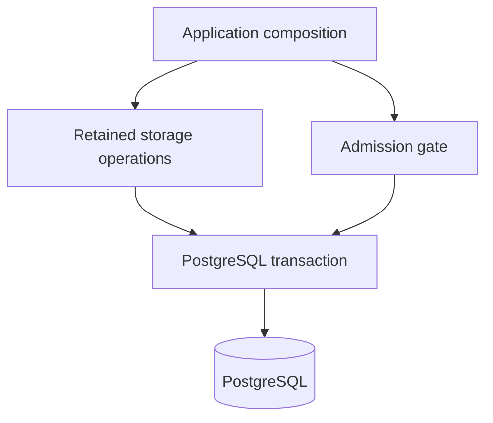

# PostgreSQL storage

This is the concrete storage owner for Study, Tactics, repertoire authoring and
basic Game Review. Retained queries use PostgreSQL syntax and psycopg `%s`
parameters directly. There is no runtime SQL translator, alternate database
implementation or generic repository interface.

`connections.py` borrows the existing process admission gate supplied during
application composition. `postgres.py` owns pools, row results and transaction
lifetime. Domain callers receive a concrete `PostgresConnection`; individual
storage operations do not decide when their caller's transaction commits.

Background acquisition, lock and transaction budgets remain bounded. Reader
transactions explicitly use PostgreSQL's read-only mode, including authoritative
reads that borrow the writer pool. Failures leave rollback to the pool's
transaction context. Storage imports no application orchestrator to run SQL.

## Borrowed next-exercise reads

`study/next_exercise_reads.py` returns detached original attempt IDs, admission
origin, applicable owner, position owner and prior attempt IDs using the caller's
borrowed connection. It opens no connection and commits no transaction. The
Study application prepares and revalidates the issuance under its existing owner
fences; these reads do not issue a plan or write learning state.

## Historical schema and retirement

The isolated `ddl/` boundary retains the original ordered migration history for
real upgrades. Keeping a historical table definition does not activate its old
runtime. Schema 050's original remediation SQL is preserved by checksum in
`ddl/historical/`; the migration runner no longer imports a retired distribution
to obtain it. Migration 064 records a paused disposition for pending retired commands,
tasks, deliveries and accepted feedback effects. It also records retained
generated presentations. Source rows, original identifiers, timestamps,
receipts, repertoire content and learning history remain unchanged.

`tempo_retired_work` is an inspection ledger for this one retirement. It is not
polled or consumed as a new task queue. Its `source_record` preserves the exact
row as it existed during the stopped-writer migration. Any later data disposal
or resumption needs a separate explicit decision.

The source expects schema 65, as defined in [`ddl/schema_version.py`](ddl/schema_version.py); the actual runtime schema has not been queried here. Applying migrations, validating the native
database and installing the branch are separate operator actions. Focused
connection-contract tests use an injected driver and do not establish native
PostgreSQL query, locking or migration correctness.
