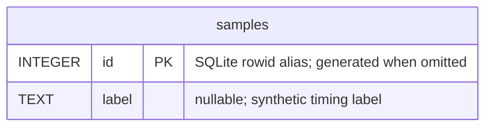

# Disposable database benchmarks

[Database proof index](../README.md). [`writer_latency.py`](writer_latency.py) is the existing SQLite foreground-writer contention benchmark, relocated byte-identically from `backend/benchmarks/`. [`benchmark-writer.mjs`](benchmark-writer.mjs) retains the entry point and `backend:database` import roots. The benchmark was **not executed** during this move; only guarded imports/discovery were checked.

This is synthetic tool storage, separate from the production schema. `TemporaryDirectory(prefix="tempo-writer-benchmark-")` owns `writer.sqlite3`; ordinary completion removes it. The benchmark retains its existing writer lifecycle, 16-worker contention sample, labels, output JSON and temporary-resource cleanup.

There are no foreign keys or relationships to Study data. The two fields above are the complete fixture DDL. Counts/latencies and phase diagnostics are written to the existing `test-results/performance/sqlite-writer-benchmark.json`, outside this transient table. No live database or actual benchmark ran for relocation.

[benchmark_storage_reads.py](../../tempo_legacy_database/tooling/benchmark_storage_reads.py) retains the existing in-process SQLite/PostgreSQL API-read rehearsal microbenchmark. It reads the supplied SQLite path and PostgreSQL reader-password file only when its benchmark main runs; it does not create a new schema. Routes, client counts, samples, credential handling and CSV/console output are unchanged. This relocation checked only source equivalence, compilation, JavaScript syntax and storage CLI `--help`; neither benchmark nor any database/API/password-file read ran. The root-derived `backend` and `database` import paths remain the same.
