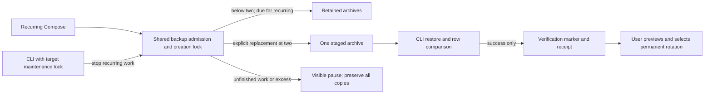

# CLI database operations

Fixed native operations used by Tempo's existing CLI composition live here. [`probes.mjs`](probes.mjs) owns the read-only ordered migration-ledger query and Redis PING commands. [`backup.mjs`](backup.mjs) owns the existing dump, archive-list verification, temporary restore database creation, single-transaction restore and restore database removal commands.

[`tempo-cli.mjs`](../../../scripts/tempo-cli.mjs) keeps diagnostic display and ledger/recovery classification. [`tempo-runtime.mjs`](../../../scripts/tempo-runtime.mjs) keeps lifecycle decisions, readiness deadline/retry policy, backup names/timestamps and journal updates between effects. Callers lend their existing Compose capability; these fixed operations add no scheduler, generic query/command interface or connection owner. Existing lifecycle ordering and restore comparison remain authoritative.

The only queried table is operational `tempo_schema_migrations(version)`, ordered ascending. Backup operations copy the existing PostgreSQL database without introducing tables, migrations, permission changes or runtime data transformations. Actual deployment, backup and live schema remain unverified by this mechanical move.

## Two-copy backup guard

**PROPOSED / source only**, [reviewed source](https://github.com/aaweaver-actuary/tempo/tree/b98610957928c3939b5fba4f50108f625d9b001d/database/tooling/cli),
based on release `20683bc0`; deployment unverified.
[`postgres-backup.sh`](postgres-backup.sh) now owns admission for both recurring
Compose and explicit CLI dumps. A shared directory lock serializes creation.
The CLI still stops recurring work before backup/restore verification. Recurring
creation pauses at two copies and skips archives younger than 24 hours, including
after container restart. There is no age-based or automatic permanent deletion.

Explicit maintenance may stage **one replacement** as `.dump.staged` when two
copies already exist. The CLI records its actual filename, restores it and runs
the existing row comparison before writing `.restore-verified` and a verified
receipt. Both original copies remain. This can temporarily occupy **three full
archive sizes**; further creation pauses until the user rotates back to two.
An unverified stage, any `.partial`, or more than two completed copies blocks
new creation with an explicit message. Interrupted work/locks are preserved for
inspection; do not remove an ownership lock until its writer is confirmed gone.

With the registered target's existing context/project/configuration options,
preview rotation without changing any backup:

```sh
docker compose <registered target options> run --rm --no-deps -T --entrypoint sh postgres-backup /opt/tempo/postgres-backup.sh preview
```

The preview lists exact archive names and recorded verification state, including
incomplete work. Historical archives without markers are **unrecorded**, not
assumed invalid or restore verified. Select permanent removal yourself, only
after checking the replacement and the operation/deployment/migration receipts
that may still name an archive. Remove only your explicitly selected archive
and its checksum/verification sidecars; keep two usable copies. A verified
`.staged` archive keeps its filename and counts as a retained copy after rotation,
so existing receipts stay valid. This guard does not repair existing excess,
clean up failed artifacts, prove free space, or replace a restore drill.



No Study schema, state writer or transaction changes. The shared filesystem lock
coordinates cooperating backup creation only; it does not fence arbitrary shell
writers. Policy/static tests: `node --test tests/runner/postgres-backup-retention.test.mjs`.
