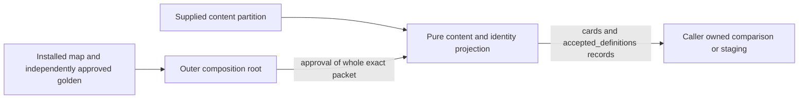

# Content and identity history projection (#267)

This leaf is **source-only preparation, unreleased for actual history**. It
implements the fixed content partition of the merged [#389 source ledger](../../../docs/architecture/study-first-reduction-2026-10-21/MIGRATION-MAP.md).
It does not establish an installed schema, capture completeness, a historical
identity map, an archive, an independently approved golden, target compatibility
or cutover permission. The source examples in that ledger remain examples.

The implementation-release checkpoint is exact installed-version,
authorized-snapshot-backed field and identity mapping plus an independently
approved golden before/after fixture. Real repeated-import, interruption and
original-authority replay evidence follows implementation and is still required
for final acceptance. The provided synthetic fixtures release no actual mapping.

## Public contract and boundaries

[`convert_content_identity(source, *, approval)`](../history_content_identity.py)
returns only `{"cards": [record, ...], "accepted_definitions": [record, ...]}`.
Each record has exactly the existing #388 `{"key": nonempty-string, "data": object}`
shape. An outer composition root concatenates disjoint leaf groups, rejects
duplicate keys, and assembles the eight-group #388 snapshot. It owns approved
authority binding and later import/transaction decisions. This leaf imports
only the Python standard library and calls only the explicitly injected approval
capability. It neither imports another converter nor reaches a service.



This is the implemented source boundary; actual-history release and target
persistence are unverified. A missing or failing approval produces a
`ContentIdentityError` and no output. There is no writer, connection, transaction,
replay, worker, lifecycle, alias resolver or permissive default in this module.
An absent converter can be omitted by composition without loading it; ordinary
Study imports none of this tooling.

`source` must contain exactly:

```json
{
  "schema_version": 1,
  "authority": {"opaque": "public receipt validated by composition"},
  "tables": {
    "cards": [{"key": "reviewer-supplied opaque original key", "row": {"id": "..."}}]
  },
  "unresolved": []
}
```

The abbreviated `tables` object above is illustrative, not a valid fixture.
Every table in `REQUIRED_TABLES` must be present explicitly as a list, including
empty lists. [The supplied source fixture](../../tests/fixtures/history_content_identity/source-synthetic.json)
shows the complete envelope. Omitting a table never establishes observed zero
rows. Schema version 1 identifies this packet, not an installed database version.
`authority` is opaque to this leaf. The required `approval(source)` callable
receives a deep copy of the **whole packet**, including original opaque keys and
all row values; only exact boolean `True` authorizes projection. The composition
root must bind this exact packet digest to the independently approved checkpoint;
an authority-only assertion is insufficient. Callback exceptions are rejected
without exposing private messages. Inputs, callback copies and outputs share no
mutable objects.

Rows are already the independently mapped **field partition** for this owner,
not arbitrary complete database rows. The exhaustive fixed `TABLES` catalog in
the implementation specifies `(group, complete original primary key, mapped
fields, cold fields)` using the merged ledger's source register L1, L24, L25,
L29, L33 and L35. It is not configurable at runtime. Input fields must match
their partition exactly; missing, unclassified, other-owner or target-only
fields fail. The caller must account for every captured source column when
building all partitions; successful projection alone cannot prove that work.

- `cards` contains the content fields from ledger section 1 plus
  `canonical_route_source`. Schedules and `introduced_at` belong to their separate
  owner partitions. Original card IDs, owner, executable revision and references
  are retained. Equal moves/FEN and graph projection pairs never create aliases.
- `repertoire_cards` preserves each membership separately from `cards.repertoire_id`.
  Integrity blocks retain every `(repertoire_id, card_id, issue_id)` row, including
  complete issue/generation/time facts cold. This projection does not collapse
  duplicate blocking pairs or create physical cards per membership.
- Accepted definitions retain the ledger's repertoire, authored Study, exercise
  revision, graph and endgame facts. Cold fields are under
  `data.cold.<original table>`; cold-only rows retain the complete declared row.
  Every row keeps its approved opaque key. No definition is regraded, regenerated
  or activated. Authoring notes, PGN, original revision and provenance remain
  inspectable. Candidate/graph/proposal cold retention does not establish accepted
  defense authority, serving compatibility, or a historical identity alias.
- Frozen-order rows are supplied by the reviews/schedules owner. Teaching rows
  are supplied by the server facts owner. Original source authority is supplied
  by the coordinator. This module neither invents nor takes over these facts.
- Nonempty `deleted_cards` is blocked: the source TEXT to target TIMESTAMPTZ
  round-trip remains unapproved. Target-only `serving_active`, `publication_id`
  and `publication_generation` are never manufactured from defaults. Existing
  target publication/binding/evidence state is outside this legacy partition and
  must be independently retained by its owner. Any needed serving adoption,
  timestamp conversion or unknown disposition must remain unresolved until its
  exact installed-version mapping is approved.

No original numeric ID, timestamp, FEN, TEXT JSON or null is coerced. JSONB/time
serialization must have been fixed by the approved source reader before this
packet is built. The reader `load_content_identity_source(path)` reads only a
supplied UTF-8 JSON file, rejects duplicate members/nonfinite numbers, and emits
fixed errors without paths or payload values. It cannot access an application,
database or browser. Duplicate supplied keys and complete source primary keys
are rejected; primary key types must match the fixed source partition and
original composite keys are compared as tuples, never joined with a guessed
delimiter. Ordering output by opaque key is deterministic.

## Synthetic owner proof

Run from the repository root:

```sh
python3 -m unittest discover -s database/tests -p test_history_content_identity.py -v
```

[`test_history_content_identity.py`](../../tests/test_history_content_identity.py)
loads the explicit [source](../../tests/fixtures/history_content_identity/source-synthetic.json)
and [expected](../../tests/fixtures/history_content_identity/expected-synthetic.json)
fixtures. It checks physical identity despite equal moves, shared memberships,
distinct integrity issues, original historical/accepted revisions, cold
provenance, lossless TEXT/null/numeric types, whole-packet approval, nonmutation,
repeated/reordered projection and fail-closed invalid/unresolved inputs.

Tests inject an explicitly fake `True` approval. Repeated pure projection is not
repeated target import, interruption, PostgreSQL durability, browser replay or
real-data acceptance. Those proofs belong to their later approved writer and
rehearsal boundaries. No actual observed records or snapshots are in these files.
