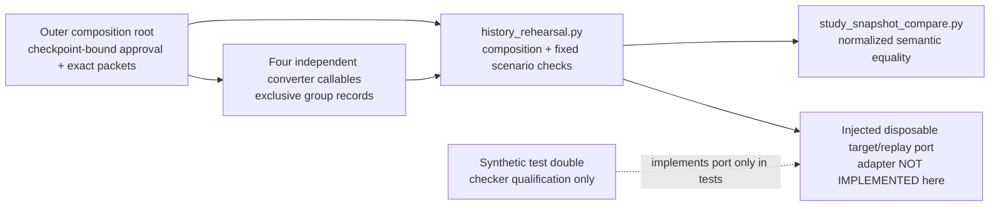

# History rehearsal checker

[#267](https://github.com/aaweaver-actuary/tempo/issues/267) owns actual history
preservation. [history_rehearsal.py](../history_rehearsal.py) prepares its bounded
composition and rehearsal checks. It has no database/browser implementation or
CLI. Importing it performs no operation. Existing
[normalized comparison](../study_snapshot_compare.py) is reused unchanged.

## Public boundaries

`convert_history_snapshot(golden=..., sources=..., converters=...,
approvals=...)` receives the four callables from the outer composition root.
Each callable implements `convert(source, *, approval)` and returns only its
owned groups. No converter imports another converter or this composition root.
The browser callable may be supplied by a caller-owned JavaScript adapter; no
subprocess or transport implementation is added here.

| Leaf | Required output groups |
| --- | --- |
| `content_identity` | `cards`, `accepted_definitions` |
| `reviews_schedules` | `reviews`, `schedules`, `introductions`, `accepted_definitions` |
| `server_receipts` | `queue_attempts`, `operation_receipts`, `introductions` |
| `browser_intents` | `browser_intents` |

The caller supplies an `approvals` callable per leaf. Each `approval(source)`
must return exactly `True` for its whole exact packet and bind it to its leaf
and #389 checkpoint. Synthetic tests use an explicit synthetic approval callable; this cannot release a real converter.
The outer root must independently approve the exact normalized `golden` against
the checkpoint. Its workspace is the sole source of output workspace identity;
the checker never infers or relabels it from a fingerprint. The assembled result
must equal that full golden. This validates supplied semantics and cannot
authenticate the golden by itself.

Shared groups concatenate records and the existing comparator rejects duplicate
keys. No key collision is overwritten, aliased, or resolved by this checker.
Missing leaves fail combined qualification before any leaf runs. Individual
leaves and ordinary Study have no dependency on this checker.

`rehearse_history(...)` accepts a caller-owned `DisposableHistoryTargets` port,
the exact import payload and independent normalized goldens for initial,
imported, replayed and every reviewed interruption checkpoint. The target owner
implements the small `DisposableHistoryTarget` protocol:

- `snapshot()` reads durable normalized state through an independent connection.
- `import_history(payload, stop_at=None)` reports `complete`, `interrupted`, or
  `conflict`; a conflict must leave all state unchanged.
- `replay_pending()` reports `complete` or `blocked`. Original authority and
  request identity remain the replay owner's responsibility; an acknowledgement
  cannot substitute for durable final completion.
- `close()` releases that session. `open(..., fresh=False)` reconnects to the
  same target after interruption. `discard()` removes only that scenario's
  independently verified disposable resource.

The checker requires the target's `disposable` flag to be exactly `True` before
using it. The actual adapter must verify labels, endpoints, workspace, resource
ownership and authorization; the flag itself is not operational evidence. An
unverified target is closed and never imported into or discarded by the checker.



The checker controls test sequence and expected comparisons. The injected
adapter owns all writes, transaction/checkpoint semantics, replay, connections
and resource lifecycle. It adds no serving dependency, mutable shared domain
state, scheduling authority, queue writer or target schema. This is an
implemented source checker; actual adapter and deployment boundaries remain
unqualified.

## Checks and limits

The fixed sequence checks first and repeated import, first and repeated replay,
close/reopen at each supplied interruption checkpoint, resumed/repeated resumed
import, and repeated conflict rejection without overwrite. Every comparison
covers all eight normalized groups and retained nested facts. Goldens and JSON
payloads are validated before any target opens. Errors contain fixed check names
without record values or authority identifiers; the caller owns private logs.

The owning tests are
[test_history_rehearsal.py](../../tests/test_history_rehearsal.py). They reuse
the existing synthetic example in
[MIGRATION-MAP.md](../../../docs/architecture/study-first-reduction-2026-10-21/MIGRATION-MAP.md)
and exercise injected synthetic callables and an in-memory target double. The
negative cases detect duplicate retry effects, dropped reviews/pending work,
before-commit leakage, after-commit loss, ignored/overwriting conflicts,
authority rewriting and acknowledgement-only completion. These are checker
regressions, not actual PostgreSQL durability or browser replay evidence.

```sh
python3 -m unittest discover -s database/tests -p test_history_rehearsal.py -v
```

Serialize validation with the existing advisory
`/tmp/tempo-mac-validation-20261025.lock`, opened without truncation and never
unlinked. No new dependencies or services are needed for this focused test.

#389's implementation-release checkpoint requires exact installed-version,
authorized-snapshot-backed mapping and an independently approved golden
fixture. Replay/interruption evidence follows implementation and is mandatory
for final acceptance. Still missing here are a qualified actual target writer,
actual original-authority replay adapter, authorized snapshot/goldens and their
real disposable execution. A checker pass always reports
`real_data_acceptance: false` and `cutover_authorized: false`.
