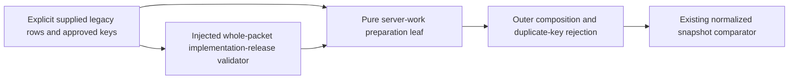

# Retained server work preparation (#267)

[`convert_server_receipts`](../history_server_receipts.py) is a pure, bounded
preparation leaf. It preserves supplied queue, saved-answer, attempt, teaching
and operation-receipt facts. It opens no database or browser, executes no command,
replays no answer, changes no receipt, and owns no transaction or queue writer.
It does not implement a target import adapter.

The existing [retained-history map](../../../docs/architecture/study-first-reduction-2026-10-21/MIGRATION-MAP.md)
remains the source ledger. The implementation reads its own explicit table
contract only; it neither imports another converter nor duplicates the existing
[`#388` snapshot comparator](../study_snapshot_compare.py). The source profile is
the legacy schema-50 DDL in the reviewed source at `1a0fd5c5`, including migrations
016/017/018/026/030/032/038/040/042 and the included remediation resource. This is
source preparation, not verification of installed bytes, live table completeness,
real history, or device authority.

## Public contract

```python
convert_server_receipts(source, *, approval) -> dict[str, list[dict]]
```

The source object contains exactly:

```json
{
  "schema_version": 1,
  "authority": {"opaque": "externally verified evidence"},
  "tables": {
    "daily_queue": [{"key": "reviewer-approved opaque identity", "row": {}}]
  },
  "unresolved": []
}
```

The abbreviated row above is intentionally invalid. Every name exported by
`TABLE_NAMES` must appear, including explicit captured empty arrays, and each row
must include exactly its declared columns with their original types and values.
The authority receipt binds installed version, workspace, original authority,
complete packet bytes and reviewer-supplied keys externally. The caller must
reject duplicate JSON member names when reading a file. No key is generated from
FEN, moves, row order or partial primary keys.

`approval` receives a detached copy of the **entire exact packet** and must return
literal `True`; truthy values fail. The outer composition supplies the reviewed
#389 checkpoint validator. A synthetic test fake does not release a real
converter. Exact installed-version mapping backed by an authorized snapshot and
independently approved golden fixture is the implementation-release checkpoint.
Actual interruption, repeated import and original-authority replay follow
implementation and remain mandatory for final acceptance and cutover.

Successful output contains only `queue_attempts`, `operation_receipts` and
`introductions` lists with exact `key`/`data` records for outer composition.
`introductions` contains only server `teaching_states`; the reviews/schedules
leaf owns the other introduction facts. Each table row remains under its table
name. Original TEXT JSON strings, timestamps, unknown/null request, integer flags,
boolean fields, answer hashes, revision, queue position, cycle, event sequence and
saved grading remain unchanged. Legacy receipt recovery columns remain under
`data.cold.operation_receipts`; they are evidence, never activated leases/tokens.
Queue origins retain `first_issued_provenance: "unknown"`: neither a backfilled
origin nor the issuance bit proves a first-issued timestamp.

Structural errors, duplicate supplied keys/complete PKs, queue identity conflicts
or any unresolved semantics raise `ServerReceiptError` before returning output.
Errors contain fixed codes and fixed table/field names, never observed values.
The caller must not convert an exception to a successful empty snapshot.

## Explicit remaining blockers

The current contract supplies no reviewed authority-transfer or terminal-work
disposition mechanism. Therefore these facts fail closed even when packet bytes
and keys were approved:

- Nonterminal server operation receipts, missing receipt payloads, outstanding
  transition fences and nonterminal transition applications require their
  original recovery owner. No receipt is completed or replayed here.
- Remediation rows require an explicit workspace/publication/embedded-authority
  transfer disposition. Workspace `legacy` is never relabelled.
- Gameplay priorities require an effective-priority disposition. Background
  tasks/events and discovery admission intents require their original owner's
  terminal disposition; no producer lease is adopted or work discarded.
- Failed/refreshing queue projections require the queue owner's reconciliation.
  A defense attempt without a queue identity cannot acquire an invented one.

Target-only Learning receipt/binding tables are outside this exact legacy input
profile; an unexpected table fails closed. They must be captured and independently
qualified by a separately released target extraction/import contract. No actual
snapshot, full backup/restore, PostgreSQL write/transaction proof, interruption
import, browser replay or final cutover was performed by this leaf.

## Boundary and local proof



The composition root owns approval wiring and group assembly. This module depends
only on Python's standard library; Study, Games, services and sibling converters
have no import or lifecycle relationship with it. Optional packet failure raises
within this call and cannot alter an unrelated component. No runtime schema,
storage ownership or serving lifecycle is changed.

Owning synthetic suite:

```sh
python3 -m unittest discover -s database/tests -p test_history_server_receipts.py -v
```

The fixture is explicitly synthetic. These tests establish parsing, preservation,
deterministic repeat conversion and rejection behavior only. They are not real
import/replay or actual-data acceptance.
