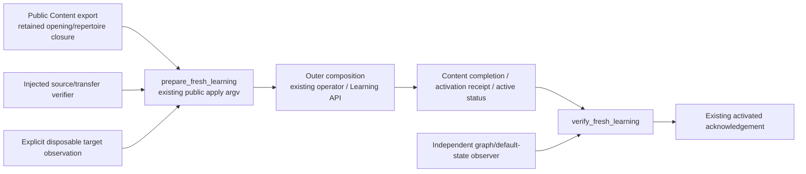

# Fresh opening graph in Learning

This source-only helper plans and checks a **fresh start** through the existing
Content publication and Learning activation boundaries. Only the retained opening
graph and its necessary repertoire/accepted-definition closure are inputs.
Historical reviews, schedules, queue state, jobs and old receipts are deliberately
excluded. They are not mapping, golden-fixture or backup prerequisites.

No live state is observed, reset or deleted here. There is no importer, database
adapter, network client, scheduler, duplicate source model or implicit workspace
selection. Actual target execution and independent storage observation belong to
the outer composition. The old history-preparation branch is separate work and
is not imported or required by this helper.

## Existing public route

1. The Content owner validates the existing `SourceSnapshot` v1 source and its
   complete opening/repertoire closure. Keep the immutable source recovery bundle
   independently: Learning's serving projection omits source route names,
   training-depth/split facts and repertoire titles. The current activation creates
   Learning repertoires with `name=id`; it does not restore original titles.
2. The supported Content CLI is
   `tempo-content publication export <publication_id> --generation <generation>`.
   It serializes the existing Content bridge export. The installed launcher may
   select its supported `tempo-a-content` wrapper explicitly.
3. The existing public operator is
   `tempo-a-bridge --content-cli <explicit-cli> --learning-origin <explicit-origin> --operator-token-file <explicit-file> apply <approved-operation-id>`.
   It owns delivery to Learning's `/internal/publications/v2/stage` and
   `/internal/publications/v2/activate`, followed by authoritative operation reads.
   No direct import of private `tempo_a_bridge.cli.execution_bundle` is allowed.
4. Initialize an explicitly selected fresh disposable Learning target through
   its existing owner command:
   `tempo-learning migrate --owner-url-file <explicit-owner-file> --workspace <explicit-workspace> --timezone <explicit-IANA-zone>`.
   This applies existing owner migrations and refuses to rebind an existing
   workspace. This helper does not run that command or provision credentials.

The helper plans that **complete existing CLI workflow**. It never requires an
emit-bundle method and never imports the private bridge serializer. The outer
composition runs the returned argv directly, without shell interpolation. The
existing operator owns V2 bundle construction, fresh due-date selection,
request checkpointing, retries and Content completion recording.

## Serialized contract

The Content bridge export has `schema_version:1`, `kind:'content_bridge_export'`,
`workspace_id`, `source` (source ID/key/digest/revision/inventory version),
`publication` (existing Content `Publication` v1), `publication_digest`, `complete`,
`provenance`, `routes`, `legacy_aliases`, `historical_mapping_unknown`,
`legal_replies`, and `export_digest`. Routes carry repertoire/route/policy IDs,
source keys and repertoire title, learner color, starting FEN, moves, bindings and
optional authority-start ply. Bindings carry ply/card/reentry and optional
exercise offset/decision identity. The Content owner validates these models and
chess legality; this helper does not reimplement them.

[`prepare_fresh_learning`][source] takes the public export, the approved existing
Content `operation_id`, explicit Content CLI/token-file paths, an explicit
Learning origin, an initial public Learning publication-status response, an
injected `verify_export` capability, and this exact target observation:

```text
{
  target_id: explicit_opaque_target_identity,
  workspace_id: explicit_workspace,
  timezone: explicit_effective_IANA_zone,
  disposable: true,
  initialized: true,
  empty_learning: true,
  observed_at: timezone_qualified_observation_time
}
```

`validate_fresh_target` validates this packet, not the actual database. Its
external observer must establish migrated workspace/settings metadata with no
existing content or learning activity. It must not infer emptiness from a new
workspace name, omitted tables or a caller's declaration. Both source export and
publication must name that same explicit workspace. No installed identity is
guessed and no live target is accepted by this disposable preparation boundary.

Initial public status must name that publication/workspace, be `unavailable` at
activation revision zero, have no staged accepted state and provide Learning's
explicit local date. The existing bridge operator selects that date for new
cards, derives `<approved-operation-id>:activate`, and durably checkpoints its
actual delivery. The helper does not choose a date or new operation identity.
The independent final effect observer must check the actual checkpoint/defaults
against the plan before claiming completion; a date or target change requires
reconciliation through the existing operator.

The existing bridge emits fresh opening facts with Learning's initial due date.
Unknown historical aliases are not a fresh-start gate; the adapted empty target
uses Content IDs and cannot adopt an old physical Learning object. Required
source/repertoire closure remains the Content/transfer owners' responsibility.

The plan returns the complete public `tempo-a-bridge ... apply <operation_id>`
argv, the expected existing activation request, and public receipt/status paths.
Composition alone runs the CLI. The bridge owns stage and activate POST bodies;
this helper neither reproduces its V2 bundler nor calls those endpoints.

`verify_fresh_learning` requires a completed Content operation result and
a **complete** `publication.activate.v2` operation receipt naming the same
workspace, operation and exact request. Its existing acknowledgement must be
`activated` at revision 1. Active status must bind the expected source digest,
publication digest, generation, a valid route digest and matching
accepted/serving bundle digest. Full route-digest/graph correspondence belongs to
the independent target observer, which receives both plan and public status. A queued operation, HTTP acknowledgement alone, stale generation or
foreign receipt is not completion.

The injected `verify_fresh_effects(plan, status)` must independently read the disposable
target and verify the complete accepted graph/membership/definition closure and
new default card state. Existing activation inserts state `new`, initial due date,
zero interval/repetitions/lapses/stability, null FSRS/introduced date and other
schema defaults; these are necessary new schedules. It also creates this new
activation's operation/activation receipts and one required `daily_queue` refresh
job. These new effects are allowed. No old schedules, reviews, attempts, queues,
receipts or background jobs are imported. Do this check before starting Study or
maintenance, which can legitimately issue further fresh work. Echoing source
expectations is not an independent target read.

## Source boundary

**Implemented pure tooling; actual source transfer, disposable execution and
usable-target qualification remain unverified.**



The helper imports only the standard library. Composition owns acquisition,
transport, service/credential lifecycle and actual mutation authority. The helper
never imports the transfer implementation, bridge internals or Learning runtime.

## Focused checks

```sh
python3.14 -m unittest discover -s database/tests -p test_opening_graph_fresh_learning.py -v
```

Fifteen pure tests cover explicit target identity, empty/disposable enforcement,
source/workspace/Learning-date binding, complete public apply argv, absent
historical gates, no adoption of old physical objects, exact completed receipt/status checks, independent new-default
verification, pending/conflict behavior and nonmutation. The test capabilities
are synthetic fakes and do not validate actual graph legality, CLI delivery,
PostgreSQL transactions or current live state. Do not run obsolete history suites
as a prerequisite to this fresh-start source slice.

[source]: ../opening_graph_fresh_learning.py
