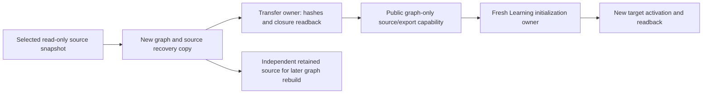

# Opening graph and source preservation

The current user scope is a fresh learning start while retaining the opening
graph, authoritative repertoire sources and a **new verified graph recovery
copy**. Old review/schedule/queue/browser/background migration acceptance is
superseded. This directory contains a source field contract, not a capture,
backup, importer, reset, deletion or deployment command. PR #442 is preserved
only as a superseded historical preparation reference.

[`closure.json`](closure.json) pins the existing immutable source evidence to
`86d11afe8579ac56b2a39d8d63984180c7f3c194`. It reuses the merged
[migration map's source ledger](../../../docs/architecture/study-first-reduction-2026-10-21/MIGRATION-MAP.md)
without reopening its history audit or migration release gates. Exact source
file SHA-256 and Git blob IDs are included for the bounded graph readers,
ordered DDL and existing hash/identity functions. No actual observed identities,
records or private evidence appear here.

## Exact capture surface

The executor captures **all rows and all columns**, without filters, from these
fourteen exact tables in source schema `public`:

```text
public.repertoires
public.repertoire_lines
public.repertoire_cards
public.cards
public.opening_graph_publications
public.opening_graph_steps
public.repertoire_line_training_depths
public.prefix_splits
public.settings
public.deleted_cards
public.canonical_prefix_previews
public.canonical_prefix_results
public.canonical_prefix_positions
public.opening_graph_legacy_mappings
```

The manifest gives literal `SELECT * FROM public.<table> ORDER BY <complete PK>`
queries. Capture all fourteen in one authorized `REPEATABLE READ READ ONLY`
snapshot. The lossless serialized transfer input is `{"tables": {<all fourteen
full-row arrays>}}`. Keep the executor's existing raw recovery encoding and bind
its exact bytes; no generic export subsystem is needed. Empty arrays are explicit
observations. Preserve all copied fields privately, including incidental old
card schedules and unrelated card types. Those fields create **no fresh-learning
migration requirement** and are not reimported as history.

The smallest behavioral field set, complete PKs and graph-relevant relationships
are separately enumerated in `closure.json`; capture is deliberately broader
than that projection. The full `opening_graph_steps` table retains original
published/staged identity. A composition adapter supplies the existing public
`{tables, graphs}` translator input, selecting `graphs` by each explicitly
selected repertoire's captured publication pointer. No raw graph duplication or
new graph application model is required.

Capture the complete authored repertoire/line catalogue so same-color, shared
prefixes cannot acquire artificial policy authority when another source route is
omitted. The executor supplies an explicit selected repertoire-ID list for the
published graph subset; no name, ID prefix or FEN heuristic chooses that list.

Use each captured `opening_graph_publications.generation` exactly. A larger
staged generation is old background work, not an accepted serving publication.
Preserve publication state honestly: copying `ready` bytes does not establish
new target readiness, and failed/missing publication is not repaired by choosing
another generation. Keep graph occurrence, source-line, physical-card and parent
references intact, including shared memberships. A route is the original
ordered line identity, not a position reached by transposition.

The pinned [`load_graph_input` and `build_graph`](https://github.com/aaweaver-actuary/tempo/blob/86d11afe8579ac56b2a39d8d63984180c7f3c194/backend/app/services/opening_graph.py)
and PostgreSQL [`prepare_next_graph_line`](https://github.com/aaweaver-actuary/tempo/blob/86d11afe8579ac56b2a39d8d63984180c7f3c194/backend/app/services/postgres_opening_graph.py)
read authored lines, training depths, `settings.initial_depth`, global split
overrides and the shortened/continuation card executables. Preserve explicit
zero/absence faithfully: this implementation uses a truthy depth override or the
default, so changing a zero into a different value changes rebuild behavior.
Deletion exclusions prevent a rebuilt graph from resurrecting removed nodes.
These are graph source dependencies, not old learning history.

[`canonical_prefix.line_origin`](https://github.com/aaweaver-actuary/tempo/blob/86d11afe8579ac56b2a39d8d63984180c7f3c194/backend/app/services/canonical_prefix.py)
uses active preview positions as verified origins for non-starting-position
sources. It requires a position's `source_revision` to match the repertoire's
current source revision. Keep stale values stale and missing origins missing;
equal FEN is insufficient permission to fabricate a route certificate.
Full previews/results/positions and graph mappings are conservatively copied
privately, but their old proposal workflows and historical aliases are not
activated. Segmentation recommendations, frozen ranks, task state and old
integrity certificates need no transfer for this fresh start. The new target
performs its own graph and route validation.

## Public interfaces and coverage

An outer composition root passes captured `tables` and `graphs` through the
existing public export/translation capability. The fresh graph-only path reuses
public `SourceSnapshot` v1, `authored_import` and `content_bridge_export`; it
creates no historical aliases and does not require old physical cards, revision
1, reviews or schedules. Each plugin accepts supplied serialized facts through
public contracts; no implementation imports another owner's private module.



This drawing describes the proposed composition. The manifest does not claim a
live copy, import, activation or rebuild was performed. Capture and import have
one owner each; ordinary Study does not depend on this tooling's lifecycle.

Line-only output cannot silently omit an independently authored card source.
The pinned source reader considers an unarchived opening card an effective
source for repertoire R when it has an explicit R membership with
`canonical_route_source=1`, or its original owner is R with card provenance 1
and **no explicit owner membership**. An explicit provenance-0 owner membership
suppresses that fallback. Report each original source card and its exact
accepted graph occurrence references. No occurrence means a card-only source
still needs a supported fresh source projection. An existing occurrence must
also have a valid same-owner line, exact executable/color and supported ordered
route coverage. Do not infer that association from matching move text/FEN.
Retain unresolved source definitions in the recovery copy and report the exact
missing capability; none of this restores the superseded history gates.

`SourceSnapshot`/Learning publication is a serving projection and omits some raw
names, depth, split and canonical-scope metadata. Keep the immutable raw recovery
bundle independently even after new source export and activation succeed. Empty
repertoires have no implied learner color; the supplied source contract or user
choice must resolve it before creating a policy.

## Hashes, snapshot criteria and next executable slice

The existing [source/graph fingerprint functions](https://github.com/aaweaver-actuary/tempo/blob/86d11afe8579ac56b2a39d8d63984180c7f3c194/contracts/game-evidence/src/tempo_game_evidence_contracts/legacy.py)
and ordered catalogue hash expression are referenced in `closure.json`; they
already exclude schedules and reviews. Their selected semantic projections do
not replace SHA-256 of the **exact raw recovery-file bytes**. TEXT JSON, FEN,
timestamps, nulls and numeric types stay lossless in that raw copy. Preserve
observed physical IDs; the existing card-ID hash is not an identity alias rule.

The sole live capture executor is `01a17488-745e-77dc-9bcd-49635df730ed`. Its next
bounded action is an authorized single read-only consistent snapshot of these
fourteen full tables, using the existing
immutable source pin. It records these tables’ columns/PK/type compatibility,
explicit repertoire scope, publication/source/prefix tokens, capture identity,
exact-byte hashes and the new graph recovery location in a separate private
receipt. No full migration census, browser inventory, old-history backup, old
background replay or old integrity certificate is a prerequisite. A mismatched
selected column shape or inconsistent closure is reported without guessing.

The transfer owner can now validate supplied full-table arrays against this fixed source include list,
required graph fields, PK, reference and generation contract, bind exact raw/source/export hashes, and
verify independent recovery readback through injected public interfaces. It
must not use `opening_graph_recovery.capture_evidence` as a verified graph export:
that old maintenance helper is paged without a single consistent snapshot and
includes superseded history/task checks. The one-game legacy capture helper is
also not a complete opening-graph recovery copy.

The fresh initialization owner confirms target DB/service identity, workspace,
source key, source completeness, new due date and new publication generation/
digest, then validates staging, activation receipt and target readback. New
serving generation and learning state can be fresh while original source and
publication identity remain intact in the recovery copy. A raw copy checksum is
not proof of new serving readiness. No reset, deletion or cutover is executed by
this contract.

The first usability checks are publication-generation equality, graph-line owner
agreement, graph card/parent existence, shared memberships, source depth,
complete split references, retained deletion exclusions and active prefix origin
source revisions. Check all graph-relevant FK closure. This capsule is not a full
database restore: incidental non-opening `cards.study_exercise_id` references
may point outside it. Preserve those source rows privately and omit them from
fresh opening projection; do not add other-domain history tables merely to
recreate unrelated FK closure. A genuinely graph-relevant non-opening dependency
is reported explicitly.
