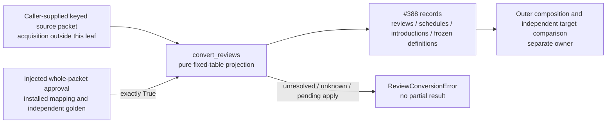

# Reviews and schedules history preparation (#267)

This pure leaf prepares the bounded source facts assigned to the
`reviews_schedules` checkpoint. It uses the [source-only field map][map] and
returns the existing [#388 comparison record shape][compare]. Discovery found
that the existing A-bridge `legacy_observation.comparison_snapshot` projects
physical content/routes for Game Evidence, without retained reviews, FSRS, quotas
or frozen-order facts. This leaf reuses the normalized comparator boundary and
adds only those missing assigned facts; it does not duplicate its exporter or
infer its content aliases. It does not read
or write a database, replay a review, run a scheduler, acquire a snapshot, approve
an identity or activate a target. The installed-version map and independently
approved golden fixture required by [#389][389] remain separate prerequisites.

## Public contract and ownership

[`convert_reviews(source, *, approval)`][source] consumes exactly:

```text
{
  schema_version: 1,
  authority: opaque nonempty authority receipt (object or string),
  tables: { fixed_table_name: [{ key: reviewer_supplied_opaque_string, row: complete_source_row }] },
  unresolved: []
}
```

`TABLE_COLUMNS` and `PRIMARY_KEYS` in the source declare the fixed 19-table
contract; every table must be present, including empty arrays. Unknown tables or
columns and missing columns require a reviewed contract change. This is a source
contract derived from the pinned map, not a claim about installed table bytes.
The caller must supply the complete retained row set. Local structural checks
cannot prove that acquisition included every real row.

The outer composition supplies `approval`, called once with a deep copy of the
complete packet; exactly `True` authorizes this projection. Its checkpoint must
bind the exact source authority, installed-version/serializer evidence, complete
rows and their opaque keys, identity/reference closure and independently reviewed
golden fixture. The leaf has no approval factory or bypass switch. The test stub
that returns `True` is synthetic preparation evidence only. Real callers must use
the coordinator's authority checkpoint. Approval is for source projection;
rehearsal, actual target reads, final acceptance and cutover remain separate.

The result contains only `reviews`, `schedules`, `introductions` and
`accepted_definitions`, each containing `{key, data}` records. Every key is
supplied by the approved packet; no alias, identity hash, review ID or decision
ID is inferred. Repeating the same approved input returns the same deep-copied
records, with stable key ordering. Arrays and source TEXT JSON stay in their
original order and spelling. Original timestamps, SQL nulls, integer flags and
Boolean settlements retain their types. This projection does not establish
import idempotency or real interruption/replay behavior.

| Source facts | Output and retained boundary |
| --- | --- |
| `reviews`, opening evidence observations/summaries/clean days, `remediation_settlements` | `reviews`: exact rows. Observations remain observations; saved aggregates are not recomputed. Invalidations and original retry-source identity survive. Cross-leaf attempt/exercise closure belongs to checkpoint approval. |
| `cards` scheduling columns | `schedules.cards`: all 16 mapped schedule/join fields, including FSRS and ordered recent-attempt TEXT. No scheduler invocation or prefix-to-decision redistribution. |
| `cards.introduced_at` | `introductions.cards`: original physical card ID and exact introduction date/null. This does not manufacture first issuance. |
| Other `cards` columns | Checked against the full source contract, projected by the separate content/identity owner. The outer composition must include that leaf; this output alone is not a complete card transfer. |
| Schedule seeds/snapshots and sibling burials | `schedules`: complete rows; original source cards, saved snapshot TEXT and local study-day facts remain distinct. |
| `settings` | `schedules.settings`: exact serving fields, with the explicit `tactics_new_per_day` to `tactic_new_per_day` rename. Remaining 15 source fields remain under `cold.settings`. `timezone='local'` blocks until an explicit installed effective-timezone contract is reviewed. |
| `tactic_progress` | `introductions`: keep clean-pass, admission and nullable card identity distinct. |
| Tactic introductions, pack activation and rotation | `introductions.cold`: exact source rows, retaining historical quota/selection facts. The checkpoint must resolve required serving compatibility; labeling a value cold does not waive active quota preservation. |
| Frozen ranks and activation | `accepted_definitions`: exact original ordinal, memberships/definition TEXT, fingerprints and activation epoch. No reranking. |
| Frozen runs | `accepted_definitions`: run ID/reader version plus every remaining field under `cold`. Previous-run closure is required. |
| Frozen queue changes | `accepted_definitions.cold`: complete original position/definition rows. Any nonempty `frozen_opening_pending` blocks conversion until the existing owner reconciles it. |
| Server `teaching_states` | Exclusively owned by the server-receipts leaf, which emits separate introductions records. This leaf rejects that table to avoid overlapping ownership. |

Outer composition concatenates disjoint leaf records and rejects duplicate keys;
it must not silently overwrite or merge records. This leaf imports only Python's
standard library. No Study, service, concrete database, exporter or sibling-leaf
implementation is imported. A rejected packet raises `ReviewConversionError`
without returning partial output; diagnostics report contract names, not captured
values or private keys. Original data remains the caller's property.

## Preparation boundary

**Implemented source; deployment and actual-history acceptance unverified.**



No arrow grants write, transaction, scheduler, settlement or cutover authority.
Cold output describes required preservation facts; it does not create an archive
or prove the independently read target archive exists. The separate converter
leaves remain optional to this pure tooling module and unrelated Study runtime.

## Focused proof

The fixtures are visibly synthetic, with no approved installed-version mapping.
They cover invalidated genuine reviews, exact FSRS/snapshot TEXT, explicit quota
rename, nullable clean-pass/admission, shared frozen memberships and old ordinals.
They are **not an independently approved real-data golden fixture**.

```sh
python3 -m unittest discover -s database/tests -p test_study_history_reviews.py -v
```

The suite also checks denied/missing/failed approval, complete packet binding,
missing/extra tables and fields, duplicate physical/source/key identity, local
reference closure, pending frozen apply, exact JSON value types, repeatability
and nonmutation. No database/browser capture or PostgreSQL import is exercised.
For source-only comparison retain the existing `test_study_snapshot_compare.py`;
do not call either suite real import, replay, interruption or cutover acceptance.

[source]: ../study_history_reviews.py
[compare]: ../study_snapshot_compare.py
[map]: ../../../docs/architecture/study-first-reduction-2026-10-21/MIGRATION-MAP.md
[389]: https://github.com/aaweaver-actuary/tempo/issues/389
