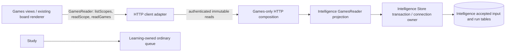

# Games-only viewing: dependency and failure boundary

Architecture acceptance is independent failure from Study, not a passing test count.
This document covers the restored viewing path only; it does not claim the whole
repository has been decoupled or that a live rollout has been qualified.

There is no Study-to-Games call, import, wait, transaction or shutdown edge in
this path. The existing optional Home launcher is only user navigation to a public
Workbench URL; it does not contact Games or gate Study availability. The optional
Workbench `Open Study` link is also user navigation, without opener access,
credentials, card identity transfer or an API call. This PR does not change either
navigation contract or import the legacy global GamesView into Study.

## Owners and semantic interfaces

- `GamesReader` in Workbench is a substitutable read capability with three typed
  methods. Both Games views receive this interface, not a concrete HTTP client,
  URL/schema request API, command store or provider. The existing HTTP client is
  its adapter. The existing renderer owns legal board replay; supplied accepted
  contexts remain the comparison authority. No comparison algorithm is copied.
- `games_api.py` is the read-only HTTP composition. It registers only health,
  bootstrap, scope listing, scope identity and game-page reads. Mutation, provider,
  report-progress and job routes are not registered. Authentication and workspace
  checks are outside the reader. Unsafe methods are additionally rejected before
  handlers; hiding UI controls is not the boundary.
- `games_reader.py` owns complete parameter-bound queries and cursor binding.
  It reads only `analysis_heads`, `analysis_runs`, `analysis_inputs` and
  `analysis_pages`. Scope selection has no engine-position aggregate. Pagination
  returns at most ten game payloads plus one lookahead; it does not fetch every
  accepted input page into Python. No import, analysis, provider or queue owner is
  called. The ordinary Analysis adapter delegates this same game read rather than
  maintaining a second implementation.
- Intelligence Store owns connections, transactions, role/workspace/migration
  validation and shutdown. The mode-specific startup contract accepts SELECT-only
  access to these four tables plus `instance` and `migration_history`; it does not
  require write or engine-table grants. Mutable startup keeps its original checks.
  No live grant or credential is created/changed. Games configuration needs only
  caller/read configuration, not operator, worker or provider credential files.

## Side effects, failure and shutdown

Reads use PostgreSQL read-only transactions, including internal calls that omit a
read flag. There are no automatic inputs, runs, analysis, Study requests or writes.
No worker or provider client starts. Failed read/auth/schema/identity checks return
unavailable/reconnect errors within Games; they do not repair or restart Study.
A missing scope stays missing. Frozen provenance is displayed explicitly; neither
current conformance nor historical recall is inferred beyond accepted evidence.

The shared Workbench composition still contains its ordinary Analysis controller
for mutable deployments. It selects Games mode immediately after bootstrap,
before pending-command recovery. Games views themselves do not import that
controller. The shared session/connection owner fences stale responses; Games
cleanup destroys only its board/view. Shared pure chess, validation and rendering
libraries are intentional dependencies, not service/worker lifecycle coupling.

The service lifespan owns only its connection pools and executor. Shutdown does
not call Study, Learning, Redis, deployment tooling or another service. Any future
practice influence must cross the Learning queue owner's semantic command
interface; no producer may write Learning queue/review/scheduling tables directly.
Study continues consuming its normal queue when the producer is unavailable.

## Resource boundary and deployment limit

Scope listing is one query capped at 100 rows. Accepted manifests bound identity
metadata to 1000 games. Game reads use one transaction with existing statement
1500ms, lock 250ms and transaction 3000ms bounds and configured pool maxima.
PostgreSQL may scan accepted pages for ordering, within the statement bound;
this is not a claim of an indexed/precomputed game projection. No Study locks or
schema are accessed. The reader never loads all page payloads into Python.

Shared PostgreSQL infrastructure and the host can still be resource dependencies.
A separate process alone does not prove operational failure isolation. Before
rollout, provision a separately bounded optional workload/connection budget that
cannot consume Study's allocation, verify effective limits, and verify shutdown
without Study changes. Those deployment/resource checks are explicitly unverified
here: no live process, role, grant, configuration or data is changed. Disposable
component checks support the source contracts but do not replace this acceptance
gate. Fresh current-repertoire comparison is a separate explicit follow-on
operation, never hidden read-side work.
