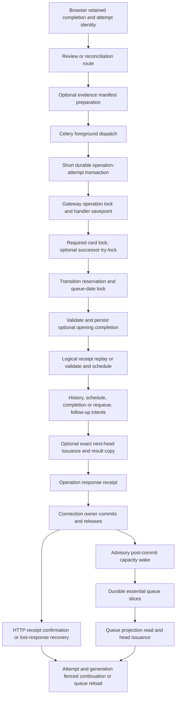

# Independent review and essential-queue architecture audit — #217

## Executive outcome and provenance

**Audited main:** `02b65f229aaccc91ae7c03fd11efc8f3aedd2883`, refreshed October 12, 2026. Live Docker labels identified deployed release `81cad1cb33817484db5d5ce2d80b3286d178d021`; this audit does not characterize that release as equivalent to main. Production source, existing PRs, CI settings, migrations, and live study services were not modified. Audit-only tools and documentation live on a separate remote audit branch.

**Confirmed:** Review and queue services still depend on the HTTP composition root. Receipt ownership is layered deliberately: operation receipts protect transport delivery; review-attempt receipts protect logical scheduling; retained queue origins protect presentation identity and issued authority. Evidence and optional continuation are inside the review transaction. Removing any layer is outside these extractions. [backend/app/review_commands.py:16–131](https://github.com/aaweaver-actuary/tempo/blob/02b65f229aaccc91ae7c03fd11efc8f3aedd2883/backend/app/review_commands.py#L16-L131) [backend/app/command_gateway.py:248–362](https://github.com/aaweaver-actuary/tempo/blob/02b65f229aaccc91ae7c03fd11efc8f3aedd2883/backend/app/command_gateway.py#L248-L362) [backend/app/queue_attempt_origins.py:74–120](https://github.com/aaweaver-actuary/tempo/blob/02b65f229aaccc91ae7c03fd11efc8f3aedd2883/backend/app/queue_attempt_origins.py#L74-L120)

**Recommendation:** Extract queue behavior without changing SQL/phase payloads, then move review orchestration behind the same owned connection. Treat #204's current five-capability scheduling port as a narrower, independently reviewable increment: its current B06 specification explicitly excludes wholesale `_apply_review` extraction. #217 must reconcile that scope before an implementation claims both goals. [docs/architecture/ci-isolation/issue-specs.md:117–133](https://github.com/aaweaver-actuary/tempo/blob/02b65f229aaccc91ae7c03fd11efc8f3aedd2883/docs/architecture/ci-isolation/issue-specs.md#L117-L133)

**Runtime evidence:** 154 existing focused Python cases passed; three native proof cohorts passed on fresh PostgreSQL 18.6 / Redis / Python 3.12 product images. They cover rollback, retained attempts, guidance revision locking, issuance contention, connection restart, generation replacement, and receipt replay. No full gate, real browser execution, process-recreation/backup restoration, saturation measurement, or performance improvement is claimed. Detailed commands/results appear below and in `evidence/`.

Labels used throughout: **Fact** means inspected code or executed evidence; **Inference** means a conclusion from those facts; **Hypothesis** means a risk requiring further proof. Proposals are future contracts, not implemented functionality.

## 1. Reproducible dependency and call inventories

Run `python3 docs/architecture/audit-217/analyze.py <output-directory>` without importing Tempo. It scans 183 application modules plus 59 Python scripts: 4,219 import records, 2,191 function definitions, 30,025 syntactic calls, and 2,011 SQL-literal mutation candidates. `inventory.json.gz` retains exact file/function/call/SQL locations and all transitive closures; `imports.dot` is the application import graph; `reverse-imports.md` lists all 16 direct composition-root imports. `state-writers.md` enumerates mutation candidates and migration sites by state category. Counts include deferred imports, constants, branches, fixture/maintenance scripts, and repeated imported symbols; they are not runtime module counts.

Static application closures for `main`, `review_commands`, and `postgres_queue_refresh` each reach 128 application modules. `main` participates in a syntax-level cycle with `canonical_prefix_api`, `study_routes`, and `services.study_attempts`. Deferred imports can break initialization order without restoring architectural dependency direction. Celery's string `include=['app.tasks']` is an additional runtime loader edge; handler registries and decorators are resolved in the trace below rather than mistaken for statically resolved direct function calls. [backend/app/celery_app.py:11–17](https://github.com/aaweaver-actuary/tempo/blob/02b65f229aaccc91ae7c03fd11efc8f3aedd2883/backend/app/celery_app.py#L11-L17) [backend/app/tasks.py:17–61](https://github.com/aaweaver-actuary/tempo/blob/02b65f229aaccc91ae7c03fd11efc8f3aedd2883/backend/app/tasks.py#L17-L61)

### Root-import classification

| Edge | Classification and consequence |
|---|---|
| `review_commands.submit_review → main._apply_review` | **A/B violation:** deferred import still loads HTTP composition and executes review logic there. [backend/app/review_commands.py:52–58](https://github.com/aaweaver-actuary/tempo/blob/02b65f229aaccc91ae7c03fd11efc8f3aedd2883/backend/app/review_commands.py#L52-L58) |
| Queue preparation/publication/slice → `main` | **A/B violation:** four deferred imports; exact consumed symbols listed in section 3. [backend/app/services/postgres_queue_refresh.py:357–427](https://github.com/aaweaver-actuary/tempo/blob/02b65f229aaccc91ae7c03fd11efc8f3aedd2883/backend/app/services/postgres_queue_refresh.py#L357-L427) [backend/app/services/postgres_queue_refresh.py:602–706](https://github.com/aaweaver-actuary/tempo/blob/02b65f229aaccc91ae7c03fd11efc8f3aedd2883/backend/app/services/postgres_queue_refresh.py#L602-L706) [backend/app/services/postgres_queue_refresh.py:798–1006](https://github.com/aaweaver-actuary/tempo/blob/02b65f229aaccc91ae7c03fd11efc8f3aedd2883/backend/app/services/postgres_queue_refresh.py#L798-L1006) |
| `study_attempts.finish_study_attempt → main.requeue` | **A/B violation:** authored Study grading also depends on HTTP-owned queue mutation. [backend/app/services/study_attempts.py:17–57](https://github.com/aaweaver-actuary/tempo/blob/02b65f229aaccc91ae7c03fd11efc8f3aedd2883/backend/app/services/study_attempts.py#L17-L57) |
| `opening_ranking_snapshot._project_snapshot → main._plan_prioritized_opening_admissions` | **A/B violation:** offline snapshot projection imports HTTP for a planner wrapper whose algorithm already lives in a pure module. [backend/app/services/opening_ranking_snapshot.py:168–187](https://github.com/aaweaver-actuary/tempo/blob/02b65f229aaccc91ae7c03fd11efc8f3aedd2883/backend/app/services/opening_ranking_snapshot.py#L168-L187) [backend/app/main.py:1196–1201](https://github.com/aaweaver-actuary/tempo/blob/02b65f229aaccc91ae7c03fd11efc8f3aedd2883/backend/app/main.py#L1196-L1201) |
| `background_worker → main.coordinator` | Legacy SQLite worker composition coupling; current PostgreSQL foreground/background processes load Celery instead. Keep historical compatibility distinct from production essential dependencies. [backend/app/background_worker.py:12–41](https://github.com/aaweaver-actuary/tempo/blob/02b65f229aaccc91ae7c03fd11efc8f3aedd2883/backend/app/background_worker.py#L12-L41) [backend/app/celery_app.py:15–33](https://github.com/aaweaver-actuary/tempo/blob/02b65f229aaccc91ae7c03fd11efc8f3aedd2883/backend/app/celery_app.py#L15-L33) |
| `canonical_prefix_api` (two sites), `study_routes._queue_refresh → main` | HTTP adapter-to-root coupling, not pure-domain imports; transitional root reuse still broadens initialization. [backend/app/canonical_prefix_api.py:102–131](https://github.com/aaweaver-actuary/tempo/blob/02b65f229aaccc91ae7c03fd11efc8f3aedd2883/backend/app/canonical_prefix_api.py#L102-L131) [backend/app/study_routes.py:86–98](https://github.com/aaweaver-actuary/tempo/blob/02b65f229aaccc91ae7c03fd11efc8f3aedd2883/backend/app/study_routes.py#L86-L98) |
| Dispatch/tasks/main/readiness → Celery root | **D:** adapter/composition dependencies are legitimate; readiness additionally enforces runtime workers. [backend/app/command_dispatch.py:15–41](https://github.com/aaweaver-actuary/tempo/blob/02b65f229aaccc91ae7c03fd11efc8f3aedd2883/backend/app/command_dispatch.py#L15-L41) [backend/app/postgres_readiness.py:36–50](https://github.com/aaweaver-actuary/tempo/blob/02b65f229aaccc91ae7c03fd11efc8f3aedd2883/backend/app/postgres_readiness.py#L36-L50) |
| `services.queue_refresh_wakeup → celery_app` | Explicit broker adapter placed under services; **D** for its publication responsibility, with **C** resource coupling. Inject this adapter at composition if enforcing a stricter package rule; do not remove durable recovery. [backend/app/services/queue_refresh_wakeup.py:36–72](https://github.com/aaweaver-actuary/tempo/blob/02b65f229aaccc91ae7c03fd11efc8f3aedd2883/backend/app/services/queue_refresh_wakeup.py#L36-L72) |

**Import side effects:** `main` constructs FastAPI, includes routers, registers routes and durable/maintenance handlers; review command modules register handlers; Celery constructs/configures its app; coordinator/database writer objects are allocated. These are registry/global-object mutations. They do **not** by themselves run FastAPI lifespan, initialize a database, start a writer thread, start the coordinator, or establish that external model services are contacted. Those actions have explicit runtime boundaries. [backend/app/main.py:195–250](https://github.com/aaweaver-actuary/tempo/blob/02b65f229aaccc91ae7c03fd11efc8f3aedd2883/backend/app/main.py#L195-L250) [backend/app/main.py:1789–1862](https://github.com/aaweaver-actuary/tempo/blob/02b65f229aaccc91ae7c03fd11efc8f3aedd2883/backend/app/main.py#L1789-L1862) [backend/app/review_commands.py:112–131](https://github.com/aaweaver-actuary/tempo/blob/02b65f229aaccc91ae7c03fd11efc8f3aedd2883/backend/app/review_commands.py#L112-L131) [backend/app/celery_app.py:11–57](https://github.com/aaweaver-actuary/tempo/blob/02b65f229aaccc91ae7c03fd11efc8f3aedd2883/backend/app/celery_app.py#L11-L57) [backend/app/services/game_sync_coordinator.py:422–445](https://github.com/aaweaver-actuary/tempo/blob/02b65f229aaccc91ae7c03fd11efc8f3aedd2883/backend/app/services/game_sync_coordinator.py#L422-L445) [backend/app/services/game_sync_coordinator.py:645–645](https://github.com/aaweaver-actuary/tempo/blob/02b65f229aaccc91ae7c03fd11efc8f3aedd2883/backend/app/services/game_sync_coordinator.py#L645-L645) [backend/app/services/database_executor.py:33–72](https://github.com/aaweaver-actuary/tempo/blob/02b65f229aaccc91ae7c03fd11efc8f3aedd2883/backend/app/services/database_executor.py#L33-L72) [backend/app/services/database_executor.py:225–225](https://github.com/aaweaver-actuary/tempo/blob/02b65f229aaccc91ae7c03fd11efc8f3aedd2883/backend/app/services/database_executor.py#L225-L225)

**Shared resources (C):** PostgreSQL pools, Redis admission/worker control, durable task/source epochs, queue-position reservations, and module registries couple otherwise distinct workflows. Moving Python files does not isolate these resources. [backend/app/postgres_store.py:204–284](https://github.com/aaweaver-actuary/tempo/blob/02b65f229aaccc91ae7c03fd11efc8f3aedd2883/backend/app/postgres_store.py#L204-L284) [backend/app/services/activity_gate.py:17–98](https://github.com/aaweaver-actuary/tempo/blob/02b65f229aaccc91ae7c03fd11efc8f3aedd2883/backend/app/services/activity_gate.py#L17-L98) [backend/app/services/refresh_requests.py:10–75](https://github.com/aaweaver-actuary/tempo/blob/02b65f229aaccc91ae7c03fd11efc8f3aedd2883/backend/app/services/refresh_requests.py#L10-L75)

## 2. Complete significant review trace



The following rows define the diagram's edges, transaction ownership, state, fences, and error behavior. References are pinned to the audit SHA.

| Operation / caller → callee | State and ownership | Fences / errors / recovery |
|---|---|---|
| Completion UI → outbox / `sendReview` | Retains original outcome, time, attempt, queue identity and optional evidence/next identity in browser storage before save. This is intent, not scheduling authority. [app/views/home_view.tsx:1303–1374](https://github.com/aaweaver-actuary/tempo/blob/02b65f229aaccc91ae7c03fd11efc8f3aedd2883/app/views/home_view.tsx#L1303-L1374) [app/lib/review-outbox.ts:220–298](https://github.com/aaweaver-actuary/tempo/blob/02b65f229aaccc91ae7c03fd11efc8f3aedd2883/app/lib/review-outbox.ts#L220-L298) | Original operation key `review-attempt:<attempt>`; reconciliation uses its own sequence key. Receipt-first retries preserve identity. Guided marker conflicts can defer to explicit guided review; marker success alone never confirms review. |
| HTTP `review` / `reconcile_review` → manifest preparation → dispatch | Routes select authoritative PG dispatch; evidence preparation reads presentation before the writer transaction. Reconcile requires original attempt and queue IDs. SQLite path remains direct compatible orchestration. [backend/app/main.py:2956–3006](https://github.com/aaweaver-actuary/tempo/blob/02b65f229aaccc91ae7c03fd11efc8f3aedd2883/backend/app/main.py#L2956-L3006) [backend/app/services/postgres_opening_evidence.py:24–56](https://github.com/aaweaver-actuary/tempo/blob/02b65f229aaccc91ae7c03fd11efc8f3aedd2883/backend/app/services/postgres_opening_evidence.py#L24-L56) | Evidence unavailable on SQLite is actionable; do not fabricate evidence. `ReviewRequest.durable_payload` omits absent new optional fields, preserving legacy hash. [backend/app/models.py:43–69](https://github.com/aaweaver-actuary/tempo/blob/02b65f229aaccc91ae7c03fd11efc8f3aedd2883/backend/app/models.py#L43-L69) |
| `dispatch_command → send_task → read_operation` | Redis/Celery delivers foreground work; PostgreSQL receipt is authoritative after result wait. HTTP owns no write transaction. [backend/app/command_dispatch.py:19–77](https://github.com/aaweaver-actuary/tempo/blob/02b65f229aaccc91ae7c03fd11efc8f3aedd2883/backend/app/command_dispatch.py#L19-L77) | Broker publication failure: 503/same key. Uncertain result-backend response still checks PG. Complete returns response; failed reconstructs error; pending returns 202/Location. Key reuse is a conflict. |
| `tasks._execute_foreground_command → record_operation_attempt` | Separate short transaction persists immutable source payload, attempt token/lease, retry-cycle counters. Foreground admission surrounds delivery. [backend/app/tasks.py:179–224](https://github.com/aaweaver-actuary/tempo/blob/02b65f229aaccc91ae7c03fd11efc8f3aedd2883/backend/app/tasks.py#L179-L224) [backend/app/command_gateway.py:82–142](https://github.com/aaweaver-actuary/tempo/blob/02b65f229aaccc91ae7c03fd11efc8f3aedd2883/backend/app/command_gateway.py#L82-L142) | Complete/failed delivery is not rerun; executing lease/retry cycle prevents stale attempt ownership. Ordinary execution errors become blocked unless the worker's explicit retryability rule applies; do not claim all database errors automatically retry. |
| `execute_command → _execute_command → registered handler` | Gateway acquires operation advisory lock and receipt row, creates `command_handler` savepoint. Handler receives the existing owned connection. [backend/app/command_gateway.py:229–310](https://github.com/aaweaver-actuary/tempo/blob/02b65f229aaccc91ae7c03fd11efc8f3aedd2883/backend/app/command_gateway.py#L229-L310) | Identity mismatch rejected before handler. Complete receipt returns original response. Stale attempt token returns no effect. Transient DB/admission exceptions escape; definitive handler failures roll back handler effects and persist failed operation receipt. [backend/app/command_gateway.py:310–362](https://github.com/aaweaver-actuary/tempo/blob/02b65f229aaccc91ae7c03fd11efc8f3aedd2883/backend/app/command_gateway.py#L310-L362) |
| `submit_review → _lock_review_cards → queue-date lock` | Required card edit advisory + card row; optional successor advisory try-lock + row `SKIP LOCKED`; lexically sorted card IDs. Then shared transition reservation + date advisory lock. [backend/app/review_commands.py:16–64](https://github.com/aaweaver-actuary/tempo/blob/02b65f229aaccc91ae7c03fd11efc8f3aedd2883/backend/app/review_commands.py#L16-L64) [backend/app/queue_position_lock.py:8–17](https://github.com/aaweaver-actuary/tempo/blob/02b65f229aaccc91ae7c03fd11efc8f3aedd2883/backend/app/queue_position_lock.py#L8-L17) | Busy/deleted/unavailable successor removes optional handoff; it must not block an otherwise valid review. Deleted required card conflicts. All locks are transaction-scoped. |
| `submit_review → persist_checkpoint` | Completion must bind same attempt/card/queue, complete terminal, revision, and prepared manifest. Persisted attempt/events/observations remain in the gateway transaction. [backend/app/review_commands.py:65–85](https://github.com/aaweaver-actuary/tempo/blob/02b65f229aaccc91ae7c03fd11efc8f3aedd2883/backend/app/review_commands.py#L65-L85) [backend/app/services/postgres_opening_evidence.py:152–282](https://github.com/aaweaver-actuary/tempo/blob/02b65f229aaccc91ae7c03fd11efc8f3aedd2883/backend/app/services/postgres_opening_evidence.py#L152-L282) | Immutable context/event/terminal identities and contiguous final sequence are required. Existing logical receipt requires matching complete evidence binding. Conflicts roll back uncommitted completion. |
| `_apply_review → receipt lookup` | Reads logical attempt before card availability/queue recovery; successful logical replay returns saved result. [backend/app/main.py:3021–3066](https://github.com/aaweaver-actuary/tempo/blob/02b65f229aaccc91ae7c03fd11efc8f3aedd2883/backend/app/main.py#L3021-L3066) | Original durable request and card/queue/outcome/guidance/time must match. Deletion tombstone check precedes replay; archived-card replay and permanent deletion are distinct contracts. |
| `_apply_review → validate card / origin` | Checks availability/archive/supersession, defense rubric requirement, repertoire integrity, queue row, revision, latest review, and retained provenance. [backend/app/main.py:3067–3109](https://github.com/aaweaver-actuary/tempo/blob/02b65f229aaccc91ae7c03fd11efc8f3aedd2883/backend/app/main.py#L3067-L3109) [backend/app/main.py:3153–3172](https://github.com/aaweaver-actuary/tempo/blob/02b65f229aaccc91ae7c03fd11efc8f3aedd2883/backend/app/main.py#L3153-L3172) [backend/app/queue_attempt_origins.py:74–95](https://github.com/aaweaver-actuary/tempo/blob/02b65f229aaccc91ae7c03fd11efc8f3aedd2883/backend/app/queue_attempt_origins.py#L74-L95) | Retained origin can recover deleted/blocked projection only with matching presentation. Queue ID alone does not authorize changed content. Completed/retired entries take replay/competing-review branches; no sample fallback. |
| `_apply_review → get_settings / completion clock` | Normalizes timezone-bearing recorded completion (rejects >5-minute future); study date derives from configured timezone when recorded. Settings reader opens a separate connection while review write connection is held. [backend/app/main.py:3021–3040](https://github.com/aaweaver-actuary/tempo/blob/02b65f229aaccc91ae7c03fd11efc8f3aedd2883/backend/app/main.py#L3021-L3040) [backend/app/main.py:3173–3184](https://github.com/aaweaver-actuary/tempo/blob/02b65f229aaccc91ae7c03fd11efc8f3aedd2883/backend/app/main.py#L3173-L3184) [backend/app/main.py:1002–1007](https://github.com/aaweaver-actuary/tempo/blob/02b65f229aaccc91ae7c03fd11efc8f3aedd2883/backend/app/main.py#L1002-L1007) | **Fact:** settings are not necessarily the same database snapshot as all review writes. **Hypothesis:** pool pressure / concurrent settings changes affect latency or consistency; not established by these checks. Preserve existing semantics during extraction. |
| Ordinary guided review → scheduling | Explicit guidance or queue failure forces `again`; persisted logical receipt retains original request identity. [backend/app/main.py:3208–3223](https://github.com/aaweaver-actuary/tempo/blob/02b65f229aaccc91ae7c03fd11efc8f3aedd2883/backend/app/main.py#L3208-L3223) | Guidance is tied to displayed revision. Stale marker cannot poison a replacement presentation. |
| `_apply_review → apply_scheduling_review → schedule_review / unlock_ready` | Existing transaction inserts history, updates FSRS/card state, incorporates valid-history and opening seed facts, clears satisfied miss priority, and unlocks legacy descendants. [backend/app/services/review_service.py:93–191](https://github.com/aaweaver-actuary/tempo/blob/02b65f229aaccc91ae7c03fd11efc8f3aedd2883/backend/app/services/review_service.py#L93-L191) [backend/app/services/scheduler.py:50–134](https://github.com/aaweaver-actuary/tempo/blob/02b65f229aaccc91ae7c03fd11efc8f3aedd2883/backend/app/services/scheduler.py#L50-L134) [backend/app/services/opening_progression.py:12–29](https://github.com/aaweaver-actuary/tempo/blob/02b65f229aaccc91ae7c03fd11efc8f3aedd2883/backend/app/services/opening_progression.py#L12-L29) | Source-kind/ref replay returns current-card scheduling response, distinct from frozen logical-attempt replay. No engine/model service participates in this computation. |
| `_apply_review → completion / requeue / snapshot / logical receipt` | Completes queue; marks tactic clean pass where eligible; allocates repeat cycle using current queue and retained origins; shifts positions; preserves mix metadata; saves schedule snapshot and request/result receipt. [backend/app/main.py:3224–3284](https://github.com/aaweaver-actuary/tempo/blob/02b65f229aaccc91ae7c03fd11efc8f3aedd2883/backend/app/main.py#L3224-L3284) [backend/app/main.py:2840–2884](https://github.com/aaweaver-actuary/tempo/blob/02b65f229aaccc91ae7c03fd11efc8f3aedd2883/backend/app/main.py#L2840-L2884) [backend/app/services/review_reconciliation.py:19–38](https://github.com/aaweaver-actuary/tempo/blob/02b65f229aaccc91ae7c03fd11efc8f3aedd2883/backend/app/services/review_reconciliation.py#L19-L38) | Origin/evidence triggers are additional writes in the same transaction. Receipt request retains original guidance/outcome even if scheduler grades `again`. |
| Competing or recovered review → `reconcile_completed_review` | Saved independent attempt may reconstruct chronological history from snapshots (up to 64 later reviews), retain computer fallback/near-term due date, or emit history-only status; stores its own logical receipt. [backend/app/main.py:3110–3152](https://github.com/aaweaver-actuary/tempo/blob/02b65f229aaccc91ae7c03fd11efc8f3aedd2883/backend/app/main.py#L3110-L3152) [backend/app/main.py:3185–3207](https://github.com/aaweaver-actuary/tempo/blob/02b65f229aaccc91ae7c03fd11efc8f3aedd2883/backend/app/main.py#L3185-L3207) [backend/app/services/review_reconciliation.py:89–181](https://github.com/aaweaver-actuary/tempo/blob/02b65f229aaccc91ae7c03fd11efc8f3aedd2883/backend/app/services/review_reconciliation.py#L89-L181) | It does not overwrite the original completed queue attempt's identity. Missing snapshot/time has explicit warning; changing presentation remains subject to outer validation. Replay is durable. |
| `reconcile_review → submit_review` | Nested `reconcile_review` savepoint fences evidence and review writes before converting a `ReviewConflict` into successful transport response `{persisted:false, conflict:...}`. [backend/app/review_commands.py:115–131](https://github.com/aaweaver-actuary/tempo/blob/02b65f229aaccc91ae7c03fd11efc8f3aedd2883/backend/app/review_commands.py#L115-L131) | Gateway's savepoint alone is insufficient when the handler catches the exception. The nested rollback must survive extraction. SQLite direct reconciliation remains separately characterized. |
| `_apply_review → progression / priority requests` | Opening review enqueues durable queue refresh preserving existing entry IDs; priority refresh requests and source epochs/jobs are written transactionally. Non-opening maturity requests queue refresh. [backend/app/main.py:3009–3019](https://github.com/aaweaver-actuary/tempo/blob/02b65f229aaccc91ae7c03fd11efc8f3aedd2883/backend/app/main.py#L3009-L3019) [backend/app/main.py:3285–3306](https://github.com/aaweaver-actuary/tempo/blob/02b65f229aaccc91ae7c03fd11efc8f3aedd2883/backend/app/main.py#L3285-L3306) [backend/app/services/introduction_priorities.py:745–790](https://github.com/aaweaver-actuary/tempo/blob/02b65f229aaccc91ae7c03fd11efc8f3aedd2883/backend/app/services/introduction_priorities.py#L745-L790) | Calculation is optional/deferred; publishing currently-required intent is part of atomic settlement. Source-version lookup itself can insert epoch state and acquire locks; it is not pure. [backend/app/services/refresh_requests.py:10–75](https://github.com/aaweaver-actuary/tempo/blob/02b65f229aaccc91ae7c03fd11efc8f3aedd2883/backend/app/services/refresh_requests.py#L10-L75) [backend/app/services/postgres_priority.py:47–65](https://github.com/aaweaver-actuary/tempo/blob/02b65f229aaccc91ae7c03fd11efc8f3aedd2883/backend/app/services/postgres_priority.py#L47-L65) |
| `submit_review → complete_review_evidence / continuation` | Binds evidence completion to review ID/result, optionally propagates validated parent color to a fresh repeat. Only a fresh logical save with successor lock may issue exact next head and replace logical receipt result JSON. [backend/app/review_commands.py:86–108](https://github.com/aaweaver-actuary/tempo/blob/02b65f229aaccc91ae7c03fd11efc8f3aedd2883/backend/app/review_commands.py#L86-L108) [backend/app/services/postgres_opening_evidence.py:417–423](https://github.com/aaweaver-actuary/tempo/blob/02b65f229aaccc91ae7c03fd11efc8f3aedd2883/backend/app/services/postgres_opening_evidence.py#L417-L423) | Continuation checks day, entry/card, cycle, revision, supported type, eligibility and current head; no independent continuation table. [backend/app/review_commands.py:35–49](https://github.com/aaweaver-actuary/tempo/blob/02b65f229aaccc91ae7c03fd11efc8f3aedd2883/backend/app/review_commands.py#L35-L49) [backend/app/queue_commands.py:93–118](https://github.com/aaweaver-actuary/tempo/blob/02b65f229aaccc91ae7c03fd11efc8f3aedd2883/backend/app/queue_commands.py#L93-L118) |
| Gateway completion → connection exit → wake | Operation `complete` response JSON is written before connection context commits. Outer `execute_command` wakes only after inner owner exits and only on successful result/requested follow-up. [backend/app/command_gateway.py:229–245](https://github.com/aaweaver-actuary/tempo/blob/02b65f229aaccc91ae7c03fd11efc8f3aedd2883/backend/app/command_gateway.py#L229-L245) [backend/app/command_gateway.py:353–362](https://github.com/aaweaver-actuary/tempo/blob/02b65f229aaccc91ae7c03fd11efc8f3aedd2883/backend/app/command_gateway.py#L353-L362) [backend/app/postgres_store.py:248–284](https://github.com/aaweaver-actuary/tempo/blob/02b65f229aaccc91ae7c03fd11efc8f3aedd2883/backend/app/postgres_store.py#L248-L284) | Handler/gateway never independently commits supplied connection. Wake failure logs pending durable recovery and cannot turn a committed save into failure. [backend/app/services/queue_refresh_wakeup.py:36–72](https://github.com/aaweaver-actuary/tempo/blob/02b65f229aaccc91ae7c03fd11efc8f3aedd2883/backend/app/services/queue_refresh_wakeup.py#L36-L72) |
| Recovery task → redispatch | Claims one expired/eligible operation under row lock, returns original source envelope, then publishes outside the DB connection. [backend/app/command_gateway.py:199–226](https://github.com/aaweaver-actuary/tempo/blob/02b65f229aaccc91ae7c03fd11efc8f3aedd2883/backend/app/command_gateway.py#L199-L226) [backend/app/tasks.py:276–296](https://github.com/aaweaver-actuary/tempo/blob/02b65f229aaccc91ae7c03fd11efc8f3aedd2883/backend/app/tasks.py#L276-L296) | Blocked receipt requires explicit retry-cycle action; failed original receipt stays authoritative while reconciliation uses a different operation identity. Lost response checks PG before resubmitting identical intent. |
| Confirmation → next card | Outbox requires `persisted:true`, matches returned continuation against originally prepared identity, and publishes settlement by logical attempt. UI fences attempt generation and progression controller; it may use exact authorized continuation or reload queue. [app/lib/review-outbox.ts:359–392](https://github.com/aaweaver-actuary/tempo/blob/02b65f229aaccc91ae7c03fd11efc8f3aedd2883/app/lib/review-outbox.ts#L359-L392) [app/lib/review-outbox.ts:435–469](https://github.com/aaweaver-actuary/tempo/blob/02b65f229aaccc91ae7c03fd11efc8f3aedd2883/app/lib/review-outbox.ts#L435-L469) [app/views/home_view.tsx:487–558](https://github.com/aaweaver-actuary/tempo/blob/02b65f229aaccc91ae7c03fd11efc8f3aedd2883/app/views/home_view.tsx#L487-L558) [app/lib/prepared-review-continuation.ts:19–53](https://github.com/aaweaver-actuary/tempo/blob/02b65f229aaccc91ae7c03fd11efc8f3aedd2883/app/lib/prepared-review-continuation.ts#L19-L53) | Late response cannot install an unrelated attempt. Offline, local conflicts, failure contexts, day mismatch and generation mismatch decline cached continuation. Browser execution was not rerun in this audit. |
| Queue read → head issuance | `_queue_payload` reads eligible projection, optional encounter/evidence presentation, closes read, then calls writer command for first head; window prefetch does not issue every card. [backend/app/main.py:1889–1910](https://github.com/aaweaver-actuary/tempo/blob/02b65f229aaccc91ae7c03fd11efc8f3aedd2883/backend/app/main.py#L1889-L1910) [backend/app/main.py:1913–2090](https://github.com/aaweaver-actuary/tempo/blob/02b65f229aaccc91ae7c03fd11efc8f3aedd2883/backend/app/main.py#L1913-L2090) | Despite its read-oriented name, it can cause persistent issuance. Pending/raced issuance produces actionable 503, not false availability. |

### Guided-game and specialized grading paths

Do not conflate `guided=True` ordinary study with guided game sessions. Guided game start locks game then existing session; attempt locks session, reconciles current finding publication, inserts unique finding attempt, advances session index, and returns revealed feedback. Those handlers do **not** call ordinary FSRS review orchestration. They use the same transport receipt/gateway transaction. [backend/app/main.py:6592–6630](https://github.com/aaweaver-actuary/tempo/blob/02b65f229aaccc91ae7c03fd11efc8f3aedd2883/backend/app/main.py#L6592-L6630) [backend/app/guided_review_commands.py:21–109](https://github.com/aaweaver-actuary/tempo/blob/02b65f229aaccc91ae7c03fd11efc8f3aedd2883/backend/app/guided_review_commands.py#L21-L109)

Authored Study finalization calls scheduling under source kind `study_exercise`, currently imports `main.requeue`, completes queue and stores Study attempt result, then buries sibling exposures. Defensive rubric completion is another scheduling caller with its own attempt/queue publication; ordinary `_apply_review` explicitly rejects defense cards. These are intentional policy-specific owners, not grounds to funnel all grading through one HTTP review method. [backend/app/services/study_attempts.py:17–96](https://github.com/aaweaver-actuary/tempo/blob/02b65f229aaccc91ae7c03fd11efc8f3aedd2883/backend/app/services/study_attempts.py#L17-L96) [backend/app/services/threat_training.py:559–614](https://github.com/aaweaver-actuary/tempo/blob/02b65f229aaccc91ae7c03fd11efc8f3aedd2883/backend/app/services/threat_training.py#L559-L614) [backend/app/main.py:3074–3076](https://github.com/aaweaver-actuary/tempo/blob/02b65f229aaccc91ae7c03fd11efc8f3aedd2883/backend/app/main.py#L3074-L3076)

## 3. PostgreSQL queue lifecycle and root dependencies


Each branch below prepares outside the publication transaction, then `execute_postgres_queue_refresh_slice` opens one background connection, locks task generation/lease/state, applies the phase, and advances the checkpoint in the same transaction. The initial claim uses its own short connection; retries, interruption and timeout backoff preserve durable phase/cursor. Stale generation or lease loses publication authority. [backend/app/tasks.py:299–319](https://github.com/aaweaver-actuary/tempo/blob/02b65f229aaccc91ae7c03fd11efc8f3aedd2883/backend/app/tasks.py#L299-L319) [backend/app/tasks.py:334–454](https://github.com/aaweaver-actuary/tempo/blob/02b65f229aaccc91ae7c03fd11efc8f3aedd2883/backend/app/tasks.py#L334-L454) [backend/app/services/durable_tasks.py:237–310](https://github.com/aaweaver-actuary/tempo/blob/02b65f229aaccc91ae7c03fd11efc8f3aedd2883/backend/app/services/durable_tasks.py#L237-L310) [backend/app/services/durable_tasks.py:361–407](https://github.com/aaweaver-actuary/tempo/blob/02b65f229aaccc91ae7c03fd11efc8f3aedd2883/backend/app/services/durable_tasks.py#L361-L407) [backend/app/services/postgres_queue_refresh.py:798–1006](https://github.com/aaweaver-actuary/tempo/blob/02b65f229aaccc91ae7c03fd11efc8f3aedd2883/backend/app/services/postgres_queue_refresh.py#L798-L1006)

| Phase / ownership | Operation, recheck and recovery | Essential / optional |
|---|---|---|
| Eligibility | `_unlock_eligible_opening_cards` with bounded sparse cursor; block invalid opening/defense entries; restore eligible due and published Study entries. Shared legacy-compatible SQL currently resides in main. [backend/app/main.py:1298–1490](https://github.com/aaweaver-actuary/tempo/blob/02b65f229aaccc91ae7c03fd11efc8f3aedd2883/backend/app/main.py#L1298-L1490) | Essential and retained in study-only. Some phase updates affect all matching rows; “one phase” is not “one row.” |
| Tactical introductions | Prepare one catalog candidate; publish/recheck quota and membership with queue-position locking. [backend/app/services/postgres_queue_refresh.py:110–237](https://github.com/aaweaver-actuary/tempo/blob/02b65f229aaccc91ae7c03fd11efc8f3aedd2883/backend/app/services/postgres_queue_refresh.py#L110-L237) | Essential phase, retained in study-only. No engine generation; uses already available catalog data. |
| Opening resets/reconciliation | Reset inconsistent introductions; prepare retained unseen context, lock card/recheck admission, retain origins through deletion; checkpoint processed IDs/counts. [backend/app/services/postgres_queue_refresh.py:239–324](https://github.com/aaweaver-actuary/tempo/blob/02b65f229aaccc91ae7c03fd11efc8f3aedd2883/backend/app/services/postgres_queue_refresh.py#L239-L324) [backend/app/services/postgres_queue_refresh.py:909–931](https://github.com/aaweaver-actuary/tempo/blob/02b65f229aaccc91ae7c03fd11efc8f3aedd2883/backend/app/services/postgres_queue_refresh.py#L909-L931) | Essential, retained in study-only. |
| Due admission | Read one candidate; card row before date-position lock; repeat eligibility SQL inside insertion. [backend/app/services/postgres_queue_refresh.py:325–355](https://github.com/aaweaver-actuary/tempo/blob/02b65f229aaccc91ae7c03fd11efc8f3aedd2883/backend/app/services/postgres_queue_refresh.py#L325-L355) | Essential; existing due work remains available in study-only. |
| Prioritized openings | Page candidate reads, read introduction consumption and limits, invoke existing pure frontier planner. #197 additionally proposes one extra decision frontier, then publication rechecks route/current limit/consumption/opportunity/miss. [backend/app/services/postgres_queue_refresh.py:357–427](https://github.com/aaweaver-actuary/tempo/blob/02b65f229aaccc91ae7c03fd11efc8f3aedd2883/backend/app/services/postgres_queue_refresh.py#L357-L427) [backend/app/services/postgres_queue_refresh.py:440–517](https://github.com/aaweaver-actuary/tempo/blob/02b65f229aaccc91ae7c03fd11efc8f3aedd2883/backend/app/services/postgres_queue_refresh.py#L440-L517) [backend/app/services/opening_capacity_frontier.py:22–102](https://github.com/aaweaver-actuary/tempo/blob/02b65f229aaccc91ae7c03fd11efc8f3aedd2883/backend/app/services/opening_capacity_frontier.py#L22-L102) | Optional new-opening selection; skipped in study-only. Current planning loops through all pages in one invocation, without a durable planning cursor. Reads close individually; total preparation remains unbounded by candidate count. |
| Authored Study admission | Enforces published exercise/study, burial exclusions, allowance; rechecks one card and quota under publication locks. [backend/app/services/postgres_queue_refresh.py:520–587](https://github.com/aaweaver-actuary/tempo/blob/02b65f229aaccc91ae7c03fd11efc8f3aedd2883/backend/app/services/postgres_queue_refresh.py#L520-L587) | Essential phase retained in study-only; separate Study daily allowance. |
| Real-game obligations | Prepare next existing obligation after cursor; promotion rechecks under card edit/row lock and preserves explicit/buried/existing-introduction rules. [backend/app/services/postgres_queue_refresh.py:589–600](https://github.com/aaweaver-actuary/tempo/blob/02b65f229aaccc91ae7c03fd11efc8f3aedd2883/backend/app/services/postgres_queue_refresh.py#L589-L600) [backend/app/services/real_game_feedback.py:65–122](https://github.com/aaweaver-actuary/tempo/blob/02b65f229aaccc91ae7c03fd11efc8f3aedd2883/backend/app/services/real_game_feedback.py#L65-L122) [backend/app/services/postgres_queue_refresh.py:960–968](https://github.com/aaweaver-actuary/tempo/blob/02b65f229aaccc91ae7c03fd11efc8f3aedd2883/backend/app/services/postgres_queue_refresh.py#L960-L968) | Optional phase skipped in study-only; ordinary scheduling still clears satisfied miss priority. |
| Ordering | Reads membership/history/saved seed, computes deterministic order outside write; date lock + membership hash recheck + queue-day row and position updates; mismatch replans phase. [backend/app/services/postgres_queue_refresh.py:602–706](https://github.com/aaweaver-actuary/tempo/blob/02b65f229aaccc91ae7c03fd11efc8f3aedd2883/backend/app/services/postgres_queue_refresh.py#L602-L706) [backend/app/main.py:1571–1668](https://github.com/aaweaver-actuary/tempo/blob/02b65f229aaccc91ae7c03fd11efc8f3aedd2883/backend/app/main.py#L1571-L1668) | Optional mixing skipped in study-only. Never remove position allocation or ordering preservation needed by foreground repeats. |
| Quarantine | Prepare bounded candidate batch; validate chess line after read closes; publish one malformed-card lock/block/diagnostic per item. [backend/app/services/postgres_queue_refresh.py:706–775](https://github.com/aaweaver-actuary/tempo/blob/02b65f229aaccc91ae7c03fd11efc8f3aedd2883/backend/app/services/postgres_queue_refresh.py#L706-L775) | Essential safety phase retained in study-only. Diagnostic is persisted, not synthetic success. |
| Projection publication | Prepare blocked count; lock current task; atomically write ready/generation/refresh flag, complete task, enqueue prefix-transition completion. [backend/app/services/postgres_queue_refresh.py:778–888](https://github.com/aaweaver-actuary/tempo/blob/02b65f229aaccc91ae7c03fd11efc8f3aedd2883/backend/app/services/postgres_queue_refresh.py#L778-L888) | Essential; interruption rolls back status/checkpoint together. |
| Head issuance | API read closes before writer command; only current matching head origin is stamped issued. [backend/app/main.py:1889–1910](https://github.com/aaweaver-actuary/tempo/blob/02b65f229aaccc91ae7c03fd11efc8f3aedd2883/backend/app/main.py#L1889-L1910) [backend/app/queue_commands.py:93–118](https://github.com/aaweaver-actuary/tempo/blob/02b65f229aaccc91ae7c03fd11efc8f3aedd2883/backend/app/queue_commands.py#L93-L118) | Essential foreground authorization, separate from prefetch/readiness. |

**All symbols consumed from main by PostgreSQL refresh:** `_ACTIVE_OPENING_MISS_SQL`, `MISS_REASON`, `_plan_prioritized_opening_admissions`; `_queue_membership_hash`, `_plan_daily_queue_order`; `_unlock_eligible_opening_cards`, `_reset_unintroduced_opening_cards`, `_reset_stale_opening_introductions`, `_block_ineligible_opening_queue_entries`, `_block_unapproved_defense_queue_entries`, `_restore_eligible_due_queue_entries`, `_restore_published_study_queue_entries`. Four deferred imports supply these, at lines 360, 605, 652, and 804. [backend/app/services/postgres_queue_refresh.py:357–427](https://github.com/aaweaver-actuary/tempo/blob/02b65f229aaccc91ae7c03fd11efc8f3aedd2883/backend/app/services/postgres_queue_refresh.py#L357-L427) [backend/app/services/postgres_queue_refresh.py:602–706](https://github.com/aaweaver-actuary/tempo/blob/02b65f229aaccc91ae7c03fd11efc8f3aedd2883/backend/app/services/postgres_queue_refresh.py#L602-L706) [backend/app/services/postgres_queue_refresh.py:798–1006](https://github.com/aaweaver-actuary/tempo/blob/02b65f229aaccc91ae7c03fd11efc8f3aedd2883/backend/app/services/postgres_queue_refresh.py#L798-L1006)

**Study-only contract:** skips opening planning/item checkpoints and real-game/randomization checkpoints, including already persisted old phase names; preserves essential phases and foreground reviews. It also restricts background work/command admission elsewhere. This is not permission to skip opening evidence completion, receipts, due eligibility, or queue issuance. [backend/app/services/postgres_queue_refresh.py:815–823](https://github.com/aaweaver-actuary/tempo/blob/02b65f229aaccc91ae7c03fd11efc8f3aedd2883/backend/app/services/postgres_queue_refresh.py#L815-L823) [backend/app/services/study_mode.py:1–30](https://github.com/aaweaver-actuary/tempo/blob/02b65f229aaccc91ae7c03fd11efc8f3aedd2883/backend/app/services/study_mode.py#L1-L30) [backend/app/tasks.py:191–207](https://github.com/aaweaver-actuary/tempo/blob/02b65f229aaccc91ae7c03fd11efc8f3aedd2883/backend/app/tasks.py#L191-L207)

## 4. State ownership matrix

The linked `state-writers.md` is the complete scanned candidate appendix, including initialization, maintenance/fixture code and migration mutations. Mutation through a supplied connection inherits the caller's transaction; the function name does not transfer commit ownership. Foreign-key cascades and origin/presentation triggers make queue/card edits additional state owners. Functions such as `_queue_payload`, `_priority_source_version`, and `finish_study_attempt` cannot be classified as pure from their names. [backend/app/main.py:2062–2069](https://github.com/aaweaver-actuary/tempo/blob/02b65f229aaccc91ae7c03fd11efc8f3aedd2883/backend/app/main.py#L2062-L2069) [backend/app/services/postgres_priority.py:47–65](https://github.com/aaweaver-actuary/tempo/blob/02b65f229aaccc91ae7c03fd11efc8f3aedd2883/backend/app/services/postgres_priority.py#L47-L65) [backend/app/services/study_attempts.py:17–96](https://github.com/aaweaver-actuary/tempo/blob/02b65f229aaccc91ae7c03fd11efc8f3aedd2883/backend/app/services/study_attempts.py#L17-L96)

| State | Significant application owners and secondary writers | Ownership assessment |
|---|---|---|
| Review history | `apply_scheduling_review`; `reconcile_completed_review`; invalidation/reset in card revision and prefix split; defensive rubric retirement; deletion cascades. [backend/app/services/review_service.py:93–191](https://github.com/aaweaver-actuary/tempo/blob/02b65f229aaccc91ae7c03fd11efc8f3aedd2883/backend/app/services/review_service.py#L93-L191) [backend/app/services/review_reconciliation.py:89–181](https://github.com/aaweaver-actuary/tempo/blob/02b65f229aaccc91ae7c03fd11efc8f3aedd2883/backend/app/services/review_reconciliation.py#L89-L181) [backend/app/card_commands.py:115–163](https://github.com/aaweaver-actuary/tempo/blob/02b65f229aaccc91ae7c03fd11efc8f3aedd2883/backend/app/card_commands.py#L115-L163) [backend/app/services/prefix_split.py:250–311](https://github.com/aaweaver-actuary/tempo/blob/02b65f229aaccc91ae7c03fd11efc8f3aedd2883/backend/app/services/prefix_split.py#L250-L311) [backend/app/services/threat_training.py:132–155](https://github.com/aaweaver-actuary/tempo/blob/02b65f229aaccc91ae7c03fd11efc8f3aedd2883/backend/app/services/threat_training.py#L132-L155) | Shared intentionally by evidence policy and maintenance; regular scheduling writer is not the sole history mutator. |
| FSRS state | Scheduling service, defense replay rebuild, reconciliation `_write_card_state`/fallback, card/prefix reset and inherited seed initialization; queue admission also changes `state`/`introduced_at` without scheduling. [backend/app/services/review_service.py:14–74](https://github.com/aaweaver-actuary/tempo/blob/02b65f229aaccc91ae7c03fd11efc8f3aedd2883/backend/app/services/review_service.py#L14-L74) [backend/app/services/review_service.py:93–191](https://github.com/aaweaver-actuary/tempo/blob/02b65f229aaccc91ae7c03fd11efc8f3aedd2883/backend/app/services/review_service.py#L93-L191) [backend/app/services/review_reconciliation.py:34–87](https://github.com/aaweaver-actuary/tempo/blob/02b65f229aaccc91ae7c03fd11efc8f3aedd2883/backend/app/services/review_reconciliation.py#L34-L87) [backend/app/services/review_reconciliation.py:153–174](https://github.com/aaweaver-actuary/tempo/blob/02b65f229aaccc91ae7c03fd11efc8f3aedd2883/backend/app/services/review_reconciliation.py#L153-L174) [backend/app/card_commands.py:139–158](https://github.com/aaweaver-actuary/tempo/blob/02b65f229aaccc91ae7c03fd11efc8f3aedd2883/backend/app/card_commands.py#L139-L158) [backend/app/services/postgres_queue_refresh.py:503–511](https://github.com/aaweaver-actuary/tempo/blob/02b65f229aaccc91ae7c03fd11efc8f3aedd2883/backend/app/services/postgres_queue_refresh.py#L503-L511) | Separate schedule versus eligibility fields; shared intentional policy, accidentally mixed HTTP placement. |
| Review-attempt receipts | `_apply_review` inserts/normalizes original request and recovered results; reconciliation inserts receipt; `submit_review` replaces result with authorized continuation. [backend/app/main.py:3110–3152](https://github.com/aaweaver-actuary/tempo/blob/02b65f229aaccc91ae7c03fd11efc8f3aedd2883/backend/app/main.py#L3110-L3152) [backend/app/main.py:3185–3207](https://github.com/aaweaver-actuary/tempo/blob/02b65f229aaccc91ae7c03fd11efc8f3aedd2883/backend/app/main.py#L3185-L3207) [backend/app/main.py:3266–3284](https://github.com/aaweaver-actuary/tempo/blob/02b65f229aaccc91ae7c03fd11efc8f3aedd2883/backend/app/main.py#L3266-L3284) [backend/app/services/review_reconciliation.py:175–181](https://github.com/aaweaver-actuary/tempo/blob/02b65f229aaccc91ae7c03fd11efc8f3aedd2883/backend/app/services/review_reconciliation.py#L175-L181) [backend/app/review_commands.py:103–108](https://github.com/aaweaver-actuary/tempo/blob/02b65f229aaccc91ae7c03fd11efc8f3aedd2883/backend/app/review_commands.py#L103-L108) | Shared intentionally within one atomic application boundary; gateway operation identity remains distinct. |
| Operation receipts | Gateway record/execute/retry/defer/recover; prefix-transition linked state; pending PGN discard also writes operation state. [backend/app/command_gateway.py:82–226](https://github.com/aaweaver-actuary/tempo/blob/02b65f229aaccc91ae7c03fd11efc8f3aedd2883/backend/app/command_gateway.py#L82-L226) [backend/app/command_gateway.py:248–362](https://github.com/aaweaver-actuary/tempo/blob/02b65f229aaccc91ae7c03fd11efc8f3aedd2883/backend/app/command_gateway.py#L248-L362) [backend/app/services/prefix_transition_application.py:250–330](https://github.com/aaweaver-actuary/tempo/blob/02b65f229aaccc91ae7c03fd11efc8f3aedd2883/backend/app/services/prefix_transition_application.py#L250-L330) [backend/app/pgn_import_commands.py:198–239](https://github.com/aaweaver-actuary/tempo/blob/02b65f229aaccc91ae7c03fd11efc8f3aedd2883/backend/app/pgn_import_commands.py#L198-L239) | Gateway is normal transaction owner; specialized long-operation lifecycle writes are explicit exceptions. Do not assert global single-writer ownership. |
| Daily queue entries | Review completion/requeue; queue commands; native refresh; real-game promotion; Study/defense grading; card/repertoire edits/deletion; graph publication, prefix split, discovery/exercise admission. Each exact direct candidate appears in appendix. [backend/app/main.py:2840–2884](https://github.com/aaweaver-actuary/tempo/blob/02b65f229aaccc91ae7c03fd11efc8f3aedd2883/backend/app/main.py#L2840-L2884) [backend/app/services/postgres_queue_refresh.py:110–1006](https://github.com/aaweaver-actuary/tempo/blob/02b65f229aaccc91ae7c03fd11efc8f3aedd2883/backend/app/services/postgres_queue_refresh.py#L110-L1006) [backend/app/queue_commands.py:120–209](https://github.com/aaweaver-actuary/tempo/blob/02b65f229aaccc91ae7c03fd11efc8f3aedd2883/backend/app/queue_commands.py#L120-L209) [backend/app/services/study_attempts.py:17–96](https://github.com/aaweaver-actuary/tempo/blob/02b65f229aaccc91ae7c03fd11efc8f3aedd2883/backend/app/services/study_attempts.py#L17-L96) [backend/app/services/threat_training.py:559–614](https://github.com/aaweaver-actuary/tempo/blob/02b65f229aaccc91ae7c03fd11efc8f3aedd2883/backend/app/services/threat_training.py#L559-L614) | Shared intentionally by product workflows; duplicated main/native eligibility/admission is an extraction/parity hazard. |
| Queue attempt origins | SQLite trigger installer; PostgreSQL origin insert/update/delete/revision triggers; `retain_recovered_completion`; deletion/cascade maintenance. [backend/app/queue_attempt_origins.py:4–71](https://github.com/aaweaver-actuary/tempo/blob/02b65f229aaccc91ae7c03fd11efc8f3aedd2883/backend/app/queue_attempt_origins.py#L4-L71) [backend/app/queue_attempt_origins.py:97–104](https://github.com/aaweaver-actuary/tempo/blob/02b65f229aaccc91ae7c03fd11efc8f3aedd2883/backend/app/queue_attempt_origins.py#L97-L104) [backend/migrations/032_queue_attempt_origins.sql:20–62](https://github.com/aaweaver-actuary/tempo/blob/02b65f229aaccc91ae7c03fd11efc8f3aedd2883/backend/migrations/032_queue_attempt_origins.sql#L20-L62) [backend/migrations/042_queue_attempt_issuance.sql:4–36](https://github.com/aaweaver-actuary/tempo/blob/02b65f229aaccc91ae7c03fd11efc8f3aedd2883/backend/migrations/042_queue_attempt_issuance.sql#L4-L36) | Trigger-owned immutable provenance plus explicit completion/issuance capabilities. Deleting queue projection must not delete historical authorization evidence. |
| Queue issuance | `issue_queue_head` sets matching origin bit; ordinary queue payload and fresh prepared review call it through distinct owner paths. New origins default unissued; replay can preserve earlier issuance. [backend/app/queue_commands.py:93–118](https://github.com/aaweaver-actuary/tempo/blob/02b65f229aaccc91ae7c03fd11efc8f3aedd2883/backend/app/queue_commands.py#L93-L118) [backend/app/main.py:1889–1910](https://github.com/aaweaver-actuary/tempo/blob/02b65f229aaccc91ae7c03fd11efc8f3aedd2883/backend/app/main.py#L1889-L1910) [backend/app/review_commands.py:35–49](https://github.com/aaweaver-actuary/tempo/blob/02b65f229aaccc91ae7c03fd11efc8f3aedd2883/backend/app/review_commands.py#L35-L49) [backend/migrations/042_queue_attempt_issuance.sql:1–36](https://github.com/aaweaver-actuary/tempo/blob/02b65f229aaccc91ae7c03fd11efc8f3aedd2883/backend/migrations/042_queue_attempt_issuance.sql#L1-L36) | Unique explicit issuance mutation; multiple intentional callers. |
| Prepared continuation | `submit_review` constructs/stores continuation in logical receipt; gateway stores same response in operation receipt; browser validates/caches/installs under attempt generation. [backend/app/review_commands.py:103–108](https://github.com/aaweaver-actuary/tempo/blob/02b65f229aaccc91ae7c03fd11efc8f3aedd2883/backend/app/review_commands.py#L103-L108) [backend/app/command_gateway.py:353–362](https://github.com/aaweaver-actuary/tempo/blob/02b65f229aaccc91ae7c03fd11efc8f3aedd2883/backend/app/command_gateway.py#L353-L362) [app/lib/review-outbox.ts:370–392](https://github.com/aaweaver-actuary/tempo/blob/02b65f229aaccc91ae7c03fd11efc8f3aedd2883/app/lib/review-outbox.ts#L370-L392) [app/lib/prepared-review-continuation.ts:36–53](https://github.com/aaweaver-actuary/tempo/blob/02b65f229aaccc91ae7c03fd11efc8f3aedd2883/app/lib/prepared-review-continuation.ts#L36-L53) | No independent continuation database/job. Server authority is issuance + frozen result; volatile client installation is separate. |
| Opening progression | `unlock_legacy_children_after_review`; queue sparse unlock from published graph/practice evidence; graph/prefix/integrity maintenance; review invalidates/request-refreshes projection. [backend/app/services/opening_progression.py:12–29](https://github.com/aaweaver-actuary/tempo/blob/02b65f229aaccc91ae7c03fd11efc8f3aedd2883/backend/app/services/opening_progression.py#L12-L29) [backend/app/main.py:1298–1382](https://github.com/aaweaver-actuary/tempo/blob/02b65f229aaccc91ae7c03fd11efc8f3aedd2883/backend/app/main.py#L1298-L1382) [backend/app/main.py:3009–3019](https://github.com/aaweaver-actuary/tempo/blob/02b65f229aaccc91ae7c03fd11efc8f3aedd2883/backend/app/main.py#L3009-L3019) [backend/app/services/postgres_opening_graph.py:478–492](https://github.com/aaweaver-actuary/tempo/blob/02b65f229aaccc91ae7c03fd11efc8f3aedd2883/backend/app/services/postgres_opening_graph.py#L478-L492) | Shared intentionally across legacy and graph-backed policy. Exposure differs from FSRS maturity. |
| Priority refresh requests | `enqueue_priority_refresh_in_transaction → request_refresh → input_version → _priority_source_version`; gateway callers and games enqueue intents; background claim/publication/retention own later generations. [backend/app/services/introduction_priorities.py:734–851](https://github.com/aaweaver-actuary/tempo/blob/02b65f229aaccc91ae7c03fd11efc8f3aedd2883/backend/app/services/introduction_priorities.py#L734-L851) [backend/app/services/introduction_priorities.py:960–1041](https://github.com/aaweaver-actuary/tempo/blob/02b65f229aaccc91ae7c03fd11efc8f3aedd2883/backend/app/services/introduction_priorities.py#L960-L1041) [backend/app/services/refresh_requests.py:10–98](https://github.com/aaweaver-actuary/tempo/blob/02b65f229aaccc91ae7c03fd11efc8f3aedd2883/backend/app/services/refresh_requests.py#L10-L98) [backend/app/services/postgres_priority.py:47–65](https://github.com/aaweaver-actuary/tempo/blob/02b65f229aaccc91ae7c03fd11efc8f3aedd2883/backend/app/services/postgres_priority.py#L47-L65) | Atomic request/source locks are currently required; calculation is deferred. Generic durable infrastructure also publishes queue failure projections: cross-domain responsibility, outside extraction scope. [backend/app/services/durable_tasks.py:54–57](https://github.com/aaweaver-actuary/tempo/blob/02b65f229aaccc91ae7c03fd11efc8f3aedd2883/backend/app/services/durable_tasks.py#L54-L57) [backend/app/services/durable_tasks.py:430–459](https://github.com/aaweaver-actuary/tempo/blob/02b65f229aaccc91ae7c03fd11efc8f3aedd2883/backend/app/services/durable_tasks.py#L430-L459) |
| Opening evidence completion | `persist_checkpoint/_persist_checkpoint`, observations/events, standalone checkpoint publication, `complete_review_evidence`; review repeat-color binding; presentation/queue triggers; deletion purge. [backend/app/services/postgres_opening_evidence.py:111–282](https://github.com/aaweaver-actuary/tempo/blob/02b65f229aaccc91ae7c03fd11efc8f3aedd2883/backend/app/services/postgres_opening_evidence.py#L111-L282) [backend/app/services/postgres_opening_evidence.py:377–423](https://github.com/aaweaver-actuary/tempo/blob/02b65f229aaccc91ae7c03fd11efc8f3aedd2883/backend/app/services/postgres_opening_evidence.py#L377-L423) [backend/app/review_commands.py:86–101](https://github.com/aaweaver-actuary/tempo/blob/02b65f229aaccc91ae7c03fd11efc8f3aedd2883/backend/app/review_commands.py#L86-L101) [backend/migrations/030_opening_decision_evidence.sql:14–85](https://github.com/aaweaver-actuary/tempo/blob/02b65f229aaccc91ae7c03fd11efc8f3aedd2883/backend/migrations/030_opening_decision_evidence.sql#L14-L85) [backend/app/card_deletion.py:85–107](https://github.com/aaweaver-actuary/tempo/blob/02b65f229aaccc91ae7c03fd11efc8f3aedd2883/backend/app/card_deletion.py#L85-L107) | Intentional aggregate/standalone distinction. Review-completing evidence stays atomic; standalone capture does not itself prove a saved review. |

### Trigger ownership and ordering

Origin triggers retain state on queue insert/update/delete and card revision changes; migration 042 replaces the origin functions while preserving historical unissued default. Opening-evidence triggers snapshot presentation then bind queue context; trigger-name order ensures snapshot exists before edited scope binding. Queue/queue-day/projection DML also takes shared prefix-transition reservation through statement triggers. These are mutation and lock edges absent from a Python-only call graph. [backend/migrations/032_queue_attempt_origins.sql:20–62](https://github.com/aaweaver-actuary/tempo/blob/02b65f229aaccc91ae7c03fd11efc8f3aedd2883/backend/migrations/032_queue_attempt_origins.sql#L20-L62) [backend/migrations/042_queue_attempt_issuance.sql:1–36](https://github.com/aaweaver-actuary/tempo/blob/02b65f229aaccc91ae7c03fd11efc8f3aedd2883/backend/migrations/042_queue_attempt_issuance.sql#L1-L36) [backend/migrations/030_opening_decision_evidence.sql:14–87](https://github.com/aaweaver-actuary/tempo/blob/02b65f229aaccc91ae7c03fd11efc8f3aedd2883/backend/migrations/030_opening_decision_evidence.sql#L14-L87) [backend/migrations/039_prefix_transition_lock_budget.sql:24–34](https://github.com/aaweaver-actuary/tempo/blob/02b65f229aaccc91ae7c03fd11efc8f3aedd2883/backend/migrations/039_prefix_transition_lock_budget.sql#L24-L34)

## 5. Transaction and lock-order diagrams

```mermaid
sequenceDiagram
  participant W as Foreground worker
  participant G as Gateway connection owner
  participant R as Review application
  participant P as PostgreSQL
  participant Q as Queue worker
  W->>P: Short attempt receipt transaction / lease
  W->>G: Execute original envelope + attempt token
  G->>P: Operation advisory lock, receipt FOR UPDATE, savepoint
  G->>R: Existing connection
  R->>P: Sorted required card edit/row locks + optional successor try-lock
  R->>P: Shared transition reservation then queue-date advisory lock
  R->>P: Evidence attempt/event scope; queue row; review/history/card/origin writes
  R->>P: Queue follow-up task/projection; priority source/job/task/intent locks
  R->>P: Optional exact head issuance + logical result update
  R-->>G: Result
  G->>P: Operation complete response; connection context commit
  G-->>W: Committed response
  W->>Q: Advisory wake outside connection
  Q->>P: Separate claim transaction
  Q->>Q: Read/prepare with connections closed between sections
  Q->>P: Background publication: task fence, phase locks/writes, checkpoint commit
```

**Observed orders, not a claimed universal acyclic order:**

- Foreground review: operation advisory → operation row → sorted card edit advisory/card row (optional candidate nonblocking) → shared transition reservation → queue-date advisory → evidence attempt row when present → queue entry → schedule/history/trigger rows → daily-task/projection follow-up → priority source epoch/repertoire epoch → priority job/task/intent → optional issuance (reentrant owned card/date locks). Some replay branches omit later locks. [backend/app/command_gateway.py:281–310](https://github.com/aaweaver-actuary/tempo/blob/02b65f229aaccc91ae7c03fd11efc8f3aedd2883/backend/app/command_gateway.py#L281-L310) [backend/app/review_commands.py:16–108](https://github.com/aaweaver-actuary/tempo/blob/02b65f229aaccc91ae7c03fd11efc8f3aedd2883/backend/app/review_commands.py#L16-L108) [backend/app/main.py:3021–3306](https://github.com/aaweaver-actuary/tempo/blob/02b65f229aaccc91ae7c03fd11efc8f3aedd2883/backend/app/main.py#L3021-L3306) [backend/app/services/refresh_requests.py:10–75](https://github.com/aaweaver-actuary/tempo/blob/02b65f229aaccc91ae7c03fd11efc8f3aedd2883/backend/app/services/refresh_requests.py#L10-L75)
- Background queue publication: task row fence first, then phase-specific card row/advisory where applicable, then transition/date-position lock, queue rows/origin/context triggers, checkpoint. Eligibility bulk updates and ordering differ from per-card admission. Projection-ready publication takes task then projection and completes in one connection. [backend/app/services/durable_tasks.py:361–407](https://github.com/aaweaver-actuary/tempo/blob/02b65f229aaccc91ae7c03fd11efc8f3aedd2883/backend/app/services/durable_tasks.py#L361-L407) [backend/app/services/postgres_queue_refresh.py:272–324](https://github.com/aaweaver-actuary/tempo/blob/02b65f229aaccc91ae7c03fd11efc8f3aedd2883/backend/app/services/postgres_queue_refresh.py#L272-L324) [backend/app/services/postgres_queue_refresh.py:334–355](https://github.com/aaweaver-actuary/tempo/blob/02b65f229aaccc91ae7c03fd11efc8f3aedd2883/backend/app/services/postgres_queue_refresh.py#L334-L355) [backend/app/services/postgres_queue_refresh.py:649–706](https://github.com/aaweaver-actuary/tempo/blob/02b65f229aaccc91ae7c03fd11efc8f3aedd2883/backend/app/services/postgres_queue_refresh.py#L649-L706) [backend/app/services/postgres_queue_refresh.py:868–888](https://github.com/aaweaver-actuary/tempo/blob/02b65f229aaccc91ae7c03fd11efc8f3aedd2883/backend/app/services/postgres_queue_refresh.py#L868-L888)
- Queue ensure/recovery: existing task row before projection row; absent-task first creation serialized by `tempo:daily-queue:current:ensure`. Timeout deferral follows task-before-projection. Native selected proofs passed both existing/absent/replaced cases. [backend/app/queue_commands.py:152–190](https://github.com/aaweaver-actuary/tempo/blob/02b65f229aaccc91ae7c03fd11efc8f3aedd2883/backend/app/queue_commands.py#L152-L190) [scripts/check_postgres_daily_study_dispatch.py:569–792](https://github.com/aaweaver-actuary/tempo/blob/02b65f229aaccc91ae7c03fd11efc8f3aedd2883/scripts/check_postgres_daily_study_dispatch.py#L569-L792)
- Guided game: gateway operation lock → game/session row (start), or session row (attempt); no ordinary card/queue scheduling lock sequence. [backend/app/guided_review_commands.py:21–109](https://github.com/aaweaver-actuary/tempo/blob/02b65f229aaccc91ae7c03fd11efc8f3aedd2883/backend/app/guided_review_commands.py#L21-L109)

**Hypothesis requiring focused proof:** Review holds card/date locks before enqueueing a daily task, whereas a queue slice owns the task before trying card/date locks. This can form a contention cycle depending on phase/current rows. Bounded background `lock_timeout`/`transaction_timeout` force yielding, and the exercised contention cases passed, but those passes do not prove all lock combinations deadlock-free. Preserve current order/timeouts during extraction; characterize this exact pair before attempting lock redesign. [backend/app/main.py:3009–3019](https://github.com/aaweaver-actuary/tempo/blob/02b65f229aaccc91ae7c03fd11efc8f3aedd2883/backend/app/main.py#L3009-L3019) [backend/app/services/durable_tasks.py:154–202](https://github.com/aaweaver-actuary/tempo/blob/02b65f229aaccc91ae7c03fd11efc8f3aedd2883/backend/app/services/durable_tasks.py#L154-L202) [backend/app/services/durable_tasks.py:361–371](https://github.com/aaweaver-actuary/tempo/blob/02b65f229aaccc91ae7c03fd11efc8f3aedd2883/backend/app/services/durable_tasks.py#L361-L371) [backend/app/services/postgres_queue_refresh.py:868–1006](https://github.com/aaweaver-actuary/tempo/blob/02b65f229aaccc91ae7c03fd11efc8f3aedd2883/backend/app/services/postgres_queue_refresh.py#L868-L1006) [backend/app/postgres_store.py:264–278](https://github.com/aaweaver-actuary/tempo/blob/02b65f229aaccc91ae7c03fd11efc8f3aedd2883/backend/app/postgres_store.py#L264-L278)

## 6. Essential versus optional dependency matrix

“Required” below describes current deployed architecture, not what an extracted pure algorithm would need. Imports alone do not imply running an HTTP server or accessing a model service.

| Operation | PostgreSQL | Redis | Celery | HTTP initialization/server | External model/analysis |
|---|---|---|---|---|---|
| Pure FSRS/readiness/frontier/order calculation | No | No | No | No | No; local FSRS/chess/data only. [backend/app/services/scheduler.py:32–134](https://github.com/aaweaver-actuary/tempo/blob/02b65f229aaccc91ae7c03fd11efc8f3aedd2883/backend/app/services/scheduler.py#L32-L134) [backend/app/services/opening_capacity_frontier.py:22–102](https://github.com/aaweaver-actuary/tempo/blob/02b65f229aaccc91ae7c03fd11efc8f3aedd2883/backend/app/services/opening_capacity_frontier.py#L22-L102) [backend/app/main.py:1571–1635](https://github.com/aaweaver-actuary/tempo/blob/02b65f229aaccc91ae7c03fd11efc8f3aedd2883/backend/app/main.py#L1571-L1635) |
| Delivered foreground review / receipt polling | Required authority | Required broker/result and configured cross-process admission | Required current delivery | HTTP adapter for request; worker currently imports root, but does not run lifespan | No unrelated computation/service calls in review body. [backend/app/command_dispatch.py:19–77](https://github.com/aaweaver-actuary/tempo/blob/02b65f229aaccc91ae7c03fd11efc8f3aedd2883/backend/app/command_dispatch.py#L19-L77) [backend/app/tasks.py:191–224](https://github.com/aaweaver-actuary/tempo/blob/02b65f229aaccc91ae7c03fd11efc8f3aedd2883/backend/app/tasks.py#L191-L224) [backend/app/review_commands.py:52–108](https://github.com/aaweaver-actuary/tempo/blob/02b65f229aaccc91ae7c03fd11efc8f3aedd2883/backend/app/review_commands.py#L52-L108) |
| Direct review application on supplied connection | Required for native transaction path; SQLite compatibility exists | Not a pure scheduling dependency; production delivery/admission still requires it | Runtime post-commit wake adapter; not scheduling algorithm | Current root import side effects; no server startup required | No. [backend/app/main.py:3021–3306](https://github.com/aaweaver-actuary/tempo/blob/02b65f229aaccc91ae7c03fd11efc8f3aedd2883/backend/app/main.py#L3021-L3306) [backend/app/command_gateway.py:229–245](https://github.com/aaweaver-actuary/tempo/blob/02b65f229aaccc91ae7c03fd11efc8f3aedd2883/backend/app/command_gateway.py#L229-L245) |
| Opening completion | Required for authoritative evidence | Transport/admission as above | Delivery as above | Preparation adapter presently routes through HTTP models; no independent running server needed to execute store helpers | Pure manifest/event reduction; no engine/model search. [backend/app/services/postgres_opening_evidence.py:24–56](https://github.com/aaweaver-actuary/tempo/blob/02b65f229aaccc91ae7c03fd11efc8f3aedd2883/backend/app/services/postgres_opening_evidence.py#L24-L56) [backend/app/services/postgres_opening_evidence.py:225–282](https://github.com/aaweaver-actuary/tempo/blob/02b65f229aaccc91ae7c03fd11efc8f3aedd2883/backend/app/services/postgres_opening_evidence.py#L225-L282) |
| Essential queue slices | Required, including durable task/projection | Required when production admission is configured; wake/control recovery | Current execution/periodic recovery | Current main import; no lifespan execution required for slice | No model calls in retained essential phases. [backend/app/services/postgres_queue_refresh.py:798–1006](https://github.com/aaweaver-actuary/tempo/blob/02b65f229aaccc91ae7c03fd11efc8f3aedd2883/backend/app/services/postgres_queue_refresh.py#L798-L1006) [backend/app/services/activity_gate.py:79–98](https://github.com/aaweaver-actuary/tempo/blob/02b65f229aaccc91ae7c03fd11efc8f3aedd2883/backend/app/services/activity_gate.py#L79-L98) |
| Opening/new-capacity ranking and real-game obligation phases | Required source snapshots and rechecks | Admission/delivery | Current slices | Current planner-root coupling | Uses persisted priority/opportunity/finding/catalog facts; does not itself require remote analysis. Optional **phases**, not optional publication fences. [backend/app/services/postgres_queue_refresh.py:357–517](https://github.com/aaweaver-actuary/tempo/blob/02b65f229aaccc91ae7c03fd11efc8f3aedd2883/backend/app/services/postgres_queue_refresh.py#L357-L517) [backend/app/services/postgres_queue_refresh.py:589–600](https://github.com/aaweaver-actuary/tempo/blob/02b65f229aaccc91ae7c03fd11efc8f3aedd2883/backend/app/services/postgres_queue_refresh.py#L589-L600) |
| Priority follow-up intent | Required and currently atomic with review | No broker I/O inside SQL helper; post-commit adapter uses broker | Deferred calculation execution | None needed after extracting app helper | Calculation/network acquisition may be separate work; enqueuing uses stored versions. [backend/app/services/introduction_priorities.py:745–790](https://github.com/aaweaver-actuary/tempo/blob/02b65f229aaccc91ae7c03fd11efc8f3aedd2883/backend/app/services/introduction_priorities.py#L745-L790) [backend/app/services/refresh_requests.py:10–98](https://github.com/aaweaver-actuary/tempo/blob/02b65f229aaccc91ae7c03fd11efc8f3aedd2883/backend/app/services/refresh_requests.py#L10-L98) |
| Queue payload/head installation | Required projection and origin issuance | Current foreground writer dispatch required for new issuance | Current `queue.issue_head` transport | HTTP for browser delivery, no model initialization | Optional badges/evidence joins currently share read path. [backend/app/main.py:1889–2090](https://github.com/aaweaver-actuary/tempo/blob/02b65f229aaccc91ae7c03fd11efc8f3aedd2883/backend/app/main.py#L1889-L2090) |
| PostgreSQL readiness | Required schema/settings/task state | Required control | Both foreground and background worker queues required | Actual health route | Model services are not part of this readiness function. [backend/app/postgres_readiness.py:15–69](https://github.com/aaweaver-actuary/tempo/blob/02b65f229aaccc91ae7c03fd11efc8f3aedd2883/backend/app/postgres_readiness.py#L15-L69) |
| Historical SQLite worker | No PG | Optional alternate activity/admission configuration | Separate legacy coordinator route | Imports root; explicitly waits for API before starting | Legacy registered work can include optional analysis; do not infer essential PG dependencies from it. [backend/app/background_worker.py:12–41](https://github.com/aaweaver-actuary/tempo/blob/02b65f229aaccc91ae7c03fd11efc8f3aedd2883/backend/app/background_worker.py#L12-L41) |

## 7. Confirmed violations and unproven risks

### Confirmed architectural findings

1. Application workers import HTTP-owned application logic; the exact reverse-import inventory is above. Lazy loading does not solve dependency direction. Review, Study grading, queue phases and offline ranking are all affected. [backend/app/review_commands.py:54–54](https://github.com/aaweaver-actuary/tempo/blob/02b65f229aaccc91ae7c03fd11efc8f3aedd2883/backend/app/review_commands.py#L54-L54) [backend/app/services/study_attempts.py:44–44](https://github.com/aaweaver-actuary/tempo/blob/02b65f229aaccc91ae7c03fd11efc8f3aedd2883/backend/app/services/study_attempts.py#L44-L44) [backend/app/services/postgres_queue_refresh.py:804–804](https://github.com/aaweaver-actuary/tempo/blob/02b65f229aaccc91ae7c03fd11efc8f3aedd2883/backend/app/services/postgres_queue_refresh.py#L804-L804) [backend/app/services/opening_ranking_snapshot.py:169–169](https://github.com/aaweaver-actuary/tempo/blob/02b65f229aaccc91ae7c03fd11efc8f3aedd2883/backend/app/services/opening_ranking_snapshot.py#L169-L169)
2. The opening planning slice drains all candidate pages and accumulates capacity inputs in one invocation without a durable preparation cursor. Connections close per read, which is good, but total preparation is not bounded/restartable at each page. Ordering also captures/reorders full membership; some eligibility phases apply whole-date updates. Preserve behavior in extraction and record a separate bounded-work follow-up rather than silently redesigning it. [backend/app/services/postgres_queue_refresh.py:357–427](https://github.com/aaweaver-actuary/tempo/blob/02b65f229aaccc91ae7c03fd11efc8f3aedd2883/backend/app/services/postgres_queue_refresh.py#L357-L427) [backend/app/services/postgres_queue_refresh.py:602–706](https://github.com/aaweaver-actuary/tempo/blob/02b65f229aaccc91ae7c03fd11efc8f3aedd2883/backend/app/services/postgres_queue_refresh.py#L602-L706) [backend/app/main.py:1385–1462](https://github.com/aaweaver-actuary/tempo/blob/02b65f229aaccc91ae7c03fd11efc8f3aedd2883/backend/app/main.py#L1385-L1462)
3. `apply_scheduling_review` combines pure schedule decisions with concrete SQL/history/seed/follow-up effects, which prevents infrastructure-free orchestration tests. Pure scheduler/frontier modules already exist: reuse them. [backend/app/services/review_service.py:93–191](https://github.com/aaweaver-actuary/tempo/blob/02b65f229aaccc91ae7c03fd11efc8f3aedd2883/backend/app/services/review_service.py#L93-L191) [backend/app/services/scheduler.py:50–134](https://github.com/aaweaver-actuary/tempo/blob/02b65f229aaccc91ae7c03fd11efc8f3aedd2883/backend/app/services/scheduler.py#L50-L134) [backend/app/services/opening_capacity_frontier.py:22–102](https://github.com/aaweaver-actuary/tempo/blob/02b65f229aaccc91ae7c03fd11efc8f3aedd2883/backend/app/services/opening_capacity_frontier.py#L22-L102)
4. Read-like helpers can mutate: queue payload issues a head; priority source-version helper inserts repertoire epochs and may lock global source state. This is a concrete ownership hazard for extraction assumptions. [backend/app/main.py:2062–2069](https://github.com/aaweaver-actuary/tempo/blob/02b65f229aaccc91ae7c03fd11efc8f3aedd2883/backend/app/main.py#L2062-L2069) [backend/app/services/postgres_priority.py:47–65](https://github.com/aaweaver-actuary/tempo/blob/02b65f229aaccc91ae7c03fd11efc8f3aedd2883/backend/app/services/postgres_priority.py#L47-L65)
5. Documentation still declares the backend intentionally SQLite-first, inconsistent with authoritative PG delivery and read-only API ownership; Python project requires >=3.14 while product Docker uses Python 3.12. These are documentation/runtime-compatibility findings, not reasons to change environment during this audit. [backend/app/README.md:1–12](https://github.com/aaweaver-actuary/tempo/blob/02b65f229aaccc91ae7c03fd11efc8f3aedd2883/backend/app/README.md#L1-L12) [backend/pyproject.toml:1–14](https://github.com/aaweaver-actuary/tempo/blob/02b65f229aaccc91ae7c03fd11efc8f3aedd2883/backend/pyproject.toml#L1-L14) [backend/Dockerfile:1–11](https://github.com/aaweaver-actuary/tempo/blob/02b65f229aaccc91ae7c03fd11efc8f3aedd2883/backend/Dockerfile#L1-L11) [backend/app/main.py:195–215](https://github.com/aaweaver-actuary/tempo/blob/02b65f229aaccc91ae7c03fd11efc8f3aedd2883/backend/app/main.py#L195-L215)

### Risks not established by this audit

- All-phase contention/lock-order deadlock freedom; source-epoch serialization and pool saturation on representative workloads.
- Large opening preparation/reconciliation/queue reads causing user-visible delays. Code shows work size, not measured latency impact. Reconciliation reads history before deciding whether <=64 events can replay. [backend/app/services/review_reconciliation.py:113–133](https://github.com/aaweaver-actuary/tempo/blob/02b65f229aaccc91ae7c03fd11efc8f3aedd2883/backend/app/services/review_reconciliation.py#L113-L133)
- Cross-tab whole-array outbox persistence races and real browser next-card/late-callback behavior. The client is statically traced, not re-qualified here. [app/lib/review-outbox.ts:93–148](https://github.com/aaweaver-actuary/tempo/blob/02b65f229aaccc91ae7c03fd11efc8f3aedd2883/app/lib/review-outbox.ts#L93-L148) [app/lib/review-outbox.ts:435–469](https://github.com/aaweaver-actuary/tempo/blob/02b65f229aaccc91ae7c03fd11efc8f3aedd2883/app/lib/review-outbox.ts#L435-L469)
- Full process recreation, machine restart, role permission boundaries, backups, old schema upgrades, and release qualification. Native connection restart/lease/replay checks are narrower.
- The existing #144 first-enqueue hazard remains relevant: main chooses proposed task ID before upsert and then looks up/events that ID. PR #146 instead uses the returned authoritative ID. Static diff supports the implementation concern; this audit did not execute the PR's new simultaneous-first-enqueue cases or claim the fix landed. [backend/app/services/durable_tasks.py:154–202](https://github.com/aaweaver-actuary/tempo/blob/02b65f229aaccc91ae7c03fd11efc8f3aedd2883/backend/app/services/durable_tasks.py#L154-L202)

No new defect is closed, no test is disabled, and no architecture finding is reported as a production fix.

## 8. #204 review extraction specification

### A1 — Existing B06 scope: scheduling application and owned-connection adapter

**Ownership:** Add `services/scheduling_review_application.py` for immutable application types/protocol and orchestration; `services/scheduling_review_store.py` for an adapter accepting the already-owned PostgreSQL/SQLite-compatible connection. Keep public `review_service.apply_scheduling_review(database, ...)` signature/result unchanged. Move its source-ref branch, scheduling invocation, history append, seed/maturity combination, computed state save and result assembly behind the five capabilities below. Preserve satisfied-miss clearing and legacy unlock after the normal scheduling branch only (not after an early source-ref replay return) in the existing transaction-bearing wrapper. Keep `schedule_review`, `unlock_ready`, defense rebuild, queue-order preservation and `ensure_card_queued_after` in their existing owners. [backend/app/services/review_service.py:14–240](https://github.com/aaweaver-actuary/tempo/blob/02b65f229aaccc91ae7c03fd11efc8f3aedd2883/backend/app/services/review_service.py#L14-L240) [docs/architecture/ci-isolation/issue-specs.md:117–133](https://github.com/aaweaver-actuary/tempo/blob/02b65f229aaccc91ae7c03fd11efc8f3aedd2883/docs/architecture/ci-isolation/issue-specs.md#L117-L133)

Proposed internal contract (freeze in #217 before consumers implement):

```python
class SchedulingReviewStore(Protocol):
    def source_review_exists(self, source_kind: str, source_ref: str) -> bool: ...
    def load_card_state(self, card_id: str, *, require_active: bool) -> CardState | None: ...
    def append_review(self, review: ReviewRecord) -> None: ...
    def load_maturity_facts(self, card_id: str) -> MaturityFacts: ...
    def save_card_state(self, card_id: str, state: UpdatedCardState) -> None: ...
```

`CardState` contains existing schedule inputs and replay response facts: due date, interval, FSRS JSON, first-correct time, reinforcement, stability, guidance, state, mode, streak, recent attempts. `ReviewRecord` carries exact history columns (card, rating/internal rating, guidance, reviewed timestamp, previous/next interval, source kind/ref). `MaturityFacts` carries distinct valid correct days, last two valid outcomes and opening seed facts separately; application combines seeds exactly as now. `UpdatedCardState` is the existing scheduling update subset. The input explicitly supplies `reviewed_at`, `review_day`, guidance/source identity and light-first interval; result has the current scheduling fields and current-card replay behavior. No commit/rollback/open-connection method exists on the protocol. [backend/app/services/review_service.py:93–191](https://github.com/aaweaver-actuary/tempo/blob/02b65f229aaccc91ae7c03fd11efc8f3aedd2883/backend/app/services/review_service.py#L93-L191)

**Compatibility/ownership:** Gateway or existing caller still owns transaction. Adapter neither opens a second write connection nor commits. Source uniqueness/native locking stay intact; do not replace current-card source replay with frozen receipt semantics. Keep original wrapper callers byte-compatible: ordinary review, Study finalization, real-game derivation, and defense grading. [backend/app/services/study_attempts.py:34–43](https://github.com/aaweaver-actuary/tempo/blob/02b65f229aaccc91ae7c03fd11efc8f3aedd2883/backend/app/services/study_attempts.py#L34-L43) [backend/app/services/threat_training.py:559–614](https://github.com/aaweaver-actuary/tempo/blob/02b65f229aaccc91ae7c03fd11efc8f3aedd2883/backend/app/services/threat_training.py#L559-L614) [backend/app/services/review_service.py:93–115](https://github.com/aaweaver-actuary/tempo/blob/02b65f229aaccc91ae7c03fd11efc8f3aedd2883/backend/app/services/review_service.py#L93-L115)

**Tests:** Retain existing scheduling/guided/game/Study/defense tests unchanged. Add B06 named cases: `scheduling_application_uses_original_completion_clock_without_database`, `scheduling_application_source_replay_preserves_current_result_contract`, `scheduling_application_maturity_uses_valid_reviews_and_seed_facts`, `scheduling_store_never_commits_outside_command_owner`, `postgres_scheduling_adapter_effects_rollback_with_receipt_failure`, `postgres_scheduling_concurrent_replay_preserves_one_history_and_queue_effect`. Register future implementation regressions in `tests/REGRESSIONS.md`; fake-store cases prove order/logic, native cases prove atomicity. [docs/architecture/ci-isolation/issue-specs.md:129–133](https://github.com/aaweaver-actuary/tempo/blob/02b65f229aaccc91ae7c03fd11efc8f3aedd2883/docs/architecture/ci-isolation/issue-specs.md#L129-L133)

### A2 — Full review orchestration goal: explicit scope reconciliation required

A1 alone leaves `review_commands → main._apply_review` intact. To fulfill the broader #217/#192 review-root goal, move exact `_apply_review` and `_refresh_progression_after_saved_review` bodies into `services/review_application.py`; expose `apply_review(card_id: str, request: ReviewRequest, *, database: OwnedReviewConnection | None = None) -> ReviewResult` as a transitional compatible signature. Keep `main._apply_review` as a forwarding wrapper for existing tests/SQLite callers; worker calls new application directly. `ReviewResult` is an internal TypedDict matching the existing canonical/reconciled/warning/continuation fields without changing emitted JSON. The compatibility connection type exposes the current adapter's required query/native-query operations for this **relocation seam only**, not as the five-capability scheduling-domain protocol. [backend/app/main.py:3009–3306](https://github.com/aaweaver-actuary/tempo/blob/02b65f229aaccc91ae7c03fd11efc8f3aedd2883/backend/app/main.py#L3009-L3306) [backend/app/review_commands.py:52–108](https://github.com/aaweaver-actuary/tempo/blob/02b65f229aaccc91ae7c03fd11efc8f3aedd2883/backend/app/review_commands.py#L52-L108)

Move the read-only settings getter body to a small non-HTTP settings reader and keep `main.get_settings` as wrapper; do not quietly change its independent read connection/snapshot. Import `requeue` from the queue application established by #220; inject/narrowly wrap historical SQLite wake/follow-up callbacks at composition so the application never back-imports `main` or a worker entry point. Preserve current direct-call transaction ownership when `database=None`, while supplied-connection paths never own commit. [backend/app/main.py:1002–1007](https://github.com/aaweaver-actuary/tempo/blob/02b65f229aaccc91ae7c03fd11efc8f3aedd2883/backend/app/main.py#L1002-L1007) [backend/app/main.py:2840–2884](https://github.com/aaweaver-actuary/tempo/blob/02b65f229aaccc91ae7c03fd11efc8f3aedd2883/backend/app/main.py#L2840-L2884) [backend/app/main.py:3009–3306](https://github.com/aaweaver-actuary/tempo/blob/02b65f229aaccc91ae7c03fd11efc8f3aedd2883/backend/app/main.py#L3009-L3306)

**Remain:** Routes, conflict-to-HTTP adapters, dispatch, gateway, review-command registration/required locks, evidence completion and optional continuation wrapper stay in current modules; `reconcile_review` savepoint remains byte-equivalent. Pure scheduling and history reconciliation stay existing services. Do not consolidate specialized Study/defense/guided-game handlers. [backend/app/review_commands.py:16–131](https://github.com/aaweaver-actuary/tempo/blob/02b65f229aaccc91ae7c03fd11efc8f3aedd2883/backend/app/review_commands.py#L16-L131)

**Additional proofs:** `review_application_import_does_not_load_http_or_worker_root`; ordinary/failed/duplicate/reconciled/recorded-clock result fixtures; existing logical/operation hash parity; native review+evidence+queue+continuation rollback with failure after each phase; optional successor contention in both lexical orders; receipt re-read after process recreation; exact supplied-connection identity. Register them in regular suite. Existing `test_prepared_continuation_replay_preserves_exactly_once_scheduling`, queue-origin recovery and native transition/maintenance proofs remain unchanged. [backend/tests/test_prepared_review_continuation.py:52–96](https://github.com/aaweaver-actuary/tempo/blob/02b65f229aaccc91ae7c03fd11efc8f3aedd2883/backend/tests/test_prepared_review_continuation.py#L52-L96) [scripts/check_postgres_training_transition.py:121–283](https://github.com/aaweaver-actuary/tempo/blob/02b65f229aaccc91ae7c03fd11efc8f3aedd2883/scripts/check_postgres_training_transition.py#L121-L283) [scripts/check_postgres_queue_attempt_recovery.py:24–408](https://github.com/aaweaver-actuary/tempo/blob/02b65f229aaccc91ae7c03fd11efc8f3aedd2883/scripts/check_postgres_queue_attempt_recovery.py#L24-L408)

**Migration:** None. Preserve table/trigger/receipt/result/operation-key shapes and pending historical payloads. **Rollback:** Revert extraction commits/wrapper imports, restoring original code placement; previously persisted work remains readable because no format/schema changes occur. B06 A1 may ship independently; do not claim A2 done until its dependency guard passes.

## 9. #220 essential queue extraction specification

**Ownership:** `services/queue_application.py` owns existing transaction-bearing eligibility/admission/requeue/materialization helpers; `services/queue_ordering.py` owns deterministic membership hashing and mixing; reuse existing `opening_capacity_frontier.plan_prioritized_opening_admissions` for opening selection. Native `postgres_queue_refresh` remains the durable slice coordinator, owning its background publication connection and phase/checkpoint sequencing. `queue_commands` remains transport registration, foreground lock/issuance/ensure-command ownership; non-command refresh publication moves to the queue application with a compatibility wrapper. No generic repository framework. [backend/app/main.py:1108–1786](https://github.com/aaweaver-actuary/tempo/blob/02b65f229aaccc91ae7c03fd11efc8f3aedd2883/backend/app/main.py#L1108-L1786) [backend/app/services/postgres_queue_refresh.py:798–1006](https://github.com/aaweaver-actuary/tempo/blob/02b65f229aaccc91ae7c03fd11efc8f3aedd2883/backend/app/services/postgres_queue_refresh.py#L798-L1006) [backend/app/queue_commands.py:93–209](https://github.com/aaweaver-actuary/tempo/blob/02b65f229aaccc91ae7c03fd11efc8f3aedd2883/backend/app/queue_commands.py#L93-L209)

### Exact moves and retained wrappers

- Into queue application: `reconcile_unseen_queue` (1108–1149), `admit_prioritized_opening_cards` (1204–1295), `_unlock_eligible_opening_cards` (1359–1382), four block/restore functions (1385–1462), two opening reset functions (1474–1490), `seed_queue` (1493–1558), `randomize_daily_queue` (1638–1668), `_quarantine_malformed_opening_cards` (1671–1710), `materialize_daily_queue` (1713–1762), `requeue` (2840–2884). Move their SQL constants/eligibility phase tuple (opening-candidate body, unlock SQL variants, reset SQL) with the functions. Compatibility wrappers in `main` preserve legacy callers/tests; all actual bodies have one non-HTTP owner. [backend/app/main.py:1108–1786](https://github.com/aaweaver-actuary/tempo/blob/02b65f229aaccc91ae7c03fd11efc8f3aedd2883/backend/app/main.py#L1108-L1786) [backend/app/main.py:2840–2884](https://github.com/aaweaver-actuary/tempo/blob/02b65f229aaccc91ae7c03fd11efc8f3aedd2883/backend/app/main.py#L2840-L2884)
- Move shared `_AVAILABLE_ATTEMPT_SQL` (queue_commands 45–62) and `_QUEUE_REFRESH_PROJECTION_SQL` (19–21) to the queue application, together with `request_queue_refresh_in_transaction` (193–209). Keep exported aliases/forwarding wrappers in queue_commands and make `requeue` reference the application-owned eligibility constant. This avoids introducing application → command-adapter dependencies during relocation; command-owned validation/issuance still stay put. [queue command helpers](https://github.com/aaweaver-actuary/tempo/blob/02b65f229aaccc91ae7c03fd11efc8f3aedd2883/backend/app/queue_commands.py#L19-L62), [transactional refresh helper](https://github.com/aaweaver-actuary/tempo/blob/02b65f229aaccc91ae7c03fd11efc8f3aedd2883/backend/app/queue_commands.py#L193-L209).
- Into queue ordering: `_queue_membership_hash` (1571–1576), `_plan_daily_queue_order` (1579–1635). Use `MISS_REASON` directly from `real_game_feedback`; `_ACTIVE_OPENING_MISS_SQL` construction belongs beside queue source SQL. Main planner wrapper forwards to the existing pure frontier implementation; native preparation and offline ranking import that implementation directly with explicit miss-reason input. [backend/app/main.py:1152–1201](https://github.com/aaweaver-actuary/tempo/blob/02b65f229aaccc91ae7c03fd11efc8f3aedd2883/backend/app/main.py#L1152-L1201) [backend/app/main.py:1571–1635](https://github.com/aaweaver-actuary/tempo/blob/02b65f229aaccc91ae7c03fd11efc8f3aedd2883/backend/app/main.py#L1571-L1635) [backend/app/services/real_game_feedback.py:15–65](https://github.com/aaweaver-actuary/tempo/blob/02b65f229aaccc91ae7c03fd11efc8f3aedd2883/backend/app/services/real_game_feedback.py#L15-L65)
- Redirect all four native main imports to these owners. Redirect `study_attempts.requeue` and snapshot planner consumer. Keep native one-card admission/reconciliation/randomization publication helpers where they are; move no SQL into the pure ordering module. [backend/app/services/postgres_queue_refresh.py:357–427](https://github.com/aaweaver-actuary/tempo/blob/02b65f229aaccc91ae7c03fd11efc8f3aedd2883/backend/app/services/postgres_queue_refresh.py#L357-L427) [backend/app/services/postgres_queue_refresh.py:602–706](https://github.com/aaweaver-actuary/tempo/blob/02b65f229aaccc91ae7c03fd11efc8f3aedd2883/backend/app/services/postgres_queue_refresh.py#L602-L706) [backend/app/services/postgres_queue_refresh.py:798–1006](https://github.com/aaweaver-actuary/tempo/blob/02b65f229aaccc91ae7c03fd11efc8f3aedd2883/backend/app/services/postgres_queue_refresh.py#L798-L1006) [backend/app/services/study_attempts.py:44–49](https://github.com/aaweaver-actuary/tempo/blob/02b65f229aaccc91ae7c03fd11efc8f3aedd2883/backend/app/services/study_attempts.py#L44-L49) [backend/app/services/opening_ranking_snapshot.py:168–187](https://github.com/aaweaver-actuary/tempo/blob/02b65f229aaccc91ae7c03fd11efc8f3aedd2883/backend/app/services/opening_ranking_snapshot.py#L168-L187)
- Retain HTTP `_queue_payload`, `_issue_returned_queue_head`, routes/read serialization, startup and legacy coordinator registration wrappers in main. Retain `queue_commands.issue_queue_head`, retained origins/triggers, durable-task claim/retry/checkpoints, evidence binding, catalog/source-specific policies and #197 capacity rechecks. They already have non-HTTP transaction-bearing owners or adapter duties; moving them adds unnecessary scope. [backend/app/main.py:1789–1910](https://github.com/aaweaver-actuary/tempo/blob/02b65f229aaccc91ae7c03fd11efc8f3aedd2883/backend/app/main.py#L1789-L1910) [backend/app/main.py:1913–2128](https://github.com/aaweaver-actuary/tempo/blob/02b65f229aaccc91ae7c03fd11efc8f3aedd2883/backend/app/main.py#L1913-L2128) [backend/app/queue_commands.py:93–118](https://github.com/aaweaver-actuary/tempo/blob/02b65f229aaccc91ae7c03fd11efc8f3aedd2883/backend/app/queue_commands.py#L93-L118) [backend/app/services/postgres_queue_refresh.py:440–517](https://github.com/aaweaver-actuary/tempo/blob/02b65f229aaccc91ae7c03fd11efc8f3aedd2883/backend/app/services/postgres_queue_refresh.py#L440-L517)

### Typed contracts and transaction requirements

Keep current callable signatures/return values for relocation wrappers. Define internal `QueueOrderingRow` (id, card_id, position, content_type, admission_kind, gameplay_priority_reason), `SavedQueueOrder` (seed, membership_hash), `QueueOrderPlan` (seed, membership_hash, ordered rows), and narrow admitted-opening proposal type matching existing durable `opening_plan` dictionaries, including optional #197 `capacity_route` fields. Do not serialize a new dataclass shape into saved checkpoints; adapters preserve current list/dictionary payloads. Pure ordering takes captured rows/date/saved seed/preserve-through ID and returns identical order/hash. No database, settings reader, broker or clock call belongs inside it. [backend/app/main.py:1571–1635](https://github.com/aaweaver-actuary/tempo/blob/02b65f229aaccc91ae7c03fd11efc8f3aedd2883/backend/app/main.py#L1571-L1635) [backend/app/services/postgres_queue_refresh.py:393–425](https://github.com/aaweaver-actuary/tempo/blob/02b65f229aaccc91ae7c03fd11efc8f3aedd2883/backend/app/services/postgres_queue_refresh.py#L393-L425) [backend/app/services/postgres_queue_refresh.py:939–951](https://github.com/aaweaver-actuary/tempo/blob/02b65f229aaccc91ae7c03fd11efc8f3aedd2883/backend/app/services/postgres_queue_refresh.py#L939-L951)

Every mutating application helper receives the caller-owned connection; no commits/new connection/network activity. Native preparation reads and compute remain outside background publication. Preserve task-generation/lease fence, card-before-date-position order where currently used, trigger reservation/side effects, hash recheck, source/route/quota recheck, and task-before-projection ordering. Do not repair unbounded preparation or unify SQLite/native admission in the extraction commit: those are separate behavior/performance changes requiring their own proofs. [backend/app/services/postgres_queue_refresh.py:868–1006](https://github.com/aaweaver-actuary/tempo/blob/02b65f229aaccc91ae7c03fd11efc8f3aedd2883/backend/app/services/postgres_queue_refresh.py#L868-L1006) [backend/app/postgres_store.py:264–278](https://github.com/aaweaver-actuary/tempo/blob/02b65f229aaccc91ae7c03fd11efc8f3aedd2883/backend/app/postgres_store.py#L264-L278)

**Compatibility:** Keep `_queue_phase`, processed IDs/counts, cursor/index, `preserve_through_entry_id`, capacity proposal payload and task/result shapes readable across deployment/restart. Study-only must resume old optional phase checkpoints by skipping to the current essential successor exactly as now. Preserve day/seed/membership/repeat-cycle/origin/issued-bit rules and SQL translation for SQLite recovery. [backend/app/services/postgres_queue_refresh.py:808–823](https://github.com/aaweaver-actuary/tempo/blob/02b65f229aaccc91ae7c03fd11efc8f3aedd2883/backend/app/services/postgres_queue_refresh.py#L808-L823) [backend/app/services/postgres_queue_refresh.py:917–1006](https://github.com/aaweaver-actuary/tempo/blob/02b65f229aaccc91ae7c03fd11efc8f3aedd2883/backend/app/services/postgres_queue_refresh.py#L917-L1006) [backend/app/main.py:2840–2884](https://github.com/aaweaver-actuary/tempo/blob/02b65f229aaccc91ae7c03fd11efc8f3aedd2883/backend/app/main.py#L2840-L2884)

**Tests unchanged:** sparse unlock, daily randomization, opening frontier/checkpoint/capacity, published Study admission, real-game obligations, study-only, queue-attempt recovery, native daily dispatch/ensure and prepared-transition proofs. Add `queue_application_import_does_not_load_http_or_worker_root`, deterministic old/new ordering/SQL fixture parity, `essential_queue_study_only_resumes_every_legacy_phase`, `postgres_queue_extraction_preserves_contention_restart_and_idempotent_replay`, and frozen #197 proposal compatibility. Keep native foreground locking and disposal proof; mocks cannot establish PG locking. [backend/tests/test_daily_queue_randomization.py:1–30](https://github.com/aaweaver-actuary/tempo/blob/02b65f229aaccc91ae7c03fd11efc8f3aedd2883/backend/tests/test_daily_queue_randomization.py#L1-L30) [backend/tests/test_study_only_mode.py:24–108](https://github.com/aaweaver-actuary/tempo/blob/02b65f229aaccc91ae7c03fd11efc8f3aedd2883/backend/tests/test_study_only_mode.py#L24-L108) [scripts/check_postgres_daily_study_dispatch.py:569–792](https://github.com/aaweaver-actuary/tempo/blob/02b65f229aaccc91ae7c03fd11efc8f3aedd2883/scripts/check_postgres_daily_study_dispatch.py#L569-L792) [scripts/check_postgres_queue_attempt_recovery.py:24–408](https://github.com/aaweaver-actuary/tempo/blob/02b65f229aaccc91ae7c03fd11efc8f3aedd2883/scripts/check_postgres_queue_attempt_recovery.py#L24-L408) [scripts/check_postgres_training_transition.py:121–283](https://github.com/aaweaver-actuary/tempo/blob/02b65f229aaccc91ae7c03fd11efc8f3aedd2883/scripts/check_postgres_training_transition.py#L121-L283)

**Migration:** None. **Rollback:** Revert module relocation/import changes/wrappers only; unchanged checkpoints, triggers and receipts remain valid. Require source-level import guard and focused native parity before removing transitional wrappers in a later change.

## 10. Outstanding work and implementation order

PR states captured during audit: #146 OPEN, head `6ce1622d6974be99278d6fe230c8790b1e81d45b`, base `964b2a3a2ede4d9ac92288bb98a9ccba831d6b62`; #191 OPEN, head `3b2e9ec262bb2427a805af46711bbe1de1f59df8`, base `d4dbf28da5b6e95db8da1acfd9fecd4655821296`. Saved PR diffs/metadata are in evidence; branch/head freshness is rechecked at publication.

| Work | Exact overlap / contract | Required action |
|---|---|---|
| #144 / PR #146 | `services/durable_tasks.py`: `_TASK_UPSERT_SQL` gains `RETURNING id`; `enqueue_task_in_transaction` uses authoritative returned task ID for events and row lookup. Also changes `scripts/check_postgres_daily_study_dispatch.py` and `tests/REGRESSIONS.md`. Shared interface is returned durable task identity/generation, consumed by queue/priority follow-ups. [backend/app/services/durable_tasks.py:33–47](https://github.com/aaweaver-actuary/tempo/blob/02b65f229aaccc91ae7c03fd11efc8f3aedd2883/backend/app/services/durable_tasks.py#L33-L47) [backend/app/services/durable_tasks.py:154–202](https://github.com/aaweaver-actuary/tempo/blob/02b65f229aaccc91ae7c03fd11efc8f3aedd2883/backend/app/services/durable_tasks.py#L154-L202) | Reconcile/qualify before extraction delivery; preserve returned-ID fix when rebasing. Current main does not contain that semantic change. A direct old-head-vs-main comparison additionally drops newer `analysis_refresh_requests.pending_since` reset and opportunity source/publication bookkeeping: these are base drift, not intended PR removals. Preserve main’s later logic, do not transplant the old file wholesale. [claim/completion bookkeeping](https://github.com/aaweaver-actuary/tempo/blob/02b65f229aaccc91ae7c03fd11efc8f3aedd2883/backend/app/services/durable_tasks.py#L315-L354). No task-ID policy redefinition in #204/#220. |
| PR #191 | Production overlap is `app/lib/review-outbox.ts`: combined flush result preserves attempt IDs and prepared-continuation maps across joined generations/errors, plus reentrant ownership reservation. Test/coverage overlap includes outbox, pending recovery, prepared continuation, attempt confirmation, progression/browser critical/workspace flows. [app/lib/review-outbox.ts:435–469](https://github.com/aaweaver-actuary/tempo/blob/02b65f229aaccc91ae7c03fd11efc8f3aedd2883/app/lib/review-outbox.ts#L435-L469) | Preserve emitted continuation/result contract. Existing main contains earlier overlap tests, but lacks PR's combine/reservation helper change. No backend production file overlap; semantic server/client handoff overlap is real. Native server passes do not qualify PR browser behavior. |
| #190 | Browser foreground computation is a separate roadmap prerequisite. Its current issue describes bulk indexing blocking foreground worker-dependent navigation and calls for cancellation/capacity/parity proofs; module relocation cannot establish those outcomes. [Current #190 evidence and requirements](https://github.com/aaweaver-actuary/tempo/issues/190). [docs/architecture/ci-isolation/issue-specs.md:1–19](https://github.com/aaweaver-actuary/tempo/blob/02b65f229aaccc91ae7c03fd11efc8f3aedd2883/docs/architecture/ci-isolation/issue-specs.md#L1-L19) | Keep open/independent; audit does not claim it resolved. No browser saturation measurement performed here. |
| B00/B02 and #192 | Current scheduling port depends on clean baseline/domain contracts and outstanding receipt work. #197 has already added capacity proposal fields and rechecks to this audit SHA. [docs/architecture/ci-isolation/issue-specs.md:117–133](https://github.com/aaweaver-actuary/tempo/blob/02b65f229aaccc91ae7c03fd11efc8f3aedd2883/docs/architecture/ci-isolation/issue-specs.md#L117-L133) [backend/app/services/postgres_queue_refresh.py:393–425](https://github.com/aaweaver-actuary/tempo/blob/02b65f229aaccc91ae7c03fd11efc8f3aedd2883/backend/app/services/postgres_queue_refresh.py#L393-L425) | Freeze shared recommendations in #217; issue owners consume one contract rather than independently redefining it. |

Recommended order: (1) reconcile/qualify Stage-0 receipt/enqueue/browser baseline work, (2) freeze exact shared clock/result/queue/transaction contracts and clarify #204 A1/A2 scope in #217, (3) deliver #220 queue-root relocation with unchanged checkpoint shapes and source guard, (4) deliver #204 A1 scheduling port independently, (5) deliver explicitly scoped A2 review-root relocation using the queue boundary, (6) separately characterize/repair bounded planning and source/lock/pool contention if measurements justify it. A1 can proceed independently once its prerequisite contract is stable; it does not have to wait for queue relocation. No roadmap box or implementation issue is completed by this audit.

## 11. Regression and qualification evidence

### Executed characterization

Production inputs stayed at audited SHA; dirty tree contains audit-only docs/tools. Local Python: CPython 3.14.8, pytest 9.1.1, dependencies installed once with `uv sync`, then `uv pip install --python .venv/bin/python -r requirements.txt` from backend. Product image uses pinned source and its Python 3.12 base; PostgreSQL migrations reached version 47. Shared immutable build caches were reused; mutable DBs/credentials/volumes were fresh per invocation.

```sh
PYTHONPATH=backend backend/.venv/bin/python -m pytest \
  backend/tests/test_prepared_review_continuation.py \
  backend/tests/test_queue_attempt_issuance.py \
  backend/tests/test_queue_attempt_recovery.py \
  backend/tests/test_postgres_guided_review.py \
  backend/tests/test_command_transport_errors.py \
  backend/tests/test_queue_refresh_deadline_recovery.py \
  backend/tests/test_queue_refresh_retry_wakes.py \
  backend/tests/test_study_only_mode.py \
  -q -o cache_dir=.pytest_cache --rootdir=.
```

**PASS:** 154 cases, pytest execution 27.15s, total invocation 27.75s. This proves selected SQLite/mock/contracts, not PG semantics. Initial multi-file `make python-file FILE='...'` was invalid because the target quotes FILE as one path: zero tests, exit 4, 1.73s. The corrected explicit pytest command above actually ran all eight files; original failure is preserved, not counted as validation.

```sh
python3 docs/architecture/audit-217/native-checks.py <external-evidence-directory>
```

**PASS:** 30.868s successful final invocation, three selected cohorts, 13 emitted successful proof labels (12 `PASS` records plus prepared-continuation base proof). Exact nested Compose/Python commands and per-command timings are in `evidence/native-provenance.json`; durations below are nested and must not be added again to total.

- Existing `check_postgres_queue_attempt_recovery.py`: 4.833s, six labels: immutable retained command retry, real-game obligation admission/restart/publication/remediation, retired evidence reconciliation atomicity/replay (valid/guided/changed/unprovable), guidance revision locking, stale marker reassignment/current-context replay, maintenance contention/restart/receipt recovery.
- Four existing `check_postgres_daily_study_dispatch` ensure functions invoked directly with `configure()`: 2.278s, existing-task timeout deferral lock order, replaced generation fencing, absent-task creation order, first-ensure singleton preservation.
- Existing `check_postgres_training_transition.py proof <owned-id>`: 3.264s, native lock/head/receipt replay; optional successor advisory/row locks decline in both lexical orders; prepared issuance fences competing edit/deletion.

API/foreground/background prerequisites were started; background workload consumer was stopped before proofs, matching regular runner's isolation. No engine/model/web container was needed. [scripts/test-postgres-docker.mjs:978–994](https://github.com/aaweaver-actuary/tempo/blob/02b65f229aaccc91ae7c03fd11efc8f3aedd2883/scripts/test-postgres-docker.mjs#L978-L994) [scripts/postgres-test-plan.mjs:24–24](https://github.com/aaweaver-actuary/tempo/blob/02b65f229aaccc91ae7c03fd11efc8f3aedd2883/scripts/postgres-test-plan.mjs#L24-L24)

Three failed setup/selection attempts are preserved separately: first proof needed absent API DNS (10.335s); second included evidence fixture requiring absent foreground issuance (12.338s); third API readiness waited for absent background worker (terminated owned wait, 206.172s). Those are audit harness setup errors, not production assertion failures and not successful latency samples. Final harness supplied actual prerequisites and respected consumer isolation. Assertions/timeouts remained unchanged. A separate attempted background build lacked the required secret-directory variable and created no resources; its error log is retained.

### Required future qualification

Source-level root-import guards should parse AST without importing application code and inspect top-level/deferred/dynamic/registered loader edges. Distinguish declared broker/composition adapters from forbidden application → HTTP/worker imports; allow only documented adapter exceptions, never a broad `services/` exemption. Existing native proof scripts remain regular-gate inputs. Future extraction checks progress from named no-service orchestration/fixture tests to affected files and contracts, then settled-candidate durability and relevant real browser specs (`post-review-progression`, `training-critical-path`, offline phone/queue recovery as affected). CI owns final revision-bound candidate qualification; no focused audit pass replaces it. Run full/local release gate only under existing policy. Record all additional named regressions in `tests/REGRESSIONS.md` during implementation; this audit adds no product fix and closes no defect.

## 12. Reproduction, preservation and cleanup

Artifacts: this report; `reverse-imports.md`; `state-writers.md`; `imports.dot`; compressed full inventory; non-importing analyzer; audit-only native runner; captured issue/PR metadata/diffs; source/test/cleanup provenance and failure/success logs. Evidence publication contains no secret values; generated credential files were task-local and removed by teardown.

Native successful project: `tempo-audit217-c5f0c57045`. Teardown: `docker compose -p <recorded-project> -f docker-compose.postgres.test.yml down --rmi local -v`. All four audit projects were verified absent afterward (containers/volumes/networks); their local service images were removed. No maintenance image was built. Shared PostgreSQL/Redis/base/build caches and live `tempo` resources were retained. Exact container/image IDs and creation times are recorded in per-attempt provenance; meaningful activity is bounded by recorded commands/start/end timestamps.

Recreate from the durable audit branch, read audited base SHA, install selected prerequisites, regenerate inventory, run focused commands above. Commit/report preservation and final checkout removal are recorded in `evidence/handoff.json`. Other tasks' uncertain/completed-but-unpreserved checkouts were not cleaned; no authorization for cross-task cleanup was inferred.
