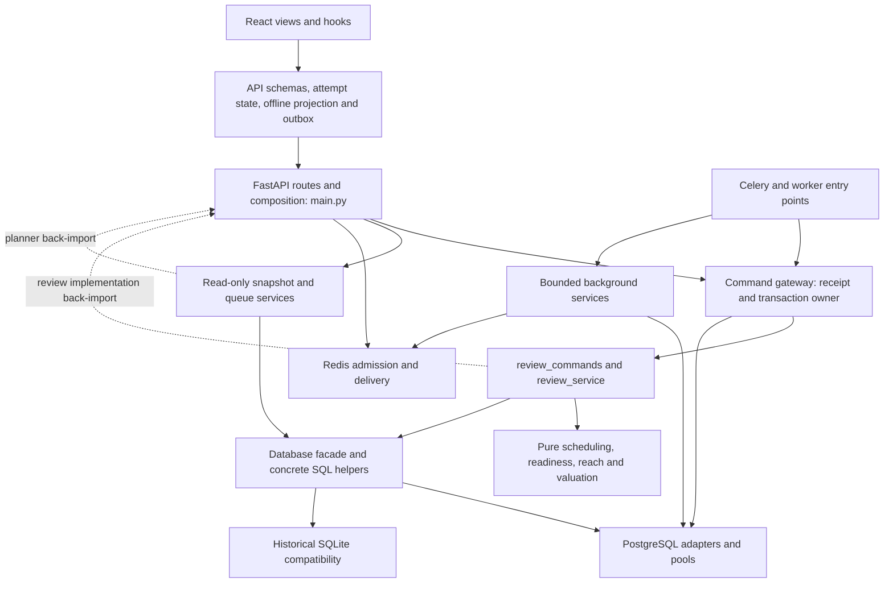
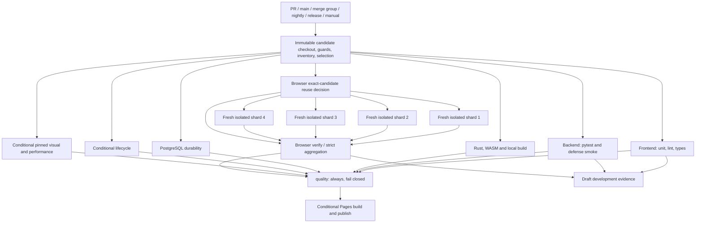
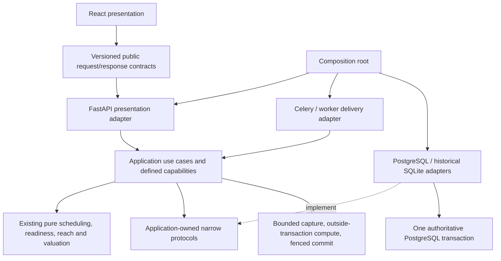

# Tempo CI Isolation and Architecture Dependency Audit

**Read-only audit • 12 October 2026 • baseline `622d611a2fc6315163a54d7ae689ce1b97d06122`**

Source was frozen at 10:44:37 UTC (06:44:37 America/New_York). All architectural findings refer to that revision. GitHub observations are retrieval-time facts. Proposed changes and performance ranges are explicitly future work. This document includes sections A–L; separate [issue specifications](issue-specifications.md), [implementation prompts](parallel-agent-prompts.md), and [evidence guide](evidence-guide.md) provide convenient copies and navigation.

## A. Executive summary

**Recommend targeted decoupling, starting with a controlled browser host and enforceable boundaries around existing pure logic.** Tempo already has independently scheduled PostgreSQL durability, lifecycle, browser, frontend, backend, build, and pinned visual jobs. Repeating “split PostgreSQL from browsers” would duplicate delivered work. The next useful separation is between tests that assert database semantics and tests that merely inherit a database-backed host requirement. [Current workflow](https://github.com/aaweaver-actuary/tempo/blob/622d611a2fc6315163a54d7ae689ce1b97d06122/.github/workflows/pages.yml#L1), [runner scopes](https://github.com/aaweaver-actuary/tempo/blob/622d611a2fc6315163a54d7ae689ce1b97d06122/scripts/postgres-test-plan.mjs#L1).

The audit sampled the latest 100 completed verification runs and expanded to 200 to obtain 23 successful workflows. There were also 46 failed and 131 cancelled workflows. Fourteen successful complete qualifications executed every selected layer freshly: median workflow wall time **15m35.5s**, p90 **18m46s**, maximum **31m56s**, and median approximately **73.69 runner-minutes**. Their median dependency computation path was **13m45s**. Seven successes included reused evidence; their much shorter median must not be presented as an execution speedup. The successful fresh population is smaller than 20, and different source inventories remain different observations. [Measurements](analysis/run-measurements.csv), [cohort definitions](analysis/ci-summary.json).

Native PostgreSQL is commonly the qualification bottleneck. Across successful workflows with the current infrastructure fingerprint, a fresh PostgreSQL job had median **12m50.5s** (16 observations). In the scheduled current-main run, its successful durability runner took **623.34s**: product image build 101.19s, startup 16.61s, background workload proofs 293.01s, and study durability 100.16s. Database startup is not the dominant cost. The background block includes queue, review handoff, worker, deletion, segmentation, evidence, freshness, and prefix-recovery proofs; its internal subprocess/fixture split is not fully timed. Native locking, rollback, receipts, migration, concurrent replay, and restart proof must remain native. [Cost breakdown](analysis/baseline-cost-breakdown.csv), [transaction owner](https://github.com/aaweaver-actuary/tempo/blob/622d611a2fc6315163a54d7ae689ce1b97d06122/backend/app/command_gateway.py#L229).

The current-main artifacts contain **2,498 pytest cases, 1,603 Vitest cases, 282 regular browser identities, 69 pinned browser identities, and eight Rust tests**. A source-derived classification finds 356 candidate Python domain cases and 156 regular browser identities worth investigating for a controlled host. These are provisional classifications, not certified safe omissions. Every regular browser case currently inherits the disposable PostgreSQL stack through configuration, including cases already intercepting their API responses. Native drag, focus, browser storage, refresh, service-worker, and cross-tab assertions must remain in browsers. [Inventory](analysis/test-classification.csv), [browser configuration](https://github.com/aaweaver-actuary/tempo/blob/622d611a2fc6315163a54d7ae689ce1b97d06122/playwright.config.ts#L1).

Scheduling, readiness, valuation, and policy reach already have useful pure seams. Protect those modules before moving them. Opening-card valuation/readiness and existing versioned snapshots make a low-risk pilot; there is no demonstrated need for a new package hierarchy or generic repository framework. A narrow scheduling-review protocol can remove SQL from one application caller later, while its existing command owner retains the atomic review transaction. Avoid beginning with `main._apply_review`, command recovery, or the durable outbox. [Scheduling](https://github.com/aaweaver-actuary/tempo/blob/622d611a2fc6315163a54d7ae689ce1b97d06122/backend/app/services/scheduler.py#L50), [valuation](https://github.com/aaweaver-actuary/tempo/blob/622d611a2fc6315163a54d7ae689ce1b97d06122/backend/app/services/opening_card_valuation.py#L1), [existing scorer protocol](https://github.com/aaweaver-actuary/tempo/blob/622d611a2fc6315163a54d7ae689ce1b97d06122/backend/app/services/opening_ranking_evaluation.py#L105).

Actual branch protection requires GitHub Actions **`quality`**, with strict current-base checking. Draft development feedback is selective today; draft `quality` deliberately fails. Ready-for-review qualification still requires core/build/durability plus critical and affected browser coverage. Future selective ready qualification is authorized for design only. It needs verified dependency ownership, provider/consumer contracts, exact inventory accounting, fail-closed selection, and a **fresh comprehensive pre-merge candidate gate**. Post-merge/nightly testing alone is insufficient. No setting was changed. [Protection evidence](evidence/remote/protection.json), [planner](https://github.com/aaweaver-actuary/tempo/blob/622d611a2fc6315163a54d7ae689ce1b97d06122/scripts/ci-verification-plan.mjs#L161).

The baseline is **not clean CI**: the scheduled main run failed WebKit board input, and the main push failed permanent-card deletion/reload. Aggregation rejected those failed shards; the missing aggregate file was a consequence. Diagnose these in separate work before major structural extraction. This audit does not infer that the live study instance has either defect, and performs no repair. [Scheduled run](https://github.com/aaweaver-actuary/tempo/actions/runs/38219350875), [push run](https://github.com/aaweaver-actuary/tempo/actions/runs/38168294966).

Issue #192 already owns the architecture roadmap. Issue #45 is closed despite stale “Open” wording; merged PRs have delivered split layers, selection, browser sharding, lifecycle separation, and shutdown improvements. Use new bounded follow-ups linked to those records, not duplicate infrastructure issues. No issues, PRs, source, settings, services, databases, or deployments were changed. All existing resources were retained. Under-three-minute PR and under-five-minute native integration targets remain hypotheses; the current durability evidence contradicts a blanket five-minute target.

## B. Current-state architecture

### B1. Dependency and ownership diagram



This is a modular-monolith candidate with existing process isolation, not a request for microservices. The graph shows representative seams, not every one of 5,010 static Python import edges. The [backend graph](analysis/backend-dependency-graph.json) records 181 application modules and 40 modules whose statically resolved transitive imports avoid the audit's driver/framework/I/O denylist. Dynamic imports, injected calls, module configuration, and filesystem access still require review; “40” is not a certified pure-module count.

### B2. Boundaries already worth preserving

- `services/scheduler.py` computes a result from card facts, outcome, explicit review time/day, and FSRS state. `unlock_ready` consumes facts. These functions need Python/FSRS, not a database or browser. Optional clock defaults warrant explicit clocks in deterministic fixtures; no wholesale extraction is needed. [Source](https://github.com/aaweaver-actuary/tempo/blob/622d611a2fc6315163a54d7ae689ce1b97d06122/backend/app/services/scheduler.py#L50).
- Opening valuation/readiness use explicit identity, evidence, timestamps, and immutable value structures. Tests already cover policy isolation, unknown evidence, duplicate routes, deterministic ordering, and no production writes. `OpeningCardScorer(Protocol)` is an existing useful seam. [Valuation tests](https://github.com/aaweaver-actuary/tempo/blob/622d611a2fc6315163a54d7ae689ce1b97d06122/backend/tests/test_opening_card_valuation.py#L71), [readiness tests](https://github.com/aaweaver-actuary/tempo/blob/622d611a2fc6315163a54d7ae689ce1b97d06122/backend/tests/test_decision_readiness.py#L1), [protocol](https://github.com/aaweaver-actuary/tempo/blob/622d611a2fc6315163a54d7ae689ce1b97d06122/backend/app/services/opening_ranking_evaluation.py#L105).
- `opening_ranking_snapshot.py` captures a versioned database snapshot and computes after its read boundary. Keep source version, policy identity, evidence cutoff, and read-only guarantees. Its back-import of the admission planner from `main` is a real dependency to remove when that adapter is touched. [Snapshot](https://github.com/aaweaver-actuary/tempo/blob/622d611a2fc6315163a54d7ae689ce1b97d06122/backend/app/services/opening_ranking_snapshot.py#L169).
- Disposable runners already own unique projects, ports, credentials, databases, volumes, diagnostics, and verified teardown. Preserve this contract; immutable images/build caches can be reused, mutable application/test state cannot. [Cleanup owner](https://github.com/aaweaver-actuary/tempo/blob/622d611a2fc6315163a54d7ae689ce1b97d06122/scripts/test-postgres-docker.mjs#L1156).

### B3. Demonstrated coupling and excessive responsibilities

`main.py` has 6,670 lines at the frozen revision. It mixes route composition, SQL, scheduling/review settlement, and queue planning. `database.py` has 1,752 lines and bridges authoritative PostgreSQL with historical SQLite interfaces. Size alone is not a refactoring justification; the demonstrated pain is service back-imports and persistence-shaped application inputs. `review_commands.submit_review` imports `_apply_review`; `study_attempts` imports `requeue`; queue refresh imports `main` at several sites; ranking snapshots import the main planner. [Review back-import](https://github.com/aaweaver-actuary/tempo/blob/622d611a2fc6315163a54d7ae689ce1b97d06122/backend/app/review_commands.py#L52), [study attempts](https://github.com/aaweaver-actuary/tempo/blob/622d611a2fc6315163a54d7ae689ce1b97d06122/backend/app/services/study_attempts.py#L44), [queue refresh](https://github.com/aaweaver-actuary/tempo/blob/622d611a2fc6315163a54d7ae689ce1b97d06122/backend/app/services/postgres_queue_refresh.py#L360), [mixed review orchestration](https://github.com/aaweaver-actuary/tempo/blob/622d611a2fc6315163a54d7ae689ce1b97d06122/backend/app/main.py#L3037).

`review_service.apply_scheduling_review` accepts `sqlite3.Connection` and issues SQL directly, although the production PostgreSQL facade supports that calling shape. The annotation does not establish SQLite as production authority. It computes schedule/state and writes review/card/descendant effects without owning commit. This is a concrete seam for a capability protocol. [Existing caller](https://github.com/aaweaver-actuary/tempo/blob/622d611a2fc6315163a54d7ae689ce1b97d06122/backend/app/services/review_service.py#L90).

Importing `main` constructs FastAPI and imports composition/worker code; importing the Celery module constructs/configures the Celery application. **Static inspection did not establish that every import starts PostgreSQL or initializes a database.** PostgreSQL pool creation is lazy; initialization/dispatch checks occur in the lifespan path. Tests using `TestClient` as a context manager exercise startup; clients instantiated without that context need not. Avoid attributing cost to hypothetical import-time database initialization. [Lifespan](https://github.com/aaweaver-actuary/tempo/blob/622d611a2fc6315163a54d7ae689ce1b97d06122/backend/app/main.py#L195), [pool/connection](https://github.com/aaweaver-actuary/tempo/blob/622d611a2fc6315163a54d7ae689ce1b97d06122/backend/app/postgres_store.py#L248), [fixtures](https://github.com/aaweaver-actuary/tempo/blob/622d611a2fc6315163a54d7ae689ce1b97d06122/backend/tests/conftest.py#L1).

Frontend `offline-training.ts` repeats some scheduling-mode/repeat decisions for its provisional offline view. The server remains the scheduler and persistence authority. Shared fixtures should characterize the overlapping decisions, clock/local-day behavior, and replay results; replacing offline behavior with a server dependency would defeat its purpose. [Offline projection](https://github.com/aaweaver-actuary/tempo/blob/622d611a2fc6315163a54d7ae689ce1b97d06122/app/lib/offline-training.ts#L199), [offline parity regressions](https://github.com/aaweaver-actuary/tempo/blob/622d611a2fc6315163a54d7ae689ce1b97d06122/backend/tests/test_phone_offline_training.py#L31).

### B4. Repository/GitHub reconciliation

| Record | Verified status and interpretation |
|---|---|
| [Issue #192](https://github.com/aaweaver-actuary/tempo/issues/192) | Open architecture coordination issue, based on older `d4dbf28…`. Its modular-monolith, transaction, foreground, compatibility, and single-integration-owner rules remain applicable. This audit supplies a narrower CI-isolation follow-up; it does not complete the umbrella. |
| [Issue #45](https://github.com/aaweaver-actuary/tempo/issues/45) | API state closed since 2026-10-01 11:48:52 UTC; timeline closure 11:48:53, without a closing commit ID. Body still says “Open.” Closure coincides with docs PR #48; later roadmap #29 describes delivered split-tier work through #51. Do not invent a closure mechanism or reopen it automatically. |
| Merged [#27](https://github.com/aaweaver-actuary/tempo/pull/27), [#47](https://github.com/aaweaver-actuary/tempo/pull/47), [#48](https://github.com/aaweaver-actuary/tempo/pull/48), [#51](https://github.com/aaweaver-actuary/tempo/pull/51) | Recovery/scoped runners, timing, local test policy, independent CI layers. Preserve these foundations. Closed unmerged #25/#26 are superseded. |
| Merged [#95](https://github.com/aaweaver-actuary/tempo/pull/95), [#96](https://github.com/aaweaver-actuary/tempo/pull/96), [#132](https://github.com/aaweaver-actuary/tempo/pull/132), [#147](https://github.com/aaweaver-actuary/tempo/pull/147), [#150](https://github.com/aaweaver-actuary/tempo/pull/150) | Six critical browser cases/affected families; separate lifecycle; draft development tiers/exact-candidate reuse; four browser shards; worker shutdown/timing repair. Current main contains these changes. PR prose predating merge is not the current status. |
| Merged [#195](https://github.com/aaweaver-actuary/tempo/pull/195) | Queue eligibility and study-only mode merged into audited main. Current-main complete CI failures remain documented separately from its prior successful PR candidate. |
| Open [#191](https://github.com/aaweaver-actuary/tempo/pull/191) | Settlement/outbox changes; head `3b2e9ec…`, base `d4dbf28…`, ten changed files. Do not use its unmerged diff as current proof. Main already contains some similarly named settlement regressions; source, not PR title, governs baseline attribution. |
| Open [#187](https://github.com/aaweaver-actuary/tempo/pull/187) → [#188](https://github.com/aaweaver-actuary/tempo/pull/188) → [#189](https://github.com/aaweaver-actuary/tempo/pull/189) | Stacked structural transition/journal/admission work: bases follow predecessor heads; 86/20/69 changed files. Native fence and browser rediscovery failures in these branches are not baseline-main capabilities. Serialize schema/journal ownership; do not absorb this stack into CI work. |
| Open [#177](https://github.com/aaweaver-actuary/tempo/pull/177), [#173](https://github.com/aaweaver-actuary/tempo/pull/173) | Offline ranking evaluation and CLI qualification policy. Existing main has valuation/snapshot contracts, but these proposed additions remain unmerged. Coordinate their files rather than duplicate them. |
| Open [#146](https://github.com/aaweaver-actuary/tempo/pull/146), [#117](https://github.com/aaweaver-actuary/tempo/pull/117), [#184](https://github.com/aaweaver-actuary/tempo/pull/184) | First-enqueue identity, position inventory, priority configuration/migrations. They constrain future application extraction and migration allocation; none is treated as merged. |

All open issues/PRs and 100 recently updated closed PRs were inventoried; materially relevant PR bodies and actual file lists are retained under [remote evidence](evidence/remote/). This is a bounded relevance review, not an acceptance audit of every unrelated product issue. No issue status/comment changed.

## C. CI performance analysis

### C1. Current jobs, triggers, and actual protection

There are three executable workflow files: the main verification/Pages orchestrator and two reusable workflows. The workflow README is documentation. Every PR event in the configured set plans work, including draft transitions/labels; `ci:full` requests complete draft execution but never makes a draft merge-eligible. Main pushes, merge groups, nightly, release, and complete manual requests retain complete applicable coverage. Pages publishing follows quality only on its explicitly enabled boundary; the demo is distinct from local Docker Tempo. [Orchestrator](https://github.com/aaweaver-actuary/tempo/blob/622d611a2fc6315163a54d7ae689ce1b97d06122/.github/workflows/pages.yml#L1), [reusable layers](https://github.com/aaweaver-actuary/tempo/blob/622d611a2fc6315163a54d7ae689ce1b97d06122/.github/workflows/verify-layer.yml#L1), [browser reusable workflow](https://github.com/aaweaver-actuary/tempo/blob/622d611a2fc6315163a54d7ae689ce1b97d06122/.github/workflows/verify-browser.yml#L1).



The diagram suppresses optional quarantine and some development fan-in for readability; raw YAML and the selected plan are authoritative. Complete browser selections use four whole-spec shards with independent disposable stacks; partial selections execute within browser verify instead. Layer jobs can reuse exact original-suite evidence under the existing bounded rules. Every checkout, shard, and aggregation pins the captured integration revision.

| Job family | Real infrastructure/setup | Qualification applicability |
|---|---|---|
| Plan | Git, Node/npm; guard and runtime inventory | Always; no product database provisioned |
| Frontend | Node/npm; Python backend requirements for producer/parity tests | Ready core; selective draft |
| Backend | Python requirements, Node tooling/defense smoke; temporary SQLite and controlled adapters/processes | Ready core; selective draft |
| Build | Rust/WASM/Node, production frontend build | Ready core; selective draft |
| PostgreSQL durability | Fresh PostgreSQL/Redis/API/foreground and background workers/model workers/web; migration/maintenance image | Required ready qualification; selective draft by affected boundaries |
| Lifecycle | Separate fresh deployment/CLI PostgreSQL/Redis/application setup | Conservative sensitive-path/complete selection |
| Regular browser | Fresh PostgreSQL/Redis/full product stack per executing shard; Chromium, Firefox, WebKit prerequisites | Six critical cases and complete selected families; complete boundaries all cases |
| Pinned visual/performance | Pinned Linux ARM64 browser container; frontend production host and controlled API; no live PostgreSQL service | Appearance/performance-sensitive paths and complete boundaries |
| Quality/development | Artifact and provenance checks | Required `quality`; development does not authorize merge |

Main protection API: `quality` from GitHub Actions app 15368; strict base checking true; force pushes/deletions disabled; admin enforcement false; no required-review block in the response; rulesets response empty. The repository has a merge-group workflow trigger, but the captured protection/rulesets do **not** establish that a mandatory merge queue is enabled. A trigger is not enforcement. [Protection](evidence/remote/protection.json), [rulesets](evidence/remote/rulesets.json).

### C2. Sample and successful distributions

Window: **2026-10-11 06:38:38 to 2026-10-12 10:44:33 UTC**, 192 PR events, six main pushes, two scheduled runs. The initial 100 completed runs did not supply 20 successes; page two supplied 23. All available attempts for sampled runs were retrieved with paginated jobs: 2,248 job records; all 200 have attempt one. Counts are workflow outcomes, not independent product defect rates. Concurrency cancellations dominate this active development window.

Infrastructure fingerprint `7baca014e641` covers the exact bytes of the three workflows, planner, and layer runner: 183 runs (23 success/43 failure/117 cancelled). It does not prove equal fixtures, product source, selected inventory, cache warmth, or runtime load. Seventeen runs belong to other/unavailable fingerprints. Thirty-eight immutable plans were downloaded, including all successes and both baseline-main complete runs; selected jobs, runtime, plan hash, head/base/integration, and shards are recorded in [plan cohorts](analysis/selected-plan-cohorts.csv). Remaining failed/cancelled runs are marked unknown-tier when a plan was not collected.

| Successful workflow population | n | Median wall | p90 wall | Maximum wall | Median runner-min |
|---|---:|---:|---:|---:|---:|
| All successes, mixed selection/reuse | 23 | 14m30s | 20m48s | 31m56s | 72.95 |
| Complete, every layer fresh | 14 | 15m35.5s | 18m46s | 31m56s | 73.69 |
| Complete, at least one reused layer | 7 | 2m06s | 20m48s | 20m48s | 3.23 |
| Targeted qualification, fresh | 2 | 17m31s | 21m52s | 21m52s | 55.86 |

Fresh complete dependency-compute path: median 825s, p90 846s, max 850s (n=14). Queue-inclusive path: median 934.5s, p90 1,125s, max 1,915s. Initial plan scheduling delay: median 15s, p90 235s, max 1,101s. A 31m56s workflow can therefore coexist with roughly 14m compute dependencies. Scheduling delay is observed job readiness-to-start time, not measured CPU contention; runner capacity and event scheduling are possible causes, not confirmed root causes.

Fresh successful jobs in the current fingerprint, excluding failed/cancelled workflows and reused layer executions:

| Job | n | Median seconds | Nearest-rank p90 | Maximum |
|---|---:|---:|---:|---:|
| Plan | 23 | 38 | 42 | 44 |
| Frontend | 17 | 444 | 462 | 465 |
| Backend | 16 | 362.5 | 387 | 396 |
| Build | 17 | 51 | 59 | 60 |
| PostgreSQL durability | 16 | 770.5 | 798 | 846 |
| Lifecycle | 14 | 362.5 | 384 | 408 |
| Visual/performance | 17 | 326 | 339 | 344 |
| Browser reuse controller | 23 | 13 | 17 | 19 |
| Browser shard 1 | 16 | 502 | 528 | 607 |
| Browser shard 2 | 16 | 486 | 598 | 609 |
| Browser shard 3 | 16 | 530.5 | 561 | 667 |
| Browser shard 4 | 16 | 502 | 548 | 555 |
| Browser aggregate/reuse validation | 22 | 15 | 19 | 22 |
| Browser direct execution in verify | 1 | 544 | 544 | 544 |
| Quality | 23 | 19 | 25 | 31 |

The two browser-verify modes must not be pooled as aggregation cost. Core reused jobs have roughly 13–19s medians and are provenance checks, not fresh suite durations. See [job statistics](analysis/successful-job-cohort-statistics.csv), [mode split](analysis/cost-summary.json), and [job measurements](analysis/job-measurements.csv). Each job population is below 20 except control jobs: this audit reports the available sample, not fabricated precision.

### C3. Cost attribution on frozen current main

Scheduled run [38219350875](https://github.com/aaweaver-actuary/tempo/actions/runs/38219350875) is complete, fresh, attempt one, Ubuntu 24.04 ARM64, Node 22.23.3, Python 3.12.14, Rust 1.99.0, wasm-pack 0.15.0. The workflow failed a browser case; **its passing layer measurements describe those layers, not a successful full workflow**. Its wall was 761s and approximate runner occupancy 75.33 minutes. Push run [38168294966](https://github.com/aaweaver-actuary/tempo/actions/runs/38168294966), same frozen SHA, failed a different browser case: 791s wall/76.53 runner-min. PG is on both computation paths; elapsed time after another layer fails still counts resource consumption.

| Boundary | Measured seconds | Attribution/limit |
|---|---:|---|
| Frontend runtime inventory | 69.80 | Dynamic Vitest collection; retain identities, investigate repeated module/harness collection |
| Vitest execution | 287.74 | 1,603 passed cases; file/test elapsed overlaps |
| Lint / typecheck | 25.48 / 16.27 | Static frontend checks |
| Backend inventory / pytest | 6.48 / 320.16 | 2,498 passed cases; JUnit case totals 316.706s are nested |
| Defense engine smoke | 0.21 | Node smoke; not production model workload |
| Rust fmt/clippy/test/WASM/local build | 0.03 / 0.41 / 0.82 / 1.32 / 3.30 | Warm build evidence; no demonstrated current build bottleneck |
| PG capability check / runner | 25.61 / 623.34 | Includes setup and native scenarios; no browser execution |
| Lifecycle capability / runner | 27.73 / 307.95 | Separate deployment rehearsal |
| Visual capability / runner | 26.90 / 277.87 | Includes container-local npm/frontend build/pinned cases; internal setup split incomplete |

PG runner nested breakdown:

| Stage | Seconds | What it proves or includes |
|---|---:|---|
| Compose validation | 0.35 | Role/storage/config assertions |
| Product image build | 101.19 | Reproducible stack build; safe cache opportunity |
| Maintenance preparation | 11.69 | Migration/import CLI image/entrypoint |
| Startup / health | 16.61 / 0.08 | Migration/roles/seed/start readiness; sub-costs not independently timed |
| Background budget / operation recovery | 0.90 / 2.35 | Native bounded transaction and receipt guarantees |
| Schema migrations | 12.00 | Upgrade/replay compatibility and current study-mode/profile proofs |
| Priority recovery / diagnostics | 3.19 / 3.82 | Native recovery/projection assertions |
| Background workloads | 293.01 | Many sequential native CLI/helper proofs; dominant block, not just PostgreSQL overhead |
| Threat candidate upsert | 1.70 | Native upsert |
| Command recreation | 41.70 | Lost-response receipt/queue/settings across recreation |
| Backup/restore | 31.29 | Durable restore and retained journal recovery |
| Study durability | 100.16 | Foreground behavior, progress, restart/replay, admission, burial/quota |
| Cleanup | 3.24 | Invocation-owned teardown verification |

The runner total includes additional process/orchestration time; rounded stage totals need not equal it. Lifecycle: product build 108.33s, maintenance 12.30s, actual lifecycle rehearsal 186.67s, cleanup 0.25s. That rehearsal logged 38 polls and **3.21s measured waiting**: arbitrary shorter waits would not remove its dominant cost. The shutdown-delay improvement is already merged in #150. [Nested stages](analysis/baseline-cost-breakdown.csv), [proof composition](https://github.com/aaweaver-actuary/tempo/blob/622d611a2fc6315163a54d7ae689ce1b97d06122/scripts/test-postgres-docker.mjs#L976).

Four browser shards repeated product image builds totaling **405.10s** and startup totaling **68.83s**. Browser stage elapsed was 273.94/288.29/401.57/241.21s, including test hooks, fixtures, polling, browser actions, and failed assertion waiting. Shard 1 failed; these are not a four-shard successful-performance sample. Fresh-success dependency medians are about 21–22s npm per shard and 48–64s browser prerequisites, with repeated capability checks around 26s. Image distribution might lower repeated compute; a controlled host removes these product builds for migrated cases. Full-system cases still need real isolated infrastructure.

Frontend case-time attribution reveals 132 source-classified harness/application cases contributing 228.646s of summed assertion time. The CLI wrapper file alone spans 192.18s (52 tests); study regression file 29.74s (76 tests); CI reliability wrapper 21.67s (four tests). These file/test times overlap and cannot be added to 287.74s as separate suite costs. They support investigating an independently owned harness lane, not claiming the frontend UI itself takes 229s. [Vitest report](evidence/ci/artifacts/38219350875/ci-result-frontend/performance/unit-files-ci-frontend.json).

### C4. Failures, retries, cancellation, and compute

| Non-gate failure category | Failed jobs | Distinct failed workflows |
|---|---:|---:|
| Browser assertion/fixture boundary | 22 | 21 |
| Native PostgreSQL proof | 11 | 11 |
| Backend test/fixture boundary | 3 | 3 |
| Frontend/harness assertion | 2 | 2 |
| Pinned rendering/timeout | 2 | 2 |
| Planning/inventory guard | 4 | 4 |
| Browser aggregate rejecting failed shard | 18 | 18 |

Sixty-two non-gate failed jobs occur in 30 failed workflows; categories overlap and aggregate cascades are secondary. The other 16 failed workflows have only a failing gate; their retained gate logs explicitly identify development/draft eligibility. Thus 46/200 (23%) is **not** a product failure rate. These categories are observed failing boundaries, not definitive root causes. [Failure table](analysis/failure-classification.csv), [redacted excerpts](evidence/ci/failure-excerpts/manifest.json), [gate-only evidence](evidence/ci/gate-excerpts/manifest.json).

Examples include unregistered browser specs/JSON module imports at planning; native journal-loss fences in unmerged transition branches; route inventory or controlled settings fixture failures in backend; missing component region in frontend; browser imports/queue readiness, durable recovery, and native piece assertions. Connection-refused messages during deliberately isolated/restarted proofs are not, by themselves, an infrastructure-outage diagnosis. No case is labeled flaky and no failure is repaired here.

- Workflow reruns: **0/200** sampled workflows have more than one attempt; all available attempts fetched. Separate new workflow dispatches are not counted as reruns. Playwright configuration uses retries zero; current-main result records do not indicate recovered retries. Internal polls/redelivery/restart proofs are intentional test behavior, not workflow retries.
- Approximate held-runner minutes: **5,129.74** across sample: success 1,214.82; failure 2,835.62; cancelled 1,079.30. This is elapsed executing job occupancy, not CPU minutes, dollar billing, or queue time. Failed/cancelled costs remain separate.
- Successful-duration estimates exclude cancelled/truncated jobs and workflows. Failure/cancellation elapsed distributions are retained only for resource accounting, not speed claims.
- No CPU throttling, RSS, network throughput, cold-cache controlled comparison, or external runner capacity history was collected. Capacity pressure may explain scheduling delays; no causal contention claim is established.

## D. Test dependency inventory

### D1. Counting method and categories

Runtime reports provide parameterized identities, not source `test_` counts. AST/import/fixture/request/assertion inspection then assigns a provisional primary category plus infrastructure facets. Static Python definitions number 1,663; they are **not** the runtime 2,498 count. All 1,603 Vitest durations match runtime identities after retaining ancestor-title separators. Browser identities include project and parameterization. This audit ran no test collection/execution locally. [Classification](analysis/test-classification.csv), [browser details](analysis/browser-classification.csv), [method script](analysis/classify_tests.py), [runtime augmentation](analysis/extend_inventory.py).

| Requested category | Source-derived count / counting unit | Current time provenance | Actual infrastructure and CI placement | Independence and gap |
|---|---|---|---|---|
| Domain unit | 356 Python candidate cases; eight Rust cases separately | Python JUnit sum 2.929s; Rust command 0.82s including runner overhead | Python/FSRS/chess packages in backend; Rust tools in build; no external DB provision observed for pure cases | Strong pilot; dynamic imports, clocks and caller parity must be certified. Rust tests are not added to Python count. |
| Application unit | 928 Python + 132 Vitest = 1,060 candidates | JUnit sum 105.929s; Vitest assertion sum 228.646s | Controlled SQL/broker/network doubles, fake clocks; some real child processes/harnesses; backend/frontend lanes | Split pure orchestration from adapter contracts and CLI/process tests; double-based concurrency is not PG proof. |
| API contract | 611 Python + 59 Vitest = 670 candidates | JUnit 103.247s; Vitest 3.184s | FastAPI/TestClient/Pydantic/schema/Python parity; 316 Python cases also flagged SQLite fixture; backend/frontend | Provider-consumer ID/schema fixtures; some HTTP fixtures start full legacy app. Producer parity needs Python even in frontend. |
| Frontend unit | 1,412 candidates | Vitest assertion sum 92.410s; not independent suite wall | jsdom/Node/components/hooks/state; frontend job also executes non-frontend harness/parity cases | Bounded files already independent; retain build/type and browser event proof where affected. |
| PostgreSQL integration | 10 top-level durability proof/scenario blocks plus lifecycle; no regular pytest case identified as provisioning live PG | Durability runner 623.34s; scenario table above; n=1 passing current-main layer | Native PG/Redis/processes, migrations, isolated databases; PG/lifecycle jobs | Already separate from browsers. 238 emitted PASS records/228 distinct labels include config and repeats; not normalized test-case count. Need machine-readable proof IDs before finer selection. |
| Infrastructure integration | 603 Python SQLite-compatibility candidates; real Redis/worker/model boundaries additionally nested in native blocks | JUnit sum 104.601s; native block timings, not additive | Temporary SQLite in backend; real workers/Redis in PG/lifecycle/full-system | SQLite compatibility retained explicitly; no trustworthy separate runtime count/time for Redis versus PG assertions today. |
| Browser integration | 156 regular controlled-host candidates + 69 already pinned identities = 225 candidates | Regular case sum 309.721s; pinned 253.985s; nested/overlapping | Regular currently full PG stack; pinned uses frontend host/API fixtures, real Chromium | 156/282 = 55.3% candidate migration ceiling, not proven isolated coverage. Unexpected requests and SW interception require characterization. |
| Full-system E2E | 126 conservative regular browser candidates; additional service recovery proofs in native runner | Case sum 875.192s, includes baseline failed case(s); not successful independent suite time | Browser/product fixtures/API/PG/Redis/workers; four regular shards plus native durability | Retain durable review, queue issuance, publication/restart; source heuristic can miss helper dependencies, so certify case by case. |

The primary categories cover the 4,452 Python/Vitest/regular/pinned browser runtime identities once. Native proof labels and eight Rust cases have different counting units and are not added to that total. **All category counts are source-derived estimates of role**, anchored to exact runtime identities; they are not a reliable automated selector. The CSV carries revision, run, environment, workflow outcome, timing provenance, reason, and independence status. 919 Python cases have a SQLite facet (603 infrastructure-primary + 316 API-primary). SQLite is an optional compatibility test stack, not replacement PostgreSQL proof.

### D2. Accidental versus necessary dependencies

1. **Configuration coupling:** regular Playwright configuration throws without `TEMPO_DOCKER_URL`, despite fully intercepted cross-browser cases. `cross-browser.spec.ts` blocks service workers and calls deterministic `prepareVisualUI`; those cases need actual WebKit/Firefox/Chromium, not native receipt persistence. [Config](https://github.com/aaweaver-actuary/tempo/blob/622d611a2fc6315163a54d7ae689ce1b97d06122/playwright.config.ts#L1), [example](https://github.com/aaweaver-actuary/tempo/blob/622d611a2fc6315163a54d7ae689ce1b97d06122/tests/browser/cross-browser.spec.ts#L42).
2. **Partial interception:** phone/review-prefetch cases intercept selected queue/review/receipt endpoints but still inherit health/settings/progress/worker/static-asset requests. “Has a route mock” does not establish backend independence. The per-case browser table therefore flags migration candidates, not assured safe replacements. [Phone fixture](https://github.com/aaweaver-actuary/tempo/blob/622d611a2fc6315163a54d7ae689ce1b97d06122/tests/browser/phone-offline-training.spec.ts#L102), [prefetch](https://github.com/aaweaver-actuary/tempo/blob/622d611a2fc6315163a54d7ae689ce1b97d06122/tests/browser/training-prefetch.spec.ts#L21).
3. **Full application fixtures:** legacy `test_workflows.py` initializes temporary SQLite and uses application startup/coordinator behavior for broad workflows. Extract narrowly pure assertions only after retaining real SQLite compatibility and native PG proof. File-local fixtures in cutover tests instead use SQL/broker doubles; their `test_postgres_` names are not evidence of a real database. [Workflow setup](https://github.com/aaweaver-actuary/tempo/blob/622d611a2fc6315163a54d7ae689ce1b97d06122/backend/tests/test_workflows.py#L1), [cutover fixture](https://github.com/aaweaver-actuary/tempo/blob/622d611a2fc6315163a54d7ae689ce1b97d06122/backend/tests/test_postgres_cutover.py#L1), [global fixtures](https://github.com/aaweaver-actuary/tempo/blob/622d611a2fc6315163a54d7ae689ce1b97d06122/backend/tests/conftest.py#L1).
4. **Business rules behind SQL-shaped callers:** review service and `main._apply_review` embed domain decisions among reads/mutations. Schedule/readiness kernels already avoid that dependency; extraction must target the caller seam, not rewrite the working algorithms. [Service](https://github.com/aaweaver-actuary/tempo/blob/622d611a2fc6315163a54d7ae689ce1b97d06122/backend/app/services/review_service.py#L90).
5. **Cross-language contracts:** API-schema parity and opening probability fixtures invoke Python from Vitest. Current frontend Python installation is therefore justified. A minimal fixture-export command may reduce installed dependencies, but only after tracing its import closure and pinned versions; no dependency install was attempted. [Parity tests](https://github.com/aaweaver-actuary/tempo/blob/622d611a2fc6315163a54d7ae689ce1b97d06122/tests/unit/api-schema-parity-regressions.test.ts#L1), [probability contracts](https://github.com/aaweaver-actuary/tempo/blob/622d611a2fc6315163a54d7ae689ce1b97d06122/tests/unit/opening-move-probability-contract-regressions.test.ts#L1).
6. **Genuine native boundaries:** live product fixtures use HTTP, command recovery, disposable-instance guards, and worker/process operations. These remain full-system. The runner’s rollback/locking/migration/receipt assertions remain PG native even if their service has unit tests. [Product fixture](https://github.com/aaweaver-actuary/tempo/blob/622d611a2fc6315163a54d7ae689ce1b97d06122/tests/browser/product-fixtures.ts#L1), [native recovery](https://github.com/aaweaver-actuary/tempo/blob/622d611a2fc6315163a54d7ae689ce1b97d06122/scripts/check_postgres_queue_attempt_recovery.py#L24).

Important inventory gaps: dynamic helper/fixture dependency certification; normalized IDs for native script assertions; independent Redis/model workload counts; collection-versus-import cost; cold/warm image/cache comparison; native two-tab lost-update characterization distinct from existing cross-tab notification tests. No “module initializes PG on import” defect was confirmed.

## E. PostgreSQL isolation proposal

### E1. Existing ownership and native guarantees

`postgres_store.connection` owns pooled connection checkout and bounded transaction context; rollback/commit occurs at that boundary. Read-only, background, authoritative, and repeatable-read choices are explicit. Background lock/statement budgets are deliberately short. SQL adaptation preserves historical SQLite-shaped callers, but callers using native `.raw` require PG semantics. `database.initialize` checks the PG migration ledger instead of automatically migrating the authoritative service; historical SQLite follows its own initialization path. [Connections](https://github.com/aaweaver-actuary/tempo/blob/622d611a2fc6315163a54d7ae689ce1b97d06122/backend/app/postgres_store.py#L248), [facade](https://github.com/aaweaver-actuary/tempo/blob/622d611a2fc6315163a54d7ae689ce1b97d06122/backend/app/database.py#L55).

`command_gateway` owns the operation transaction and receipt. It prepares outside the write boundary, takes an operation-scoped transaction advisory lock, inserts/locks the receipt, verifies command/payload identity, invokes the handler under a savepoint, and completes effects/response in the same outer transaction. Retryable/uncertain-commit errors must remain recoverable; post-commit queue wake occurs only after the connection closes. [Owner](https://github.com/aaweaver-actuary/tempo/blob/622d611a2fc6315163a54d7ae689ce1b97d06122/backend/app/command_gateway.py#L229).

`review_commands.submit_review` preserves required card/queue/receipt lock ordering. Review history, schedule, queue, evidence, logical receipt, and optional authorized continuation belong to one transaction. Optional continuation locks must decline promptly rather than block the required review. The application seam must not commit independently, perform network I/O mid-transaction, or move a receipt update into a separate transaction. [Review handler](https://github.com/aaweaver-actuary/tempo/blob/622d611a2fc6315163a54d7ae689ce1b97d06122/backend/app/review_commands.py#L52), [native optional-lock proof](https://github.com/aaweaver-actuary/tempo/blob/622d611a2fc6315163a54d7ae689ce1b97d06122/scripts/check_postgres_training_transition.py#L179).

### E2. Concrete smallest protocol: scheduling review

**Proposed future seam, not implemented:** keep pure `schedule_review`/`unlock_ready`; make a bounded scheduling application depend on an application-owned `SchedulingReviewStore` protocol. Define immutable input/result structures in that application module. The adapter receives the already-owned connection; it does not open/commit one. Do not introduce a generic `Repository`, SQL executor protocol, dependency injection framework, or new database.

```python
# Illustrative capability sketch; exact types/contracts require characterization.
class SchedulingReviewStore(Protocol):
    def source_review_exists(self, source_kind: str, source_ref: str) -> bool: ...
    def load_card_state(self, card_id: str, *, require_active: bool) -> CardState | None: ...
    def append_review(self, review: ReviewRecord) -> None: ...
    def load_maturity_facts(self, card_id: str) -> MaturityFacts: ...
    def save_card_state(self, card_id: str, state: UpdatedCardState) -> None: ...
```

Five persistence capabilities mirror the current caller’s reads/writes without exposing a concrete connection. `CardState` includes the existing scheduler state and replay response facts (due date, interval, state, stability, mode, streak); `ReviewRecord` includes outcome/internal rating, guided flag, original review timestamp, previous/next interval, source kind/ref. `MaturityFacts` contains successful distinct review days, most recent valid outcomes, and seed facts; application logic preserves seed combination and `unlock_ready`, including invalidated evidence rules.

The application accepts `reviewed_at`, `review_day`, and configured light interval explicitly. The presentation/command boundary derives these from the original completion envelope and configured local day; replay must not invent “now.” It loads active card state, computes schedule, appends the review, obtains post-insertion maturity facts, and saves the computed state. On existing `source_ref`, preserve today's current replay result semantics—including the current-card lookup and idempotent fields—rather than silently changing them to an original-result receipt. Source-ref uniqueness and concurrent replay remain native guarantees.

Two existing atomic follow-ups must be explicit: clear a satisfied real-game miss for study reviews, and unlock eligible legacy descendants. Initially retain them in the current transaction-bearing wrapper immediately after the scheduling application, with a plain named follow-up function receiving the owned adapter/connection and computed facts. If a later application extraction needs to test their orchestration, add only those named effect capabilities; do not hide their policy inside a generic adapter. Characterize ordering and rollback before moving them.

Adapter placement can be one `services/scheduling_review_store.py` file beside the current caller, implementing the application-defined protocol with existing SQL helpers. Transitional `apply_scheduling_review(database, …)` constructs the adapter and delegates, preserving every caller and public response. The command gateway remains transaction owner. A controlled in-memory store can prove sequencing, missing/archived-card behavior, source replay branch, invalid/empty evidence, guided flags, seed handling, and original-clock use. It cannot prove cross-process locks, uniqueness races, rollback, receipt durability, or crash recovery.

Required before extraction: record existing service callers; parameterized response/effect fixtures for every scheduling mode/source; native parity over the same card/review history; explicit failure injection between append/update/follow-up/receipt; concurrent identical/conflicting deliveries; restart and uncertain-commit replay. Retain [phone scheduling/replay tests](https://github.com/aaweaver-actuary/tempo/blob/622d611a2fc6315163a54d7ae689ce1b97d06122/backend/tests/test_phone_offline_training.py#L31), [prepared continuation contract](https://github.com/aaweaver-actuary/tempo/blob/622d611a2fc6315163a54d7ae689ce1b97d06122/backend/tests/test_prepared_review_continuation.py#L46), [queue maintenance contention/restart](https://github.com/aaweaver-actuary/tempo/blob/622d611a2fc6315163a54d7ae689ce1b97d06122/scripts/check_postgres_queue_attempt_recovery.py#L24), and the complete settled-candidate PG durability gate. Complexity is medium, risk higher than the valuation pilot; it should follow contract characterization and baseline stabilization.

### E3. What can skip PG during ordinary future development

Pure scheduler/valuation/readiness changes with unchanged persisted/public shapes can qualify on domain tests and controlled affected application/provider-consumer tests once certified. A SQL adapter, migration, lock order, isolation setting, receipt identity, scheduling-result serialization, or replay policy change cannot take that exemption. Background capture/compute/commit changes require named contention/restart/replay proof and real PG boundaries. Every candidate still receives comprehensive fresh native qualification before merge and deployment.

## F. Browser isolation proposal

### F1. Use existing Playwright interception first

The existing pinned frontend host and `prepareVisualUI` show the simplest viable direction. Create a separate controlled-API Playwright configuration using a production **local product** frontend build on an invocation-owned port, with `reuseExistingServer: false`. It must not activate the Pages demo or proxy requests to the live study service. Its host starts no PostgreSQL, API, Redis, worker, or maintenance process. Current `vite.static.config.ts` can proxy `/api` to localhost:8000; an isolated test configuration must disable that fallback. [Pinned host](https://github.com/aaweaver-actuary/tempo/blob/622d611a2fc6315163a54d7ae689ce1b97d06122/playwright.visual.config.ts#L26), [Vite target](https://github.com/aaweaver-actuary/tempo/blob/622d611a2fc6315163a54d7ae689ce1b97d06122/vite.static.config.ts#L1).

Use `context.route`/`page.route` deterministic responses with explicit method/path/query matching, controllable deferred responses, and a frozen clock only where clock behavior is not the subject. Register routes before navigation. Maintain state only for the fixture’s promised behavior: issued queue IDs/revisions, original review intent, pending/complete/conflict receipts, and authorized continuations. Do not create an elaborate simulated backend.

**Fail closed:** unrecognized API requests must abort and fail the test with method, path and call phase; malformed contracts must fail provider/consumer checks; unsuccessful save responses must remain unsuccessful. The current visual catch-all returns `{}` for unknown endpoints and reports fixture health as `local-sqlite`, which is deterministic but weaker than a truthful isolated host contract. Replace only within the future bounded fixture work, preserving explicit expected empty responses and error scenarios. [Current fallback](https://github.com/aaweaver-actuary/tempo/blob/622d611a2fc6315163a54d7ae689ce1b97d06122/tests/browser/visual-fixtures.ts#L255).

Fixtures are versioned examples checked against backend models/provider response serializers and frontend schemas. Include valid, empty, pending, unavailable, conflict, deferred, retryable failure, and malformed cases. Check consumer behavior and provider production response shape; validating only two copies of the same hand-written fixture is not provider proof. Any changed shared schema runs both sides and conservatively selects further consumers.

### F2. Case-by-case movement

| Representative case family | Appropriate proof after isolation | Coverage retained elsewhere |
|---|---|---|
| Fully intercepted cross-browser navigation/board/split/dialogs | Controlled frontend host, all three native engines | Full system browser smoke and complete product boundaries |
| Phone headings/layout/keyboard/status/held response | Controlled API browser; component assertions for pure state/messages | Native browser input/focus/layout; pinned visuals for appearance |
| Prefetch/acknowledgment/stale responses/receipt-first reload | Controlled receipt and queue fixtures, real browser storage/reload | PG command/attempt receipts, exact replay, live durable next-card workflow |
| Pure response decoding/queue filtering | Existing unit/schema tests, if assertions are identical at that layer | Browser tests retained for any native input/storage/refresh behavior |
| Offline shell/worker cache/update | Native browser with real frontend/SW assets; separately characterize API delivery | Live durable offline review/reconnection and server receipt reconciliation |
| Real import/queue materialization/review/worker stop/restart | Full-system product fixture | Native PG durability, migration, crash/replay; no mock equivalence |
| Real cross-tab notification/storage coordination | Native multi-page/browser context | Backend persistence if asserted; additional transactional outbox characterization |

The 156 candidates are reviewed case identities in [browser-classification.csv](analysis/browser-classification.csv). Classification follows actual test body, local helper/hook, request/process use, and product fixture imports. Remote helper/dynamic setup can still add dependencies; only a successful no-backend experiment with strict request detection and retained assertions can certify movement. Do not automatically move an entire mixed spec or rely on grep/name patterns.

### F3. Service worker and offline path are a separate experiment

Cross-browser fixtures explicitly block service workers; offline tests intentionally exercise them, CacheStorage, IndexedDB, worker assets, and full offline reload. Interception does not automatically control requests already owned by a service worker. First capture request ownership and cache transitions with the real frontend worker. If browser-context interception cannot provide the needed HTTP semantics, add a tiny invocation-owned deterministic API server **only for those cases**, bound to loopback with no live fallback. Do not disable service workers to make offline tests pass, substitute intercepted success for durable replay, or overwrite persisted state with sample data. [Offline proof](https://github.com/aaweaver-actuary/tempo/blob/622d611a2fc6315163a54d7ae689ce1b97d06122/tests/browser/phone-offline-training.spec.ts#L102), [cross-browser choice](https://github.com/aaweaver-actuary/tempo/blob/622d611a2fc6315163a54d7ae689ce1b97d06122/tests/browser/cross-browser.spec.ts#L9).

### F4. Full-system and native-browser proof that remains mandatory

Retain durable review exactly-once; lost-response receipt reconciliation; authoritative queue issuance/continuation; blocked and stale review recovery; worker foreground contention; crash, process/pool restart and container recreation; background generation/publication recovery; live offline review replay. Retain real drag, held pointer, keyboard focus, native storage failure/quota, refresh, and cross-tab coordination even when APIs are controlled. Full-system movement preserves every named assertion and creates an explicit coverage ledger mapping old identity → new identity/host → native retained proof. Zero cases, duplicate identities, unexpected skips, incomplete teardown or an uncovered assertion must fail qualification.

## G. Target architecture and study protection

### G1. Target dependency model



Protocols express a real capability, not a new abstract framework. Keep one authoritative PostgreSQL transaction for atomic review effects, existing worker/process boundaries, historical compatibility, and versioned snapshots. Neither adding a `domain/` directory nor replacing concrete type annotations alone establishes independence.

Proposed enforceable rules:

| Layer | Allowed direction | Initially prohibited / controlled |
|---|---|---|
| Audited domain allowlist | Standard/value libraries and explicitly reviewed pure math/chess/FSRS dependencies | Direct/transitive database drivers, SQL adapter, Redis/Celery/web entry points; time/network/process globals except explicit clock inputs |
| New application modules | Domain, application-owned protocols/value contracts | `main`, concrete PG/SQLite adapters, HTTP routers, Celery/worker entry points |
| Adapters | Implement application capabilities; driver libraries; explicit transaction owner | Importing presentation to obtain business rules; unowned commits or startup work |
| Presentation/composition | Calls application; wires concrete adapters | Business policy embedded in transport handlers as new default |
| Frontend | Public contract and browser attempt/view/storage responsibilities | Treating speculative/offline projection as authoritative server persistence |

Implement a static graph check over Python imports, including relative/lazy imports, plus focused subprocess import smoke tests with database/network construction forbidden. Static graphs cannot prove all side effects. Transitional exceptions are exact file/import edge, reason, owner, expiry/review milestone and guarding regression—not an entire `services/**` exemption. Existing `main` back-imports can stay temporarily behind a shrinking allowlist; no new ones. Fail on new dependencies and expire an exception when its consumer extraction merges.

### G2. Low-risk pilot

Use existing opening-card valuation + decision readiness + exported snapshots. Keep files and public imports initially; add certified domain test ownership, explicit clock/identity fixtures and import rules. Run the existing valuation/readiness/probability/frontier contracts without a service environment. Only move the snapshot’s planner dependency if needed for its caller isolation, in a separate adapter change; the pure arithmetic is already extracted. Preserve unknown probability mass, policy-specific identities, read-only/no-admission behavior, deterministic serialization, and Python/Rust parity where deterministic logic is migrated. PR #177 remains separate. [Valuation export contract](https://github.com/aaweaver-actuary/tempo/blob/622d611a2fc6315163a54d7ae689ce1b97d06122/backend/tests/test_opening_card_valuation.py#L384), [snapshot examples](https://github.com/aaweaver-actuary/tempo/blob/622d611a2fc6315163a54d7ae689ce1b97d06122/docs/examples/opening-ranking-snapshot.json#L1).

### G3. Study-invariant coverage map

These are representative **named existing** protections, not a replacement minimal smoke suite. Preserve the complete registry and CI-selected inventory. Native layers are required before deployment regardless of whether an ordinary future PR can omit them.

| Requested invariant | Fast unit/contract protection | Native PostgreSQL protection | Browser / full-system protection |
|---|---|---|---|
| Load a study session | `issue186_authoritative_empty_queue_settles_saved_progression`; prepared-head identity contracts | `test_postgres_queue_attempt_maintenance_contention_restart_and_receipt_recovery` | `study_only_mode_preserves_foreground_review_and_queue_progression across reload and resumption` (live product) |
| Render an available card | `prepared_continuation_requires_current_head_and_matching_identity: confirmed guided successor retains guidance` | `test_postgres_prepared_issuance_fences_competing_edits_and_deletions` | `Black Train prompt remains playable with a fully visible narrow board`; cross-browser native board input |
| Submit a review | Foreground submission/same-card predecessor and original-envelope outbox regressions | `verifyForegroundAndStudyDurability`; command receipt handler | `connected next training card waits for review confirmation and fresh queue`; live study-mode/progression specs |
| Persist exactly once | `test_prepared_continuation_replay_preserves_exactly_once_scheduling`; `test_legacy_phone_retry_after_uncertain_save_does_not_count_twice` (controlled/SQLite) | `test_postgres_queue_attempt_maintenance_contention_restart_and_receipt_recovery`; `command_recreation` native receipt assertions | `issue186_completed_tactic_has_bounded_progression` variants retain one durable review; controlled phone one-POST tests are additional client proof |
| Advance to next card | `prepared_next_card_advances_after_durable_review_without_queue_refresh`; unconfirmed-head/continuation guards | `test_postgres_prepared_optional_locks_decline_without_blocking_review`; issuance fences | `prepared_reconciliation_failure_preserves_native_play_and_blocks_unissued_successor_until_retry`; live progression |
| Recover after refresh | Outbox `retains a failed review for retry after reload without duplicating the queue entry` | `command_recreation`, pool/receipt recovery and backup/restore | `Phone reload consumes a retained completed review receipt without another review POST`; offline full reload/worker proof |
| Failed/delayed/lost response | `issue186_lost_review_response_receipt_recovery_uses_queue_only_retry`; bounded acquisition and late-result tests | `command_recreation` lost-response receipt replay; retryable uncertain-commit behavior | Phone pending/terminal/conflict cases; `issue186_completed_tactic_has_bounded_progression` abort/timeout variants |
| Prevent duplicate submissions | Outbox original identity, conflict, predecessor ordering; `new_review_flush_and_restart_receipt_cannot_reuse_previous_attempt_authorization` | Concurrent operation conflict/receipt proof; native review replay under locks | Offline one-review-per-attempt and receipt-first reload assertions; full-system exactly-one persisted history |
| Preserve durable progress | Original completion time/local-day and evidence contracts in phone backend tests | `verifyForegroundAndStudyDurability`, `backup_restore`, native operation/queue restart | Offline storage/quota journals, live review then recreation and progression; full product persistence |
| Valid queue ownership | `test_prepared_continuation_requires_current_head_and_matching_identity`; conflicted issued-head contract | `test_retained_command_retry_preserves_immutable_identity`; guided revision locks and issuance fences | Poisoned-A/B/C recovery, current-attempt fencing, authorized successor before native piece input |

Sources: [fast confirmation](https://github.com/aaweaver-actuary/tempo/blob/622d611a2fc6315163a54d7ae689ce1b97d06122/tests/unit/review-attempt-confirmation-regressions.test.tsx#L96), [outbox](https://github.com/aaweaver-actuary/tempo/blob/622d611a2fc6315163a54d7ae689ce1b97d06122/tests/unit/review-outbox-regressions.test.ts#L121), [prepared consumer contracts](https://github.com/aaweaver-actuary/tempo/blob/622d611a2fc6315163a54d7ae689ce1b97d06122/tests/unit/prepared-review-continuation-regressions.test.ts#L67), [provider contracts](https://github.com/aaweaver-actuary/tempo/blob/622d611a2fc6315163a54d7ae689ce1b97d06122/backend/tests/test_prepared_review_continuation.py#L46), [native queue recovery](https://github.com/aaweaver-actuary/tempo/blob/622d611a2fc6315163a54d7ae689ce1b97d06122/scripts/check_postgres_queue_attempt_recovery.py#L24), [native foreground proof](https://github.com/aaweaver-actuary/tempo/blob/622d611a2fc6315163a54d7ae689ce1b97d06122/scripts/test-postgres-docker.mjs#L435), [live progression](https://github.com/aaweaver-actuary/tempo/blob/622d611a2fc6315163a54d7ae689ce1b97d06122/tests/browser/post-review-progression.spec.ts#L11), [study-mode live proof](https://github.com/aaweaver-actuary/tempo/blob/622d611a2fc6315163a54d7ae689ce1b97d06122/tests/browser/study-only-mode.spec.ts#L8), [registry](https://github.com/aaweaver-actuary/tempo/blob/622d611a2fc6315163a54d7ae689ce1b97d06122/tests/REGRESSIONS.md#L3931).

Cross-tab notification reconciliation already has native two-page tests for storage events/BroadcastChannel fallback; live opening-evidence cases test ownership/recovery. They do not settle the suspected concurrent whole-array outbox write race. Preserve existing cross-tab tests and characterize the missing race with coordinated simultaneous writers/refresh, original unresolved intents, and idempotent replay before any storage redesign. [Cross-tab cases](https://github.com/aaweaver-actuary/tempo/blob/622d611a2fc6315163a54d7ae689ce1b97d06122/tests/browser/cross-browser.spec.ts#L292), [live evidence recovery](https://github.com/aaweaver-actuary/tempo/blob/622d611a2fc6315163a54d7ae689ce1b97d06122/tests/browser/opening-evidence.spec.ts#L214).

Before deployment: complete applicable core/build/producer-consumer contracts; full PG durability and migration/backup/recreation; deployment lifecycle; full regular browser including native cross-engine input/offline/cross-tab; pinned visual/performance; generation/foreground/crash/publication proof; exact inventory/provenance aggregation. Main/merge/nightly/release/manual policies stay comprehensive. A reduced ordinary PR plan does not authorize deployment.

### G4. Unresolved current-main failures

| Run/revision | Failure | Audit interpretation / required follow-up |
|---|---|---|
| [38219350875](https://github.com/aaweaver-actuary/tempo/actions/runs/38219350875), frozen SHA, scheduled complete | WebKit `critical navigation, board input, split and dialogs work across browser engines`: `.board-frame` FEN remained starting position after e2/e4; expected `/4P3/` at spec line 60, 5s assertion | Real browser input boundary failed even with controlled API. Diagnose interaction/fixture timing from existing trace; keep assertion/deadline and all engines. No “PG flake” inference. |
| [38168294966](https://github.com/aaweaver-actuary/tempo/actions/runs/38168294966), frozen SHA, push complete | Chromium `permanently deleting the active training card clears its attempt and survives reload`: expected count >1, observed 1 after 20s predicate | Native product deletion/reload boundary. Diagnose publication/setup/product causes before extraction; no simple retry or weakened count. |

Both had failing browser aggregation and failed quality. Successful PG/backend/frontend layers do not make the revision clean. Reports/excerpts and exact project identities are retained; this read-only audit did not download browser screenshot/trace media or attempt reproduction. Issue #192’s older prefix-diagnostics failure remains historical context; the two newest frozen-main failures above are the present qualification gap.

## H. CI qualification strategy

### H1. Evaluate the requested matrix

| Change | Proposed ordinary ready PR qualification after prerequisites | Explicit omission justification | Coverage boundary retained |
|---|---|---|---|
| Pure domain logic | Domain identities, all affected application callers, relevant static checks; cross-language/consumer parity if semantics overlap | Verified reverse import/capability graph and unchanged persistence/transport contracts; no infrastructure behavior changed | Fresh comprehensive integration/PG/browser on merge candidate and deployment; complete main/nightly/release |
| Application orchestration | Controlled dependency tests, error/replay/order contracts and affected providers/consumers | No concrete adapter/transaction or browser-native change; narrow protocols certified | Native effects/rollback/concurrency and live workflows at fresh merge/deployment |
| PG implementation/migration | Affected native integration/concurrency/durability, compatibility and producer contracts; lifecycle where migration/deploy-sensitive | Browser omission only if public outcomes/issuance/progression remain demonstrably unchanged; uncertainty selects browser | Full native browser/product proof before merge/deploy |
| Frontend presentation/interaction | Frontend units/types/build and affected controlled-API browser engines; pinned appearance checks as applicable | Strict API fixtures and certified provider contracts exclude DB/worker dependency for selected browser identities | Full-system review/offline/recovery/queue browser + native durability at merge/deploy |
| Shared contract | Provider and every affected consumer; invalid/empty/error/replay/serialization fixtures | Explicit ownership/version graph; persisted shape/receipt semantics trigger native qualification | Comprehensive candidate boundaries; unknown consumers cause complete selection |
| Fixtures/runners/locks/CI/unknown | Conservative comprehensive qualification | No safe exemption established; test infrastructure controls what is proved | Fresh complete run and all affected harness/teardown contracts |
| Merge candidate/main/nightly/release/deployment | Comprehensive applicable integration/full-system qualification | No ordinary-PR exception crosses this boundary | Native durability, compatibility, complete browser and lifecycle retained |

This is feasible incrementally, but **not safely supported by the current path map alone**. Existing family selection, inventory matching, provenance, exact-candidate evidence, and fail-closed aggregation are valuable prerequisites. Missing pieces are certified domain/application ownership, fixture dependency metadata, native proof IDs, and an enforced comprehensive pre-merge gate. A service filename or “non-persistence” path cannot substitute for a dependency contract.

### H2. Proposed jobs and plan data

Retain existing PG/lifecycle/browser/full-system jobs. Add logical domain, controlled-application, contract, frontend, and controlled-browser ownership to the planner; physically split jobs only when setup/latency measurements justify it. A separate CLI/harness lane may reduce front-end iteration cost while remaining required for runner/config/uncertain changes and comprehensive boundaries. Do not serialize independent layers behind an image job unless measured image transfer is faster on the critical path.

Each immutable plan records repository, PR, event/tier, head/base/integration, selection policy version, dependency graph hash, fixture/contract inventories, exact selected IDs/commands/runtime, and **every omitted suite’s reason plus mandatory qualification boundary**. The aggregate requires exact execution identity sets, no missing/duplicated/skipped tests, expected job applicability, successful cleanup, and matching artifacts. A runner reporting a passing unplanned subset is a failure.

Dependency closure includes direct/transitive/reverse imports, application capabilities and concrete adapter implementations, response/serialization schemas, clocks and local-day fixtures, migrations/persisted records, shared setup, lockfiles, Docker/WASM/build inputs and runner scripts. Renames/deletions, unavailable base, unresolved dynamic imports, new tests not owned, altered dependency lock/runtime, and uncertain edges select complete qualification. A narrowly bounded exception has an owner and expiry, not a silent skip.

### H3. Migration from today's required `quality`

1. **Shadow only:** add dependency metadata and omitted-suite explanations while leaving existing required ready policy intact. Every proposed selective plan is compared with the complete inventory and complete result; record missed failures/affected assertions. No settings change.
2. **Pilot only certified leaves:** independent local/domain/controlled-host jobs provide feedback, while existing quality/native jobs still authorize merge. Compare exact retained cases and identical assertions; do not treat shadow success as merge qualification.
3. **Install/enforce a fresh merge-candidate gate before relaxing ready quality.** Preferred: mandatory merge queue that runs complete plan on its captured integration SHA, with an explicit required complete-candidate check. If queue unavailable, require an equivalent enforceable pre-merge integration-candidate workflow whose head/base must still match at merge and whose base changes invalidate the pass. Strict `quality` on a selective PR alone is insufficient.
4. Only after that enforcement and shadow evidence, allow selective ready `quality` under an approved policy version. Keep the required context fail-closed and bind applicability to event/tier/candidate; a development/draft result can never satisfy complete-candidate qualification. Independent integration owner controls policy and protection migration; no ad-hoc branch-protection bypass.
5. Fresh comprehensive candidate execution is required at merge. Existing exact-candidate original-suite reuse may remain bounded for repeated PR development/qualification events, but does not substitute older-head/base/integration passes or become general cross-PR cached test results. Complete non-PR boundaries already execute fresh and retain that behavior.
6. Continue complete main/nightly/release/deployment execution as additional protection. Roll back to comprehensive ordinary qualification on any selection escape, unresolved contract, missing proof, or operational failure; retain diagnostics and the case that exposed it.

### H4. Approach comparison and modeled savings

Baseline for modeling: **825s median dependency computation path**, **935.5s median observed fresh complete wall**, **73.69 approximate runner-min**, n=14 historical fresh complete runs. These are not a controlled A/B and not identical inventories. Queue delay is excluded from modeled execution estimates; add actual measured queue to obtain workflow wall. A 38s plan + 19s quality are control overhead anchors. No prototype was executed.

| Approach | What changes | Likely wall benefit | Compute benefit / cost | Risk and judgment |
|---|---|---|---|---|
| CI-only restructuring | Preserve separation; investigate inventory overhead, warm immutable image distribution, shard imbalance and runner availability | Limited complete-gate gain while PG remains ~770s job; removing duplicated noncritical work may give zero wall benefit | Avoid some repeated ~405s browser image work; shared producer adds transfer/cache cost and serialization | Lowest product risk; useful bounded optimization, cannot certify ordinary leaf omissions or solve config coupling alone |
| Targeted decoupling | Strict browser host/fixtures; existing pure-module ownership; narrow application seam; guarded selection and fresh merge gate | Large potential ordinary-leaf feedback reduction; complete gate remains comprehensive | Avoid whole unused PG/browser job execution on certified PR leaves; retain candidate cost | Recommended smallest credible path; medium test/contract risk, reversible incremental rollout |
| Broader modularization | Reorganize large application/service/front-end ownership and SQL adapters | No measured incremental speed advantage beyond targeted seams; could eventually simplify future dependency certification | Added migration/requalification work; no quantified extra compute savings | High study/recovery/migration collision risk; defer to #192 after demonstrated concrete need |

Representative future scenarios (modeled, no queue, not achieved SLAs):

| Change scenario | Modeled execution wall | Modeled runner-min | Approximate saving vs baseline compute path / runner-min | Conditions and uncertainty |
|---|---:|---:|---|---|
| Pure scheduling/domain leaf | 1.5–3m | 1.5–3 | ~78–89% wall; ~96–98% compute | 30–120s small job plus control; existing 356 candidate case sum ~3s is only an anchor. Python/setup/static/caller contracts must be measured. Three-minute target plausible hypothesis. |
| Controlled application orchestration | 3–6m | 3–7 | ~56–78% wall; ~90–96% compute | 120–300s affected job plus control; callable closure certified; no persistence/receipt policy change. Some current subprocess tests defeat a small-job target. |
| Database implementation/migration | ~13.8m | 15–22 | ~0% wall; ~70–80% compute | Keep ~770.5s PG plus controls, affected backend/contract/lifecycle in parallel. Browser only when unchanged contract demonstrable; five-minute total unsupported. |
| Frontend presentation/interaction | ~8.4m for current full frontend lane; bounded pilot may be 2–5m | 13–20 | ~39% wall; ~73–82% compute | Full frontend job444s dominates controlled-browser assumption90–300s; relevant build/pinned work included. Separating harness or selecting bounded files is unmeasured additional benefit. |
| Shared contract | ~8–14m | 16–74 | ~0–42% wall; ~0–78% compute | Provider/consumer breadth determines cost; persisted/receipt/unknown consumer selects native or complete. No general shared-contract speed promise. |
| Unknown/shared infrastructure | ~13.75m compute; observed baseline ~15.6m | ~74 | None assumed | Comprehensive qualification; queues and inventory changes still vary. |

Ranges are budgets based on selected measured job anchors and hypothesized smaller execution/setup, not extrapolated guarantees. They do not include the additional comprehensive merge gate per change; net end-to-end CI consumption depends on edit count and overlapping base changes. Database-only compute savings can be substantial despite no critical-path improvement. Four-way browser sharding already traded compute for latency; do not repeat its historical reduction as a new audit saving.

Under-five-minute **all-native-durability** is unsupported: background workload and study blocks alone total 393.17s before setup or other guarantees. Some isolated native scenario groups are much smaller, but splitting them safely requires complete proof IDs, independent fresh state, worker/receipt/restore dependencies, and comparable measurements. Replacing concurrency tests with mocks or dropping slow assertions does not meet the target.

## I. Ranked roadmap

Benefit ranks refer to future certified ordinary changes unless otherwise stated. Effort is an estimate for one bounded workstream: S roughly 1–3 focused engineering days, M 3–7, L multi-week depending on failures/review. No calendar commitment.

| Rank / phase | Proposal | Measured benefit anchor and expected effect | Effort | Regression / operational risk | Architecture, reversibility, independence |
|---|---|---|---|---|---|
| 0 / stabilize | Diagnose frozen-main board/deletion failures; preserve assertions | Two actual complete-main failures; establishes trustworthy baseline, no claimed speed gain | S–M | Medium / low if disposable | Separate defect ownership; prerequisite for large extraction, read-only/pure pilot can proceed |
| 1 / fixture pilot | Strict controlled frontend host + migrate fully intercepted cross-browser/phone presentation cases | Four repeated image builds ~405s; 156 candidate IDs; avoids PG/model setup for certified cases | M | Medium / low | High test independence; config rollback easy; no product refactor required |
| 2 / boundary pilot | Certify existing valuation/readiness/scheduler imports and explicit snapshot contracts | 356 domain candidates ~3s case sum; kernels already pure | S–M | Low / low | High architectural benefit; keep public imports/files; independent of browser host |
| 3 / measured harness follow-up | Separate CLI/CI harness ownership and reduce repeated collection where proven | CLI wrapper192s, dynamic collection69.8s; no double counting | M | Medium / low | Potential frontend iteration benefit; CI integration owner, preserve every case; links closed #45 foundations |
| 4 / qualification rollout | Dependency metadata, shadow selector, mandatory fresh merge-candidate enforcement; then selective ready policy | Fresh ordinary complete median15m35/73.69runner-min | M–L | High coverage / low direct runtime | Largest potential savings; policy rollback immediate; **one integration owner**; depends on certified contracts/fixtures |
| 5 / narrow application seam | Scheduling review port at existing caller; native transaction remains owner | SQL/application coupling demonstrated; no measured runtime speedup | M | Medium–high / medium | Concrete seam, controlled tests; serialize shared contracts/receipt-facing edits; after stabilization |
| 6 / optional CI-only cost | Native proof IDs/detail spans; immutable image preparation experiment and safe native group split | PG background293s; repeated imagebuilds; lifecycle waits already repaired | M | Medium / low | Measure before changing; can save compute without wall; independent image experiment requires exact cache inputs |
| 7 / conditional modularization | Broader training/frontend/background ownership extractions under #192 | Back-imports and mixed ownership real; no incremental CI speed measurement | L | High / high | Defer; keep adapters and compatibility until replacement parity/native proof; highly coordinated |

Requested phase 1 (PG/browser job separation) is already delivered. Revised sequence is stabilization → fixture and pure-boundary pilots in parallel → measured harness/proof metadata → shadow selection and enforced pre-merge gate → selective ready policy → narrow application extraction where demonstrated. Broad modularization is not a prerequisite for the first useful isolated suites.

Dependencies: freeze public/snapshot contracts before parallel consumer changes; one owner for CI planner/inventory/aggregation/protection policy; one owner for migrations/receipt lock order; serialize contract-format changes. Pure domain certification and controlled-host work can run independently if they do not edit shared schemas. Native workload refactoring follows proof-ID coverage, not arbitrary parallel subprocesses.


## J. GitHub issue specifications

These are future implementation specifications, not created issues or authorization to change repository settings. Baseline: `622d611a2fc6315163a54d7ae689ce1b97d06122`. Refresh main, issue bodies/discussion, and open PR diffs before implementation. Reference architecture umbrella [#192](https://github.com/aaweaver-actuary/tempo/issues/192) without closing it. [#45](https://github.com/aaweaver-actuary/tempo/issues/45) is closed; preserve its merged follow-on work and use ordinary historical references rather than reopening it or claiming the whole remaining architecture scope is complete.

### B00 — Qualify current-main study browser failures before structural extraction

**Motivation:** The frozen scheduled and push main runs fail two distinct browser assertions. A clean native baseline is a prerequisite for moving invariant-bearing application code; CI failure attribution is currently obscured by downstream aggregate errors.

**Scope:** Reconcile the WebKit board-input failure in run38219350875 and Chromium permanent-card-deletion/reload failure in run38168294966 with latest main and existing issues. Create separate bounded defect implementations if still reproducible; use existing issue owners when they already cover the whole defect. Capture trace/state/request/fixture evidence, reproduce the smallest actual failing case, and correct the demonstrated cause.

**Non-goals:** Broad architecture extraction, CI selection changes, repeated blind reruns, snapshot regeneration to hide a defect, relaxed deadlines/counts, or live study operations.

**Implementation guidance:** Inspect existing failure artifacts first. Preserve e2/e4 actual piece-input/FEN assertions across WebKit/Firefox/Chromium and deletion/reload semantics. A queue/fixture preparation fix must wait for a meaningful publication version/readiness within existing bounded conditions, not invent successful progress. Distinguish product defect, fixture defect, and aggregation consequence.

**Acceptance:** The original failing named cases pass on the repaired candidate; baseline failure is documented or inability to reproduce is explained with exact environment; full affected spec/native boundary passes; fresh complete required candidate CI passes; no hidden skips or unrelated repair bundled.

**Regressions:** Existing `critical navigation, board input, split and dialogs work across browser engines` and `permanently deleting the active training card clears its attempt and survives reload`. Add a specific named lower-level regression for any demonstrated product/fixture defect, with failure before fix where practical; record in `tests/REGRESSIONS.md`.

**Validation:** Smallest project/case filter on the real browser; entire affected browser spec and cross-engine input coverage; relevant deletion/queue native proof if its adapter changes; CI owns final full candidate gate. Retain failed evidence and durations, original assertions, revision and isolated resource ownership.

**Dependencies/ownership:** #192 Stage0 and latest relevant defect PRs. Keep independent from controlled-host pilot; one defect owner per case. Complexity S–M, medium regression risk, no expected speed claim.

### B01 — Run controlled-API browser cases on an isolated frontend host

**Motivation:** Fully intercepted browser tests inherit `TEMPO_DOCKER_URL` and a full disposable product stack. Four current-main shards repeat ~405s image-build work. Candidate inventory identifies156 regular identities for investigation; that number is not a migration promise.

**Scope:** Add a separate production-local frontend test configuration and runner; start with fully intercepted `cross-browser.spec.ts` cases and a small phone presentation/receipt set. Use existing Playwright interception, method/path/query-aware deterministic fixtures, no live API proxy, truthful test health, unhandled-request detection, and producer/consumer contracts. Keep current full-system configuration and native fixtures.

**Non-goals:** Mocking native transaction guarantees; rewriting the backend; migrating mixed specs wholesale; replacing drag/focus/storage/reload with jsdom; disabling real offline service workers; creating a general simulated server.

**Likely files:** `playwright.config.ts`, proposed `playwright.controlled.config.ts`, `vite.static.config.ts` or a dedicated test-only host config, `tests/browser/visual-fixtures.ts`, `cross-browser.spec.ts`, `phone-opening-study.spec.ts`, a proposed strict fixture helper/contract file, runner helper in `scripts/`. CI planner integration belongs to B04/B05's single owner.

**Implementation guidance:** Routes precede navigation. Explicitly admit expected empty/error responses; unexpected requests abort and fail with useful diagnostics. Keep queue/receipt/continuation identity faithful. Validate examples against real backend response producers and frontend schemas. Service-worker/offline cases remain on their current path pending a separately recorded routing/cache experiment. No request may reach localhost8000/live study when a fixture is missing.

**Acceptance:** Selected original identities/assertions pass with no PG/API/Redis/worker services or credentials; missing route/provider drift fails loudly; exact migrated/retained IDs are accounted for; native cross-engine input/focus/refresh remain; full-system exactly-once/recovery/issuance/crash/publication coverage remains mandatory at the existing complete boundary. Successful comparable before/after observations identify build/setup/execution/wait/teardown and never count failed runs as speedups.

**Named new regressions:** `controlled_browser_unexpected_api_request_fails_without_live_fallback`; `controlled_browser_local_host_preserves_product_mode_and_contract_errors`; `controlled_browser_review_receipt_uses_original_intent_and_authorized_continuation`; `controlled_browser_fixture_provider_consumer_shape_parity`; `controlled_browser_movement_preserves_exact_case_inventory`. Names proposed, not existing tests. Preserve current WebKit assertion and all existing study/browser protections; register coverage.

**Validation:** Focused host/fixture contracts; original selected real-browser cases on all applicable engines; frontend typecheck/lint/build; relevant provider contract cases; selected controlled-host runner requires its own capabilities and disposable port cleanup. Real PG/browser complete candidate CI remains required. No broad local overlapping full suite.

**Dependencies/ownership:** B00 diagnosis for failed case qualification; frozen public contracts from B02; coordinate #191 and #187–189 without importing unmerged behavior. Browser owner owns test-host/fixture files, integration owner alone changes shared planning. Complexity M, medium coverage risk, low operational risk, high reversibility.

### B02 — Certify existing opening valuation/readiness domain boundaries

**Motivation:** Useful pure functions already exist. Protect their independence before reorganizing application modules.356 candidate domain cases have ~2.929s total current Python case timing, but independent job/setup cost is unmeasured.

**Scope:** Define a reviewed allowlist for existing scheduler/readiness/valuation/reach/identity modules; retain public imports. Add static transitive dependency rules and focused import smoke in an environment where DB/network/process construction is forbidden. Use existing explicit-time/identity snapshot fixtures and certify caller/consumer coverage.

**Non-goals:** New services, new database, generic repository framework, production scheduling changes, moving files for style, Rust migration without parity, or importing open #177 implementation.

**Likely files:** `backend/app/services/scheduler.py`, `decision_readiness.py`, `opening_card_valuation.py`, policy/probability modules, their existing tests, proposed domain-dependency checker/test, snapshot contract docs. Only change pure source where a demonstrated coupling requires it; initially most work is test metadata/guarding. The snapshot planner back-import is an adapter issue and separate from arithmetic certification.

**Implementation guidance:** Check relative, lazy, transitive imports; dynamic calls require explicit review. Audit FSRS/chess dependency and clock defaults. No forbidden driver/framework import hidden behind a new re-export. Each transitional exception specifies exact edge, owner, reason, expiry and guarding regression. Provider/consumer version/source-cutoff identity stays unchanged.

**Acceptance:** Existing valuation/readiness/scheduling tests execute without PG/Redis/Docker/browser/environment credentials; import guard rejects a deliberately introduced forbidden edge; byte-identical snapshot fixtures/policy identity/unknown mass remain; adapters and callers are recorded; no claim that static graph alone proves no side effects.

**Named new regressions:** `domain_import_rules_reject_transitive_database_and_entrypoint_dependencies`; `domain_import_smoke_requires_no_database_or_network_initialization`; `valuation_readiness_snapshot_contract_is_identical_at_fixed_as_of`; `domain_boundary_exception_is_explicit_owned_and_bounded`. Retain existing `test_valuation_input_permutation_is_byte_identical`, `test_valuation_no_production_queue_admission_or_network_writes`, `test_valuation_foreign_identity_fails_before_scoring`, fixed-time readiness cases and Python/Rust parity where applicable.

**Validation:** Smallest guard regression then affected pytest files (`test_opening_card_valuation.py`, `test_decision_readiness.py`, existing service scheduler cases); relevant snapshot/provider-consumer fixtures; selected static scope. Native complete candidate remains CI-owned. Do not install service dependencies merely for prose/metadata; use the actual selected test import closure and standard backend environment instructions when execution requires it.

**Dependencies/ownership:** #192 Stage1, merged probability/readiness/valuation PRs; coordinate #177 snapshot/evaluation files. Domain owner alone publishes foundational fixture revisions; contract format changes merge before consumers. Complexity S–M, low risk, high independence/reversibility.

### B03 — Give CLI/CI harness tests independent ownership and profile repeated collection

**Motivation:** Current frontend verification includes132 candidate harness/application cases with228.646s summed assertion time; CLI wrapper spans192.18s and runtime collection69.8s. This complicates frontend cost attribution and focused qualification.

**Scope:** Extend existing inventory/runner ownership to distinguish actual frontend unit/state checks, Python provider parity, and CLI/CI runner contracts. Investigate costly dynamic collection and subprocess grouping using current reports; deliver one bounded measured change if justified. Preserve all regular harness cases and comprehensive boundary inclusion.

**Non-goals:** Deleting slow cases, converting actual process-cancellation behavior to mocks, broad npm-script renaming, skipping harness coverage on changed/shared runners, caching test results across different candidates, or repeating work delivered by #51/#132/#147.

**Likely files:** `tests/unit/tempo-cli-regressions.test.ts`, `ci-reliability-regressions.test.ts`, `test-plan-regressions.test.ts`, `tests/runner/`, `scripts/ci-collect-*`, `ci-run-layer.mjs`, `verification-stages.mjs`, planner ownership metadata. Changes to shared planner/workflows are by the integration owner only.

**Acceptance:** Exact before/after runtime ID ledger has no missing/duplicate cases; frontend changes select relevant UI/parity cases and all affected callers; harness/shared configuration changes conservatively select all affected harness/core/native scopes; comprehensive boundaries still execute all cases. Any collection caching keys cover revision, runtime, imports, lockfiles, fixtures, schemas and configuration. Zero matches are failure. Comparable successful timings distinguish collection/setup/execution.

**Named new regressions:** `harness_lane_preserves_all_original_runtime_case_ids`; `frontend_selection_retains_python_provider_contracts`; `runner_change_selects_complete_harness_and_affected_native_boundaries`; `inventory_change_invalidates_collection_artifact`; `cancelled_or_truncated_collection_cannot_qualify_candidate`. Retain real child-process cancellation/backpressure and regular runner wrappers. Record registry coverage.

**Validation:** Affected `node --test tests/runner/...` files and regular Vitest wrappers; planner inventory tests; Python parity where invoked; lint/types/build as affected. Changes to Docker orchestration require the affected real disposable mode; CI owns complete candidate. Record setup/cold-warm cache environment; do not promise under-three-minute frontend based only on removing one file's elapsed time.

**Dependencies/ownership:** Historical #45/#48/#51/#132, current integration owner B04. Scope ownership metadata can be prepared independently, but shared runner/policy edits merge serially. Complexity M, medium test-runner risk, low operational risk.

### B04 — Shadow dependency-aware selection with an assertion coverage ledger

**Motivation:** Current path/family planning is conservative and useful, but does not certify pure-domain/application omissions for ready PRs. Unknown/shared changes must remain comprehensive.

**Scope:** Extend immutable plan schema with certified module/capability/contract/fixture ownership; reverse dependency closure; exact selected identities; every omitted suite's reason and mandatory boundary; conservative fallback. Initially emit/compare shadow selections while current `quality` requirements remain unchanged.

**Non-goals:** Relaxing ready quality, branch protection changes, using post-merge testing as the only integration gate, broad test-result reuse, or automatic inference from filenames.

**Likely files:** `scripts/ci-verification-plan.mjs`, source/spec inventory, layer/aggregate validators, exact-candidate evidence modules, `tests/runner/ci-*`, regular unit wrappers, `docs/testing.md`. The single integration owner owns these foundational files and coordinates B01–B03 metadata.

**Acceptance:** Dependency closure covers shared interfaces/provider-consumer contracts, transitive/lazy imports, migrations/persisted records, fixtures, lockfiles, build/runtime/CI changes, renames/deletions and unavailable comparison; all uncertain cases select complete. Shadow plans never authorize merge. Every old assertion retains a named proof and qualification boundary. Aggregation rejects missing, duplicate, stale, skipped, failed, mismatched-runtime/plan evidence and teardown failures. Selection escape triggers conservative fallback and a regression, not a silent exception.

**Named new regressions:** `shadow_domain_change_includes_all_application_and_contract_consumers`; `shadow_persisted_contract_requires_native_durability`; `shadow_unknown_dynamic_dependency_selects_complete`; `omitted_suite_requires_dependency_reason_and_mandatory_candidate_boundary`; `moved_assertion_without_retained_native_proof_fails_inventory`; `new_head_base_or_policy_invalidates_selection_evidence`.

**Validation:** Focused planner/runner/aggregation tests, complete inventory comparisons, adversarial missing/duplicate/unknown-contract fixtures; regular wrapper inclusion. Obtain shadow-versus-complete evidence across representative certified-domain, application, DB, frontend, shared-contract and unknown changes before proposing readiness policy migration. Include failure detection comparisons, not only duration.

**Dependencies/ownership:** B01/B02 certified fixtures/contracts, B03 ownership; #192 Stage5. **One integration owner**, no parallel edits to shared planner/qualification contracts. Complexity M–L, high coverage risk, easy policy rollback, no direct product change.

### B05 — Enforce fresh comprehensive merge-candidate qualification before selective ready policy

**Motivation:** Actual protection requires strict `quality`, but does not prove mandatory merge queue enforcement. Selective PR testing followed only by main/nightly testing would leave pre-merge integration unqualified.

**Scope:** Design a concrete protection/workflow migration, then implement only after explicit authorization for that policy/settings action. Require a fresh complete integration-candidate check before merge, through mandatory merge queue or equivalent enforceable current-head/current-base candidate workflow. After B04 shadow evidence and enforcement, allow selective ready `quality` for certified leaves. Keep draft development ineligible and all complete non-PR boundaries fresh.

**Non-goals:** Admin bypass, disabling strict checks, allowing drafts to merge, accepting old base/integration results, CI-only labels overriding uncertainty, or deploying from a selective ordinary plan.

**Guidance:** Distinguish merge-group trigger from enforced queue. Record actual settings before/after and rollback. Required contexts must check event/tier/policy/applicability rather than merely success text. A new base/head/policy/runtime/contract invalidates qualification. The merge candidate performs complete applicable core/build/native PG/lifecycle/browser/pinned coverage and exact aggregation; post-merge complete runs are additional defense. Do not broaden existing same-candidate reuse into cross-PR result caching.

**Acceptance:** Adversarial tests/verification show no merge path for draft/development/partial/stale-base/cancelled/missing/failed evidence; actual repository protection enforces the complete candidate requirement; base change requires new candidate proof; releases/deployments always complete. Controlled rollback restores comprehensive ordinary quality. User approval applies to concrete reviewed workflow/settings configuration, not a vague proposal.

**Named new regressions:** `selective_ready_quality_cannot_satisfy_complete_merge_candidate`; `merge_candidate_runs_all_applicable_suites_fresh`; `base_advance_invalidates_previous_complete_candidate`; `draft_development_remains_merge_ineligible`; `main_release_deployment_cannot_consume_selective_plan`; `required_candidate_gate_rejects_missing_or_cancelled_evidence`.

**Validation:** Planner/aggregate/workflow contract tests; real disposable CI candidate exercises and actual readback of protection after authorized configuration. No live study deployment. Complete gate succeeds on each final exact candidate. Retain tested repository/head/base/integration/runtime/inventory provenance.

**Dependencies/ownership:** B04 shadow evidence, B00 clean baseline, reviewed policy decision, enforceable GitHub capability. Same integration owner controls B04/B05 and settings; serialize these commits/PRs. Complexity M–L, high qualification risk, reversible policy.

### B06 — Isolate scheduling review application logic with an owned-transaction port

**Motivation:** `apply_scheduling_review` combines SQL and schedule/readiness decisions. Pure algorithms are already independently testable; a narrow application-owned persistence capability can isolate the caller without touching native receipt ownership.

**Scope:** Characterize existing scheduling service callers/results/effects, introduce the five-capability store sketched in reportE2, controlled application tests and a concrete adapter accepting the existing owned connection. Preserve the current wrapper/API and explicit transaction-bearing follow-ups. No separate commit/connection or network I/O inside the atomic review boundary.

**Non-goals:** Refactoring the whole `main._apply_review`/queue/recovery system, generic repositories/UoW framework, changing source-ref replay semantics, removing SQLite compatibility, changing scheduling modes or persistent shapes.

**Likely files:** `backend/app/services/review_service.py`, proposed scheduling application/types and store adapter, service tests, existing phone/continuation contracts. `command_gateway.py`/`review_commands.py` should remain byte-equivalent unless a demonstrated owner change is separately reviewed; changes there require expanded native proof.

**Acceptance:** Original request/result/history/card/seed/guidance/follow-up fixtures remain identical; no-PG controlled tests observe correct order and explicit clocks; duplicate source branch preserves current behavior; missing/archived/invalid/empty cases preserved; atomic review/queue/evidence/receipt effects survive native rollback/concurrent replay/restart/uncertain response qualification. The adapter cannot independently commit.

**Named new regressions:** `scheduling_application_uses_original_completion_clock_without_database`; `scheduling_application_source_replay_preserves_current_result_contract`; `scheduling_application_maturity_uses_valid_reviews_and_seed_facts`; `scheduling_store_never_commits_outside_command_owner`; `postgres_scheduling_adapter_effects_rollback_with_receipt_failure`; `postgres_scheduling_concurrent_replay_preserves_one_history_and_queue_effect`.

**Validation:** Focused controlled application cases then entire affected pytest files/provider-consumer contracts; retain native optional-lock/issuance/receipt/queue contention/restart and SQLite import/recovery; settled-candidate `make docker-durability` when policy requires focused native evidence, plus CI full candidate. No claim fake store proves locking or atomic commit.

**Dependencies/ownership:** B00, B02 contracts, current #191/#146 and structural recovery stack reconciliation. One scheduling/transaction-contract owner; merge foundational types before parallel consumers, do not modify shared migrations. Complexity M, medium–high regression risk, medium study impact, reversible wrapper.

### B07 — Normalize native proof IDs and measure the next avoidable setup cost

**Motivation:** Current native durability emits238 PASS records/228 distinct labels, including configuration and repeated labels, but lacks a normalized parameterized assertion inventory. Its293s background block hides subprocess/fixture cost, while repeated image work is already visible.

**Scope:** Extend existing reporter with stable native proof identities, parent spans and bounded sanitized details for setup/fixture/execution/wait/teardown. Preserve ten proof/scenario groups plus five setup and one cleanup stage. Only then evaluate immutable image preparation/distribution or independent native proof-family execution through a written experiment and comparable successful A/B evidence.

**Non-goals:** Sharing mutable test DBs, globally increasing workers, dropping crash/restore/recreation assertions, loosening timeout/lock budgets, repeating merged lifecycle shutdown work, changing application background scheduling, or a new runner framework.

**Acceptance:** Every native assertion/parameterized identity is counted and required exactly as intended; nested spans are not added to enclosing duration; missing/truncated/failure/cleanup evidence cannot pass; no secret values retained. Cache fingerprints cover exact source, Docker/Compose/config, schema, lock/runtime and fixture inputs; fresh state/credentials/ports/volumes remain invocation owned. Failed/disparate runs never become speedups. If optimization has no measured benefit, deliver the useful inventory/report and explicitly defer it.

**Named new regressions:** `native_proof_inventory_preserves_all_required_assertion_ids`; `native_nested_timings_do_not_double_count_job_wall`; `native_failed_or_truncated_span_cannot_qualify`; `immutable_image_reuse_invalidates_all_source_schema_and_fixture_inputs`; `native_family_split_retains_restart_recreation_and_teardown_ownership` (last two only if those mechanisms are implemented).

**Validation:** Existing runner speedup/CI shard tests and regular wrappers; real affected disposable Docker modes for runner/orchestration changes; complete native candidate CI. A/B uses identical proof IDs/source/runtime/environment with multiple comparable successful observations where practical; report transfer/compute tradeoff and CPU/memory if parallelizing.

**Dependencies/ownership:** Closed #45 and merged #147/#150 foundations; #192 Stage5. Integration owner serializes native inventory schema with B04 aggregation; measurement spans can be developed independently behind frozen schemas. Complexity M, medium infrastructure-proof risk, low live operational risk under disposable contract.

## K. Parallel agent assignments

These prompts describe future authorized implementation work. No agents were delegated during this read-only audit. Start from the latest remote main in isolated .dev-copies checkouts, following current AGENTS.md and CONTRIBUTING.md; never develop in the live study checkout. Audit baseline: 622d611a2fc6315163a54d7ae689ce1b97d06122. Read [the report](audit-report.md) and [specifications](issue-specifications.md), then refresh existing issues/open PRs before implementing. Historical audit measurements are not passes for a new candidate.

### Ownership and concurrency contract

| Workstream | Owner and exclusive files | Can run beside | Required ordering / merge conflicts |
|---|---|---|---|
| Domain certification B02 | Domain owner: domain guard/tests, reviewed pure-module metadata, snapshot fixture contract revisions | Controlled browser host and read-only harness profiling | Foundational fixture/type/schema changes merge first; coordinate #177. No planner/receipt/migration edits. |
| Controlled browser host B01 | Browser owner: dedicated host/config, strict interception helper, migrated browser assertions | Domain certification and harness profiling | No shared schema format change until contract owner publishes it. Mixed specs/visual fixture edits conflict with #191/structural branches; inspect current diffs. |
| Harness/proof measurement B03/B07 | Harness owner: attribution/collection experiments, ownership proposals, stable span producer | Domain and browser work with frozen artifact schema | Integration owner alone edits shared planner, layer runner, aggregation, workflow and policy. Regular wrappers remain authoritative. |
| Selection and qualification B04/B05 | **Single integration owner**: planner/inventory, shared artifact schema, layer/aggregate runners, workflows, policy, reviewed settings plan | Receives metadata from other streams; builds shadow consumer against frozen contracts | Serialize plan/artifact/public-contract changes; shadow first; complete merge gate before ready-policy relaxation. Settings changes need separately authorized concrete plan. |
| Baseline defects B00 | One owner per existing case/issue | Pure certification/host characterization with coordinated ownership | Qualification gap blocks major application extraction. Defect fixes remain separate. |
| Scheduling seam B06 | Scheduling application owner after prerequisites | Unrelated domain work | Serialize foundational types and transaction-adjacent edits; avoid #146/#191/#187–189 collisions. |

Coordinate additive tests/REGRESSIONS.md entries at merge; never discard another branch's entries. Native migration numbers and command/receipt ownership have one owner. Independent hosts use unique invocation-owned ports/resources; do not run heavy suites concurrently on the study machine.

### Prompt 1 — Domain certification owner

~~~text
Implement specification B02 from the Tempo CI Architecture Audit bundle as a bounded PR linked to issue192 Stage1. Preserve existing pure logic and public imports. Refresh latest main, AGENTS/CONTRIBUTING/testing policy, issue bodies and open PR177 before choosing files. Use an isolated branch/checkout and protect live study resources.

Your exclusive scope is scheduler/readiness/valuation/reach/identity certification: reviewed ownership, static transitive/lazy import guard, no-database/no-network import smoke, explicit-time/identity snapshot parity, and affected existing tests. Start with opening_card_valuation.py, decision_readiness.py, their tests and exported snapshots. Introduce no generic repository, new package hierarchy, algorithm change or Rust migration. Move a file only for demonstrated coupling.

Record exact allowed edges and bounded exceptions with owner/reason/expiry. Preserve unknown probability mass, policy identity, source version, evidence cutoff, deterministic bytes and no production queue admission. Existing OpeningCardScorer is a useful seam, not a mandate to add interfaces everywhere.

Add B02 named regressions: domain_import_rules_reject_transitive_database_and_entrypoint_dependencies; domain_import_smoke_requires_no_database_or_network_initialization; valuation_readiness_snapshot_contract_is_identical_at_fixed_as_of; domain_boundary_exception_is_explicit_owned_and_bounded. Retain existing valuation/readiness regressions and register coverage.

Record smallest test plan and affected callers/contracts. Run focused guard case, affected Python files and required contracts; set up only selected prerequisites using standard backend environment instructions. CI owns complete exact-candidate qualification. Static imports alone do not prove runtime independence. Measure independent execution/setup rather than extrapolate from the audit's three-second case sum.

Do not edit CI planner, shared artifact schema, command gateway, migrations or browser fixtures. Deliver certified metadata to the integration owner as a reviewable file/PR description. Foundational snapshot-format changes merge before consumers with expanded contract proof. Commit/push a draft PR and follow current CI/review handoff rules. Preserve diagnostics and clean only your own disposable resources. Report exact head/base/integration, counts, commands/durations, no-service evidence, pending checks and retained checkout owner.
~~~

Expected impact: enforceable domain independence with low product risk. Risks: dynamic escape, implicit clocks, falsely treating adapters as pure. Acceptance is B02; no three-minute guarantee until measured.

### Prompt 2 — Controlled browser host owner

~~~text
Implement B01 from the Tempo CI Architecture Audit bundle in an isolated checkout. Read latest AGENTS, CONTRIBUTING, docs/testing and issue192; reconcile #191 and structural PR187–189 files. Own test host/fixtures and a small certified set of intercepted cases, starting with cross-browser navigation/board/split/dialogs and phone presentation/receipt cases.

Provide a dedicated production-local frontend host/config on an invocation-owned port. Require no PostgreSQL/API/Redis/workers/credentials, preserve local product mode, and never proxy missing API requests to live study or localhost8000. Retain full-system and pinned paths. Prefer Playwright interception; add no general simulated backend.

Register method/path/query-aware routes before navigation. Unexpected requests abort and fail with diagnostics. Preserve explicit empty/error/pending/conflict/receipt/authorized-continuation shapes. Check examples against production backend providers and frontend schemas, not two copies of one example. No sample-success fallback or hidden empty response replaces real native proof.

Keep native drag/held pointer, focus, storage/quota, refresh and cross-tab assertions. Do not disable service workers in offline cases; specify a separate real-SW routing/cache experiment before movement. Keep live durable reviews, lost-response recovery, issuance, contention, crash/restart/publication in full-system/native suites.

Add B01 named regressions for unexpected request/no fallback, local product mode/error contract, original intent/receipt/continuation, provider-consumer parity and exact inventory. Preserve current WebKit e2/e4 FEN assertion and all engines. If its failure remains, diagnose or coordinate B00 in a separate defect PR; do not weaken it to qualify the host.

Record each moved identity/unchanged assertion and retained native counterpart. Run focused fixture contracts, original selected browser cases/applicable engines, typecheck/lint/build and provider tests. Verify no-service host execution and owned-port cleanup. Use appropriate elevated browser capabilities and only selected prerequisites. Compare successful setup/build/execution/wait/teardown with exact source/inventory/runtime. Candidate count156 is not a migration quota or proof.

Do not edit shared CI planner/inventory/policy or public schema formats. Integration owner connects the host lane after reviewing evidence. Coordinate visual-fixtures/mixed-spec conflicts. Commit/push draft PR and qualify under existing policy; report exact revision, pending gates, named coverage and resource ownership. Protect live study and other tasks.
~~~

Expected impact: avoid database/model setup for certified native-browser interaction. Risks: incomplete interception, fixture drift, service-worker bypass, hidden mixed-spec dependencies. Acceptance is B01 and exact inventory conservation.

### Prompt 3 — Harness measurement and ownership owner

~~~text
Implement a bounded measured follow-up from B03, with B07 proof-ID/span work only as a separately scoped useful change. Read current reports first. Refresh main and merged/open work: issue45 is closed and #51/#132/#147/#150 already delivered separation/caching/sharding/lifecycle foundations. Do not repeat them.

First attribute and classify actual UI/state, Python parity, CLI/CI harness contracts and native labels into a reviewable ownership inventory. CLI wrapper spans192s and collection69.8s, but file/test elapsed overlaps; do not add it to suite time or claim a speedup from failed/different fixtures. Trace real subprocess/fixture behavior before proposing one avoidable cost reduction.

Preserve every runtime identity/assertion and regular-suite discoverability. Real child cancellation/backpressure tests retain real children; zero matches/skips/duplicates/missing cases fail. Python producer parity retains required imports/versions. Collection artifacts invalidate on changed revision/runtime/import/fixture/schema/lock/build/configuration. No cross-candidate result caching.

Do not independently edit planner, ci-run-layer, aggregation, workflows or policy. Submit ownership/proof schema to the integration owner and freeze it before producer/consumer changes. For native measurement, extend existing sanitized parent spans/proof IDs without changing semantics or sharing mutable state. Preserve five setup, ten proof/scenario and one cleanup stage; nested timings remain nested. No worker increase, shorter timeouts or dropped restart/recreation.

Add relevant B03/B07 named regressions and registry entries. Run focused runner tests and regular Vitest wrappers, inventory comparisons and actual affected disposable Docker mode only for orchestration changes. CI owns full current candidate. Compare successful identical-identity/source/runtime/cache observations; if no benefit is shown, deliver attribution/ownership and defer optimization.

Commit/push a bounded draft PR linked to issue192 and historical issue45 without closing umbrella192. Follow CI handoff rules. Preserve diagnostics, clean owned resources only, report exact revision/counts/commands/durations/comparability and pending evidence.
~~~

Expected impact: clearer attribution and possibly faster frontend iteration while retaining harness proof. Risks: invalid collection reuse and removing regular wrappers. Acceptance is B03; native optimization additionally requires B07.

### Prompt 4 — Single CI integration and qualification owner

~~~text
Own shared CI integration for B04/B05. Refresh current main, actual protection/rulesets, issue192 and policy PR173. Read existing planner/inventory/layer/aggregate/original-evidence rules. Preserve independent PG/browser/lifecycle jobs, exact integration checkouts, immutable plans and fail-closed aggregation. Required quality is strict; drafts deliberately remain merge-ineligible.

Receive certified domain/browser/harness metadata. You alone change planner/inventory/artifact schema/shared runners/workflows/docs-testing policy. Serialize foundational contracts; other owners must not guess fields. First implement shadow selection while today's required qualification/settings remain unchanged.

Plans include reverse/transitive/capability/provider-consumer/fixture closure, exact IDs/commands/runtime, every omission's dependency reason and mandatory candidate/deployment boundary. Unknown/dynamic unresolved edges, renames/deletions/unowned cases, lockfiles, migrations, shared runners/build/CI and unavailable comparison select complete. Reject missing/duplicate/skipped/stale/mismatched/cancelled evidence and teardown failures. Add B04 adversarial regressions and preserve existing coverage.

Obtain shadow-versus-complete evidence across domain/application/database/frontend/shared-contract/unknown changes. Compare detection and assertions, not only duration. Three-minute PR feedback remains a hypothesis until fresh measurements support it.

Before selective ready policy, prepare an enforceable fresh comprehensive integration-candidate gate: mandatory merge queue or equivalent verified current-head/current-base pre-merge workflow. A merge_group trigger is not enforcement; main/nightly testing alone is insufficient. Require complete core/build/native durability/lifecycle/full browser/pinned coverage and fresh exact aggregation. Base changes invalidate evidence. Draft/development/selective-ready cannot satisfy complete-candidate qualification. Preserve fresh complete non-PR runs and bounded same-candidate original evidence rules.

B05 settings/policy is later separately authorized work. Present concrete reviewed workflow/protection configuration and rollback before required approval; do not change settings under shadow scope. After enforcement/authorized rollout, verify actual settings and adversarial merge blockers. Restore comprehensive ordinary policy on selection escape. Add B05 named regressions and registry coverage.

Run smallest planner/runner/aggregate tests, complete inventory comparisons and CI-owned full disposable qualification per final candidate. Keep unrelated repairs separate. Commit/push staged draft PRs, monitor current required CI and follow ready/mergeable handoff. Do not merge/deploy without user instruction. Report head/base/integration/runtime/plan, actual settings, commands/counts/durations, missed-failure audit, pending approvals/evidence and retained owner.
~~~

Expected impact: largest potential ordinary-PR compute saving while preserving comprehensive pre-merge proof. Risks: dependency omission, stale-base evidence, context applicability and settings migration. Acceptance is B04/B05 under one owner.

### Deferred work

Scheduling B06 follows baseline stabilization and frozen contracts; do not assign it beside competing review/receipt/outbox owners. B07 image/native-group experiments follow normalized proof IDs and a written successful A/B plan. Broader modularization remains #192 scope with no measured incremental CI benefit here.

## L. Evidence appendix and completion record

### L1. Immutable baseline and safety

Repository: [aaweaver-actuary/tempo](https://github.com/aaweaver-actuary/tempo). Audited remote main: **622d611a2fc6315163a54d7ae689ce1b97d06122**, captured2026-10-12 10:44:37 UTC. All source diagrams/analyses use frozen Git objects; unmerged diffs are supplemental context and labeled as such.

The preservation check at11:27:14 UTC found clean main at the same SHA, empty staged/tracked differences, and unchanged remote main. No source branch/checkout was changed or created. No dependencies installed, services started/restarted, database operations, migrations, infrastructure suites, issue/PR/settings writes, merge, deployment or cleanup occurred. Thirteen existing containers and88 image records were retained. The ten running services are the live study Compose project; three stopped proof containers belong to other work and were retained. Its deployed image revision is not assumed equal to audit source. Only requested artifacts outside the repository were created. [Preservation evidence](evidence/final-preservation-check.json), [safe Docker inventory](evidence/final-docker-inventory.json), [checkout ownership](evidence/checkout-owners.json).

### L2. Primary CI observations

| Run | Event/outcome | Exact source/candidate | Use in report |
|---|---|---|---|
| [38219350875](https://github.com/aaweaver-actuary/tempo/actions/runs/38219350875) | Scheduled, complete fresh, failure, attempt1 |Frozen main622d611…; plan ba8352af… | Current runtime inventory, passing-layer cost breakdown, WebKit baseline failure; not complete success |
| [38168294966](https://github.com/aaweaver-actuary/tempo/actions/runs/38168294966) | Main push, complete fresh, failure, attempt1 |Frozen main622d611…; plan50bbc7c5… | Current deletion/reload failure and second current-main elapsed observation |
| [38164745705](https://github.com/aaweaver-actuary/tempo/actions/runs/38164745705) | PR, complete fresh, success, attempt1 |Plan's captured head/base/integration in raw artifact and run table | Successful near-baseline context; not a main pass and not identical future revision |
| Remaining23 successful workflows |14complete fresh,7with reuse,2targeted fresh | Exact head/base/integration/plan/runtime retained per row | Historical described distributions; no controlled same-tree speedup |

All200run links/IDs and2,248job records are inspectable in the [run table](analysis/run-measurements.csv), [job table](analysis/job-measurements.csv), [raw metadata](evidence/ci/runs.json), [selected-plan table](analysis/selected-plan-cohorts.csv), and [failure excerpts](evidence/ci/failure-excerpts/manifest.json). Original artifact IDs/download metadata are retained in each run's listing.json. Browser image/trace media was not downloaded.

### L3. Representative source reference map

| Finding | Frozen reference |
|---|---|
| Independent layer DAG, triggers, candidate checkout |[Orchestrator](https://github.com/aaweaver-actuary/tempo/blob/622d611a2fc6315163a54d7ae689ce1b97d06122/.github/workflows/pages.yml#L1), [reusable layer](https://github.com/aaweaver-actuary/tempo/blob/622d611a2fc6315163a54d7ae689ce1b97d06122/.github/workflows/verify-layer.yml#L1), [browser shards](https://github.com/aaweaver-actuary/tempo/blob/622d611a2fc6315163a54d7ae689ce1b97d06122/.github/workflows/verify-browser.yml#L1) |
| Conservative plan, critical browser and draft policy |[Planner](https://github.com/aaweaver-actuary/tempo/blob/622d611a2fc6315163a54d7ae689ce1b97d06122/scripts/ci-verification-plan.mjs#L161), [testing policy](https://github.com/aaweaver-actuary/tempo/blob/622d611a2fc6315163a54d7ae689ce1b97d06122/docs/testing.md#L1) |
| Regular browser inherits product database host |[Playwright config](https://github.com/aaweaver-actuary/tempo/blob/622d611a2fc6315163a54d7ae689ce1b97d06122/playwright.config.ts#L1) |
| Existing isolated pinned frontend precedent |[Pinned config](https://github.com/aaweaver-actuary/tempo/blob/622d611a2fc6315163a54d7ae689ce1b97d06122/playwright.visual.config.ts#L26), [visual fixture fallback](https://github.com/aaweaver-actuary/tempo/blob/622d611a2fc6315163a54d7ae689ce1b97d06122/tests/browser/visual-fixtures.ts#L255) |
| Pure scheduling/application SQL seam |[Scheduler](https://github.com/aaweaver-actuary/tempo/blob/622d611a2fc6315163a54d7ae689ce1b97d06122/backend/app/services/scheduler.py#L50), [review service](https://github.com/aaweaver-actuary/tempo/blob/622d611a2fc6315163a54d7ae689ce1b97d06122/backend/app/services/review_service.py#L90) |
| Low-risk existing pure valuation boundary |[Valuation](https://github.com/aaweaver-actuary/tempo/blob/622d611a2fc6315163a54d7ae689ce1b97d06122/backend/app/services/opening_card_valuation.py#L1), [contract regressions](https://github.com/aaweaver-actuary/tempo/blob/622d611a2fc6315163a54d7ae689ce1b97d06122/backend/tests/test_opening_card_valuation.py#L71) |
| Native transaction and receipt owner |[Gateway](https://github.com/aaweaver-actuary/tempo/blob/622d611a2fc6315163a54d7ae689ce1b97d06122/backend/app/command_gateway.py#L229), [review handler](https://github.com/aaweaver-actuary/tempo/blob/622d611a2fc6315163a54d7ae689ce1b97d06122/backend/app/review_commands.py#L52), [pool context](https://github.com/aaweaver-actuary/tempo/blob/622d611a2fc6315163a54d7ae689ce1b97d06122/backend/app/postgres_store.py#L248) |
| Service-to-presentation back-import |[Ranking snapshot](https://github.com/aaweaver-actuary/tempo/blob/622d611a2fc6315163a54d7ae689ce1b97d06122/backend/app/services/opening_ranking_snapshot.py#L169), [queue refresh](https://github.com/aaweaver-actuary/tempo/blob/622d611a2fc6315163a54d7ae689ce1b97d06122/backend/app/services/postgres_queue_refresh.py#L360) |
| Native workload and durable full-product proof |[Background block](https://github.com/aaweaver-actuary/tempo/blob/622d611a2fc6315163a54d7ae689ce1b97d06122/scripts/test-postgres-docker.mjs#L976), [foreground/study](https://github.com/aaweaver-actuary/tempo/blob/622d611a2fc6315163a54d7ae689ce1b97d06122/scripts/test-postgres-docker.mjs#L435), [queue restart](https://github.com/aaweaver-actuary/tempo/blob/622d611a2fc6315163a54d7ae689ce1b97d06122/scripts/check_postgres_queue_attempt_recovery.py#L24) |
| Browser intent/continuation proof |[Outbox tests](https://github.com/aaweaver-actuary/tempo/blob/622d611a2fc6315163a54d7ae689ce1b97d06122/tests/unit/review-outbox-regressions.test.ts#L121), [native browser continuation](https://github.com/aaweaver-actuary/tempo/blob/622d611a2fc6315163a54d7ae689ce1b97d06122/tests/browser/training-prefetch.spec.ts#L21), [live progression](https://github.com/aaweaver-actuary/tempo/blob/622d611a2fc6315163a54d7ae689ce1b97d06122/tests/browser/post-review-progression.spec.ts#L11) |
| No false authoritative offline scheduler |[Offline projection](https://github.com/aaweaver-actuary/tempo/blob/622d611a2fc6315163a54d7ae689ce1b97d06122/app/lib/offline-training.ts#L199), [original completion/local-day backend proof](https://github.com/aaweaver-actuary/tempo/blob/622d611a2fc6315163a54d7ae689ce1b97d06122/backend/tests/test_phone_offline_training.py#L31) |
| Existing cross-tab notification versus unproven write race |[Native cross-tab](https://github.com/aaweaver-actuary/tempo/blob/622d611a2fc6315163a54d7ae689ce1b97d06122/tests/browser/cross-browser.spec.ts#L292), [live opening recovery](https://github.com/aaweaver-actuary/tempo/blob/622d611a2fc6315163a54d7ae689ce1b97d06122/tests/browser/opening-evidence.spec.ts#L214) |

All source snapshots/hashes and report-cited line links are in [source catalog](evidence/source-catalog.csv) and [reference index](evidence/source-references.csv). Native POSIX/SQLite compatibility and Rust/WASM source are retained alongside manifests and fixtures. This report's shorthand revision displays do not replace full identifiers in raw evidence.

### L4. Executed work and methodology

Executed: bounded read-only checkout/Docker inventory, remote-main/protection/issue/PR and200completed verification-run metadata, all sampled attempts/paginated jobs, bounded structured artifact/log retrieval, immutable source snapshots, static import/fixture/AST classification, timing calculations and report-only artifact creation. Used existing parsers; no dependency installation. make plan provided descriptions only. Runtime counts/timings are CI-derived, not locally reproduced.

Exact external API commands/outcomes and helper scripts, formulas, sample exclusions, selected-inventory grouping, artifact restrictions and deferred experiment details are provided in the [evidence guide](evidence-guide.md). The guide is part of this bundle; it distinguishes substantive reproducible commands from incidental text reads. Main sources: captured GitHub API/raw artifacts and frozen repository source, not public secondary articles.

Nearest-rank p90, n, outcome, runtime/runner, revision and inventory/plan provenance accompany measurements. Nested test/fixture/step/scenario times are never added to enclosing wall. Passing layers in failed workflows are labeled. The dataset has only14fresh complete successful runs in this window; no within-cohort20-run precision is implied. Approximate runner consumption is not billing/CPU use. No performance experiment was run.

### L5. Confidence, remaining uncertainty and deferred execution

**Observed:** current DAG already isolates PG/browser; exact current workflow/protection policy; pure functions and back-import edges; configuration host requirement; collected CI timing/results/failures; retained resources/reference checkout.

**Source-derived estimate:** provisional eight-category test roles,156controlled-host candidates,40driver/framework-free import candidates, coverage dependency closure requiring future certification.

**Modeled:** selective-PR job/setup ranges and percentage savings, immutable image distribution value, three-/five-minute target feasibility. These are future experiment budgets, not measured outcomes.

**Unresolved:** failed current-main native browser assertions; exact cause of long scheduling queues; cold/warm cache/CPU contention; internal subprocess/fixture share of293s native block; normalized PG/Redis parameterized proof inventory; service-worker request interception/cache semantics; suspected concurrent outbox lost-update race; enforcement capability for a mandatory fresh pre-merge candidate gate; Python project>=3.14 versus CI3.12.14 mismatch.

Deferred experiments are specified in B00–B07 and evidence-guide:identical-assertion no-backend browser execution; fixed-clock domain import smoke; scheduling-store/native parity; strict fixture/provider checks; native span/ID instrumentation; isolated image/caching A/B; shadow selector adversarial coverage; authorized complete-candidate enforcement. None was substituted with infrastructure execution during this audit.

**Audit completion:** requested report, inspectable measurements/raw evidence, approach comparison, issue-ready specifications, ownership matrix and copy-ready parallel prompts are delivered. Source/study resources remain untouched; current-main CI failures are documented without repair. No implementation, issue creation, PR, merge or deployment follows this audit.

Closing read-only observation 2026-10-12T11:37:58.321087+00:00: reference checkout remains clean at 622d611a2fc6315163a54d7ae689ce1b97d06122; remote main is 622d611a2fc6315163a54d7ae689ce1b97d06122. Subsequent main change: False. [Closing check](evidence/closing-reference-check.json); [snapshot hash verification](evidence/source-integrity-check.json).
