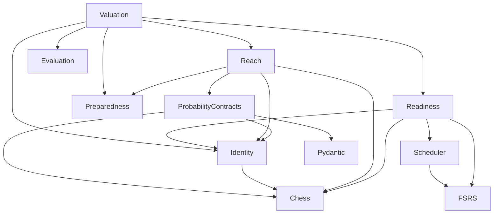

# B02 domain boundary certification

Issue #200 implements the bounded Stage 1 pilot from #192. Existing module
hierarchy, public imports, serialized shapes and scheduling behavior remain.
The only product change redirects probability contracts' `position_key` import
to existing pure `opening_segmentation.opening_position_key`.
`canonical_prefix.position_key` remains available to its existing callers.

## Certified dependency direction

The executable [allowlist](../../../tests/fixtures/domain-boundary/rules.json)
certifies `app.opening_move_probability_contracts` and seven `app.services`
modules: `scheduler`, `decision_readiness`, `opening_card_valuation`,
`opening_policy_reach`, `opening_preparedness`, `opening_ranking_evaluation`,
and `opening_segmentation`. Package initializers are traversed too.
The checked [graph](../../../tests/fixtures/domain-boundary/dependency-graph.json)
records all local edges and explicit library leaves. Updating that fixture
cannot authorize a forbidden edge.

Static traversal resolves absolute, relative, conditional, lazy, re-exported
and literal dynamic imports. Unknown modules, unresolved dynamic imports,
escaped import callables, wildcard imports and unreviewed library symbols fail.
Database/framework/worker/network/process and filesystem imports are prohibited;
calls on injected SQL/network capabilities are rejected too.

Reviewed libraries are python-chess 1.999 / chess 1.11.2, FSRS 6.3.2's
Card/Rating/Scheduler APIs, and Pydantic value validation. Their runtime closure
permits only chess, fsrs, pydantic, pydantic_core, annotated_types,
typing_extensions and typing_inspection as newly imported third-party roots.
Pydantic remains a transitive dependency of existing requirements; record its
installed version rather than adding a pin. FSRS Optimizer, chess engine APIs
and broader Pydantic capabilities are excluded. Pydantic's reviewed dynamic
export/schema loading and URL parsing are value operations. Plugin discovery
cannot import an unreviewed package or initialize a service in guarded execution.

## Exact compatibility exceptions

Every [exception](../../../tests/fixtures/domain-boundary/rules.json) has owner
`aaweaver-actuary`, a reason, a named regular regression, a review milestone and
review deadline **November 12, 2026**. Expired, unused, duplicate, wildcard,
changed-expression or multiple-call exceptions fail. Normalized source-expression
fingerprints avoid Python-version differences in AST dump formatting.

| Exact operation | Bounded use | Guard |
| --- | --- | --- |
| `scheduler.schedule_review` → `datetime.datetime.now` | Existing absent-`reviewed_at` fallback | `test_domain_scheduler_clock_compatibility_is_bounded` |
| `scheduler.schedule_review` → `datetime.date.today` | Existing absent explicit calendar day/time fallback | Same scheduler regression |
| `scheduler.schedule_review` → `fsrs.Card` | New-card epoch identity and FSRS 1 ms collision wait | Same scheduler regression; fixed persisted IDs bypass both |
| `OpeningRankingContext.__post_init__` → `getattr` | Fixed tuple of self value fields | Fixed-as-of contract regression |
| `OpeningCardValuationSnapshot.__post_init__` → `getattr` | Fixed tuple of self evidence collections | Fixed-as-of contract regression |

Scheduling is service-independent with these retained clock exceptions.
New-card serialized IDs are not claimed to be deterministic. Fixed-state proof
supplies explicit times and persisted FSRS identity `200`. Fuzzing stays disabled.
Changing these defaults requires a separate compatibility review.

## Runtime and immutable contract proof

`backend/tests/test_domain_boundaries.py` belongs to the existing regular pytest
gate. Each certified module is imported first in a fresh `python -I -B` process
with credentials removed. During import and real valuation/readiness/scheduling/
replay calls, a finder rejects service and uncertified application imports;
audit hooks and socket guards reject network, database/process initialization
and domain file access. Deliberate violations prove the guards are active.

Python code/native-extension reads and distribution metadata are required for
imports. CPython platform configuration initializes before the guard. An exact
read-only allowance for the existing test probability fixture applies only to
its test-loader frames, never application frames. Test harness processes,
fixtures and logs are not domain capabilities.

The [fixed contract](../../../tests/fixtures/domain-boundary/fixed-as-of.json)
was captured from main `2ef94eaf04e36b8f354af7d95ed901b05cec5baf` before the import
correction. It contains canonical valuation, readiness and scheduling bytes.
Hash-seed replay and an [immutable fixture manifest](../../../tests/fixtures/domain-boundary/immutable-fixtures.json)
protect those bytes and existing probability/snapshot fixtures. Existing tests
retain policy identity, unknown mass, fixed clocks, input permutation,
foreign-identity rejection and no queue admission.

Static traversal covers local source. Reviewed third-party entrypoints are
leaves; their actual imported closure and side effects are checked at runtime.
This is architecture enforcement for reviewed code, not a security sandbox or
certification of every optional library function. Injected scorers retain the
existing trusted-pure-code contract.

## Validation and ownership

Run the smallest named guard first, then
`make python-file FILE=backend/tests/test_domain_boundaries.py`. Run existing
valuation, readiness, preparedness, policy-reach, segmentation and probability
files plus `test_services.py::SchedulerTests`. Run pure ranking/replay node IDs
without services and the full ranking-evaluation file separately for controlled
adapter compatibility. The consumer check is
`TEMPO_PYTHON=backend/.venv/bin/python make unit-file FILE=tests/unit/opening-move-probability-contract-regressions.test.ts`.

Report setup, collection, case time, subprocess/command overhead, wall time,
versions and tested revisions separately. The audit's 2.929 s case sum is not an
end-to-end guarantee. CI owns comprehensive candidate execution. B02 changes no
planner, workflow, runner, aggregation or browser fixture.

`opening_ranking_snapshot` and its capture/planner dependencies remain adapters
outside the allowlist. PR #177's harness/corpus stays separate and unchanged;
B02 fixtures have their own directory. No PostgreSQL transaction, receipt,
queue, migration, application startup or live-study resource changes are part
of this certification. The draft PR supplies development evidence; its expected
`quality` failure is not merge qualification. Do not merge or deploy.
