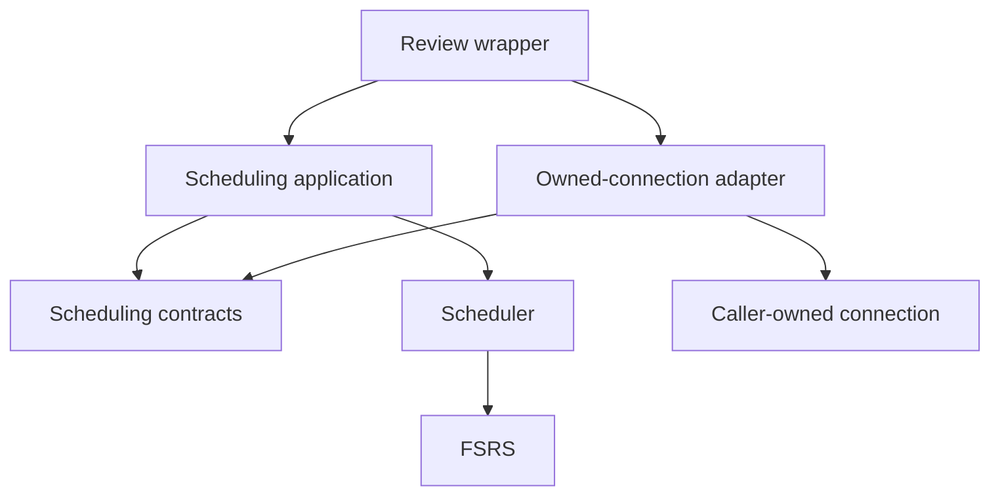

# Independently testable scheduling application

This boundary certifies the A1 seam from merged PR #226. Related work: #192,
#200, #202, #220/PR #227, and #224. It neither implements queue extraction nor
review orchestration extraction. Baseline: main
`c5f773b18c4a5b30a3abda84ecac01ab625a3902`.

## Contract and dependency direction



The contracts module contains the existing immutable records, five-method store
protocol, and result type. Original imports from `scheduling_review_application`
remain available as identical class objects through explicit re-exports. The
application's function body and all record fields are unchanged.

The caller supplies store, source identity, completion timestamp, calendar review
date, and light-mode interval. The five capabilities are source lookup, card-state
load, review append, maturity-facts load, and card-state save. Fresh reviews retain
append → maturity read → save ordering. Source replay retains its current-card
result and skips fresh effects. Missing/archived cards, invalid input, errors,
guided flags, seed facts, and FSRS serialization retain existing behavior.

The adapter borrows the existing connection. Transactions, savepoints, locks,
logical and gateway receipts, queue follow-ups, progression, and post-commit
wakes remain outside this module. There is no new connection, commit, queue
writer, scheduler policy, persisted format, or HTTP contract.

Exact allowed edges are published in
`tests/fixtures/scheduling-boundary/ownership.json`:

| Source | Allowed dependencies |
| --- | --- |
| Contracts | annotation support, dataclasses, datetime, typing |
| Application | contracts, scheduler, datetime, json, annotation support |
| Scheduler | FSRS, dataclasses, datetime, annotation support |
| Package initializers | no imports |

Only the review wrapper imports the application in production. Only the
application and owned store adapter import contracts. Other existing scheduler
consumers remain allowed. The reverse application path is review wrapper → HTTP
review orchestration and study-attempt service; those callers remain responsible
for integration qualification.

## Enforcement and independent execution

`.importlinter` uses built-in forbidden/protected contracts. Internal dependency
edges are closed, infrastructure imports are forbidden, and the two allowed
internal edges are exact, required exemptions. Grimp-backed regular pytest tests
also check all direct edges, the complete internal/external source closure, and
package initializers. Dynamic import loaders are disallowed in the three
certified modules. External libraries are represented as leaf packages in the
static graph; the fresh interpreter is additional runtime proof.

Adversarial tests modify only temporary source copies and run the real linter.
They prove rejection of direct imports, imports inside functions and false
branches, transitive bridges, and unowned consumers. A fresh interpreter blocks
unrelated application/infrastructure imports and service initialization while
executing all 13 existing application cases. No application startup, database,
Redis, Docker, credentials, Node dependencies, or browser is needed for this
independent suite. Pytest, FSRS, and the test-only Import Linter package are the
required direct dependencies; installed service packages are never initialized.

For the normal development environment, from `backend/` run `uv sync`, then
`uv pip install --python .venv/bin/python -r requirements.txt -r requirements-test.txt`.
Return to the repository root:

```sh
PYTHONPATH=backend backend/.venv/bin/lint-imports --config .importlinter --no-cache --show-timings
make python-file FILE=backend/tests/test_scheduling_boundary.py
make python-file FILE=backend/tests/test_scheduling_review_application.py
make python-file FILE=backend/tests/test_scheduling_review_store.py
```

All guards run in regular backend pytest discovery. Python CI installation
includes `requirements-test.txt`; production requirements/images are unchanged.

## Ownership contract for #202

The ownership fixture is module-local evidence, not a replacement CI planner or
permission to omit required integration tests. It records source paths, shared
contracts, owning files, consumers, and native qualification boundaries. Tests
verify consumer relationships against the actual Grimp graph.

| Changed source | Ownership demonstration |
| --- | --- |
| Application implementation | boundary and application tests |
| Unrelated motif detector | motif tests, excluding scheduling owning tests |
| Scheduling contracts | owning tests plus store, wrapper, offline-review, prepared-continuation, and study-durability consumers |

This distinguishes a developer's isolated iteration boundary from complete
product qualification. Real server review consumers retain PostgreSQL and
browser qualification even if the module itself needs none. Unknown/shared
consumer risk remains conservative. No shared CI planner or inventory is changed.
Current main classifies the application as unknown ownership (FULL); scheduler
changes select an existing STUDY mapping. This PR itself selects FULL because
Python test tooling/workflow installation changes are qualification infrastructure.
Actual dependency-aware selection wiring remains with #202.

Native browser consumers include `post-review-progression.spec.ts`,
`training-critical-path.spec.ts`, `study-only-mode.spec.ts`, and the real online
review/replay cases in `studies.spec.ts`. These call ordinary review or study-attempt
routes that reach the scheduling wrapper. Offline delivery that eventually reaches
a real server also depends on it. Fully mocked review/attempt responses prove
client behavior only; browser file membership alone does not establish a backend
edge. The broad current CI gate remains the final owner of all applicable cases.
Native A1 rollback and concurrent-replay proofs remain in regular durability.

## Costs, validation, and rollback

Baseline inspection at local `d82f78e9` on macOS arm64/Python 3.14.8: 13 application
cases passed in 0.10s pytest time / 0.35s process wall time. Baseline source agrees
with the selected main application. Development candidate: 16 boundary cases
passed in 1.32s pytest time / 1.64s invocation wall time; 13 application cases
passed in 0.11s; 10 store cases passed in 2.76s. These are focused results, not a
complete candidate pass or a performance improvement claim. The store tests use
historical in-memory SQLite compatibility; they do not prove PostgreSQL semantics.
Import Linter took 0.168s process wall time: graph construction 0.031s, internal
edge check 0.009s, protected checks 0.001s/0.000s, infrastructure check 0.002s.
Graph construction and contract checks are measured separately using
`--show-timings`; exact output, commands, source revision/diff fingerprint, and
candidate CI references are preserved outside the checkout in
`test-results/scheduling-boundary-2026-10-13/`.

CI owns fresh complete final qualification. No overlapping local full or Docker
suite is scheduled. Reverting the boundary restores the original type locations;
no migration or data conversion is needed. Do not merge or deploy as part of this
work.
