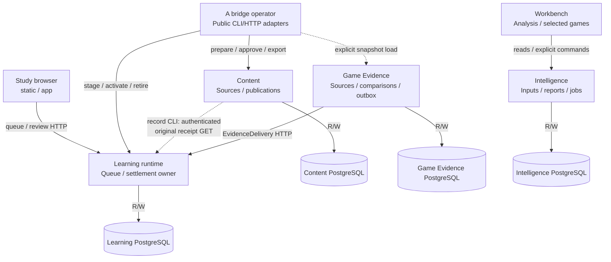

# Architecture drawing index

These are source maps and retained target references, not assignments or deployment certificates. [SPEC](../../../SPEC.md) governs current product requirements and delivery order; [AGENTS](../../../AGENTS.md) governs execution. [#192](https://github.com/aaweaver-actuary/tempo/issues/192) is historical migration context. Source determines implementation facts, not intended requirements. Report a source/SPEC discrepancy instead of silently treating existing behavior as the requirement.

Database table/key/field views live in the [database directory index](../../../database/README.md); physical colocation preserves the component owners shown here. The [implemented frozen-order policy/storage split](../../../backend/app/study/frozen_order/README.md) documents its bounded policy/storage wiring and remaining legacy caller coupling. The subsequent [authored Studies conflict split](../../../backend/app/studies/README.md) keeps line queries in the legacy database owner and pure conflict computation outside it.

The proposed [two-copy backup guard](../../../database/tooling/cli/README.md#two-copy-backup-guard)
shows shared recurring/manual creation admission, bounded replacement staging,
existing CLI restore verification and user-controlled rotation. Source only;
no backup, service or deployment operation was performed.

The [current backend organization view](../../../backend/app/README.md) maps the first separated policy/contract leaves and shared timing declaration. Its [finite checklist](../../../backend/ORGANIZATION.md) keeps remaining legacy workflows and technical composition gaps explicit; reviewing or relocating source does not establish deployment isolation.

## Source and status

**SOURCE IMPLEMENTED / #503:** [Study recombination](../../../backend/app/study/recombination/README.md)
owns the canonical saved-review, route-local join/split transaction, exact manual
attempt confirmation and original-obligation targeting diagrams. Its six-table
ER retains source content and immutable history. Migration 053/readiness 53 and
changed native evidence are source qualification; A08 rerun and deployment are
separate claims.

**PROPOSED / #487:** [Study game feedback](../../../backend/app/study/README.md)
owns the canonical receiver/transaction and normal Study recovery drawings;
[its database chart](../../../database/tempo_legacy_database/adapters/study/README.md)
shows the additive effect receipt/deadline/tombstone schema. These views describe
unmerged source and bounded native evidence, with deployment/resource isolation
unverified. Existing scheduler, queue and review authorities are retained.

Current documentation reconciliation: main at
[`1ce172e9f4f312d7d70b2a363dce7b20dab35baf`](https://github.com/aaweaver-actuary/tempo/commit/1ce172e9f4f312d7d70b2a363dce7b20dab35baf),
reviewed October 26, 2026 UTC. This is a bounded source review of the affected
directory views, public interfaces and recent retirement/graph/launcher changes,
not an exhaustive requalification of every component. Relative source links refer
to that source baseline.

The October 20 [durable integration receipt](../study-isolation-integration-2026-10-20.md)
and PR322–329 entries below remain historical source/build evidence at their
recorded SHAs. They are not fresh acceptance evidence for this later assembly.
No deployment, live schema or effective host resource isolation is implied.

| Label | Meaning and limits |
| --- | --- |
| **MAIN** | Implemented source at the stated baseline or a specifically dated owner view; independent installation, consumer adoption and live deployment are separate claims. |
| **LEGACY / GAP** | Actual shared source, persistence or lifecycle coupling. A scoped observation, not acceptance of that coupling for new paths. |
| **MERGED PR322** | [Games-only viewing PR322](https://github.com/aaweaver-actuary/tempo/pull/322), implementation [`653a85bb5f5b3e520c0eda0c36234d3b416708b4`](https://github.com/aaweaver-actuary/tempo/commit/653a85bb5f5b3e520c0eda0c36234d3b416708b4), is now included in the MAIN baseline above. Source availability does not establish deployment or exact live read grants. |
| **MERGED PR324** | [Physical Study composition PR324](https://github.com/aaweaver-actuary/tempo/pull/324) at [`30191b9c026f27f3d816304c47e5b72e0ec390b0`](https://github.com/aaweaver-actuary/tempo/commit/30191b9c026f27f3d816304c47e5b72e0ec390b0). Historical reviewed feature input, now included in the MAIN baseline; exact merge recorded in the integration receipt. Deployment unverified. |
| **MERGED PR325** | [HostActivity memory/publication isolation PR325](https://github.com/aaweaver-actuary/tempo/pull/325) at [`118389f1d933410ef377a47861001c4d6cf37060`](https://github.com/aaweaver-actuary/tempo/commit/118389f1d933410ef377a47861001c4d6cf37060). Historical reviewed feature input, now included in the MAIN baseline; exact merge recorded in the integration receipt. Deployment unverified. |
| **MERGED PR326** | [Optional endgame worker and pool ownership PR326](https://github.com/aaweaver-actuary/tempo/pull/326) at [`72d5d9c7ab964d5fbbb10528d67ce6cb28e77a18`](https://github.com/aaweaver-actuary/tempo/commit/72d5d9c7ab964d5fbbb10528d67ce6cb28e77a18). Historical reviewed feature input, now included in the MAIN baseline; exact merge recorded in the integration receipt. Deployment unverified. |
| **MERGED PR327** | [Borrowed review-policy transaction PR327](https://github.com/aaweaver-actuary/tempo/pull/327) at [`e07471d2e0eb7699e7992cb5f4a00892430cc0f1`](https://github.com/aaweaver-actuary/tempo/commit/e07471d2e0eb7699e7992cb5f4a00892430cc0f1). Historical reviewed feature input, now included in the MAIN baseline; exact merge recorded in the integration receipt. Deployment unverified. |
| **MERGED PR329** | [Learning queue persistence owner PR329](https://github.com/aaweaver-actuary/tempo/pull/329) at [`5f896cffdc29b228d36ea0b543c004100650b058`](https://github.com/aaweaver-actuary/tempo/commit/5f896cffdc29b228d36ea0b543c004100650b058). Historical reviewed feature input, now included in the MAIN baseline; exact merge recorded in the integration receipt. Deployment unverified. |
| **PR328 DOCS PLACEMENT** | Canonical directory-README diagram placement at [`68f1ab115b6c96846ba5e56373f7348361edd32e`](https://github.com/aaweaver-actuary/tempo/commit/68f1ab115b6c96846ba5e56373f7348361edd32e), reconciled here with the five merged source inputs. |
| **PROPOSED** | Use this label and pinned PR source links for future unmerged changes; do not silently include them in MAIN. |
| **TARGET** | Adopted direction without an implementation claim. |
| **DEPLOYMENT UNVERIFIED** | No live process, configuration, resource allocation, credential, database or deployment was inspected or changed for these drawings. |

PR319's encountered-card practice proposal is paused and excluded from these
implemented views; it supplies no current API/behavior claim. The Games reader
views now describe merged PR322 source, while operational activation is unverified. The user-identified live
Study revision `86d11afe` is outside this inspection and was not touched.

## Current public surfaces and coupling limits

**Reduced, not eliminated.** Stable public-contract dependencies are intentional;
the goal is to eliminate private implementation and shared mutable/lifecycle
authority coupling at the changed boundary, not to have no dependencies. The recent source cuts remove optional producers,
not the legacy assembly's shared database, broker, command registry or all
cross-workflow imports. Retained stored facts do not imply a live call to their
retired producer, and a public function name alone does not prove an independently
replaceable plugin.

| Current boundary / change | Canonical owner and remaining limitation |
| --- | --- |
| Games guided-review server and daily statistics | [Legacy service retirement map](../../../backend/app/services/README.md#retired-optional-capabilities) distinguishes the removed routes/commands/materialization from retained Study scheduling, game-feature calculation and canonical publication. Physical stored schema is not dropped. |
| Opportunity and adaptive-priority producers | [Opportunity flow](../../../backend/app/services/README.md#opportunity-production-and-optional-api-retirement) and [priority flow](../../../backend/app/services/README.md#adaptive-priority-producer-retirement) remove refresh/scoring/worker edges. Ordinary queue owners still read saved opportunity/score/miss facts and retain fallback, source invalidation and canonical writing. |
| Browser extension seam | [Study browser capabilities](../../../app/README.md#public-browser-capabilities-and-extension-limits) names connection/session exports and injected workspace callbacks. The physical Study entry excludes the legacy workspace; the full build still shares shell/runtime/state. This is not dynamic plugin discovery. |
| Policy versus command composition | [Backend public surfaces](../../../backend/app/README.md#public-surfaces-and-extension-boundary) distinguishes supplied-fact policy, named contracts and borrowed storage from the legacy global command registry and HTTP/worker root. Local guards are scoped, not a repository-wide no-cycle proof. |
| Graph recovery and serving | [Fresh graph helper](../../../database/tooling/opening_graph_fresh_learning/README.md) composes public Content/bridge/Learning commands; [title activation](../../../database/tempo_learning_database/adapters/publication-execution/README.md#optional-repertoire-display-title) preserves optional titles atomically. The source recovery bundle remains separate from Learning's reduced serving projection. |
| Launcher and installed runtime | [Scripts](../../../scripts/README.md) expose planning, readiness, transition and fail-closed v2 routing; [persistent quarantine](../../../config/study-persistent/README.md) is non-serving preparation. Merged source does not establish a configured default provider, completed installed admission or live startup acceptance. |

The [graph-preserving fresh-start disposition](../../../database/PERSISTENCE-DISPOSITION.md)
and merged source cuts supersede the earlier retained-drain assumptions for those
retired capabilities. The late-merged [#429 proposal](https://github.com/aaweaver-actuary/tempo/pull/429)
is historical decision/source evidence, not proof that its former producer,
refresh URL or recovery handler still exists.

At this baseline, startup leaves
[#469](https://github.com/aaweaver-actuary/tempo/pull/469),
[#470](https://github.com/aaweaver-actuary/tempo/pull/470),
[#471](https://github.com/aaweaver-actuary/tempo/pull/471),
[#472](https://github.com/aaweaver-actuary/tempo/pull/472) and
[#473](https://github.com/aaweaver-actuary/tempo/pull/473) are **PROPOSED / UNMERGED**:
installed authority, serving configuration, database readback, cold start and
completed admission are not current-main functionality. Their PRs carry their
own source/fake evidence; do not infer live readiness from those receipts.

For an additional optional integration, reuse an existing named public contract,
wire implementations only in outer composition, and identify one owner for state,
transactions, retries, cancellation and shutdown. Ordinary Study must not wait
for that integration; queue influence enters Learning's semantic command boundary,
not its tables. Existing evidence supports bounded separability, **not** a blanket
claim of robust arbitrary plugins, eliminated coupling or deployed failure/resource
isolation.

## Bounded resumption priorities

The table contains dated candidate follow-ups, not prerequisites or automatically active assignments.

Resume from the pinned source and the existing owner task, not from an assumption
that a merged preparation PR is an installed, accepted system. These are proposed
next tasks, not changes implemented by this documentation update.

| Priority / bounded owner task | Public boundary to preserve | Evidence needed before claiming closure |
| --- | --- | --- |
| 1. Reconcile Game Evidence's export inventory | [`components.json`](../../../components.json) lists five `game-evidence` exports; [the actual `__all__`](../../../services/game-evidence/src/tempo_game_evidence/__init__.py) lists ten, including the legacy authority/preview types. Decide the supported public surface with that owner; do not silently drop working exports. | Run the selected component boundary validator and existing import-side-effect proof after the owning fix. [`check-python.py`](../../../tools/component-build/check-python.py) compares exact lists, so source inspection predicts a mismatch; this review did **not** execute it or establish a runtime failure. |
| 2. Finish the installed launcher composition, only after its dependencies are reviewed | Keep [planning/readiness/transition](../../../scripts/README.md) separate from normal start/stop/status. Review the unmerged #469–473 owner surfaces and bind the selected image, configuration, database readback and completed admission; do not add a second launcher or bypass fail-closed routing. | Exact installed-source/target correspondence, public-command readback and bounded startup/shutdown proof. Fake/synthetic receipts are not real-target acceptance or cutover authorization. |
| 3. Remove the specific legacy worker-to-HTTP-root registration edge | [`background_worker.py`](../../../backend/app/background_worker.py) imports `main.coordinator`; [`tasks.py`](../../../backend/app/tasks.py) imports command modules for registration. Give outer composition an explicit owned registrar/handler set, preserving command identities and receipt authority. | Fresh-process import/duplicate-registration checks and an owning worker proof that does not import the HTTP root. Preserve existing command/transaction/recovery behavior; no generic plugin framework is needed. |
| 4. Narrow one legacy Study facade at a time | Start with [frozen-order composition](../../../backend/app/study/frozen_order/README.md), which already has pure public policy/fact exports but still binds feedback and private queue-order helpers. Keep the caller transaction and canonical queue writer. | Fake semantic-capability tests plus the retained borrowed-transaction/queue-order regression for that changed boundary; check the actual imports, not just folder placement. |
| 5. Qualify each optional integration's failure/removal boundary | Reuse explicit owner APIs; optional practice influence enters Learning, never its tables. Do not restart removed producers merely to demonstrate extensibility. | For a separately authorized integration, establish installed import/build closure without its implementation, then stop/fail it after accepted intake while the same Study instance retains queue/review/replay behavior. Record actual shared host/database limits. |

Before resuming an interrupted disposable import or rehearsal, inspect its
existing task-owned resources, artifacts and incomplete effects before deciding
whether a retry or cleanup is safe. This documentation review did not inspect or
clean those resources and grants no reset, deletion, deployment or live cutover
authority. Reuse still-applicable exact-source receipts; documentation-only
reconciliation is not a reason to repeat runtime suites.

## Implemented component increments

The [proposed local pgAdmin companion](../../../config/pgadmin/README.md#ownership-and-startup)
has its own bounded operational view. It is not activated or a Study dependency.

**MAIN:** these implementations coexist with the
[legacy assembly](../../../backend/README.md#legacy-assembly-and-existing-coupling). This
view shows source interfaces available for explicit composition, not a claim that
all users or live data have moved to them. `apps/study-web` remains a planned
independent artifact; the Learning-connected Study build reuses `static`/`app`.
`R/W` storage edges mean reads/writes by that state's owning component.

The bridge is an explicit operator tool, not an automatically invoked Learning
dependency. Content's explicit record CLI also makes its own authenticated
Learning receipt read before recording a result; see the
[publication sequence](../../../services/content/README.md#content-publication-and-serving-activation-main).
The former external A-export pilot is retired from maintained source; its
[last source snapshot](https://github.com/aaweaver-actuary/tempo/tree/b39dd3a9ac2e846f1d2a9242a9d8a2eda682f9a8/tools/analysis-restoration/c_pilot)
is historical reference, not an active edge in this view. Intelligence also
implements Explorer source work and Maia job/result APIs, omitted here to bound the graph: its
[provider worker](../../../services/intelligence/src/tempo_intelligence/worker.py)
owns HTTP source calls, [Maia validation](../../../services/intelligence/src/tempo_intelligence/maia.py)
binds registered jobs/results, and the [Maia inference core](../../../workers/maia/README.md#retained-inference-boundary)
owns model computation. Its unused standalone supervisor/CLI is retired; the root
coverage scripts and Dockerfile.maia retain their separate execution path. These APIs do not grant Learning admission authority or
establish a deployed worker connection.

| Edge / boundary | Concrete source and interface |
| --- | --- |
| Study build and connection | [Vite target](../../../vite.static.config.ts), [static entry](../../../static/src/main.tsx), [Study connection](../../../app/lib/study-connection.ts) (`learningFetch`, origin/path allowlist). [Study artifact status](../../../apps/study-web/README.md) is still planned. |
| Learning HTTP, transaction and install closure | [`create_app`](../../../services/learning/runtime/src/tempo_learning_runtime/api.py), [`Database`](../../../database/tempo_learning_database/connections.py), [installed dependencies](../../../services/learning/runtime/pyproject.toml). Game Evidence **contracts**, not its service implementation, are installed. |
| Content/bridge and activation | [Content `Store`](../../../database/tempo_content_database/adapters/store.py), [bridge domain](../../../services/content/src/tempo_content/bridge/__init__.py), [operator](../../../tools/analysis-restoration/a_bridge/src/tempo_a_bridge/cli.py), [Learning publication bridge](../../../services/learning/runtime/src/tempo_learning_runtime/publication_bridge.py). See [activation flow](../../../services/content/README.md#content-publication-and-serving-activation-main). |
| Game Evidence output and delivery | [`Store`](../../../database/tempo_game_evidence_database/adapters/store.py), [`deliver_one`](../../../services/game-evidence/src/tempo_game_evidence/delivery.py), [analysis export](../../../services/game-evidence/src/tempo_game_evidence/analysis_export.py), [Learning receiver](../../../services/learning/runtime/src/tempo_learning_runtime/receivers.py). |
| Workbench / Intelligence | [`IntelligenceClient`](../../../apps/workbench-web/src/client.ts), [`PendingCommands`](../../../apps/workbench-web/src/commands.ts), [HTTP composition](../../../services/intelligence/src/tempo_intelligence/api.py), [Analysis routes](../../../services/intelligence/src/tempo_intelligence/analysis/api.py), [`AnalysisStore`](../../../database/tempo_intelligence_database/adapters/analysis_store.py). |
| Engine dispatch | [bounded Intelligence dispatcher](../../../services/intelligence/src/tempo_intelligence/analysis/worker.py), injected client interface (no concrete worker dependency), [job/result contracts](../../../contracts/analysis-jobs/README.md). The standalone Stockfish worker/client is retired; see its [pre-removal snapshot](https://github.com/aaweaver-actuary/tempo/tree/cb0ed5910e6bd05894919fd8d49f5dc7bc236975/workers/stockfish). Maia and native/browser engine paths remain. The external A-export pilot is retired; see its [historical source snapshot](https://github.com/aaweaver-actuary/tempo/tree/b39dd3a9ac2e846f1d2a9242a9d8a2eda682f9a8/tools/analysis-restoration/c_pilot). |
| Shared libraries | [scheduling](../../../packages/scheduling/README.md), [chess identity](../../../packages/chess-core/README.md), [browser intents](../../../database/browser-intents/README.md), [Study session](../../../packages/study-session/README.md), [board renderer](../../../packages/board-ui/README.md), [contract index](../../../contracts/README.md). Package existence is not proof of every consumer's adoption. |

## Views and maintenance owners

Each Mermaid block has one canonical home in a directory `README.md`. The system
overview renders above; the component and sequence blocks render in the owning
README sections linked below. This makes directory navigation useful without
duplicating drawing bodies. The former [system](system.md),
[Study/Games](study-games.md) and [sequence](flows.md) pages retain their headings
as compatibility pointers and cross-cutting notes, not second copies.

Owners below are component responsibilities, not invented individual assignments.
The implementing PR author updates the affected view; reviewers of the named
component and any changed contract check its correspondence. See the
[component registry](../../../components.json) for registration and qualification
ownership; its status alone does not prove adoption.

| View / canonical README section | Level / question | Maintenance owner and source entry |
| --- | --- | --- |
| [Extracted component map](#implemented-component-increments) | System: what can run separately, and who owns each database? | Composition/affected service owners; [Learning](../../../services/learning/runtime/README.md), [Content](../../../services/content/README.md), [Game Evidence](../../../services/game-evidence/README.md), [Intelligence](../../../services/intelligence/README.md). |
| [Legacy assembly](../../../backend/README.md#legacy-assembly-and-existing-coupling) | System: where do current full-app dependencies cross those target boundaries? | Legacy app/backend owners; [Home](../../../app/views/home_view.tsx), [backend root](../../../backend/app/main.py), [Compose](../../../docker-compose.yml). |
| [Data, resource and lifecycle ownership](system.md#data-resource-and-lifecycle-owners) | Component: migrations, pools, shutdown and shared failure domains | Each state/resource owner; source links in the table. |
| [Study dependency detail](../../../app/README.md#main-study-path-and-source-gap) | Component: which adapters and semantic ports serve Study, and how is optional workspace ownership excluded from Study? | Study browser/session and Learning owners (merged MAIN source); [connection](../../../app/lib/study-connection.ts), [ReviewStore](../../../services/learning/application/src/tempo_learning_review/ports.py). |
| [Conditional Study build/offline assets](../../../static/README.md#conditional-study-build-and-offline-assets-main) | Build/data flow: can emitted optional chunks enter the required offline shell without executing? | Study build and offline-shell owners; [inventory plugin](../../../scripts/offline-shell-assets.ts), [service worker](../../../public/sw.js), [readiness client](../../../app/lib/offline-shell.ts). PR324 retains actual emitted-artifact and synthetic offline evidence; combined deployment unverified. |
| [Shared Learning request execution gaps](../../../services/learning/runtime/README.md#shared-learning-request-execution-gaps-main) | Runtime/failure boundary: where can host publication and optional endgame work delay essential Study progress? | Learning HTTP, HostActivity and endgame adapter owners; [API](../../../services/learning/runtime/src/tempo_learning_runtime/api.py), [host publisher](../../../services/learning/runtime/src/tempo_learning_runtime/host_activity.py). Host ownership remains; the merged endgame calculation removal retires its worker/pools and preserves saved receipt/practice boundaries. The receipt remains historical evidence for its dated assembly, not removal qualification. |
| [Games reader](../../../apps/workbench-web/README.md#merged-pr322-games-reader) | Component: UI capability, read projection, grants, lifecycle and resource budget | Workbench and Intelligence read owner; PR322 source links in the view. |
| [Review and lost-response recovery](../../../services/learning/runtime/README.md#review-commit-and-recovery-main) | Sequence: durable browser intent, transaction owner, logical settlement, next load | Study session, Learning review and queue owners. |
| [Evidence and asynchronous admission](../../../services/game-evidence/README.md#observed-game-evidence-to-learning-main) | Sequence/data flow: independent producer, immutable delivery, receipts, lease fencing and queue effects | Game Evidence delivery, Learning receiver/remediation/admission owners. |
| [Publication and activation](../../../services/content/README.md#content-publication-and-serving-activation-main) | Data flow: immutable definitions versus serving authority | Content, bridge operator and Learning publication owners. |
| [Games read and failure](../../../apps/workbench-web/README.md#games-read-failure-and-disposal-main-merged-pr322) | Sequence: accepted snapshot read, unavailable state, cleanup | Workbench Games reader and Intelligence transaction/lifespan owners; merged PR322 source, deployment unverified. |

## Drawing conventions

Flowchart arrows point from caller/consumer to capability/provider; labels name
the operation, transport or read/write effect. Dotted arrows explicitly label
navigation, serialized transfer or a source gap; they are not silently omitted
dependencies. Cylinders represent owned storage, subgraphs group composition or
ownership rather than guaranteeing a process/container. Sequence arrows show
calls and dashed arrows show results; notes name commit boundaries and durable
asynchrony. A receipt of acceptance does not imply queue admission or study
completion. Pure libraries may be shared without creating service dependencies.

Use GitHub-supported `flowchart` and `sequenceDiagram` fenced `mermaid` blocks,
quoted flowchart labels and stable node IDs. Avoid external assets, plugins,
click scripts, experimental diagram types or a single repository-sized graph.
Keep explanatory detail and source links beside each bounded view.

## Maintenance and review procedure

1. Determine whether the assigned change materially alters a represented boundary.
   No runtime boundary change means no new diagram. For a new materially changed
   boundary, add one appropriately bounded view, not a documentation programme.
2. Update only its canonical owner README/view and directly affected navigation.
   Show real callers, state/transaction authority, relevant failures, and proposed
   versus implemented status. Reuse existing views; do not duplicate diagrams or
   refresh unrelated baselines.
3. Check source correspondence and changed local links. Parse changed Mermaid
   with already available tooling when useful. Inspect rendered layout when
   changed diagram structure makes it necessary and the renderer is available.
   Do not install tooling, run browsers/services, or repeat cosmetic adjustments
   merely to qualify prose. Report unavailable checks without equating them to
   functional failure; actual explicit requirements remain applicable.
4. Put a concise architecture-impact statement in the existing PR. Missing or
   misleading material ownership information is actionable; unchanged-diagram
   polish is not another release gate.

This criterion preserves data, permissions, applicable gates, and independence
of the changed path under [root working rules](../../../AGENTS.md). It does not
assign unrelated extraction or waive safeguards.
