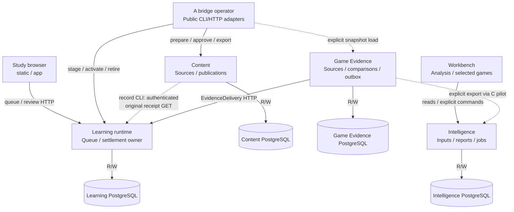

# Architecture drawing index

These maintained Mermaid views are reviewable maps of source, not deployment
certificates. Start at the system level, follow the component links, then use a
sequence to inspect the transaction or failure boundary in question. The
[adopted target](../component-reconstruction.md) and
[migration index #192](https://github.com/aaweaver-actuary/tempo/issues/192) remain
the target/migration authorities. Source wins if a drawing disagrees; correct the
drawing and disclose the discrepancy.

## Source and status

Baseline reviewed: `main` at
[`fc92a4d9765bc43997151b09613e353f161d4263`](https://github.com/aaweaver-actuary/tempo/commit/fc92a4d9765bc43997151b09613e353f161d4263),
verified October 20, 2026 after PR323 merged. This directory-README follow-up moves
the ten reviewed diagram bodies without changing them. Their code baseline remains
PR322's merged implementation; PR323 added documentation only. Relative source
links track the reviewed main tree and should change with affected code.

| Label | Meaning and limits |
| --- | --- |
| **MAIN** | Implemented source at the baseline; independent installation, consumer adoption and live deployment are separate claims. |
| **LEGACY / GAP** | Actual shared source, persistence or lifecycle coupling. A scoped observation, not acceptance of that coupling for new paths. |
| **MERGED PR322** | [Games-only viewing PR322](https://github.com/aaweaver-actuary/tempo/pull/322), implementation [`653a85bb5f5b3e520c0eda0c36234d3b416708b4`](https://github.com/aaweaver-actuary/tempo/commit/653a85bb5f5b3e520c0eda0c36234d3b416708b4), is now included in the MAIN baseline above. Source availability does not establish deployment or exact live read grants. |
| **PROPOSED PR324** | [Study composition repair PR324](https://github.com/aaweaver-actuary/tempo/pull/324) was observed open at [`799d6a56c3e1c32328d4323681e9d91cd26dc3eb`](https://github.com/aaweaver-actuary/tempo/commit/799d6a56c3e1c32328d4323681e9d91cd26dc3eb). It is not part of this MAIN baseline. The current import/offline gaps are retained; this ref does not establish completion of the separate request-execution repairs or deployment. |
| **PROPOSED** | Use this label and pinned PR source links for future unmerged changes; do not silently include them in MAIN. |
| **TARGET** | Adopted direction without an implementation claim. |
| **DEPLOYMENT UNVERIFIED** | No live process, configuration, resource allocation, credential, database or deployment was inspected or changed for these drawings. |

PR319's encountered-card practice proposal is paused and excluded from these
implemented views; it supplies no current API/behavior claim. The Games reader
views now describe merged PR322 source, while operational activation is unverified. The user-identified live
Study revision `86d11afe` is outside this inspection and was not touched.

## Implemented component increments

**MAIN:** these implementations coexist with the
[legacy assembly](../../../backend/README.md#legacy-assembly-and-existing-coupling). This
view shows source interfaces available for explicit composition, not a claim that
all users or live data have moved to them. `apps/study-web` remains a planned
independent artifact; the Learning-connected Study build reuses `static`/`app`.
`R/W` storage edges mean reads/writes by that state's owning component.

The bridge is an explicit operator tool, not an automatically invoked Learning
dependency. Content's explicit record CLI also makes its own authenticated
Learning receipt read before recording a result; see the
[publication sequence](../../../services/content/README.md#content-publication-and-serving-activation-main).
Likewise the pilot supplies the Stockfish client; merely serving an
accepted report does not start that worker. Intelligence also implements Explorer
source work and Maia job/result APIs, omitted here to bound the graph: its
[provider worker](../../../services/intelligence/src/tempo_intelligence/worker.py)
owns HTTP source calls, [Maia validation](../../../services/intelligence/src/tempo_intelligence/maia.py)
binds registered jobs/results, and the [independent Maia worker](../../../workers/maia/README.md)
owns model execution. These APIs do not grant Learning admission authority or
establish a deployed worker connection.

| Edge / boundary | Concrete source and interface |
| --- | --- |
| Study build and connection | [Vite target](../../../vite.static.config.ts), [static entry](../../../static/src/main.tsx), [Study connection](../../../app/lib/study-connection.ts) (`learningFetch`, origin/path allowlist). [Study artifact status](../../../apps/study-web/README.md) is still planned. |
| Learning HTTP, transaction and install closure | [`create_app`](../../../services/learning/runtime/src/tempo_learning_runtime/api.py), [`Database`](../../../services/learning/runtime/src/tempo_learning_runtime/database.py), [installed dependencies](../../../services/learning/runtime/pyproject.toml). Game Evidence **contracts**, not its service implementation, are installed. |
| Content/bridge and activation | [Content `Store`](../../../services/content/src/tempo_content/store.py), [bridge domain](../../../services/content/src/tempo_content/bridge.py), [operator](../../../tools/analysis-restoration/a_bridge/src/tempo_a_bridge/cli.py), [Learning publication bridge](../../../services/learning/runtime/src/tempo_learning_runtime/publication_bridge.py). See [activation flow](../../../services/content/README.md#content-publication-and-serving-activation-main). |
| Game Evidence output and delivery | [`Store`](../../../services/game-evidence/src/tempo_game_evidence/store.py), [`deliver_one`](../../../services/game-evidence/src/tempo_game_evidence/delivery.py), [analysis export](../../../services/game-evidence/src/tempo_game_evidence/analysis_export.py), [Learning receiver](../../../services/learning/runtime/src/tempo_learning_runtime/receivers.py). |
| Workbench / Intelligence | [`IntelligenceClient`](../../../apps/workbench-web/src/client.ts), [`PendingCommands`](../../../apps/workbench-web/src/commands.ts), [HTTP composition](../../../services/intelligence/src/tempo_intelligence/api.py), [Analysis routes](../../../services/intelligence/src/tempo_intelligence/analysis/api.py), [`AnalysisStore`](../../../services/intelligence/src/tempo_intelligence/analysis/store.py). |
| Engine dispatch | [pilot CLI](../../../tools/analysis-restoration/c_pilot/src/tempo_analysis_pilot/cli.py), [public-client adapter](../../../tools/analysis-restoration/c_pilot/src/tempo_analysis_pilot/stockfish_client.py), [bounded dispatcher](../../../services/intelligence/src/tempo_intelligence/analysis/worker.py), [worker API](../../../workers/stockfish/index.mjs), [job/result contracts](../../../contracts/analysis-jobs/README.md). |
| Shared libraries | [scheduling](../../../packages/scheduling/README.md), [chess identity](../../../packages/chess-core/README.md), [browser intents](../../../packages/browser-intents/README.md), [Study session](../../../packages/study-session/README.md), [board renderer](../../../packages/board-ui/README.md), [contract index](../../../contracts/README.md). Package existence is not proof of every consumer's adoption. |

## Views and maintenance owners

Each Mermaid block has one canonical home in a directory `README.md`. The system
overview renders above; the component and sequence blocks render in the owning
README sections linked below. This makes directory navigation useful without
duplicating drawing bodies. The former [system](system.md),
[Study/Games](study-games.md) and [sequence](flows.md) pages retain their headings
as compatibility pointers and cross-cutting notes, not second copies.

Owners below are component responsibilities, not invented individual assignments.
The implementing PR author updates the affected view; reviewers of the named
component and any changed contract check its correspondence. See the
[component registry](../../../components.json) for registration and qualification
ownership; its status alone does not prove adoption.

| View / canonical README section | Level / question | Maintenance owner and source entry |
| --- | --- | --- |
| [Extracted component map](#implemented-component-increments) | System: what can run separately, and who owns each database? | Composition/affected service owners; [Learning](../../../services/learning/runtime/README.md), [Content](../../../services/content/README.md), [Game Evidence](../../../services/game-evidence/README.md), [Intelligence](../../../services/intelligence/README.md). |
| [Legacy assembly](../../../backend/README.md#legacy-assembly-and-existing-coupling) | System: where do current full-app dependencies cross those target boundaries? | Legacy app/backend owners; [Home](../../../app/views/home_view.tsx), [backend root](../../../backend/app/main.py), [Compose](../../../docker-compose.yml). |
| [Data, resource and lifecycle ownership](system.md#data-resource-and-lifecycle-owners) | Component: migrations, pools, shutdown and shared failure domains | Each state/resource owner; source links in the table. |
| [Study dependency detail](../../../app/README.md#main-study-path-and-source-gap) | Component: which adapters and semantic ports serve Study, and where is Games still in shared source? | Study browser/session and Learning owners; [connection](../../../app/lib/study-connection.ts), [ReviewStore](../../../services/learning/application/src/tempo_learning_review/ports.py). |
| [Conditional Study build/offline assets](../../../static/README.md#conditional-study-build-and-offline-assets-main) | Build/data flow: can emitted optional chunks enter the required offline shell without executing? | Study build and offline-shell owners; [inventory plugin](../../../scripts/offline-shell-assets.ts), [service worker](../../../public/sw.js), [readiness client](../../../app/lib/offline-shell.ts). Source checked; emitted artifact and live failure unverified. |
| [Shared Learning request execution gaps](../../../services/learning/runtime/README.md#shared-learning-request-execution-gaps-main) | Runtime/failure boundary: where can host publication and optional endgame work delay essential Study progress? | Learning HTTP, HostActivity and endgame adapter owners; [API](../../../services/learning/runtime/src/tempo_learning_runtime/api.py), [host publisher](../../../services/learning/runtime/src/tempo_learning_runtime/host_activity.py). Open source-supported gaps, not reproduced live failures. |
| [Games reader](../../../apps/workbench-web/README.md#merged-pr322-games-reader) | Component: UI capability, read projection, grants, lifecycle and resource budget | Workbench and Intelligence read owner; PR322 source links in the view. |
| [Review and lost-response recovery](../../../services/learning/runtime/README.md#review-commit-and-recovery-main) | Sequence: durable browser intent, transaction owner, logical settlement, next load | Study session, Learning review and queue owners. |
| [Evidence and asynchronous admission](../../../services/game-evidence/README.md#observed-game-evidence-to-learning-main) | Sequence/data flow: independent producer, immutable delivery, receipts, lease fencing and queue effects | Game Evidence delivery, Learning receiver/remediation/admission owners. |
| [Publication and activation](../../../services/content/README.md#content-publication-and-serving-activation-main) | Data flow: immutable definitions versus serving authority | Content, bridge operator and Learning publication owners. |
| [Games read and failure](../../../apps/workbench-web/README.md#games-read-failure-and-disposal-main-merged-pr322) | Sequence: accepted snapshot read, unavailable state, cleanup | Workbench Games reader and Intelligence transaction/lifespan owners; merged PR322 source, deployment unverified. |

## Drawing conventions

Flowchart arrows point from caller/consumer to capability/provider; labels name
the operation, transport or read/write effect. Dotted arrows explicitly label
navigation, serialized transfer or a source gap; they are not silently omitted
dependencies. Cylinders represent owned storage, subgraphs group composition or
ownership rather than guaranteeing a process/container. Sequence arrows show
calls and dashed arrows show results; notes name commit boundaries and durable
asynchrony. A receipt of acceptance does not imply queue admission or study
completion. Pure libraries may be shared without creating service dependencies.

Use GitHub-supported `flowchart` and `sequenceDiagram` fenced `mermaid` blocks,
quoted flowchart labels and stable node IDs. Avoid external assets, plugins,
click scripts, experimental diagram types or a single repository-sized graph.
Keep explanatory detail and source links beside each bounded view.

## Maintenance and review procedure

1. Identify changed interfaces, callers, databases, effects, transactions,
   commands/receipts, failure, cancellation, shutdown and resource owners. Search
   source and public exports as well as this index and `components.json`.
2. Update only affected system/component/sequence views in the same PR as the
   architecture change. Add a bounded view for an unrepresented changed boundary;
   its absence is not a no-impact reason. Place the canonical block directly in
   the relevant owning directory's `README.md`; keep this README's overview and
   placement links current. For a cross-component drawing, choose one README home
   and link from peer directories. Move existing blocks/source notes and update
   references instead of copying a drawing. Split an unreadable graph by question. Link new nodes and
   important edges to concrete source files and symbols in nearby prose/tables;
   preserve named gaps instead of drawing only the desired design.
3. Check both ends of each edge. Verify who can read/write each state, which
   transaction commits receipts with effects, and what retries or loses authority
   after timeout, cancellation, stale generation or lost response. Study must have
   no Games call/import/wait/readiness/transaction/lifecycle dependency. Optional
   influence must enter Learning's semantic interface, never its tables directly.
4. Label source state and exact baseline. Keep unmerged diagrams pinned to the
   reviewed PR SHA. When adopted, verify the actual merge/source, move the view
   into MAIN, and replace proposal links; do not infer deployment from merging.
   Refresh only affected baseline/evidence statements and explain reuse limits.
5. Extract edited Mermaid blocks and parse with already available lightweight
   Mermaid tooling if present; report its version and limits. Check relative paths
   and anchors, pinned source links and symbol correspondence. Run
   `npm run check:conflicts` and `git diff --check` per [testing](../../testing.md).
   Inspect GitHub's rendered Markdown at useful width; parsing alone does not
   prove layout or GitHub's exact renderer version. Record any unavailable check.
   Do not install a new toolchain, start services or run heavy suites for drawings.
6. In the PR, write `Architecture impact:` with updated view links and the actual
   boundary change, or `Architecture impact: none` with a concrete reason. State
   relevant checks, exceptions, and deployment/resource claims still unverified.
   Reviewers check the graph against source, not just its appearance or test count.

This documentation criterion preserves the [MVP policy](../../../AGENTS.md#deliver-a-usable-single-user-mvp),
essential data/permission safeguards and existing required checks. It neither
requires every extraction/edge case before delivery nor excuses coupling in a
new or changed path that claims isolation.
