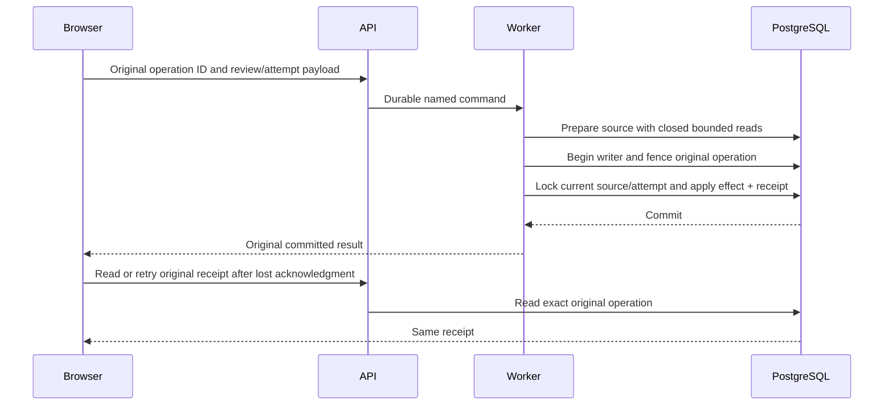

# Retained transaction and recovery flow

Source candidate; these diagrams do not certify installation or assembled behavior.

Foreground broker wakes remain advisory. Existing periodic operation and queue recovery preserve accepted Study work. Retired command names are excluded from redelivery and report a non-retryable paused status while retaining original payloads and states. Schema 64 snapshots retired identities into `tempo_retired_work`; it does not rewrite their historical records.

Native PostgreSQL locking, rollback, race behavior and saved-review-to-next-card behavior still require disposable database/assembled proof. Compilation, injected driver tests, source-link scans and frontend builds establish narrower source evidence only.
