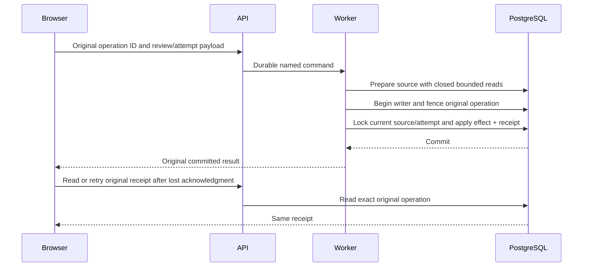

# Retained transaction and recovery flow

Source candidate; these diagrams do not certify installation or assembled behavior.



Foreground broker wakes remain advisory. Existing periodic operation and queue recovery preserve accepted Study work. Retired command names are excluded from redelivery and report a non-retryable paused status while retaining original payloads and states. Schema 64 snapshots retired identities into `tempo_retired_work`; it does not rewrite their historical records.

Native PostgreSQL locking, rollback, race behavior and saved-review-to-next-card behavior still require disposable database/assembled proof. Compilation, injected driver tests, source-link scans and frontend builds establish narrower source evidence only.

For next-card acquisition, the three queue GET routes delegate through Study
composition to the next-exercise operation. It reads a snapshot, issues or
replays the original head and rechecks day and head before returning the flat
queue. Position manifests use `position_checkpoint`; the fixed storage reads
borrow the caller's connection. A pending command retains its original operation
receipt; a held position and an unavailable projection remain distinct. Explicit
foreground admission denial uses `foreground_wait`. No optional prepare-next or
feedback preparation command is part of this flow.

Schema 66 is the source expectation, not a queried runtime schema or evidence of
an applied migration.

An accepted manual split for an issued Study attempt creates a durable intent
and an immutable waiting acknowledgment in the original command transaction.
The existing essential recovery path checks for the exact saved human review;
it queues one deterministic foreground child command, which revalidates the
source and publishes the split and intent result atomically. A held intent
records its reason. Waiting intents do not veto queue issuance; existing attempts
remain usable and unrelated queue entries remain eligible. The child retries its
original identity while another attempt is active and can progress after input
becomes quiet; continuous new attempts have no established fairness guarantee. Native transaction, race, recovery and assembled
browser acceptance are required before this source claim is qualified.

```mermaid
sequenceDiagram
  participant Browser
  participant API
  participant Writer as Foreground writer
  participant DB as PostgreSQL
  participant Recovery as Essential operation recovery
  Browser->>Writer: Accept split with original card, revision and queue entry
  Writer->>DB: Commit waiting intent and original operation receipt
  Browser->>Writer: Save the original review
  Writer->>DB: Commit review and original review receipt
  Recovery->>DB: Match saved review and enqueue stable child operation
  Recovery->>Writer: Dispatch child through existing foreground recovery
  Writer->>DB: Revalidate fences; commit split and intent result together
  Browser->>API: Read original intent status
  API->>DB: Read exact intent
```

A position-introduction history conflict is recorded by the Study storage owner
in the same transaction as the queue checkpoint. The affected introduction
remains held while the refresh can continue to unrelated work; later refreshes
revalidate the source and history. Transient lock contention remains retryable.

```mermaid
sequenceDiagram
  participant Worker as Study refresh worker
  participant Store as Study storage owner
  participant DB as PostgreSQL
  Worker->>Store: Fence exact position introduction and history
  Store->>DB: Lock source, aliases, and inspect retained history
  DB-->>Store: Retained attempt conflict
  Store->>DB: Record source, target, alias, revision, and reason
  Worker->>DB: Advance original refresh checkpoint in same transaction
  DB-->>Worker: Commit hold and checkpoint together
  Worker->>Worker: Continue other introductions; recheck on later selection
```

For a newly generated ordinary opening attempt, the browser records ephemeral
fresh-attempt provenance and tries to hold the original attempt's Web Lock.
After a positively observed first IndexedDB transaction abort and a generation
change, recovery can restore the original event only while the same authority
and locator return, the lock remains held, no aggregate or evidence delivery
has been exposed, and the journal, events and phone aggregate checks permit the
same transaction. Exposure aborts an in-flight missing-anchor transaction. A
later ambiguous write invalidates an earlier abort observation. Existing
matching durable headers use the retained prefix validation path.

Exposed, foreign, legacy, position, lock-unavailable and uncertain missing-anchor
captures stay held. Old tabs do not participate in the new lifecycle proof;
ordinary review remains available when Web Locks are unavailable. This source
map does not establish real-browser, assembled or installed acceptance.

```mermaid
sequenceDiagram
  participant Capture as Fresh ordinary capture
  participant Lock as Original attempt Web Lock
  participant Journal as Browser journal owner
  participant DB as Original authority IndexedDB
  participant Aggregate as Review and phone owners
  Capture->>Lock: Hold original attempt identity
  Capture->>Journal: Append original header and events
  Journal->>DB: Begin original-authority transaction
  DB-->>Journal: Positively observed abort
  alt Aggregate exposed, ambiguous outcome, or lock lost
    Aggregate-->>Journal: Mark exposure before retention or send
    Journal-->>Capture: Hold original evidence
  else Original authority returns with exclusive unexposed proof
    Capture->>Journal: Retry original attempt
    Journal->>DB: Check absent header, events and phone aggregate; insert atomically
    DB-->>Journal: Commit original identity and event bytes
  end
```
