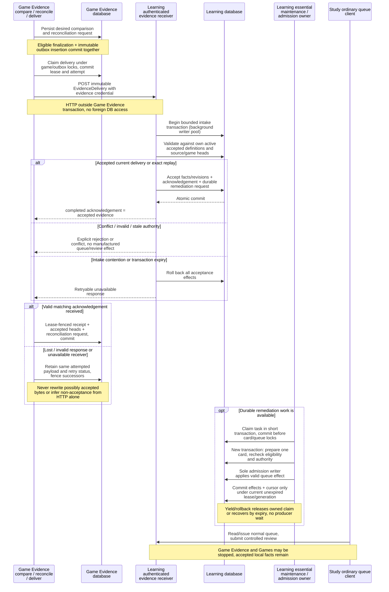
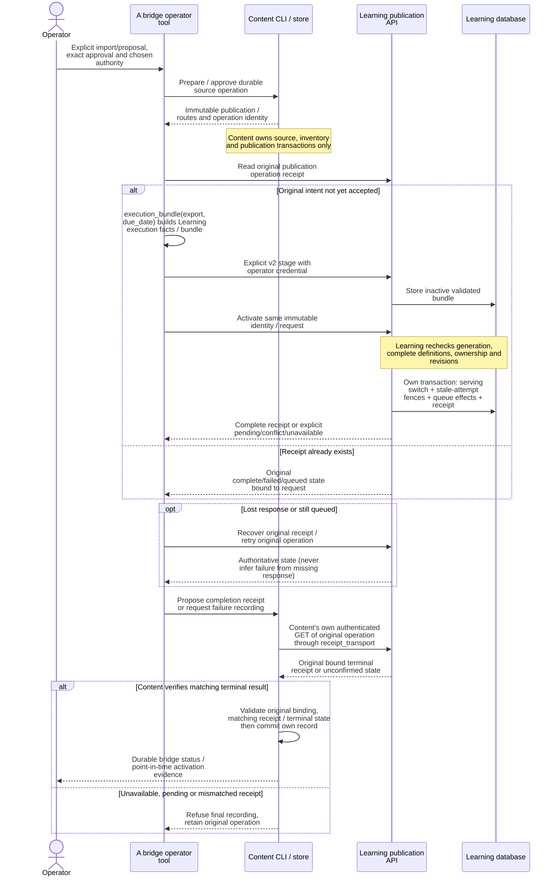
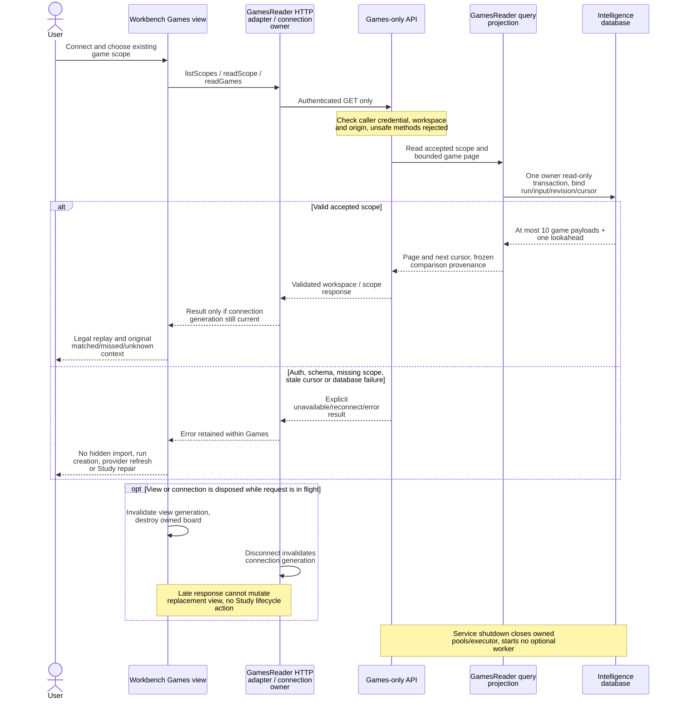

# Transactions, data flow and failure sequences

[Index and source/status legend](README.md) · [System and ownership](system.md) ·
[Study/Games detail](study-games.md)

These are bounded sequences for the named paths, not every endpoint or branch.
Notes identify durable asynchronous work and transaction owners. Network arrows
do not imply a distributed transaction. No sequence requires Study to call Games.

## Review commit and recovery (MAIN)

Scope: Learning-connected aggregate review through the installed review
application. Typed Study/tactics/defense attempts retain their own handlers and
identity rules; they are not silently folded into `cards.review`.

```mermaid
sequenceDiagram
  actor User
  participant S as Study session /<br/>review-outbox
  participant B as Browser IntentStore
  participant A as Learning HTTP and<br/>gateway
  participant R as Review application +<br/>borrowed adapter
  participant D as Learning PostgreSQL
  User->>S: Complete issued attempt with<br/>stable logical ID
  S->>B: Retain immutable payload,<br/>authority and request ID
  alt Browser retention fails
    B-->>S: storage-failed, no new<br/>unretained dispatch
  else Retained
    B-->>S: pending intent committed<br/>locally
    S->>A: POST card review with same<br/>Idempotency-Key
    Note over A: Authenticate workspace/origin before<br/>DB access
    Note over A: PROPOSED host repair: bounded memory<br/>request entry / exit; daemon owns I/O
    A->>D: record_intent in its own<br/>transaction
    D-->>A: queued intent committed (or<br/>matching identity found)
    Note over A,D: Execution transaction, operation<br/>advisory lock and receipt row lock
    A->>R: submit_review using caller<br/>connection / handler<br/>savepoint
    R->>D: Lock cards then queue date,<br/>validate attempt, revision,<br/>receipt
    Note over R,D: Optional successor uses nonblocking<br/>locks, never delays current review
    R->>D: Required evidence +<br/>review/history/schedule +<br/>attempt completion
    R->>D: Required local obligation<br/>settlement, logical receipt,<br/>queue effects
    alt Valid execution
      R-->>A: Persisted result (or<br/>original idempotent result)
      A->>D: Complete operation receipt,<br/>commit with all handler<br/>effects
      A-->>S: Authoritative result<br/>(response may be lost)
    else Terminal domain conflict
      A->>D: Roll back handler savepoint,<br/>commit failed operation<br/>receipt
      A-->>S: Conflict / failure, no<br/>partial handler effects
    else Transient DB contention or timeout
      A->>D: Roll back execution,<br/>original queued intent<br/>remains
      A-->>S: Unavailable, retain identity<br/>for retry
    end
    opt Response lost or acceptance still unconfirmed
      S->>A: Read original operation<br/>receipt / replay same<br/>request
      A-->>S: Original result, pending<br/>state, or explicit conflict
      Note over S,A: Unknown/pending is not committed,<br/>changed payload under same ID<br/>conflicts
    end
    S->>B: Persist authoritative<br/>settlement before projecting<br/>it
    opt Settled review may advance
      S->>A: Load issued next attempt /<br/>validate prepared<br/>continuation
      A-->>S: Next attempt or explicit<br/>load failure
      Note over S,B: Next-load retry uses progression<br/>checkpoint, never resubmits grade
    end
  end
```

Source owners: [`review-outbox`](../../../app/lib/review-outbox.ts) retains immutable
aggregate intent and adapts receipts;
[`createStudySession`](../../../packages/study-session/src/index.ts) claims delivery,
persists settlement, fences presentation generations and bounds next acquisition;
[`IntentStore`](../../../packages/browser-intents/src/index.ts) owns browser
transactions. [`learningFetch`](../../../app/lib/study-connection.ts) restricts
authority; the [HTTP review handler](../../../services/learning/runtime/src/tempo_learning_runtime/api.py)
dispatches to [`gateway`](../../../services/learning/runtime/src/tempo_learning_runtime/gateway.py).
[`submit_review`](../../../services/learning/application/src/tempo_learning_review/application.py)
uses [`ReviewSubmissionStore`](../../../services/learning/application/src/tempo_learning_review/ports.py),
implemented by [`LearningReviewAdapter`](../../../services/learning/runtime/src/tempo_learning_runtime/review_adapter.py).
[Scheduling/review effects](../../../services/learning/runtime/src/tempo_learning_runtime/review_service.py)
and [required settlement](../../../services/learning/runtime/src/tempo_learning_runtime/remediation_adapter.py)
remain Learning-local under the borrowed transaction. The
[`Database`](../../../services/learning/runtime/src/tempo_learning_runtime/database.py)
context commits/rolls back, not the application port.

Transport idempotency and logical attempt identity are separate protections.
Reconciliation may use a new transport operation while retaining the original
logical attempt. A rejected/discarded attempt must not advance as a successful
review. Browser disposal preserves retained work; a late response may settle its
original record but cannot overwrite a newer session snapshot. Auth rejection,
storage failure, pending save and failed next load remain different states.

Ordinary queue reads are not necessarily side-effect free: the
[queue payload handler](../../../services/learning/runtime/src/tempo_learning_runtime/api.py)
dispatches `queue.ensure_current`, runs at most two foreground maintenance assists,
and [queue command handlers](../../../services/learning/runtime/src/tempo_learning_runtime/queue_commands.py)
own attempt issuance. None of those operations calls the game producer.


HostActivity note source: proposed checkpoint
[`09cb4eef`](https://github.com/aaweaver-actuary/tempo/blob/09cb4eef027666aaa3e728660b9e7ca39eb36091/services/learning/runtime/src/tempo_learning_runtime/host_activity.py).
The request-accounting note is source repair only; deployment is unverified.
A last healthy idle snapshot remains valid for its existing 15-second lease;
[the host execution view](study-games.md#shared-learning-request-execution-gaps-main)
describes stale/missing expected-source admission and asynchronous cleanup.


## Observed game evidence to Learning (MAIN)

Scope: independent Game Evidence v1/v2 delivery into independent Learning. This is
distinct from the [legacy-local receiver](system.md#legacy-assembly-and-existing-coupling).
The Games viewer is not the evidence producer, and reading a game does not trigger
this sequence.



[`Store._compare`](../../../services/game-evidence/src/tempo_game_evidence/store.py)
and [`reconciliation`](../../../services/game-evidence/src/tempo_game_evidence/reconciliation.py)
own desired results/outbox/accepted-head projection.
[`deliver_one`](../../../services/game-evidence/src/tempo_game_evidence/delivery.py)
owns the attempt, external HTTP, immutable retry and local receipt lease fence.
[`EvidenceDelivery` contracts](../../../contracts/game-evidence/README.md) express
observed facts and obligations, not permission to schedule or invent controlled
study evidence. Learning's
[HTTP intake](../../../services/learning/runtime/src/tempo_learning_runtime/api.py)
uses `connection(background=True, intake=True)`;
[`receivers.receive`](../../../services/learning/runtime/src/tempo_learning_runtime/receivers.py)
and [`remediation_adapter.receive`](../../../services/learning/runtime/src/tempo_learning_runtime/remediation_adapter.py)
validate/store inside it. The
[installed remediation repository](../../../services/learning/remediation/src/tempo_learning_remediation/repository.py)
owns Learning-local obligation persistence. [`maintenance`](../../../services/learning/runtime/src/tempo_learning_runtime/maintenance.py),
[`durable_tasks`](../../../services/learning/runtime/src/tempo_learning_runtime/durable_tasks.py)
and [`admission.admit`](../../../services/learning/runtime/src/tempo_learning_runtime/admission.py)
own claims, short slices and canonical queue writing.

Acceptance is bounded to at most 128 wire items in the 1000 ms intake transaction;
ordinary maintenance retains its 250 ms transaction bound and size-1 pool.
`completed` acknowledges durable acceptance, not completed studying or synchronous
admission. A miss may retain a documented allowance/progression exception, but
cannot bypass burial, retirement, invalidity, deletion or revision validation.
Controlled review settlement stays in the review transaction shown above.

Delivery `401` is retained retryable with a minimum 60-second backoff; replacing
the producer's private token file requires producer restart/reload, not Study
restart. Unverifiable terminal/conflict/stale outcomes can block reconciliation
with diagnostics. See [delivery/auth recovery](../../../services/game-evidence/README.md#authentication-recovery).
No command here grants a producer cross-component database writes.

## Content publication and serving activation (MAIN)

The explicit bridge operator talks to owners' public boundaries; it is not part
of an ordinary Study request. Arrows show data/command flow, not shared database
connections or atomic commits across services.



Source anchors: Content [`bridge`](../../../services/content/src/tempo_content/bridge.py)
and [`CLI`](../../../services/content/src/tempo_content/cli.py), external
[`Operator` receipt/retry workflow and `execution_bundle`](../../../tools/analysis-restoration/a_bridge/src/tempo_a_bridge/cli.py),
Learning [publication routes](../../../services/learning/runtime/src/tempo_learning_runtime/api.py),
[`publication_bridge`](../../../services/learning/runtime/src/tempo_learning_runtime/publication_bridge.py),
[`publications`](../../../services/learning/runtime/src/tempo_learning_runtime/publications.py)
and [`gateway`](../../../services/learning/runtime/src/tempo_learning_runtime/gateway.py).
Content exports serialized publication/routes; the external bridge constructs
Learning execution facts/bundle. Content's supported CLI then independently calls
[`receipt_transport.authenticated_operation` / `verified_receipt` / `verified_terminal_failure`](../../../services/content/src/tempo_content/receipt_transport.py)
before its local `record` / `record_terminal_failure` write. That verification
uses Content's configured original Learning authority and operator credential,
checks the original request binding and terminal state, and for completion checks
that the proposed receipt matches the authenticated response. It is not merely
trusting the bridge's earlier receipt read. Failure/unavailability retains the
operation rather than recording an unverified result. Content's CLI therefore has
this explicit operator-invoked Learning HTTP dependency; it is not startup or
ordinary Study work.
Retirement is a separate command; it locks/fences affected definitions and attempts.
Failed activation must preserve the previous serving generation. Staging or a
Content publication alone supplies no serving authority. An activation receipt is
historical evidence, not proof that its generation remains current forever.
An Analysis response proposal is a draft input to this explicit approval path,
never automatic Content approval or Learning admission.

## Games read, failure and disposal (MAIN, merged PR322)

PR322 implementation `653a85bb5f5b3e520c0eda0c36234d3b416708b4` merged as
`bc746728ca1967cc8ad9991cbe8c12099a01a3ae`; see the
[source-linked component view](study-games.md#merged-pr322-games-reader).



The query reader does not use engine-position progress, change accepted inputs,
write a command, contact a provider or query Study/Learning. Repertoire conformance
is frozen to the accepted input; a current-repertoire comparison would require a
separate explicit operation. Failure/shutdown isolation is a source boundary;
[shared host/database budgets remain deployment-unverified](study-games.md#failure-lifecycle-and-resource-acceptance).
Parsing this sequence or passing component tests cannot certify a live allocation.
