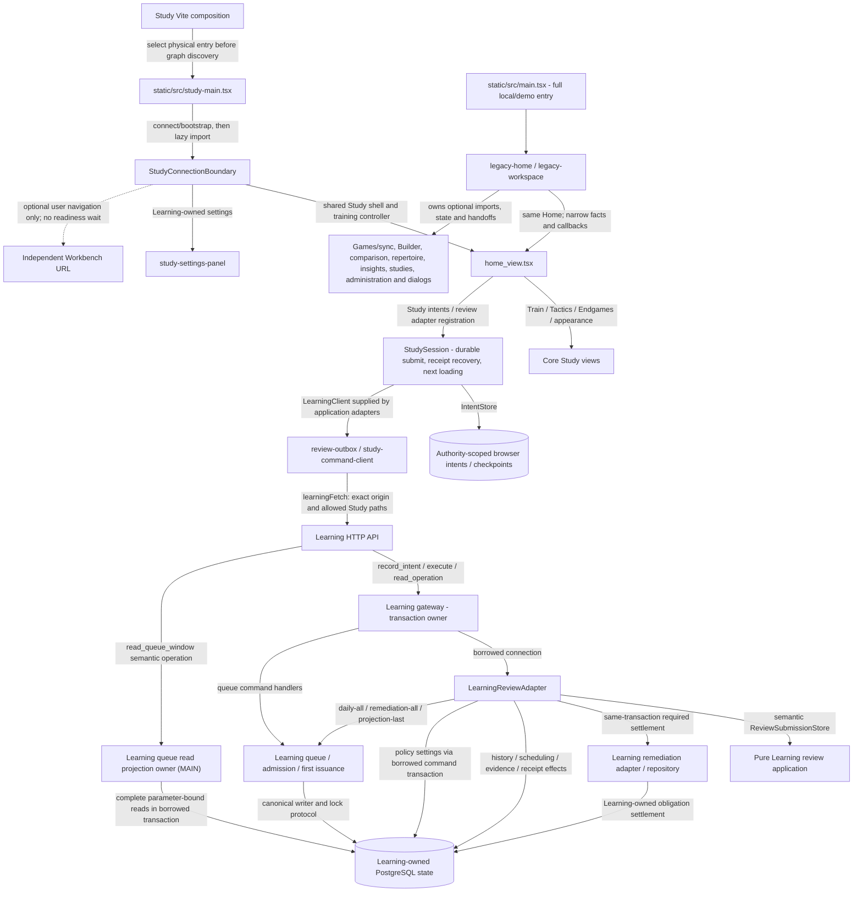
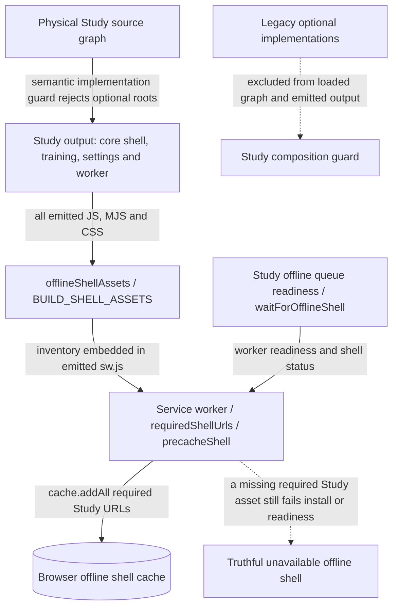
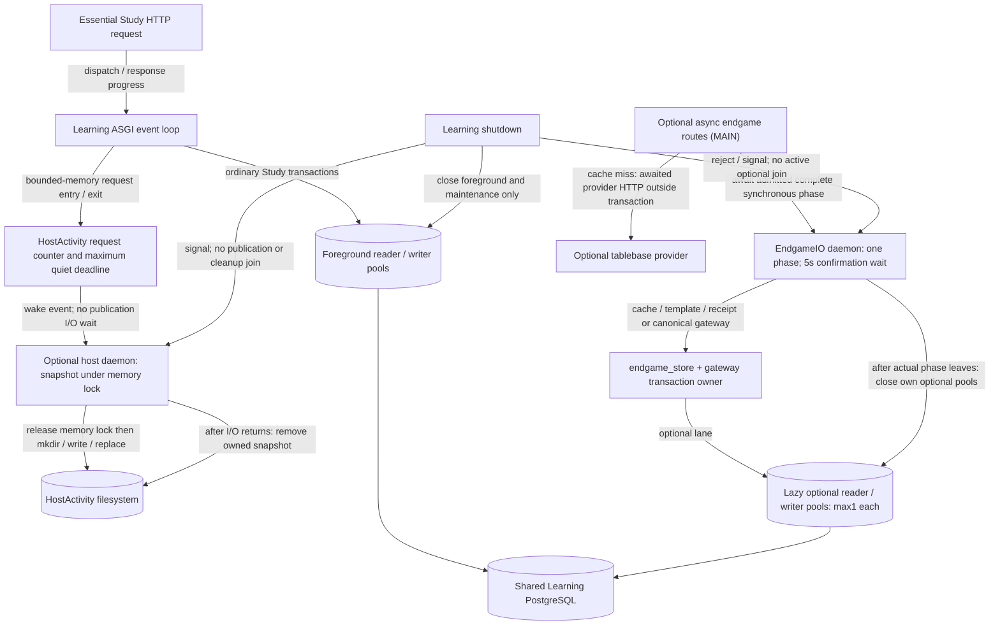
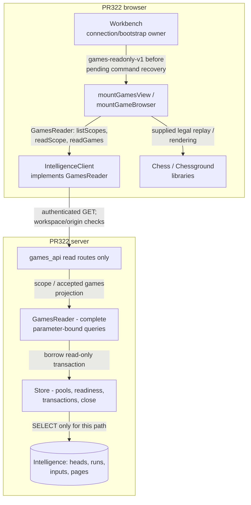

# Study and Games dependency detail

[Index and source/status legend](README.md) · [System and ownership](system.md) ·
[Sequences](flows.md)

## Main Study path and source gap

**PR324 IMPLEMENTED SOURCE, UNMERGED:** the browser composition below describes
`30191b9c026f27f3d816304c47e5b72e0ec390b0` on `codex/study-games-composition`, with PR323's documentation merged
separately. It replaces the shared-Home Games import gap in this branch. MAIN at
`fc92a4d9` and any deployed artifact are not claimed to contain this change.
The Learning gateway retains serving and transaction authority. MAIN now includes
HostActivity325, endgame326, borrowed review-policy327 and queue persistence329;
this PR adds only the physical browser composition and its scoped proof.

| Interface / decision | Source correspondence |
| --- | --- |
| Physical entry and loaded graph guard | [`studyComposition`](../../../scripts/study-composition.ts) changes the HTML entry before graph discovery. Its semantic optional implementation list rejects loaded Games/sync, authoring, comparison, insights, administration, and legacy composition roots, even if later tree-shaken. [`study-main.tsx`](../../../static/src/study-main.tsx) has no legacy import. |
| Optional state, presentation and handoff owner | [`LegacyHome`](../../../app/views/legacy-home.tsx) injects [`LegacyWorkspace`](../../../app/views/legacy-workspace.tsx). It owns Builder/comparison/discovery/filter/paste/repair state, repair race fencing, deletion recovery and optional views/dialogs. [`LegacyWorkspaceProps` / slots / controller](../../../app/components/optional-workspace.ts) expose selected card/position facts and explicit queue/card commands; they do not pass the Home store. Home owns one training controller and queue acquisition. Unsupported controls are omitted when their action capability is absent. |
| Genuine Study settings and navigation | [`StudyConnectionBoundary`](../../../app/components/study-connection-boundary.tsx) retains [`StudySettingsPanel`](../../../app/components/study-settings-panel.tsx) for Learning settings. [`StudySettingsView`](../../../app/views/study-settings-view.tsx) changes browser appearance/shortcuts. [`canOpenWorkspace`](../../../app/lib/study-workspace-policy.ts) checks direct intents as well as Navbar visibility. |
| Connection and allowed transport | [`study-connection.ts`](../../../app/lib/study-connection.ts): `connectStudy`, `studyWorkspace`, `learningPaths`, `authenticatedLearningFetch`. Only the configured Learning origin/Study paths receive the credential; no Games fallback. The boundary waits for Learning bootstrap or explicitly permitted cached practice. |
| Session and browser data ownership | [`study-session-runtime.ts`](../../../app/lib/study-session-runtime.ts) composes adapters into [`createStudySession`](../../../packages/study-session/src/index.ts); [`study-intent-storage.ts`](../../../app/lib/study-intent-storage.ts) supplies [`IntentStore`](../../../packages/browser-intents/src/index.ts). [`review-outbox.ts`](../../../app/lib/review-outbox.ts) and [`study-command-client.ts`](../../../app/lib/study-command-client.ts) preserve family-specific payloads/identities. |
| MAIN PR329 queue read and refresh projection | [`queue_application.read_queue_window`](../../../services/learning/runtime/src/tempo_learning_runtime/queue_application.py) owns complete card/count/projection queries and the retained legacy card fields. The HTTP queue payload consumes `QueueWindowProjection` before commanding head issuance; it does not rewrite SQL. The same owner exposes `mark_queue_refresh_pending_in_transaction`; review flushes all daily tasks, then remediation tasks, then projection marks in its borrowed transaction. Existing entry-state/queue-command SQL helpers remain a scoped legacy boundary outside this queue-window repair. |
| Borrowed review capabilities | [`ReviewStore` / `ReviewSubmissionStore`](../../../services/learning/application/src/tempo_learning_review/ports.py), [`submit_review`](../../../services/learning/application/src/tempo_learning_review/application.py), [`LearningReviewAdapter`](../../../services/learning/runtime/src/tempo_learning_runtime/review_adapter.py). The application receives semantic facts/operations; it does not acquire/commit a connection. The adapter reads policy settings through the same borrowed transaction after submission acquires card/queue locks; it does not acquire a nested reader connection. An injected policy provider remains supported. |
| Serving, borrowed review and settlement | [API registration](../../../services/learning/runtime/src/tempo_learning_runtime/api.py), [gateway](../../../services/learning/runtime/src/tempo_learning_runtime/gateway.py), [`submit_review` / ports](../../../services/learning/application/src/tempo_learning_review/application.py), [review adapter](../../../services/learning/runtime/src/tempo_learning_runtime/review_adapter.py), [queue application](../../../services/learning/runtime/src/tempo_learning_runtime/queue_application.py), [admission](../../../services/learning/runtime/src/tempo_learning_runtime/admission.py), [receivers](../../../services/learning/runtime/src/tempo_learning_runtime/receivers.py), [remediation adapter](../../../services/learning/runtime/src/tempo_learning_runtime/remediation_adapter.py). The review application receives semantic capabilities; gateway retains transaction authority. Settlement uses Learning-local facts, not an online Games call. |

The independent Learning install closure contains no Game Evidence service,
Intelligence service, legacy backend, Redis/Celery or engine/model runtime. Its
[package definition](../../../services/learning/runtime/pyproject.toml) includes
Game Evidence **contracts** and Learning's own remediation module. Pure shared
libraries do not create a producer lifecycle dependency.

**Acceptance invariant:** Study must have no Games call, import, wait,
readiness, transaction or lifecycle dependency. Games must be able to fail
completely while ordinary Study continues. This PR repairs the browser source and
artifact boundary only; merged host/endgame execution repairs below retain their own scoped proof,
and deployment resource isolation remains unverified.

Optional practice influence enters the **Learning/queue owner's semantic
interface**, as the [existing evidence sequence](flows.md#observed-game-evidence-to-learning-main)
shows. Learning owns validation, eligibility/admission, idempotency, transactions
and ordinary queue consumption. Producers must not write Learning queue, review
or scheduling tables. PR319 remains paused; no proposed encountered-card API is
assumed here.

## Conditional Study build and offline assets (MAIN)

**PR324 IMPLEMENTED SOURCE AND ACTUAL BUILD, UNMERGED:** the all-emitted-assets
inventory rule remains intact. The physical Study composition removes optional
implementations before emission. This changes the former conditional dependency;
it does not filter required assets out of the worker to conceal coupling.

| Edge / owner | Concrete source and effect |
| --- | --- |
| Composition → actual output | [`studyComposition`](../../../scripts/study-composition.ts) emits `study-composition.json`, recording loaded application modules and each emitted chunk's modules. PR324's actual bounded Study build passed the expanded implementation guard. It emitted seven JS/CSS assets, including the Study worker, and no named optional implementations. |
| Output → inventory | [Vite config](../../../vite.static.config.ts) installs [`offlineShellAssets`](../../../scripts/offline-shell-assets.ts). Its `writeBundle` inventories every emitted `.js`, `.mjs` and `.css` key and replaces `BUILD_SHELL_ASSETS` in `sw.js`. The actual emitted inventory equals that output set. |
| Inventory → install/cache | [`public/sw.js`](../../../public/sw.js): `requiredShellUrls` combines base shell, HTML references and build inventory. `precacheShell` uses `cache.addAll`; installation waits for that promise before `skipWaiting`. Required fetch failures still reject new-shell installation. |
| Cache → offline readiness | Worker `tempo:offline-shell-status` checks all required URLs. [`waitForOfflineShell`](../../../app/lib/offline-shell.ts) verifies worker version and readiness. [Queue preparation/fallback](../../../app/views/fetchAndInitializeQueue.tsx) calls it before claiming offline readiness. [`renderApplication`](../../../static/src/render-application.tsx) registers the production worker. |

**Verification status:** actual emitted modules, chunks and offline inventory were
inspected for this branch: 157 application modules and seven emitted JS/CSS assets.
One native Chromium context served the actual artifact and worker from a disposable
loopback host with canonical synthetic Learning bootstrap/settings/queue/teaching
fixtures. Optional asset URLs returned 404; worker status was ready before and after
offline reload, the prepared opening queue remained usable, and browser appearance
preferences persisted across settings/training navigation. Unknown API, external
network and page-error counts were zero; the context, Chromium process and host
were closed. The PR evidence retains the exact fixture script, screenshots and
initial fixture/oracle failures. No live service, data, deployment, PostgreSQL
behavior or whole-host resource independence is certified by this frontend proof.

## Shared Learning request execution gaps (MAIN)

**MAIN HOST, ENDGAME AND POLICY REPAIRS:** HostActivity PR325, optional endgame
PR326 (merged at `8b1dcbfd`) and borrowed review-policy PR327 are merged source.
Host publication/cleanup belongs to its optional daemon; essential request
accounting uses bounded memory. Endgame persistence runs as complete phases on
its dedicated daemon with separate connection capacity and late cleanup ownership.
Source availability does not establish deployment or shared host/PostgreSQL
isolation. The merged PR329 queue persistence boundary is described above.

| Interface / lifecycle owner | Actual assembled source and limit |
| --- | --- |
| Essential request memory accounting | [`HostActivity.request`](../../../services/learning/runtime/src/tempo_learning_runtime/host_activity.py) updates a counter and maximum quiet deadline. At most 1,024 browser sessions bound shared snapshot memory work. [`request_activity`](../../../services/learning/runtime/src/tempo_learning_runtime/api.py) has no filesystem or daemon-result await, including cancellation. This is bounded-memory synchronization, not hard real-time, lock-free progress or a scheduler latency guarantee. |
| Optional publication and cleanup | `HostActivity.start` starts its daemon without initial file I/O. The daemon releases the memory lock before publishing; `close` signals without joining publication or cleanup. An optional activity 200 acknowledges memory submission against the last healthy lease; missing/known-failed/stale publication or browser capacity returns 503. |
| Explicit admission tradeoff and deployment prerequisite | The unchanged [native reader](../../../scripts/host-study-activity.mjs) can retain an idle snapshot until its 15-second producer lease expires. A new essential request may overlap admitted managed work during that remaining lease; asynchronous publication provides no immediate foreground exclusion. Present stale evidence is unavailable. Missing/startup/removed-source denial requires configuring protected workspace identities in the managed runners' `TEMPO_STUDY_ACTIVITY_EXPECTED_SOURCES` before deployment; default `[]` accepts absence as idle. No live configuration or lease protocol changed. |
| MAIN optional complete database phases | [`EndgameIO`](../../../services/learning/runtime/src/tempo_learning_runtime/endgame_io.py) admits one phase to a dedicated daemon and preserves request database context. [`endgame_store`](../../../services/learning/runtime/src/tempo_learning_runtime/endgame_store.py) owns cache/template/receipt SQL; admitted command effects still use the canonical gateway. Each connection stays inside its complete worker phase. Busy requests return 503; result waits end at five seconds or immediately on cancellation/shutdown. Provider HTTP stays outside transactions, retaining its three-second timeout and the existing five-second/80-candidate preparation policy. |
| MAIN separate connection capacity | [`Database`](../../../services/learning/runtime/src/tempo_learning_runtime/database.py) routes optional worker phases to lazy size-1 reader/writer pools. Foreground capacity is preserved even at configured pool size one. Total configured maximum is `2 * pool_size + 3`, including maintenance and both optional pools. Database/process/host resource and lock contention remain possible; separate pools do not establish deployment isolation. |
| MAIN optional cancellation and shutdown authority | Main close never takes the optional pool lock or closes an active optional transaction. It signals the daemon and closes foreground/maintenance pools; the daemon closes its own pools after actual phase completion. A stalled phase may remain allocated until process exit. An unconfirmed attempt carries `state: unknown`, its same operation ID, `Location` and `Retry-After`; the canonical receipt determines eventual commit/replay. No thread kill, abandoned transaction, fabricated failure or duplicate logical effect is claimed. |

**Evidence and limits:** [owning regressions](../../../services/learning/runtime/REGRESSIONS.md) retain blocked
HostActivity directory creation/cleanup, essential HTTP/lifespan progress,
cancellation and recovery. The native reader case runs the exact Python source,
verifies its hash and proves healthy idle persists through 15 seconds minus one
nanosecond, then becomes unavailable. Endgame cases exercise actual ASGI requests,
real `Database` routing with fake size-one pools, provider/transaction boundaries,
canonical gateway timeout/replay and interpreter exit with a never-returning
daemon. These component proofs are scoped and synthetic. The scoped endgame component evidence does not itself establish native
PostgreSQL behavior or live latency/resource allocation. No live incident, deployment
or whole-host resource independence is established by these drawings.

## Merged PR322 Games reader

**MAIN / MERGED PR322:** implementation
`653a85bb5f5b3e520c0eda0c36234d3b416708b4` merged as
`bc746728ca1967cc8ad9991cbe8c12099a01a3ae`. It restores frozen accepted
input viewing through an enforced read composition. It does not restore live
sync, fresh repertoire comparison, analysis creation or practice commands.

Source links below follow the merged implementation. The index retains the exact
implementation and merge SHAs; no deployed process or effective grant is inferred.

| Boundary | Merged PR322 concrete source |
| --- | --- |
| Typed view port | [`GamesReader`](../../../apps/workbench-web/src/games-reader.ts): three typed read methods; [`games-view.ts`](../../../apps/workbench-web/src/games-view.ts) and [`game-browser.ts`](../../../apps/workbench-web/src/game-browser.ts) receive it. [`client.ts`](../../../apps/workbench-web/src/client.ts) adapts HTTP and fences connection generations. |
| Shared Workbench composition | [`workbench.ts`](../../../apps/workbench-web/src/workbench.ts) still imports its ordinary Analysis controller/commands. It selects Games mode after bootstrap, before mutation recovery. Games view modules do not import that controller. The whole Workbench artifact is not claimed to contain only read code. |
| Server composition / enforcement | [`api.py`](../../../services/intelligence/src/tempo_intelligence/api.py) returns after registering [`games_api.py`](../../../services/intelligence/src/tempo_intelligence/analysis/games_api.py), rejects unsafe methods, and starts no worker/provider in read-only mode. Health, bootstrap, scope and game reads are registered; mutation/job/report-progress routes are absent. |
| Query / cursor owner | [`games_reader.py`](../../../services/intelligence/src/tempo_intelligence/analysis/games_reader.py) queries only `analysis_heads`, `analysis_runs`, `analysis_inputs`, `analysis_pages`. Cursor binds workspace/run/revision/input/ordering. Scope and page share one transaction. Ordinary Analysis delegates the same game reader. |
| Database and lifecycle | [`Store`](../../../services/intelligence/src/tempo_intelligence/store.py) forces read-only transactions even when a caller omits the flag. Startup checks SELECT access for these tables plus metadata, without requiring engine/write grants. [`Configuration`](../../../services/intelligence/src/tempo_intelligence/config.py) rejects worker/model configuration in read-only mode and needs caller/read configuration rather than operator/worker secrets. This is not a claim that live grants were provisioned or every possible write privilege is audited away. |

**Before PR322 (historical `4fc2eb8c`):** the earlier
[Workbench](https://github.com/aaweaver-actuary/tempo/blob/4fc2eb8c6b534345b25668761b3746c91be08cf0/apps/workbench-web/src/workbench.ts)
browsed selected games inside ordinary Analysis. The earlier
[`AnalysisStore.runs` / `games`](https://github.com/aaweaver-actuary/tempo/blob/4fc2eb8c6b534345b25668761b3746c91be08cf0/services/intelligence/src/tempo_intelligence/analysis/store.py)
used engine-position aggregates for run listing and loaded accepted input through
`_input` before paging games in memory. The earlier
[API composition](https://github.com/aaweaver-actuary/tempo/blob/4fc2eb8c6b534345b25668761b3746c91be08cf0/services/intelligence/src/tempo_intelligence/api.py)
registered mutation/provider/job routes and could start a background worker.
The mutable mode still has those capabilities; merged PR322 adds the separate
read-only composition, narrow view port and bounded game projection above.

## Failure, lifecycle and resource acceptance

| Path | Local ownership and failure result | Limit of claim |
| --- | --- | --- |
| Study → Learning | Browser retains immutable intents; Learning owns readiness, queue and settlement. Authentication failures require reconnection. Learning/database outage can prevent online studying; cached practice remains explicitly unconfirmed. | Learning is an essential dependency. PR324 provides a physical Study entry and optional composition boundary in this source; deployment remains unverified. |
| Conditional Study offline assets | PR324 excludes named optional implementations before emission; the worker still requires every emitted JS/MJS/CSS asset and reports unavailable required assets honestly. | [Actual PR324 artifact and synthetic offline proof](#conditional-study-build-and-offline-assets-main): 157 application modules, seven emitted JS/CSS assets, ready worker before/after offline reload with optional URLs unavailable. This is component-scoped evidence, not a live incident or deployment claim. |
| Shared Learning host reporting (MAIN) | Essential accounting uses bounded-memory synchronization; daemon-owned publication and cleanup have no essential filesystem wait or shutdown join. | [Merged host source](#shared-learning-request-execution-gaps-main); last healthy idle evidence can permit foreground overlap for the remaining 15-second lease. Missing/startup/removed-source denial requires configured expected workspace identities; default `[]` accepts absence. Deployment/resource isolation unverified. |
| Optional endgame execution (MAIN) | One daemon admits complete synchronous phases; separate lazy reader/writer pools each max1 preserve foreground capacity. Main shutdown signals without joining active optional I/O or closing its transaction; the daemon owns late completion and cleanup. | [Merged endgame source](#shared-learning-request-execution-gaps-main); canonical operation receipt owns unknown/late outcomes. Shared PostgreSQL/process/host allocation remains deployment-unverified. |
| Games read (MAIN) | Invalid auth/schema/scope/cursor or DB failure returns Games error; missing scopes remain missing. No hidden run creation, import, analysis, Study call or repair. View disposal destroys its own board and ignores late responses; server lifespan closes only its pools/executor. | See [read/failure sequence](flows.md#games-read-failure-and-disposal-main-merged-pr322). No Study/worker shutdown is part of this path. |
| Games DB work (MAIN) | Scope listing ≤100 rows; accepted scope metadata ≤1000 games; page ≤10 games plus one lookahead. Existing 1500 ms statement, 250 ms lock, 3000 ms transaction bounds and configured pool maxima apply. | PostgreSQL may scan/order accepted JSON pages within that budget; no indexed/precomputed projection or host latency guarantee is claimed. |
| Navigation | Optional public Workbench launch and general Open Study root link are user navigation with no credentials/card authority transfer or service readiness check. | A link is not a required Study API dependency. Reuse existing [navigation contracts](../../../apps/workbench-web/src/public-navigation.ts), [launch URL validation](../../../app/lib/workbench-navigation.ts); do not add a wait. |
| Shared host / PostgreSQL cluster | CPU/memory/I/O/connection allocation and cluster failure can cross logical service/database boundaries. | **DEPLOYMENT UNVERIFIED:** separate bounded optional workload/connection budgets, effective limits and independent shutdown need verification before rollout. Separate processes or green component tests alone do not prove it. |

The merged [Games source architecture notes](../../../docs/analysis-restoration/games-only-architecture.md)
and component regression inventories describe its source proofs. This
documentation PR does not rerun those proofs, qualify a deployment, change CI
or touch live Study. Exact live reader grants and operational activation remain
unverified here.
