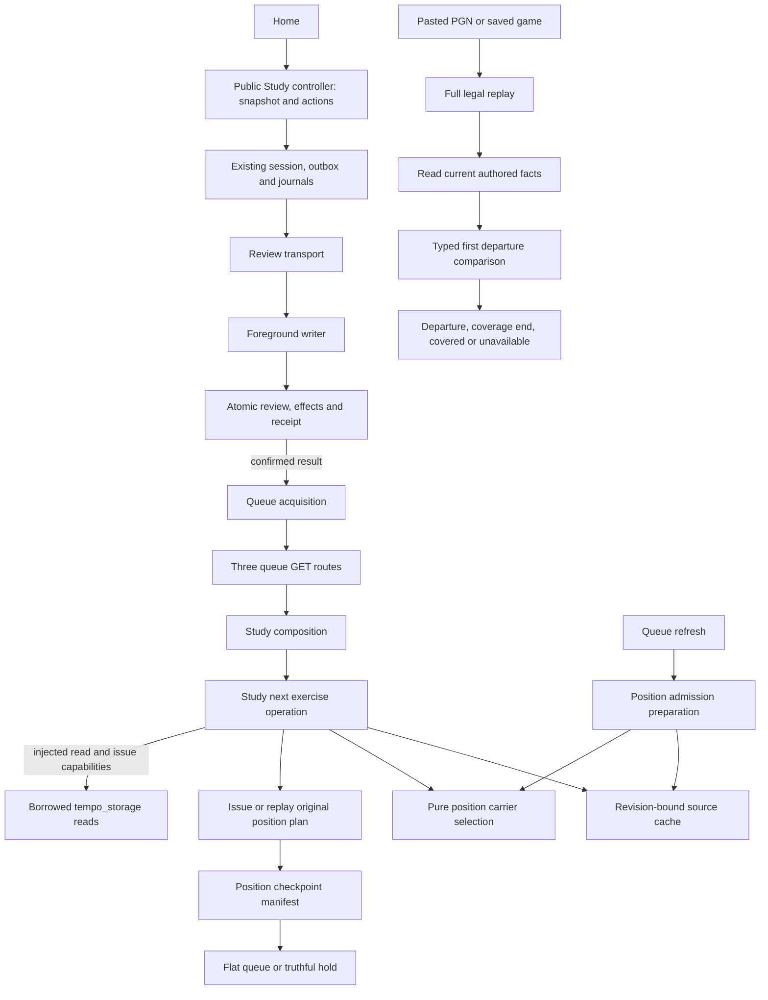

# Study and minimal Game Review

[Current ownership](system.md) · [Transaction flow](flows.md) · [Reduction audit](../reduction-pass2/README.md)

The carrier selector is shared pure policy. The source cache remains with queue-head
preparation; it is a bounded hint and does not replace the writer source fence.

The Study owner rechecks the current day and head after issuance. Original
attempts, first-response checkpoints and human review receipts retain their
identity. Browser and native tests are needed to establish the assembled
saved-review to playable-next journey; this source map is not that evidence.

Game Review reads storage without provider acquisition or Study effects. Retired
automatic feedback and recombination do not become current through preserved
historical records. Pasted PGN comparison does not save a game.
