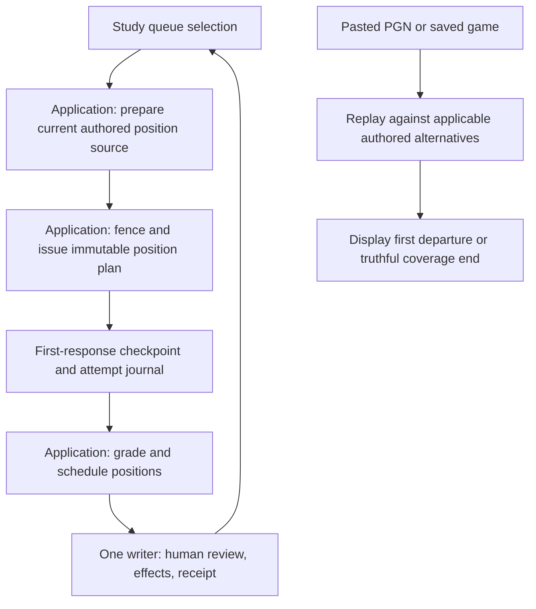

# Study and minimal Game Review

[Current ownership](system.md) · [Transaction flow](flows.md) · [Reduction audit](../reduction-pass2/README.md)

Position schedules remain owned by repertoire, variant and actual chess position. Human reviews and durable first-response receipts retain their identities and original fences. Review replay does not manufacture a second logical attempt.

Recombination no longer prepares, joins, splits or publishes cards. Existing generated physical exercises, schedule state, reviews and lineage remain stored. Their historical membership keeps them classified as reviews and excludes them from fresh introduction/reset accounting.

Automatic game effects and their producer/retry/qualification protocols are retired. Existing effects and incomplete operations remain preserved with an explicit paused disposition; they do not block ordinary issuance. Old proposal/audit suspensions are historical; current repertoire integrity and source/revision guards remain active.

Minimal Game Review deliberately has no provider refresh, engine analysis, Study admission, or scheduling callback. Pasted PGN input is replayed locally for comparison and is not saved by this screen. Previously saved games remain readable.
