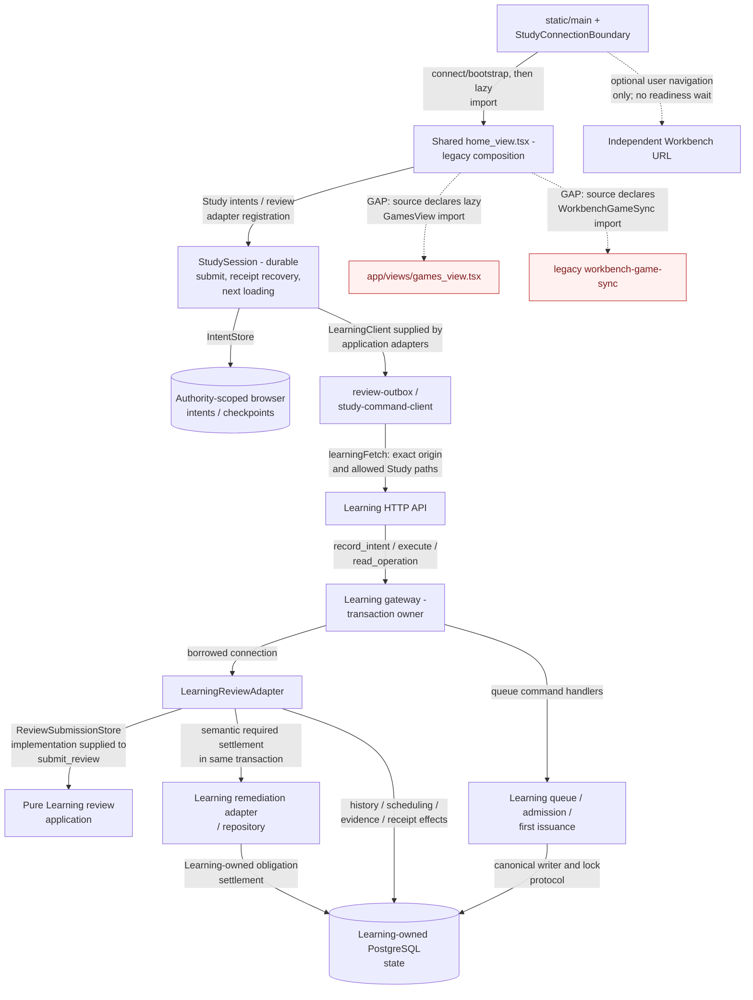
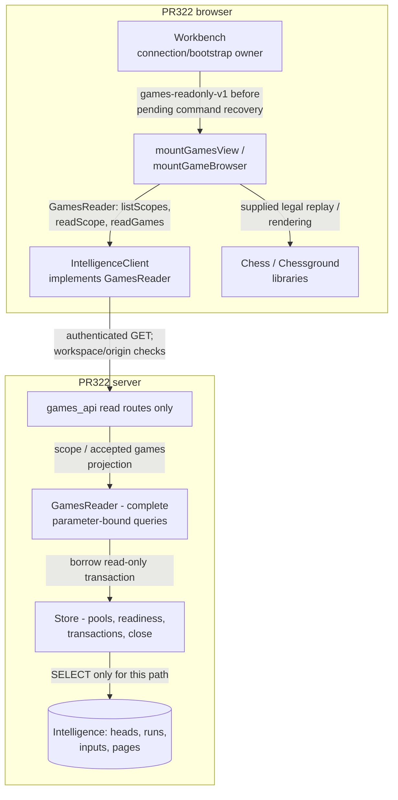

# Study and Games dependency detail

[Index and source/status legend](README.md) · [System and ownership](system.md) ·
[Sequences](flows.md)

## Main Study path and source gap

**MAIN:** `TEMPO_TARGET=study` selects the Learning connection boundary. The
diagram separates its HTTP serving path from the shared browser source that it
still loads. It does **not** certify that the whole Study artifact is free of
Games imports.

| Interface / decision | Source correspondence |
| --- | --- |
| Connection, bootstrap, authority and allowed transport | [`study-connection.ts`](../../../app/lib/study-connection.ts): `connectStudy`, `studyWorkspace`, `learningPaths`, `authenticatedLearningFetch`. Only configured Learning origin/Study paths receive the credential; no fallback to Games. [Connection boundary](../../../app/components/study-connection-boundary.tsx) waits for Learning bootstrap or explicitly permitted cached practice. |
| Browser composition and retained import gap | [`static/src/main.tsx`](../../../static/src/main.tsx) loads the boundary, which imports [`home_view.tsx`](../../../app/views/home_view.tsx). Home declares lazy `GamesView` and `WorkbenchGameSync` imports and contains Games-related navigation/state. [`Navbar`](../../../app/components/Navbar.tsx) filters Study navigation; that is not source/import separation. The [planned Study artifact](../../../apps/study-web/README.md) has no independent build claim. |
| Session and browser data ownership | [`study-session-runtime.ts`](../../../app/lib/study-session-runtime.ts) composes adapters into [`createStudySession`](../../../packages/study-session/src/index.ts); [`study-intent-storage.ts`](../../../app/lib/study-intent-storage.ts) supplies the [`IntentStore`](../../../packages/browser-intents/src/index.ts). [`review-outbox.ts`](../../../app/lib/review-outbox.ts) and [`study-command-client.ts`](../../../app/lib/study-command-client.ts) preserve family-specific payloads/identities. |
| Borrowed review capabilities | [`ReviewStore` / `ReviewSubmissionStore`](../../../services/learning/application/src/tempo_learning_review/ports.py), [`submit_review`](../../../services/learning/application/src/tempo_learning_review/application.py), [`LearningReviewAdapter`](../../../services/learning/runtime/src/tempo_learning_runtime/review_adapter.py). The application receives semantic facts/operations; it does not acquire/commit a connection. |
| Serving and settlement | [API handler registration](../../../services/learning/runtime/src/tempo_learning_runtime/api.py), [gateway](../../../services/learning/runtime/src/tempo_learning_runtime/gateway.py), [queue application](../../../services/learning/runtime/src/tempo_learning_runtime/queue_application.py), [admission](../../../services/learning/runtime/src/tempo_learning_runtime/admission.py), [receivers/settlement](../../../services/learning/runtime/src/tempo_learning_runtime/receivers.py), [remediation adapter](../../../services/learning/runtime/src/tempo_learning_runtime/remediation_adapter.py). Settlement uses accepted Learning-local facts, not an online Games call. |

The independent Learning install closure contains no Game Evidence service,
Intelligence service, legacy backend, Redis/Celery or engine/model runtime. Its
[package definition](../../../services/learning/runtime/pyproject.toml) includes
Game Evidence **contracts** and Learning's own remediation module. A contract or
pure shared library is not a dependency on the producer lifecycle.

**Acceptance invariant:** Study must have no Games call, import, wait,
readiness, transaction or lifecycle dependency. Games must be able to fail
completely while ordinary Study continues. Existing shared Home imports are a
named **legacy source gap**, not an exception permitting new coupling or evidence
that the invariant is already met. This documentation makes no bundle-elimination
claim and changes no runtime source. PR322 does not remove this gap.

Any optional practice influence enters the **Learning/queue owner's semantic
interface**, as the [existing evidence sequence](flows.md#observed-game-evidence-to-learning-main)
shows. Learning owns validation, eligibility/admission, idempotency, transactions
and ordinary queue consumption. Study must not learn how to contact the producer;
the producer must not write Learning queue, review or scheduling tables. PR319 is
paused; no proposed encountered-card API is assumed here.

## Merged PR322 Games reader

**MAIN / MERGED PR322:** implementation
`653a85bb5f5b3e520c0eda0c36234d3b416708b4` merged as
`bc746728ca1967cc8ad9991cbe8c12099a01a3ae`. It restores frozen accepted
input viewing through an enforced read composition. It does not restore live
sync, fresh repertoire comparison, analysis creation or practice commands.

Source links below follow the merged implementation. The index retains the exact
implementation and merge SHAs; no deployed process or effective grant is inferred.

| Boundary | Merged PR322 concrete source |
| --- | --- |
| Typed view port | [`GamesReader`](../../../apps/workbench-web/src/games-reader.ts): three typed read methods; [`games-view.ts`](../../../apps/workbench-web/src/games-view.ts) and [`game-browser.ts`](../../../apps/workbench-web/src/game-browser.ts) receive it. [`client.ts`](../../../apps/workbench-web/src/client.ts) adapts HTTP and fences connection generations. |
| Shared Workbench composition | [`workbench.ts`](../../../apps/workbench-web/src/workbench.ts) still imports its ordinary Analysis controller/commands. It selects Games mode after bootstrap, before mutation recovery. Games view modules do not import that controller. The whole Workbench artifact is not claimed to contain only read code. |
| Server composition / enforcement | [`api.py`](../../../services/intelligence/src/tempo_intelligence/api.py) returns after registering [`games_api.py`](../../../services/intelligence/src/tempo_intelligence/analysis/games_api.py), rejects unsafe methods, and starts no worker/provider in read-only mode. Health, bootstrap, scope and game reads are registered; mutation/job/report-progress routes are absent. |
| Query / cursor owner | [`games_reader.py`](../../../services/intelligence/src/tempo_intelligence/analysis/games_reader.py) queries only `analysis_heads`, `analysis_runs`, `analysis_inputs`, `analysis_pages`. Cursor binds workspace/run/revision/input/ordering. Scope and page share one transaction. Ordinary Analysis delegates the same game reader. |
| Database and lifecycle | [`Store`](../../../services/intelligence/src/tempo_intelligence/store.py) forces read-only transactions even when a caller omits the flag. Startup checks SELECT access for these tables plus metadata, without requiring engine/write grants. [`Configuration`](../../../services/intelligence/src/tempo_intelligence/config.py) rejects worker/model configuration in read-only mode and needs caller/read configuration rather than operator/worker secrets. This is not a claim that live grants were provisioned or every possible write privilege is audited away. |

**Before PR322 (historical `4fc2eb8c`):** the earlier
[Workbench](https://github.com/aaweaver-actuary/tempo/blob/4fc2eb8c6b534345b25668761b3746c91be08cf0/apps/workbench-web/src/workbench.ts)
browsed selected games inside ordinary Analysis. The earlier
[`AnalysisStore.runs` / `games`](https://github.com/aaweaver-actuary/tempo/blob/4fc2eb8c6b534345b25668761b3746c91be08cf0/services/intelligence/src/tempo_intelligence/analysis/store.py)
used engine-position aggregates for run listing and loaded accepted input through
`_input` before paging games in memory. The earlier
[API composition](https://github.com/aaweaver-actuary/tempo/blob/4fc2eb8c6b534345b25668761b3746c91be08cf0/services/intelligence/src/tempo_intelligence/api.py)
registered mutation/provider/job routes and could start a background worker.
The mutable mode still has those capabilities; merged PR322 adds the separate
read-only composition, narrow view port and bounded game projection above.

## Failure, lifecycle and resource acceptance

| Path | Local ownership and failure result | Limit of claim |
| --- | --- | --- |
| Study → Learning | Browser retains immutable intents; Learning owns readiness, queue and settlement. Authentication failures require reconnection. Learning/database outage can prevent online studying; cached practice remains explicitly unconfirmed. | Learning is an essential dependency. Shared Home remains a source gap. |
| Games read (MAIN) | Invalid auth/schema/scope/cursor or DB failure returns Games error; missing scopes remain missing. No hidden run creation, import, analysis, Study call or repair. View disposal destroys its own board and ignores late responses; server lifespan closes only its pools/executor. | See [read/failure sequence](flows.md#games-read-failure-and-disposal-main-merged-pr322). No Study/worker shutdown is part of this path. |
| Games DB work (MAIN) | Scope listing ≤100 rows; accepted scope metadata ≤1000 games; page ≤10 games plus one lookahead. Existing 1500 ms statement, 250 ms lock, 3000 ms transaction bounds and configured pool maxima apply. | PostgreSQL may scan/order accepted JSON pages within that budget; no indexed/precomputed projection or host latency guarantee is claimed. |
| Navigation | Optional public Workbench launch and general Open Study root link are user navigation with no credentials/card authority transfer or service readiness check. | A link is not a required Study API dependency. Reuse existing [navigation contracts](../../../apps/workbench-web/src/public-navigation.ts), [launch URL validation](../../../app/lib/workbench-navigation.ts); do not add a wait. |
| Shared host / PostgreSQL cluster | CPU/memory/I/O/connection allocation and cluster failure can cross logical service/database boundaries. | **DEPLOYMENT UNVERIFIED:** separate bounded optional workload/connection budgets, effective limits and independent shutdown need verification before rollout. Separate processes or green component tests alone do not prove it. |

The merged [Games source architecture notes](../../../docs/analysis-restoration/games-only-architecture.md)
and component regression inventories describe its source proofs. This
documentation PR does not rerun those proofs, qualify a deployment, change CI
or touch live Study. Exact live reader grants and operational activation remain
unverified here.
