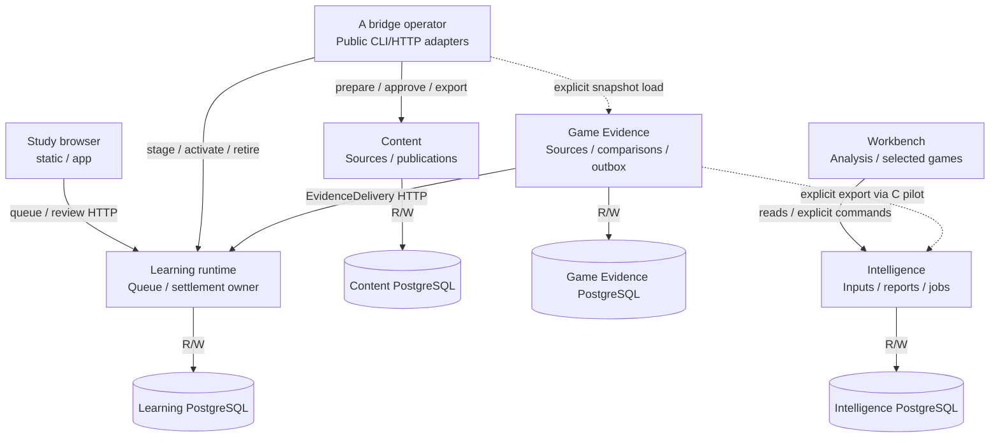
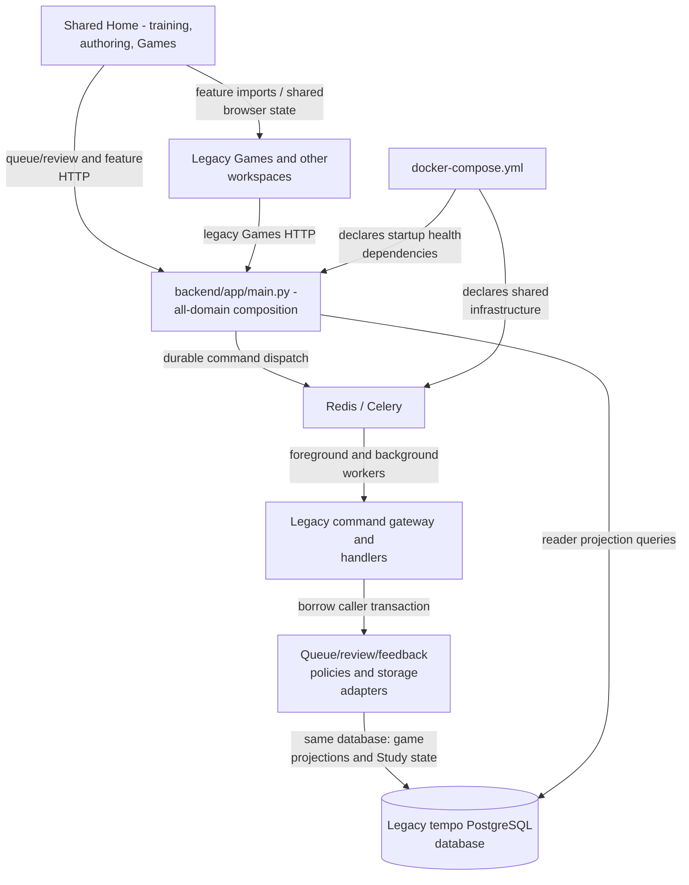

# System, ownership and failure domains

[Index and source/status legend](README.md) · [Study/Games detail](study-games.md) ·
[Sequences and data flows](flows.md)

## Implemented component increments

**MAIN:** these implementations coexist with the legacy assembly below. This
view shows source interfaces available for explicit composition, not a claim that
all users or live data have moved to them. `apps/study-web` remains a planned
independent artifact; the Learning-connected Study build reuses `static`/`app`.
`R/W` storage edges mean reads/writes by that state's owning component.

The bridge is an explicit operator tool, not an automatically invoked Learning
dependency. Likewise the pilot supplies the Stockfish client; merely serving an
accepted report does not start that worker. Intelligence also implements Explorer
source work and Maia job/result APIs, omitted here to bound the graph: its
[provider worker](../../../services/intelligence/src/tempo_intelligence/worker.py)
owns HTTP source calls, [Maia validation](../../../services/intelligence/src/tempo_intelligence/maia.py)
binds registered jobs/results, and the [independent Maia worker](../../../workers/maia/README.md)
owns model execution. These APIs do not grant Learning admission authority or
establish a deployed worker connection.

| Edge / boundary | Concrete source and interface |
| --- | --- |
| Study build and connection | [Vite target](../../../vite.static.config.ts), [static entry](../../../static/src/main.tsx), [Study connection](../../../app/lib/study-connection.ts) (`learningFetch`, origin/path allowlist). [Study artifact status](../../../apps/study-web/README.md) is still planned. |
| Learning HTTP, transaction and install closure | [`create_app`](../../../services/learning/runtime/src/tempo_learning_runtime/api.py), [`Database`](../../../services/learning/runtime/src/tempo_learning_runtime/database.py), [installed dependencies](../../../services/learning/runtime/pyproject.toml). Game Evidence **contracts**, not its service implementation, are installed. |
| Content/bridge and activation | [Content `Store`](../../../services/content/src/tempo_content/store.py), [bridge domain](../../../services/content/src/tempo_content/bridge.py), [operator](../../../tools/analysis-restoration/a_bridge/src/tempo_a_bridge/cli.py), [Learning publication bridge](../../../services/learning/runtime/src/tempo_learning_runtime/publication_bridge.py). See [activation flow](flows.md#content-publication-and-serving-activation-main). |
| Game Evidence output and delivery | [`Store`](../../../services/game-evidence/src/tempo_game_evidence/store.py), [`deliver_one`](../../../services/game-evidence/src/tempo_game_evidence/delivery.py), [analysis export](../../../services/game-evidence/src/tempo_game_evidence/analysis_export.py), [Learning receiver](../../../services/learning/runtime/src/tempo_learning_runtime/receivers.py). |
| Workbench / Intelligence | [`IntelligenceClient`](../../../apps/workbench-web/src/client.ts), [`PendingCommands`](../../../apps/workbench-web/src/commands.ts), [HTTP composition](../../../services/intelligence/src/tempo_intelligence/api.py), [Analysis routes](../../../services/intelligence/src/tempo_intelligence/analysis/api.py), [`AnalysisStore`](../../../services/intelligence/src/tempo_intelligence/analysis/store.py). |
| Engine dispatch | [pilot CLI](../../../tools/analysis-restoration/c_pilot/src/tempo_analysis_pilot/cli.py), [public-client adapter](../../../tools/analysis-restoration/c_pilot/src/tempo_analysis_pilot/stockfish_client.py), [bounded dispatcher](../../../services/intelligence/src/tempo_intelligence/analysis/worker.py), [worker API](../../../workers/stockfish/index.mjs), [job/result contracts](../../../contracts/analysis-jobs/README.md). |
| Shared libraries | [scheduling](../../../packages/scheduling/README.md), [chess identity](../../../packages/chess-core/README.md), [browser intents](../../../packages/browser-intents/README.md), [Study session](../../../packages/study-session/README.md), [board renderer](../../../packages/board-ui/README.md), [contract index](../../../contracts/README.md). Package existence is not proof of every consumer's adoption. |

## Legacy assembly and existing coupling

**MAIN / LEGACY:** the full app and legacy backend still combine domain concerns.
This is a separate assembly from the independent Learning runtime. The declared
PostgreSQL Compose stack below is source configuration, **deployment unverified**.
SQLite compatibility paths also exist; see [storage](../../STORAGE.md).

The extracted feedback/queue ports improve local decision/effect ownership; they
do not split this database, broker or application root. The legacy
[`QueueAdmissionAdapter`](../../../backend/app/services/queue_admission_adapter.py)
still joins gameplay priorities, opportunities and miss projections while preparing
ordinary queue candidates. Its
[feedback composition](../../../backend/app/services/real_game_feedback_adapter.py)
wraps the caller connection with
[`BorrowedFeedbackStore`](../../../backend/app/storage/real_game_feedback.py);
the [miss projection](../../../backend/app/storage/real_game_miss_projection.py)
and [accepted-scope storage](../../../backend/app/storage/legacy_game_evidence_scope.py)
own those queries. Queue policies must not acquire a second writer.

The legacy [evidence command](../../../backend/app/game_evidence_commands.py)
also borrows the existing [command gateway](../../../backend/app/command_gateway.py)
transaction. This legacy-local bridge is not the independent Learning receiver
and must not be mistaken for permission for another service to write these tables.
[Games view](../../../app/views/games_view.tsx),
[legacy root](../../../backend/app/main.py), [command dispatch](../../../backend/app/command_dispatch.py),
[Celery root](../../../backend/app/celery_app.py) and
[Compose](../../../docker-compose.yml) are the source anchors for the graph.

These are scoped legacy gaps for architecture review, not a claim that Games can
fail independently throughout the full app. The [Study detail](study-games.md#main-study-path-and-source-gap)
also exposes shared browser imports. Changes claiming isolation must satisfy the
new rule at the affected boundary; this documentation does not repair the legacy
assembly or authorize a live cutover.

## Data, resource and lifecycle owners

| Owner | Durable state and transaction authority | Resource / lifecycle / failure boundary |
| --- | --- | --- |
| Study browser | [Intent store adapter](../../../app/lib/study-intent-storage.ts) and [browser-intents](../../../packages/browser-intents/src/index.ts) own browser intent transactions; [offline cache](../../../app/lib/offline-training.ts) owns retained practice data. Credentials stay in the connection's session storage; durable attempt identity includes authority. Browser persistence does not settle server state. | [Study session](../../../packages/study-session/src/index.ts) owns delivery and next-load state. Dispose keeps durable work; stale responses must not replace newer session state. Storage failure blocks unretained dispatch. Learning outage may allow cached practice, never fabricated commitment. |
| Learning | [Runtime migration manifest](../../../services/learning/runtime/src/tempo_learning_runtime/migrations/manifest.json) orders owned schema; [remediation migration](../../../services/learning/remediation/migrations/001_remediation.sql) is a module inside Learning. [Gateway](../../../services/learning/runtime/src/tempo_learning_runtime/gateway.py) and [Database](../../../services/learning/runtime/src/tempo_learning_runtime/database.py) own transactions; review adapters borrow them. Accepted definitions, queue, attempts, history, schedule, required evidence, receipts and settlement stay in this authority. | Reader/writer pools each default to 4, configured maximum 16; essential maintenance/intake share a separate size-1 writer pool. Foreground acquire/lock/statement/transaction bounds: 250/250/1500/2500 ms. Background: 100/25/200/250 ms; intake transaction: 1000 ms. [Lifespan](../../../services/learning/runtime/src/tempo_learning_runtime/api.py) stops/awaits its maintenance task then closes activity/pools. Learning database failure affects connected Study. |
| Content | [Store](../../../services/content/src/tempo_content/store.py), [explicit migrations](../../../services/content/src/tempo_content/migrate.py), [bridge approval/operation state](../../../services/content/src/tempo_content/bridge.py) own sources, inventory, immutable publication and delivery records. | CLI slices/leases can resume; runtime does not migrate at startup. An invalid successor retains the last complete immutable output. Publication alone cannot activate Learning. |
| Game Evidence | [Store](../../../services/game-evidence/src/tempo_game_evidence/store.py) owns its connections and [migrations](../../../services/game-evidence/src/tempo_game_evidence/migrations); raw sources, revisions, indexes, comparisons, desired results, outbox and accepted-head projection are local. | [CLI work loop](../../../services/game-evidence/src/tempo_game_evidence/cli.py) bounds slices; signals stop between operations. [Provider](../../../services/game-evidence/src/tempo_game_evidence/providers.py) cooldown/cursor/lease state survives restart. HTTP delivery occurs outside DB transactions; immutable attempted payloads and lease fences survive lost responses. |
| Intelligence | [Store](../../../services/intelligence/src/tempo_intelligence/store.py) owns pools/transactions; [manifest](../../../services/intelligence/src/tempo_intelligence/migrations/manifest.json) owns source caches, accepted inputs, runs, engine intents, reports and command receipts. These are not Learning state. | [API lifespan](../../../services/intelligence/src/tempo_intelligence/api.py) / [runner](../../../services/intelligence/src/tempo_intelligence/runtime.py) own background execution and cleanup. Pool defaults: foreground 4, background 1; transaction statement/lock/total bounds: 1500/250/3000 ms. Provider calls hold no DB transaction. Mutable MAIN service can run its worker; proposed Games mode changes that composition. |
| Stockfish / Maia | Workers own execution, cancellation, child processes and model/engine resources, not queue/review writes. See [Stockfish](../../../workers/stockfish/README.md) and [Maia](../../../workers/maia/README.md). | Caller job/worker session and generation checks fence late results. Intelligence [dispatch](../../../services/intelligence/src/tempo_intelligence/analysis/worker.py) cancels or closes a failed session before releasing durable capacity. Model/engine availability is optional for ordinary Study. |

Separate logical databases, roles and bounded transactions do not guarantee host
CPU, memory, disk, network or PostgreSQL cluster capacity isolation. Shared
infrastructure can still fail or contend. Effective deployment budgets and
shutdown under load require their own relevant evidence before claiming
operational independence; none is established by this documentation.

Learning also has an optional
[`HostActivity`](../../../services/learning/runtime/src/tempo_learning_runtime/host_activity.py)
file publisher for same-host admission control. It does not contact Games and
does not wait for a consumer acknowledgement. Publication I/O is still a local
resource operation; errors are logged and retained control expires closed for
managed work. This is an optional advisory resource signal, not proof of host
isolation or a substitute for separate workload budgets.
