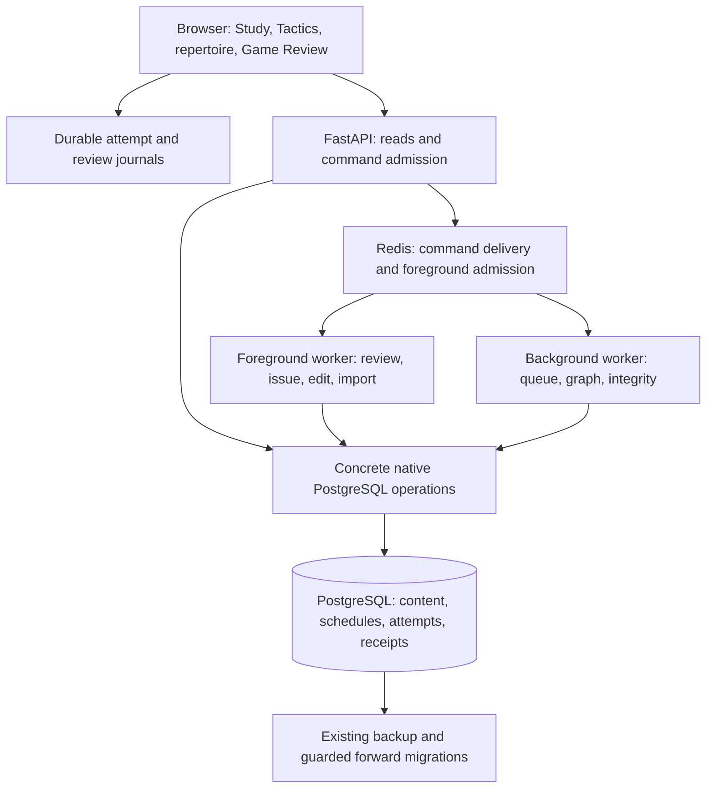

# Current application and storage ownership

Source candidate for the November 10 aggressive reduction pass 2. Installation and native PostgreSQL qualification remain unverified.

The serving implementation is `backend/app` and `database/tempo_storage`. Source preparation and grading policy belong to the application. Fixed SQL operations borrow the existing transaction; storage imports no application orchestrator. Three remaining reverse import edges concern pure immutable facts or receipt DTOs, not startup or workflow calls.

API readers retain read-only transactions. Foreground command receipts and effects commit together. Essential checkpoint delivery retains its original `opening_evidence.checkpoint` command name and durable browser attempt identity. Queue refresh, graph and integrity tasks retain leases, generations and bounded slices; their dispatcher uses direct priority ordering rather than the retired multi-class scheduling turns.

Game Review reads saved game moves or replays a pasted PGN and compares current authored lines. It writes no Study effects. Providers, automatic feedback, recombination, and their separate collector are absent.

Schema 64 adds a paused retirement ledger without updating or deleting original source records. Historical migrations 001–063 and their checksum-bound schema-050 inclusion remain isolated under `tempo_storage/ddl`.
