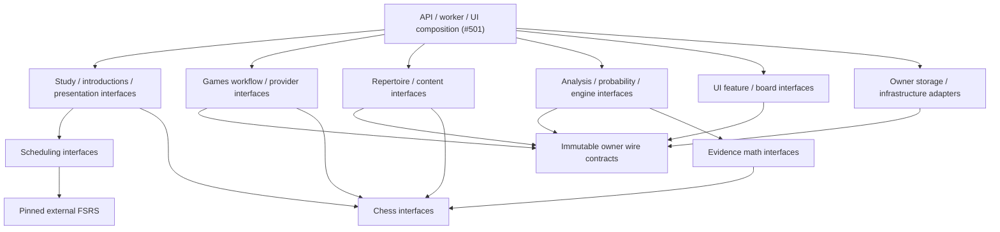

# Interface-directory integration allocation

**First allocation, not a completed decoupling claim.** The [root rule](../../../AGENTS.md#component-owned-interfaces-are-required) is already authoritative on main at `d87accc5`. This manifest preserves unmerged source and live Study; it authorizes no service adoption, schema change, installation, merge or deployment.

[allocation.json](allocation.json) contains exact disjoint first-wave output files, current source heads, allowed component dependencies and the sole integration/guard file owners. `read_roots` are context, not write leases. Existing runtime hotfix ownership takes precedence until the parent releases it.

## Dispatch now — revision 2

This revision consolidates 26 groups into nine existing owner batches. It supersedes the original per-leaf owner suggestions for restructuring only. Existing functional issue ownership and hotfix leases remain intact. All nine owner batches are now dispatched; no groups are unassigned.

| Existing owner | Component groups | Dispatch / dependency |
| --- | --- | --- |
| #482 | `wire-contracts` | Retained guard/contracts owner; source guard/tooling remains exclusive. |
| #483 | `repertoire`, `content-changes` | Dispatched repertoire/content batch; base chess + wire surfaces. |
| #487 | `study`, `introductions` | Study/introduction surfaces follow immediate functional fix; no competing edits. |
| #490 | `ui-study-games`, `ui-repertoire-board` | Dispatched both UI groups; shared roots remain #501. |
| #491 | `game-ingestion`, `game-sync` | Retained Games/sync owner; functional fixes first, surfaces from exact published head. |
| #497 | `chess`, `comparison`, `lichess`, `chesscom`, `probability`, `stockfish`, `maia` | Dispatched chess, comparison, engine and external adapter batch; no new implementations. |
| #503 | `scheduling`, `presentations`, `tactics`, `evidence-math` | Dispatched scheduling, presentation, tactics and evidence-math support batch. |
| #494 | `coverage`, `similarity`, `proposals` | Dispatched Analysis interface batch; no feature expansion. |
| #501 | `storage-infrastructure`, `analysis-runner`, `composition` | Integration retained; concrete routing only after the exact consumed surfaces are qualified. |

Preparation may proceed in parallel. Allowed import dependencies: chess/scheduling first; wire contracts and evidence math over neutral chess; domain policies/workflows over their typed facts; UI/storage over owner contracts; composition selects concrete implementations last. This is not an all-leaf completion gate.

Exact new files, read roots and each component dependency remain in allocation.json. No file allowlist changed in this ownership correction: 134 unique first-wave outputs, zero overlaps with other owners or the shared/guard registries.
## Small commits and ownership

Each owner first exposes existing semantic contracts/operations through explicit named exports and a short README, retaining class identity and behavior. Use the named new surface check plus the affected existing semantic suite; a cold import must not start a connection, provider, engine, worker or application. Do not copy DTOs or policy. A placeholder remains explicitly unavailable.

Next migrate only that component’s internal callers. Supply cross-owner caller and root patches to #501. After integration and required negative controls pass, remove the exact compatibility aliases. No wildcard barrels, root imports from policy, or re-export of another owner’s implementation. Public contracts may reference existing canonical owner values during the transition; their origins and removal condition must be explicit.

#501 alone integrates shared API/worker/UI roots, registries, dependency manifests/locks, runtime packaging, central test registration and the diagram index. #482 alone owns the public-interface checker and its negative controls/docs. AGENTS.md is exclusively #501 and is already updated. The JSON lists exact files; no two lanes receive the same first-wave path. The parent dispatches existing owners; this manifest spawns no duplicate owners.

The current #487 deferred-priority repair and #491 Games sync/history fixes stay ahead of their mechanical moves. Their working implementation files are not leased by this first allocation. New interface files may be prepared independently where their actual published source is stable.

## Allowed dependency DAG (target, not current-source certification)

Arrows below are source imports to typed public capabilities/pure libraries. Concrete implementation selection and lifetime wiring belong only to composition. A workflow may receive a Study/Repertoire protocol without importing its implementation. Storage adapters depend inward on their owner’s interface; they never acquire mutation authority by sharing a database directory.

There is no Study→Games/Analysis/provider edge. Intake records immutable facts and durable owner-directed delivery without a synchronous queue refresh or optional-producer dependency. Receiving owners alone validate and mutate learning/content state. Evidence and learning policy/effects stay separate.

## Observed integration work and required proof

Existing `backend/app/background_worker.py` is documented as importing `main.coordinator` and waiting on HTTP startup; it must be routed through explicit worker composition when owner surfaces land. `backend/app/services/` still mixes legacy policy, workflow and adapters. The current product import guard covers only selected namespaces, so its green result cannot certify the whole repository. These are recorded migration edges, not permissions to hide them behind a public barrel.

#482’s checker must resolve the declared Python/TypeScript/Rust public surfaces and reject private sibling imports, root-backwards imports, cycles and export bypasses with negative controls. Use the existing component-build/contract tooling rather than a second framework. Every moved boundary retains its semantic regressions and gains only the changed import/lifecycle/failure/replay/protected-state proof it needs. No broad full-system gate or image build is added.

The exact source inputs are in allocation.json. Current main and the listed published checkpoints are not one merged runtime. Interface delivery, consumer adoption, native proof and live operation remain separate claims. Existing C/D/E qualifications are retained; Analysis feature expansion is paused.

## Concrete residual edges

`allocation.json.remaining_edges` assigns the exact Tactics mutation/Study receiver boundary (#503/#487), existing pure clean-streak export (#503), generic coordinator/health assembly (#501), and remaining caller/contract adoption. The legal-position helper remains the same pure evidence-math operation; the allowed repertoire/wire dependency is corrected explicitly instead of copying it into chess. Analysis runner’s immutable coverage value dependency is likewise explicit. None of these edges is considered resolved because an interface directory exists.
