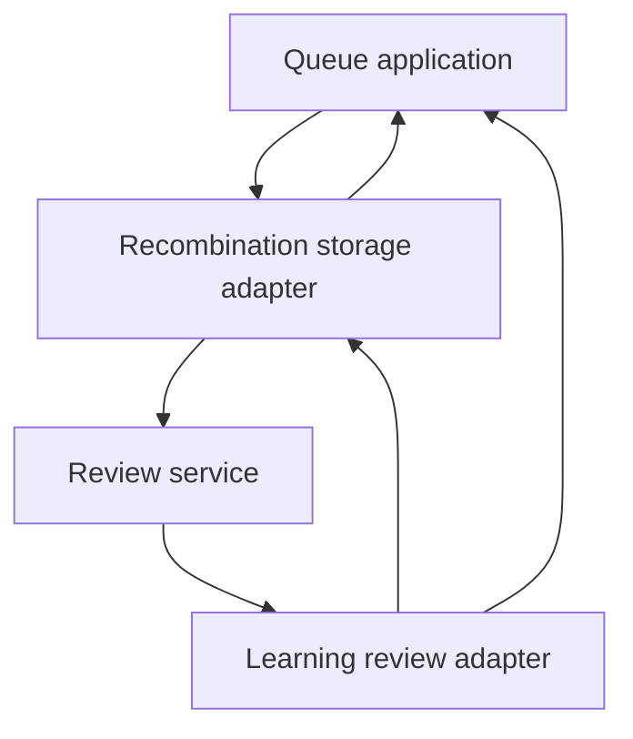

# Runtime reduction — November 10, 2026

## Scope and source

Andy explicitly narrowed this source reduction to Study, Tactics, and basic repertoire-based Game Review, and accepted downtime and temporary Study regressions. The source audit began at `0bf1dc99b4d247804dc4b4c7df4c0add4e33dc70`. PR #977 remained open at `18d4911c69033c71ef3a8d3a7fbcdac7f6155773`; it is not silently included here. No live database or installed host was inspected.

The objective is fewer responsibilities and dependencies. A file being imported by the current assembly is a repair location, not an automatic exemption from deletion. Source changes do not authorize resetting current repertoire or learning data.

## What the earlier deletion batches removed

PRs #975 and #976 removed 507 unique whole files and 67,655 textual lines, adding 712. Counts include source, tests, schema documentation, fixtures, and lockfiles. They mostly removed experimental Intelligence, Content, Game Evidence, and bridge architectures while preserving the original shared backend. #972 disconnected routes without deleting whole files; its changes overlap #973 and must not be added again.

The surviving `database/tempo_legacy_database` was the installed shared storage implementation, not an unused alias. At the audit pin it held 379 tracked files and 40,960 physical lines: 234 Python files / 29,122 lines, 64 SQL files / 2,888 lines, and 81 Markdown files / 8,950 lines. These are source counts, not live table counts.

## This source cut

| Area | Disposition |
| --- | --- |
| Retired engine-era analysis, Explorer, Coverage, Discovery, Defense wrappers | Delete implementations, exclusive adapters, protocol surfaces and tests. |
| Old Games positions/comparisons/findings/misses/events/features/priorities pipeline | Delete worker dispatch and producer hooks, including automatic refresh after repertoire edits. Retain the current product PGN/repertoire comparison path. |
| Standalone Learning API, independent database, publication/position-effect prototypes | Delete. Extract the small used helper closure into existing backend Study ownership. |
| Duplicate scheduler, evidence contracts, segmentation and opening-progression helpers | Reuse the already equivalent backend implementations. |
| Standalone Learning launchers, version-2 registration/cutover, exclusive fixtures | Delete. Reject a retired registration before selecting any retained installation. |
| Unused Learning-transfer and Content-publication protocols | Delete their separate packages and exclusive consumers. |
| Alternate SQLite runtime | Delete startup DDL, the writer thread, compatibility coordinator and launcher/proof paths. Retain the existing PostgreSQL transaction/admission owner. |
| Advanced prefix workflows and UI | Delete evaluation, comparison, transition, diagnostics, advisory segmentation and canonical-prefix preview/save workflows. Keep existing scope reads, simple editing, manual Study splitting and ordinary graph preparation. |
| Operator-only graph recovery | Delete its maintenance tree and generic task callbacks. Keep ordinary graph rebuild/retry, integrity and queue publication. |
| Review application and remediation | Retain actual used libraries and borrowed-transaction semantics. They are not separately deployed services. |
| Existing PostgreSQL storage | Preserve tables and stored records. Forward migration 063 drops only the ten obsolete prefix-transition scope triggers and their three functions; separate queue and deletion serialization guards remain. No live migration is performed here. |

Moved helper validation compares complete Python ASTs, including constants, defaults, SQL strings and class bodies, normalizing only explicit ownership import changes. It does not establish database transaction behavior. Native PostgreSQL and packaged save-to-next-card verification remain separate.

## Why the legacy package still needs replacement

At the audit pin, 142 backend Python files imported the legacy namespace. Twenty-five non-test legacy modules contained 73 imports back into application code. Some are pure contracts; others invoke application workflows. A conservative source graph including function-local imports contained a 49-module cycle. This does not prove runtime import failure or deadlock, but it makes independent changes harder to reason about.

One concrete cycle survives the initial cuts:

The 1,451-line recombination adapter mixes SQL with source preparation, qualification, target mapping, queue mutation and application calls. It is not a narrow database adapter. Renaming the package would leave that structure intact.

## Structural cuts and remaining removal sequence

The source cut removes the second runtime database backend. The former 1,737-line `connections.py` held extensive SQLite initialization after its PostgreSQL branch returned. The new owner retains PostgreSQL admission, connections and read-only schema validation. Writer/coordinator users call existing PostgreSQL transaction contexts directly. Removing advanced prefix workflows also removes their special command lifecycle and task/queue callbacks instead of preserving a generic extension point for a deleted feature.

1. **Delete optional source reconstruction and automatic Games-to-Study orchestration that the minimum product does not require.** Basic Review needs imported PGNs, applicable repertoire data and the first departure. Existing accepted Study records can remain stored without retaining a new producer or a historical replay system.
2. **Narrow Study operations.** Queue selection, issue, first response and review save should call direct cohesive policy and persistence functions. Move application decisions out of SQL adapters, particularly recombination and feedback qualification. Keep required position identity, deterministic introduction order, scheduling and review replay semantics.
3. **Use native PostgreSQL queries.** `adapters/postgres_store.py` still translates SQLite-shaped SQL using `sqlglot`. Deleting SQLite connections alone does not remove this dialect dependency. Port retained queries to native PostgreSQL before removing the translator.
4. **Delete the old package.** Move only the reviewed small set of retained SQL operations into a concrete current storage owner. Delete the legacy directory and all runtime imports; do not bulk-copy its adapters or leave a re-export facade. Keep historical upgrade SQL in the maintenance boundary only where an actual supported upgrade requires it.

## Required forward migration

Migrations 038/039 installed `guard_prefix_transition_scope(text, text)`, which raises `P0080` when a card/repertoire fence belongs to a different transaction-local prefix operation. Leaving those guards installed after deleting the provider could permanently block ordinary card, repertoire and graph mutations. Migration 063 removes those obsolete scope triggers/functions without erasing their historical rows. The queue reservation and permanent-deletion guards sharing an advisory lock remain because they serve retained operations. Startup requires the new schema version; installing source without applying the reviewed forward migration is not a supported deployment.

The destination needs cohesive storage for repertoire facts, scheduling, attempts/reviews, queue, Tactics, and minimal Game Review. It does not need separate databases, a new service framework, a generic repository layer, or an event bus.

## Finite acceptance

- API and worker import and start using retained installed dependencies; deleted packages are physically absent from the test environment.
- Study issues a playable card, records the original response, saves/replays one review exactly once and issues the next card. Frozen new-card ordering and position schedule identity remain inspectable.
- Tactics capture, solve and receipt replay work without retired analysis workers.
- Basic Game Review imports/replays a PGN and identifies its first repertoire departure without invoking the removed derivation pipeline.
- A repertoire edit cannot enqueue the removed pipeline. Stale retired task names terminate through the existing retirement boundary.
- No storage adapter imports an application orchestrator in the replacement owner. No runtime import resolves the retired legacy namespace when that final stage is complete.

Focused source/component results are not a packaged browser pass, merge qualification, installation, or activation. The environment for this audit has Python and Node, but no Docker executable; native database and installed lifecycle behavior are unverified here.
