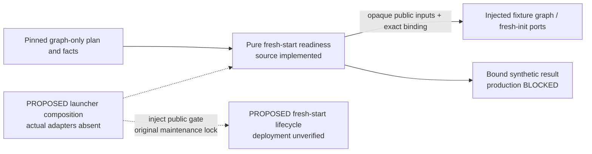

# Graph-preserving fresh-start readiness (#359, packet 3)

This branch prepares the selected **graph-preserving fresh start**. Old reviews,
schedules, server/background work and old pending browser envelopes impose no
preservation, drain or replay gate. Preserve the complete authored opening graph,
repertoire/source names and dependency closure, then initialize an independent
clean Learning target under an explicitly selected new authority.

Only a pure synthetic source harness is implemented here. The registered
installation, current database, default CLI, credentials and browser storage are
unchanged. The existing [cutover specification](../LAUNCHER-CUTOVER.md) supplies
the original-lock, durable-publication and interruption-safety boundaries; its old
history-preservation prerequisites are superseded for this fresh-start branch.

Every result explicitly says `production.status: 'blocked'` and
`liveExecutionAllowed: false`, with `graph-contract-pending` and
`fresh-initialization-contract-pending`. A synthetic `status: 'ready'` proves only
the supplied fixture wiring. No actual graph/import/reset/cutover receipt is minted.

## Public source interface

[`evaluateFreshStartReadiness`](../../../../scripts/tempo-cutover-readiness.mjs)
accepts `{plan, checkpoint, gateContext, evidence, facts}` and optional
`{graphAdapter, freshInitializationAdapter}`. Its only import is Node's hash
function. It runs no commands, services, browser, network, filesystem or database
operations and imports no converter or service implementation.

The planner owns candidate identity and artifact checks. Its exact fresh-start
choice and common `.cutover` bind workspace, ingress, schema, graph source reference
and final `graphReceipt` / `freshInitReceipt` references. These values are supplied
inputs; the harness cannot infer installed graph mappings or choose real targets.
The lifecycle owns the original maintenance lock, intent, effects and durable
publication. The composition root injects readiness through its public gate port.

`readinessBinding(plan, checkpoint, gateContext)` returns
`{version: 1, checkpoint, gateContext, planSha256}`. SHA-256 covers the complete JSON
plan with recursively sorted object keys and ordered arrays. Invalid JSON values
are rejected. The lifecycle compares that complete binding; finalizing either
receipt changes it. Each lock invocation supplies a new nonce. A nonce rejects
stale evidence but cannot substitute for actual state observation.

Both optional fixture ports expose
`{scope: 'synthetic-fixture', validate(input, expected)}` and return
`{status: 'verified', binding: expected}`. Their inputs are copied/frozen. Graph
source, recovery, import and fresh-init receipts remain opaque. Expected bindings
name the selected source/target, revision, graph reference, workspace, ingress,
schema, current checkpoint/nonce and, where finalized, the applicable receipt
reference. Missing, failing, asynchronous or mismatched ports block their gate.
Actual provider scopes are rejected; no actual adapter exists in this packet.

### Stable public fresh-initialization helper

The reviewed public interface is
[`opening_graph_fresh_learning.py` at `dd906511`](https://github.com/aaweaver-actuary/tempo/blob/dd906511835a4542779bef51ae09125f8f6dca49/database/tooling/opening_graph_fresh_learning.py)
in [PR #452](https://github.com/aaweaver-actuary/tempo/pull/452):

- `prepare_fresh_learning(export, *, target, operation_id, content_cli,
  learning_origin, operator_token_file, initial_status, verify_export)` produces
  a plan for the existing `tempo-a-bridge ... apply <operation_id>` public CLI.
  It does not execute that CLI or build a private serialized bundle.
- `verify_fresh_learning(plan, *, operator_result, receipt, status,
  verify_fresh_effects)` owns Content completion, the exact Learning activation
  operation receipt, active source/publication identity, and independently read
  complete graph/default-state verification. Node must not duplicate these checks.

Successful verification returns the authoritative activation response with exactly
`contract_version`, `workspace_id`, `activation_id`, `publication_id`,
`publication_generation`, `activation_revision`, `status: 'activated'` and `reason`.
It is not the Node gate verdict `{status: 'verified', binding}`. A future outer
capability may pass this response opaquely through `plan.freshInitialization` and
`facts.freshInitialization.freshInitReceipt`, then issue a gate verdict only after
binding the verified result to this exact launcher plan and current checkpoint.
Passing the raw response directly as that verdict is rejected.

The launcher's opaque `freshInitReceipt` reference remains explicit outer input;
do not derive or assume it equals `activation_id`. The helper response does not
contain the launcher `targetKey`, pinned schema or browser ingress identity. Its
target observation and Learning origin must be bound by the composition owner to
the selected target and actual ingress wiring. It also supplies no proof that old
cached credentials/authority cannot replay into the new target; independent
isolation remains required, without old-envelope inspection or draining.

The fixture now uses this exact public response shape behind a separately supplied
synthetic capability. It demonstrates opaque plumbing, not Python semantic
verification or a production adapter. Actual capsule/copy verification, target IDs,
independent effect/authority observations and final cutover confirmation remain
pending. No evaluator source or production permission changed in this reconciliation.

## Checkpoints

| Checkpoint | Required boundary |
| --- | --- |
| `before-preparation` | Explicit fresh-start intent and graph/fresh-init provider contracts. No cutover confirmation is needed for safe pure/disposable preparation. |
| `before-authority-switch` | Full graph/source closure and immutable restore-verified recovery copy; independent clean target; exact workspace/origin/schema; public graph import and fresh initialization; read-only graph quarantine; new authority isolation; exact separate cutover confirmation. |
| `before-admission` | All switch proofs plus matching durable v2 publication and separate exact target admission confirmation. |
| `before-resume` | Fresh target quarantine and phase-appropriate original-writer observation under the current lock. Preparation permits the original writer to remain active. |
| `before-forward-recovery` | Final graph/init/publication consistency, fresh quarantine and original fence, and preservation of effects already accepted by the fresh target. |

`facts.graphSource.graphSourceReference` identifies the pinned closure.
`graphRecoveryCopy` requires `immutable`, `restoreVerified` and
`fullSourcePreserved`; reduced Learning rows do not preserve authored source and
repertoire names. `targetProvisioning` verifies clean, independent target identity,
workspace, ingress and schema. Graph import and initialization return opaque
receipts. Quarantine verifies the same authority/schema and graph closure with
maintenance and write-capable traffic disabled. `facts.resumption` describes this
transition's current writer state, not old background-work recovery.

Old cached intent replay must be isolated from the new workspace/origin/token
authority. The fixture gate requires explicit isolation evidence, without inspecting
or draining old envelopes. No new epoch protocol is introduced and no credential
values enter the plan. A real isolation implementation/acceptance remains pending.

## Source boundary and remaining integration

The implemented source and owning fixture are
[`tempo-cutover-readiness.mjs`](../../../../scripts/tempo-cutover-readiness.mjs)
and the [labelled synthetic input](../../../../scripts/tests/fixtures/tempo-cutover-readiness/synthetic-fresh-start.json).
There are no sibling implementation imports, reverse dependencies or shared
mutable receipts. A missing graph plugin blocks this optional transition without
becoming a dependency of ordinary Study. No database schema changes occur here.

The actual graph owner must verify full source closure using its public capture,
`SourceSnapshot` v1 and authored import-manifest boundaries. The recovery verifier
binds `capture.json`, the sole executor's `capture-receipt.json`, `source.json` and
`import-manifest.json` by hashes/sizes and exact installed source revision. Keep
this verified immutable graph/source bundle independently recoverable; historical
backup retention is not a gate.

Content's public `publication export <publication_id> --generation <n>` emits the
serialized `content_bridge_export` envelope. The installed public
`tempo-a-bridge ... apply <operation_id>` boundary owns delivery to Learning's
`/internal/publications/v2/stage` and `/v2/activate` interfaces. Graph/fresh-init
helpers and version-specific closure acceptance remain the graph owner's work;
the launcher must consume their public receipts one way. It must not call private
converter functions or infer version-specific table mappings.

Prepare/verify the new graph copy and independent target while the current
database and services remain untouched. Only after exact target/graph verification
and separate user confirmation may the authorized executor fence the original
writer and publish. Persist `admission-started` before that fence/publication and
`activation-started` before enabling new target writes. Split publication blocks
automatic startup. Once new effects may have been accepted, repair that fresh
authority forward; do not restore an older snapshot or automatically return to the
old writer. No live step is authorized or executed by this branch.

## Focused verification

Run `node --test scripts/tests/tempo-cutover-readiness.test.mjs` for the owning
dependency-free suite. It covers graph/source-copy completeness, independent
target/schema checks, confirmation timing, new-authority isolation, publication,
resume/forward safety and failed/missing public providers. It repeats none of the
six completed artifact/qualification suites. Serialize validation with the existing
`/tmp/tempo-mac-validation-20261025.lock`, opened without truncation and never removed.

`readFreshStartReadinessFixture` reads bounded explicitly labelled synthetic JSON
only. Fixture identifiers are invented examples, not actual installed observations,
graph preservation acceptance or user cutover confirmation.
