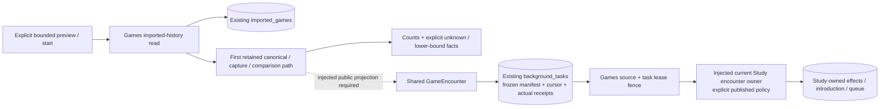

# Bounded retained-game history preparation (#491)

This private source path uses already imported canonical games. It requires no
provider fetch, new PGN, Game Review screen, C/D/R11 workflow, replacement runtime
or full-history migration. It does not activate a live history pass.

## Source and preview

- [Games application](../../../backend/app/games/feedback/history.py) owns the
  explicit account/provider, half-open UTC window, repertoires, speed/rated policy,
  game/position budgets and frozen run identity.
- [Games read adapter](../../../database/tempo_legacy_database/adapters/games/product_history.py)
  reads at most the selected game bound plus one sentinel from `imported_games`.
  Pages use stable canonical IDs and preserve `adaptive_excluded`. Cast/query
  failure is an unavailable preview, never a successful empty result.
- [Composition](../../../backend/app/product_composition/game_history.py) reuses
  `capture_game` and #488's public `prepare_captured_encounters` assembly from
  the qualified first path. That owner supplies the current source-domain
  snapshot, findings and shared encounters. Stored moves are never
  re-exported as supposedly original PGN. No `product_feedback_sources` row is
  required for a retained game.

The preview distinguishes selected/compared games, compared played-position ×
repertoire slots, known matches, different selected responses, eligible lapses,
`known_unintroduced` encounters, exclusions, unknown authority/mapping and
positions without a reportable finding. Those are descriptive facets, not a
partition: an uncertain chronological case can still contain different play.
`known_unintroduced` can be a historical encounter before a later introduction;
it is not an instruction to introduce the current card again.

Current #486 findings do not report every correctly played introduced occurrence.
Matches are therefore an explicit lower bound, and non-reportable positions are
shown separately. Zero eligible misses never asserts that every game was correct.
The next page and `more_available` remain visible; a bounded prefix never claims
the entire requested window was exhausted.

## Execution and existing durability

`current_retained_history_comparer()` explicitly binds #488's qualified
`prepare_captured_encounters(capture, detected_at=...)`. Its returned source-domain
snapshot, findings and shared encounters are consumed unchanged; this binding
does not rebuild the snapshot or reinterpret retained chronology. The older
explicit `project_retained_encounters` injection remains for focused pure-source
tests. Generic comparer instances without either capability remain preview-only.
No GameEncounter builder or raw provenance is copied, and constructing the
binding starts no read or worker.

`current_retained_history_receiver` requires the explicit owner policy identity,
actual `operation_stopped` callback, Study introduction policy and clock. It binds
#488's public `receive_admitted_encounter`; that wrapper supplies the current
Study introduction capability and owns canonical source fencing. Games chooses
no allowance/Study-only override. The approved targeted encounter exception comes
from the current Study/introduction owner; global controls, full Study pause,
foreground safety and source/legality/conflict guards are unchanged.

`start_history_in_transaction` stores one frozen manifest in existing
`background_tasks`, kind `game_feedback_history`. A transaction-scoped run lock
serializes same-run starts, and a different manifest/policy cannot overwrite the
saved cursor. There is no new table or migration. Manifest size is capped at
1 MiB and 256 commands; exceeding a preparation bound refuses execution.
The start method requires the trusted server selection separately from the plan.
Command provider/workspace/repertoire/window/detection and game bounds are
checked before any task write. Existing library metadata rechecks the actual
account/window/speed/rated/exclusion predicate at start and under the existing
source fence during each effect. A plan cannot authorize its own changed scope.

`execute_history_slice` requires an injected actual whole-operation admission
context spanning capture through commit. There is no default permissive guard;
denied, unreadable or unknown control state must defer. Bind the existing
background/foreground/maintenance admission decision. No separate pause column
is invented, and neither zero cap nor Study-only is interpreted as full pause.
The receiving factory may supply `paused=False` only after that guard admits and
the absence of a distinct full-pause feature is actually verified/documented.

The slice captures and calls the qualified preparation helper before the writer,
retaining the original saved command even if fresh findings differ. It fences the
task lease, calls the admitted receiving wrapper, then checks actual library
selection under the wrapper's source lock. One actual
EncounterReceipt and cursor advance share that transaction. The full receipt
subtype/disposition/deferred fields are retained. A failed checkpoint rolls back
the effect; retry uses the saved original key, source, command and detection.
Completion means the bounded observation-processing run is complete, not that a
pending first introduction is already available. Subsequent admission/maintenance
and actual pause/authority deferral remain with Study.
`history_run_status` reads saved progress, preview and actual owner admission
counts/receipts; it never starts or retries a pass.



## Qualification and exact remaining joins

Only static syntax/marker/newline and relative-link checks have run. No test,
database, image build or live operation has run for this private preparation.
The proposed focused application check (including the real shared projection
binding and frozen-scope compatibility cases) is:

```sh
TEMPO_PYTHON="$TEMPO_TASK_PYTHON" make python-file FILE=backend/tests/test_product_game_history.py
```

Before activation, the parent integration owner must bind the actual admitted
operation control and qualified receiving owner, register only this optional
task kind in its dispatcher, and prove actual native task/effect/receipt rollback
and restart with a disposable fixture. Ordinary Study must not depend on that
dispatcher or producer. Existing 64-route/128-physical capture guards are retained;
an oversized actual source is reported unknown, never bypassed or certified by
small synthetic fixtures. No provider/UI/C/D/R11 completion is a prerequisite.
