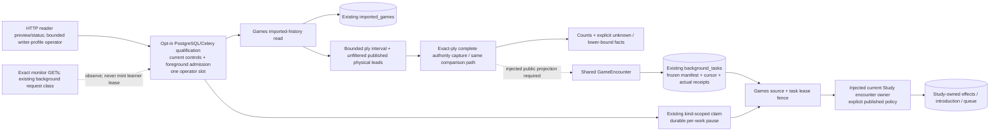

# Bounded retained-game history preparation (#491)

This private source path uses already imported canonical games. It requires no
provider fetch, new PGN, Game Review screen, C/D/R11 workflow, replacement runtime
or full-history migration. It does not activate a live history pass.

## Source and preview

- [Games application](../../../backend/app/games/feedback/history.py) owns the
  explicit account/provider, half-open UTC window, repertoires, speed/rated policy,
  game/position budgets and frozen run identity.
- [Games read adapter](../../../database/tempo_legacy_database/adapters/games/product_history.py)
  reads at most the selected game bound plus one sentinel from `imported_games`.
  Pages use stable canonical IDs and preserve `adaptive_excluded`. Cast/query
  failure is an unavailable preview, never a successful empty result.
  Older rows without the provider ID required by the existing source-owner lock
  remain visible as `retained_provider_identity_unavailable`; they are counted
  unknown and cannot authorize an encounter effect.
- [Composition](../../../backend/app/product_composition/game_history.py) reuses
  `capture_game` and #488's public `prepare_captured_encounters` assembly from
  the qualified first path. That owner supplies the current validated
  snapshot, findings and shared encounters. Stored moves are never
  re-exported as supposedly original PGN. No `product_feedback_sources` row is
  required for a retained game.

The preview distinguishes selected/compared games, compared played-position ×
repertoire slots, known matches, different selected responses, eligible lapses,
`known_unintroduced` encounters, exclusions, unknown authority/mapping and
positions without a reportable finding. Those are descriptive facets, not a
partition: an uncertain chronological case can still contain different play.
`known_unintroduced` can be a historical encounter before a later introduction;
it is not an instruction to introduce the current card again.

Current #486 findings do not report every correctly played introduced occurrence.
Matches are therefore an explicit lower bound, and non-reportable positions are
shown separately. Zero eligible misses never asserts that every game was correct.
The next page and `more_available` remain visible; a bounded prefix never claims
the entire requested window was exhausted.

### Exact bounded position windows

The history selection also freezes zero-based `start_ply` (default 0) and
`maximum_plies` (default/maximum 16). Every selected game/repertoire examines only
that half-open interval. The existing published
[`candidate_lookup.decision_bindings`](../../../database/tempo_legacy_database/adapters/games/authority/candidate_lookup/README.md)
adapter supplies unfiltered current-publication physical leads, then
[`retained_history_capture`](../../../backend/app/services/retained_history_capture.py)
calls the unchanged complete authority capture for each exact learner ply.
Missing, blocked, unintroduced and conflicting alternatives are never filtered
from this discovery/capture boundary. A 65th binding or catalogue route remains
unresolved at that position; the 64-route/128-card guards are unchanged. It does
not prevent a later exact position from having its own complete capture.

The history composition retains only the selected ply's findings/commands from
the existing capture preparation helper. Earlier canonical moves use its existing
authored-route traversal. The comparer, command projector, complete source proof
and receiving owner are unchanged.
No game source, route, alternative, mapping or game/decision effect identity is
invented, truncated or relabeled.

`unresolved_positions` reports selected learner positions without reportable
authority/mapping evidence. Diagnostics retain overflow and missing-binding
reasons. `remaining_positions` counts unexamined played-position/repertoire slots
beyond this window, and `next_start_ply` identifies the next interval. Repeat the
same game page, explicit filters and window with that start ply and a new run ID
until `next_start_ply` is null; only then advance `after_game_id` to the next game
page. Earlier unresolved positions remain unresolved, never implicit matches.
Overlapping windows retain the same deduplicated game/decision identities.
Started runs resume their frozen encounter cursor independently of discovery.
Version-1 saved manifests retain their exact original serialization/digest;
new position-window manifests are version 2.

## Execution and existing durability

`current_retained_history_comparer()` explicitly binds #488's qualified
`prepare_captured_encounters(capture, detected_at=...)`. Its returned validated
snapshot, findings and shared encounters are consumed unchanged; this binding
does not rebuild the snapshot or reinterpret retained chronology. The older
explicit `project_retained_encounters` injection remains for focused pure-source
tests. Generic comparer instances without either capability remain preview-only.
No GameEncounter builder or raw provenance is copied, and constructing the
binding starts no read or worker.

Equivalent route aliases remain complete source facts. The comparer proves that
every active authored occurrence has mapping coverage; the shared pure
`resolve_equivalent_mapping` helper then selects one deterministic original
member only when every non-route mapping field agrees exactly. The shared
encounter projector consumes that same resolver and does not discard differing
availability evidence. Route rows, mappings, alternatives and genuine conflicts
are retained. Multiple route provenance rows alone are not multiple physical
Study targets or game/decision effects. The current Study owner independently
rechecks/fences the retained complete source before accepting that command.

Routine monitor GETs (`/api/health`, `/api/system/foreground-active`,
`/api/system/foreground-requests-active`, `/api/system/tasks`) use the existing
background request classification even when an older caller omits the header.
They observe activity without creating a learner foreground lease. This matters
for the standard Docker health probe, which runs every three seconds. Their
existing read handlers, reader permissions and query-only request context stay
unchanged. They cannot clear a genuine foreground request or browser-input lease;
unknown control state still denies history work. Queue/attempt reads, review/save
commands and browser-input pulses retain their existing foreground safeguards.

`current_retained_history_receiver` requires the explicit owner policy identity,
actual `operation_stopped` callback, Study introduction policy and clock. It binds
#488's public `receive_admitted_encounter`; that wrapper supplies the current
Study introduction capability and owns canonical source fencing. Games chooses
no allowance/Study-only override. The approved targeted encounter exception comes
from the current Study/introduction owner; global controls, full Study pause,
foreground safety and source/legality/conflict guards are unchanged.

`start_history_in_transaction` stores one frozen manifest in existing
`background_tasks`, kind `game_feedback_history`. A transaction-scoped run lock
serializes same-run starts, and a different manifest/policy cannot overwrite the
saved cursor. There is no new table or migration. Manifest size is capped at
1 MiB and 256 commands; exceeding a preparation bound refuses execution.
The start method requires the trusted server selection separately from the plan.
Command provider/workspace/repertoire/window/detection and game bounds are
checked before any task write. Existing library metadata rechecks the actual
account/window/speed/rated/exclusion predicate at start and under the existing
source fence during each effect. A plan cannot authorize its own changed scope.

`execute_history_slice` requires an injected actual whole-operation admission
context spanning capture through commit. There is no default permissive guard;
denied, unreadable or unknown control state must defer. Bind the existing
background/foreground/maintenance admission decision. No separate pause column
is invented, and neither zero cap nor Study-only is interpreted as full pause.
The receiving factory may supply `paused=False` only after that guard admits and
the absence of a distinct full-pause feature is actually verified/documented.

The slice captures and calls the qualified preparation helper before the writer,
retaining the original saved command even if fresh findings differ. It fences the
task lease, calls the admitted receiving wrapper, then checks actual library
selection under the wrapper's source lock. One actual
EncounterReceipt and cursor advance share that transaction. The full receipt
subtype/disposition/deferred fields are retained. A failed checkpoint rolls back
the effect; retry uses the saved original key, source, command and detection.
Completion means the bounded observation-processing run is complete, not that a
pending first introduction is already available. Subsequent admission/maintenance
and actual pause/authority deferral remain with Study.
`history_run_status` reads saved progress, preview and the actual committed
delivery receipt snapshots; it never starts or retries a pass. Admission counts
describe those delivery snapshots. They are not a fresh query of later Study
settlement or a promise that a queued card is still available now.



## Operator activation and one bounded pass

The release owner, rather than Andy using a terminal, performs these local HTTP
operations after a separately qualified installation. Source is disabled by
default. Activation requires both `TEMPO_RETAINED_HISTORY_ENABLED=1` and
`TEMPO_RETAINED_HISTORY_QUEUE_MODE=postgres-celery`. Before setting them, verify
that the old unfiltered `app.background_worker` / `GameSyncCoordinator` is absent.
The PostgreSQL API lifespan and the ordinary Celery poller do not claim this kind;
only explicit operator calls do. No new daemon or dispatcher registration exists.
These values qualify the selected deployment, not a change to global Study policy.

The root binding uses current `study_priority.control_snapshot()` availability,
foreground state and readable Boolean Study-only evidence; Study-only does not
stop this approved exception. There is no distinct full-Study-pause field in the
retained settings/control source. Unknown evidence defers. The actual kind-scoped
claim checks durable per-work pause, and the next writer fences its current lease
and generation. Only that admitted claimed unit supplies `paused=False` to the
receiving owner. Existing background database, canonical source, current mapping,
legality/conflict and maintenance fences remain in force.

All routes use prefix `/api/product/game-history`, and the entire prefix receives
background admission, including callers without a special work-class header.
The API reader profile serves preview/status only. It supplies no receiving
capability, reports `execution_ready=false`, and rejects write requests with
`retained_history_writer_operator_required` (HTTP 503). The existing bounded
operations may instead be invoked by an explicit operator in the established
writer-worker profile; API writer credentials and a new dispatch layer are not
introduced. The packaged writer budget qualification below is still incomplete.

1. `POST /preview` with a unique `run_id` and explicit `selection`: workspace
   `legacy`, provider `lichess` or `chesscom`, actual account, half-open UTC
   `window` (`start_at`, `end_at`, `precision`), selected `repertoire_ids`,
   `speeds`, nullable `rated`, and game/position bounds. Defaults are 25 games
   and 10,000 played-position/repertoire slots; maximums are 100 and 10,000.
   This POST is query-only. It returns counts, diagnostics, page continuation,
   the exact selection and `manifest_digest`; no executable commands are exposed.
2. Review the counts/unknowns, then `POST /start` with the same run ID, selection
   and digest. The server freezes its own original plan, not client commands.
   A repeated start of the same plan reuses its task; changed manifests conflict.
3. `POST /run-ready` with `maximum_units` (default 16, maximum 100) performs that
   many ready encounter units, yielding to controls between units. It processes
   the approved history queue, not a named run. `POST /resume` has the same bounded
   behavior and retains all original keys, detection, policy and checkpoints.
4. `GET /runs/{run_id}` returns stored progress and full receipt snapshots without
   performing work. A new process can resume started tasks without the preview
   cache. Unstarted previews require another preview after restart/eviction.
5. If `more_available` is true, use the returned `next_game_id` as the next
   selection's `after_game_id`, with a new run ID and the same explicit window.
   Neither paging nor overlapping windows manufacture another game/decision ID.

The private preview cache holds at most eight plans, each at most 1 MiB. No source
table, migration, synthetic PGN, provider fetch, automatic full-history scheduling
or live kickoff is part of this path.

## Qualification and remaining release boundary

The focused packaged check at `0840fa21` found the reader API requesting a writer
connection. The narrow correction at `fb36dbe9ce175a119e3b3d81eb1da80d9dd63c20`
preserves read-only API permissions and uses the existing bounded operations in
the established writer profile. Its packaged image built, imported without a
source overlay, bootstrapped schema 051 and reached actual API/Celery health.
HTTP preview passed with truthful read-only readiness, and reader write requests
were rejected with the expected 503 before any writer transaction.

The writer operator committed its bounded manifest and reached actual receiving
admission, then hit the standard 250ms PostgreSQL transaction limit during
`promote_encounter -> ensure_card_queued_after -> presentation_facts`. No completed
run or owner receipt was acknowledged. Packaged duplicate/resume checks were not
reached and are not claimed passed. The timeout was preserved, not raised.
No receiving-owner preparation hook exists on this path; a bounded/prepared
promotion capability or established command preparation fitting the current
budget is the concrete remaining qualification seam. No SQL-copy/prewarm hack
or larger design is added here. Activation remains blocked. All disposable
stack/image/builder/secrets resources were removed and locks released.

The missing published #487 `abfacd08` material-introduction correction is now
consumed at runtime checkpoint `5865882c77ce44c0aa9e6b0c082afd78021d569a`.
Only the owning retention projection, ordinary reconciliation/presentation and
native PostgreSQL stale-reset hooks changed; existing equivalent ordering stays.
Its same-day/next-day native selection passed **2 cases, 20 deselected, 2.10s**.
This preserves a real current-revision encounter introduction during ordinary
seeding without admitting unapplied facts or manufacturing another review.

Pending encounter maintenance is connected: the existing Celery beat/foreground
route calls `maintain_game_feedback`, kind-claims `study_game_feedback`, then
uses the encounter-aware sweep on the writer worker. Its original command/source,
durable per-work pause, current lease/generation and explicit encounter allowance
are retained. The unchanged #488 pending-maintenance proofs for Study-only false
and true are reused; that source connection is not a remaining gap. Actual
packaged history completion is blocked by the receiving transaction budget above.

At local executable **`38693c6da56a140938f4e0cf5412e222395f3f08`**:

- The two application/HTTP files passed **35 cases in 0.55s**.
- `test_product_game_history_postgres.py` passed **4 cases in 5.22s** on the
  capped disposable schema 051 fixture. It used the actual root middleware/router,
  public claim/control, receiver and ordinary Study controller; only database
  transport and clocks were bound to the task fixture.
- The actual window selected 3 games, compared 2 games/2 positions, reported 1
  known match, 1 differing response, 2 unintroduced encounters, 1 excluded and 0
  unknown. Saved zero allowance and Study-only remained unchanged.
- Durable pause prevented claim; first-introduction/frequency-only receipts and
  cursor committed together. A new composition resumed without preview cache.
  A checkpoint failure after the real owner effect rolled back both, then an
  expired-lease restart used the original detection/key. Normal Study saved its
  first genuine target review without a fabricated Again. Unknown control and
  foreground states deferred before work; unrelated optional tasks stayed paused.
- Fixture removal is verified; the advisory validation lock was released.

The final factual-source guard at **`5134d174e61a34a68926b9abff7de62da2182637`**
also passed the one affected root/window native case (**1 passed, 3 deselected,
3.50s**). Its selected window includes an old row without provider identity:
**4 selected, 2 compared, 1 known match, 1 differing response, 2 unintroduced,
1 excluded, 1 explicitly unknown**. Execution still processes only the two
proved encounter commands. The other three native and 35 application/HTTP cases
are unchanged and retain the earlier evidence. This guard invents no identity or
lock fallback; broader old-row admission requires a public source-owner capability.

Exact scoped commands:

```sh
python -m pytest backend/tests/test_product_game_history.py backend/tests/test_product_game_history_http.py -q --rootdir=.
make python-file FILE=backend/tests/test_product_game_history_postgres.py
```

The dependency assembly is #488's local `fb4db3d4` / native-qualified `cf777b52`,
including its explicitly held receiving and day-only corrections. This practical
branch remains local while those publication holds remain; it must not publish
the held work through another branch. The wider provider/UI draft remains #519.
Source/native evidence does not qualify an installed image or deployment resource
isolation. The exact pure analysis-jobs contract packaging from published
`4c35eafd` is registered in Dockerfile, pyproject and lockfile; its metadata/path
consistency check passed. The C runtime/routes/dispatcher are not activated.
The native checks used the explicit source path; no image build, installation or
live action ran, and installed-image qualification remains with release.

Ordinary Study has no dependency on this optional operator. Existing
64-route/128-physical capture guards are retained;
an oversized actual source is reported unknown, never bypassed or certified by
small synthetic fixtures. No provider/UI/C/D/R11 completion is a prerequisite.
