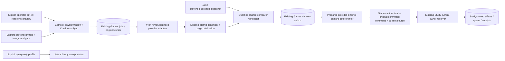

# Continuous provider synchronization follow-on (#491)

This branch prepares bounded Lichess/Chess.com synchronization on top of frozen
qualified retained-history source `0db8c980`. It changes no live process, account,
setting, data, release checkout or frozen feature ref. The older wider draft #519
and its private work are preserved separately. This is backend preparation;
Game Review mounting/browser acceptance and live activation are not claimed.

## Reused source and ownership

- Published #484/#485 adapters retain their request, byte, page/month, filter,
  cancellation and rate-limit contracts. The acquisition wrapper closes one
  connection/client per call; numeric/HTTP-date Retry-After flows to #489.
- The existing #489 coordinator/store/runner owns original captures, immutable
  commands, job leases, retries, page cursors and acknowledgments. The qualified
  comparer/projector and Study source from `0db8c980` remain the base; no matching,
  normalization, scheduling writer or introduction policy is copied.
- #483 `current_published_snapshot` from `967076a0` supplies the explicit current
  publication revision. The authored `current_snapshot` API remains separate.
- The earlier private canonical publication adapter is preserved and reused:
  Games publishes the normalized library row and page/capture/delivery/cursor in
  one transaction. Canonical ID/alias races roll back for recomputation. No PGN
  export, fake capture or pre-checkpoint side effect manufactures authority.
- #489 `2e6aa9d6` binds strict PGN normalization to the retained canonical ID,
  source revision and exact stored fingerprint before comparison. Raw PGN proof
  and acquisition revision remain separately captured. Its source branch is
  remote-verified; queued findings and original commands are never relabeled.
- Configuration, queries and mutations remain in Games-owned adapters. The API
  reader is not granted a write credential. The operator preview uses READ_URL
  and a query-only connection; that connection rejects writer capability use.

## Explicit forward windows

`ForwardWindow(overlap_seconds)` and `ContinuousSync` add no timer or database
lifecycle. They use the current configuration account, repertoires, speeds/rated
policy and interval. Fixed-window recurrence stays fixed by default. Only an
explicit `--follow --overlap-seconds N` opts into advancing windows. Configured
window widths must be 60 seconds to 1 day, overlap 0 to 3600 seconds and smaller than width.

The first window is exactly the configured scope. Each following completed
window advances contiguously from the prior covered end with explicit overlap,
by at most the configured width. A long outage is drained in bounded windows;
it is never skipped by jumping directly to now. Current time only limits the
next upper bound. Job identity includes workspace/provider/account/configuration
revision/window/overlap and is stable on restart. Pending/running/rate-limited,
failed or quarantined work keeps its original cursor and cannot be replaced by
a new window. A held provider does not hide the other configured provider.
A configuration with no recurrence remains disabled. Config changes remain
revision guarded; unexpected saved scope changes refuse rather than infer.

The optional-process loop retains signal/cancellation ownership, can drain a
bounded `--once --max-units N`, and yields on actual admission deferral. Current
controls and foreground checks precede recurring enqueue and each run unit.
Study-only/ordinary cap settings are not changed. Real foreground, unreadable
controls and explicit process stop remain effective. No API startup, beat entry
or service registration starts this worker automatically.



## Prepared receiving binding and remaining qualification

### New owner direction: durable acceptance before independent Study refresh

The next integration must bind only the public idempotent encounter priority
intake. Its accepted/pending receipt acknowledges immutable evidence; it does
not establish queue availability. Games must neither rebuild/promote Study inline
nor poll private queue state. Study owns durable accepted obligations and its
independent refresh. The current default CLI remains blocked, so the earlier
prepared inline concrete helper is not an approved activation binding for this
direction. The prepared native file below describes that earlier receiving seam;
it must be aligned with #487's published decoupled intake before execution or
acceptance claims. No duplicate receiving store or refresh framework is added.

`test_product_priority_intake_boundary.py` exercises the unchanged producer via
the public port only: accepted/pending is acknowledged without availability or
queue access; a lost acceptance ack retries the exact original command and reads
the duplicate receipt without a refresh dependency. This semantic check is not
proof of the receiver's durable storage/refresh implementation.

One remaining producer-contract mismatch is owned by #489: in encounter mode,
new confirmed introduced misses still enter its existing `GameLapse` branch.
The newly requested encounter-evidence-only intake must cover that case as well;
#491 does not convert or relabel an already-frozen lapse command. Existing
qualified first-release interfaces and the frozen release branch stay unchanged.

Activation currently fails before any acquisition/source read with
`qualified_provider_encounter_receiver_required`, unless an explicit qualified
receiving capability is injected. There is deliberately no lapse-only fallback.

The provenance join is now supplied by #489's canonical source owner. The new
`CurrentProviderFeedback` prepares one bounded current capture/projection before
opening its writer. Inside that same borrowed transaction, Games locks/rereads
the canonical source, rejects excluded/changed/quarantined facts, and requires
the exact frozen command in its committed source effects. The existing Study
receiver then owns current mapping, introduction/schedule, queue and receipt.
The command is acknowledged only after commit. Eligible existing GameLapse
commands keep their canonical lapse receiver; encounter commands never become
fabricated lapses. Unknown day-only chronology stays unknown.

`create_current_provider_worker` requires explicit writer and query-only reader
profiles. Its stop callback is available only inside actual admitted worker units,
rechecks the existing readable controls, and reads the real runtime stop event.
The retained product has no distinct full-pause setting; disabled worker opt-in,
process stop, foreground/maintenance admission and unreadable controls are its
existing whole-operation gates. Zero ordinary allowance and Study-only remain
unchanged and do not manufacture pause. Status reads require the reader profile
and retain EncounterReceipt disposition/admission fields. Pending encounter
maintenance is already connected through the existing durable Study task in
`feedback_maintenance.py`; this follow-on does not add another wake or scheduler.

This concrete helper is prepared source, not installation acceptance. The default
CLI still refuses a missing qualified receiver. Its next native seam is both
provider adapters over synthetic HTTP, ordered source migrations 001..052 on an
empty task-owned database, original outbox restart, actual targeted Study
introduction, and retained-history replay of the same effect. That prepared test
has not run while repair/R11 owns native priority. Reader/writer role packaging
and readiness remain separate unresolved deployment boundaries.

The backend has no new UI DTO. Existing explicit SyncConfiguration fields are
reused; forward mode/overlap are currently operator choices. Parent coordinates
any future UI exposure and the qualified #490 usability/onReviewGap mount. No
standalone receipt source URL/expected move is invented.

## Prepared commands and coverage

Read-only next-window preview (existing reader profile, no live execution here):

```sh
python -m app.product_composition.game_sync_current --workspace legacy \
  --preview --follow --overlap-seconds 300
```

After the receiving native seam and runtime qualification are complete, the
separately authorized optional writer would explicitly set
`TEMPO_PRODUCT_GAME_SYNC_ENABLED=1` and use `--follow --overlap-seconds 300`.
`--once --max-units 50` bounds an existing queued-work drain; adding `--follow`
schedules at most one due window per configured provider before that drain. It does not infer
new account/filter settings. Current source intentionally cannot activate through
that command yet. Reader preview reports `executable=false` with the exact reason.
Import/window completeness is distinct from comparison coverage, unresolved
mapping/authority, delivery pending/held and actual Study availability. Zero
eligible misses is never an all-correct claim. This branch makes no live request.

Source migration052 is reused unchanged from published #491 checkpoint f137d970;
it adds only Games-owned optional tables. This follow-on has not activated it or
changed the frozen schema051 release. Readiness-version/fixture coordination and
ordered migration qualification remain a later exclusive window; do not overwrite
a higher owner version or run a live migration from this branch.

## Current evidence and next work

Cheap focused checks cover deterministic restart/contiguous catch-up, original
retry cursor retention, held-provider independence, explicit publication reader,
read-only writer refusal and admission before claims/enqueue. Changed syntax
checks pass. No database, image, browser or native worker work is started while
the repair/R11 owners hold priority. The 19 new provider-binding cases pass;
#489's unchanged 70 identity/workflow/projection/continuous-policy cases and one
dependency guard are reused. The new native file is
`backend/tests/test_product_provider_receiving_postgres.py`; collect-only is not
an execution pass. Reuse the provider/workflow and stop/kill receipts where inputs
are unchanged. Next run only that canonical publication/actual receipt replay
seam in the coordinated native slot, then qualify affected profiles/packaging.
UI mounting/browser acceptance stays separate from this backend checkpoint.
