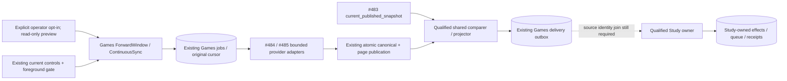

# Continuous provider synchronization follow-on (#491)

This branch prepares bounded Lichess/Chess.com synchronization on top of frozen
qualified retained-history source `0db8c980`. It changes no live process, account,
setting, data, release checkout or frozen feature ref. The older wider draft #519
and its private work are preserved separately. This is backend preparation;
Game Review mounting/browser acceptance and live activation are not claimed.

## Reused source and ownership

- Published #484/#485 adapters retain their request, byte, page/month, filter,
  cancellation and rate-limit contracts. The acquisition wrapper closes one
  connection/client per call; numeric/HTTP-date Retry-After flows to #489.
- The existing #489 coordinator/store/runner owns original captures, immutable
  commands, job leases, retries, page cursors and acknowledgments. The qualified
  comparer/projector and Study source from `0db8c980` remain the base; no matching,
  normalization, scheduling writer or introduction policy is copied.
- #483 `current_published_snapshot` from `967076a0` supplies the explicit current
  publication revision. The authored `current_snapshot` API remains separate.
- The earlier private canonical publication adapter is preserved and reused:
  Games publishes the normalized library row and page/capture/delivery/cursor in
  one transaction. Canonical ID/alias races roll back for recomputation. No PGN
  export, fake capture or pre-checkpoint side effect manufactures authority.
- Configuration, queries and mutations remain in Games-owned adapters. The API
  reader is not granted a write credential. The operator preview uses READ_URL
  and a query-only connection; that connection rejects writer capability use.

## Explicit forward windows

`ForwardWindow(overlap_seconds)` and `ContinuousSync` add no timer or database
lifecycle. They use the current configuration account, repertoires, speeds/rated
policy and interval. Fixed-window recurrence stays fixed by default. Only an
explicit `--follow --overlap-seconds N` opts into advancing windows. Configured
window widths must be 60 seconds to 1 day, overlap 0 to 3600 seconds and smaller than width.

The first window is exactly the configured scope. Each following completed
window advances contiguously from the prior covered end with explicit overlap,
by at most the configured width. A long outage is drained in bounded windows;
it is never skipped by jumping directly to now. Current time only limits the
next upper bound. Job identity includes workspace/provider/account/configuration
revision/window/overlap and is stable on restart. Pending/running/rate-limited,
failed or quarantined work keeps its original cursor and cannot be replaced by
a new window. A held provider does not hide the other configured provider.
A configuration with no recurrence remains disabled. Config changes remain
revision guarded; unexpected saved scope changes refuse rather than infer.

The optional-process loop retains signal/cancellation ownership, can drain a
bounded `--once --max-units N`, and yields on actual admission deferral. Current
controls and foreground checks precede recurring enqueue and each run unit.
Study-only/ordinary cap settings are not changed. Real foreground, unreadable
controls and explicit process stop remain effective. No API startup, beat entry
or service registration starts this worker automatically.



## Concrete remaining source interface

Activation currently fails before any acquisition/source read with
`qualified_provider_encounter_receiver_required`, unless an explicit qualified
receiving capability is injected. There is deliberately no lapse-only fallback.

The old new-provider workflow freezes provider PGN `GameRecord.source_digest` and
requires normalized game/finding digests to match it. Retained history instead
uses the authenticated canonical library header fingerprint. The same genuine
game/decision key can therefore arrive with different semantic source hashes,
which the receiving owner correctly holds as changed source. Publication revision
alignment alone does not resolve that provenance join. Do not relabel queued
findings, weaken hash/source guards or create a second matching pipeline.
A small source/normalizer contract with #489/#487 is required before the current
factory can safely bind new-provider delivery to the qualified receiving owner.
Generic snapshots also preserve unknown day-only introduction chronology; this
must not be fabricated into positive lapse evidence or silently called correct.

The backend has no new UI DTO. Existing explicit SyncConfiguration fields are
reused; forward mode/overlap are currently operator choices. Parent coordinates
any future UI exposure and the qualified #490 usability/onReviewGap mount. No
standalone receipt source URL/expected move is invented.

## Prepared commands and coverage

Read-only next-window preview (existing reader profile, no live execution here):

```sh
python -m app.product_composition.game_sync_current --workspace legacy \
  --preview --follow --overlap-seconds 300
```

After the receiving identity seam and runtime qualification are complete, the
separately authorized optional writer would explicitly set
`TEMPO_PRODUCT_GAME_SYNC_ENABLED=1` and use `--follow --overlap-seconds 300`.
`--once --max-units 50` bounds an existing queued-work drain; adding `--follow`
schedules at most one due window per configured provider before that drain. It does not infer
new account/filter settings. Current source intentionally cannot activate through
that command yet. Reader preview reports `executable=false` with the exact reason.
Import/window completeness is distinct from comparison coverage, unresolved
mapping/authority, delivery pending/held and actual Study availability. Zero
eligible misses is never an all-correct claim.

Source migration052 is reused unchanged from published #491 checkpoint f137d970;
it adds only Games-owned optional tables. This follow-on has not activated it or
changed the frozen schema051 release. Readiness-version/fixture coordination and
ordered migration qualification remain a later exclusive window; do not overwrite
a higher owner version or run a live migration from this branch.

## Current evidence and next work

Cheap focused checks cover deterministic restart/contiguous catch-up, original
retry cursor retention, held-provider independence, explicit publication reader,
read-only writer refusal and admission before claims/enqueue. Changed syntax
checks pass. No database, image, browser or native worker work is started while
the release owner is deploying. Reuse the prior provider/workflow and stop/kill
receipts where inputs are unchanged. After the receiving identity contract is
ready and deployment releases the validation slot, run only the new canonical
publication/receipt replay and migration boundary, then the affected integrated
provider/browser proof. This source checkpoint is not installation acceptance.
